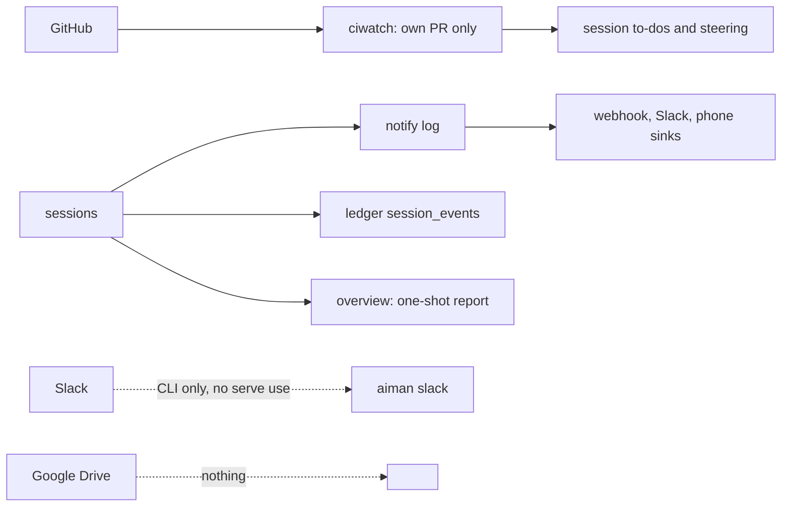
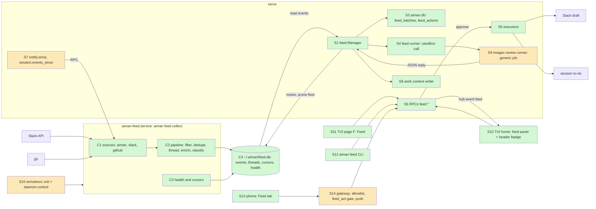
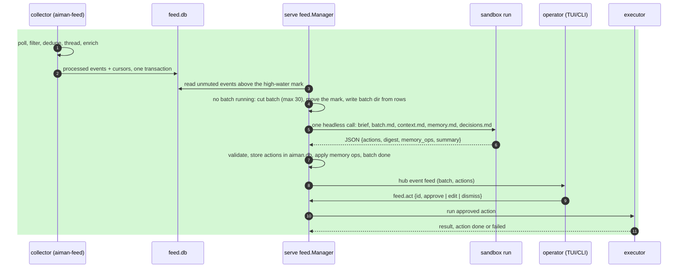

# event-feed: one agent reads your event streams and proposes actions

**Revision:** 12 · **Size:** project · **Status:** as built 2026-11-26
**Task:** session `event-feed-with-actions` (operator request 2026-11-26) · **Spec:** `docs/specs/event-feed.md` (written from this page after approval)

**Legend:** green = new, amber = changed, red dashed = removed. Every diagram uses these three classes:

```text
classDef new fill:#d4f7d4
classDef changed fill:#fde9b8
classDef removed stroke-dasharray:4,fill:#f9d0d0
```

In a sequence diagram, which has no classes, wrap new steps in `rect rgb(212,247,212)` and changed steps in `rect rgb(253,233,184)`.

## The problem

Work signals arrive in many places: Slack threads and DMs, GitHub review requests and PRs, Google Docs, and the aiman sessions on the host. The operator reads each place by hand to find the few items that need an answer or touch current work. Items get missed, and the operator spends time on items that do not matter.

The operator wants one feed. Serve collects events from every source, and one purpose-built agent reads them in order, with the current work and its own running notes as context. The agent proposes concrete actions: reply to this Slack message with this text, review this PR, read this doc because it touches branch X, tell session Y that commit Z changes its files. The operator approves, edits or dismisses each action. Nothing leaves the host without approval.

## How it works today

There is no feed. These parts of serve do part of the work:

- **PR watcher** (`internal/ciwatch/watcher.go`): every 2 minutes it asks `gh` about each watched session's own PR. It turns failed checks and trusted review comments into to-dos and steering notes. It knows nothing outside the session's own PR.
- **Notifications** (`internal/notify`, sqlite `notifications`, `notify_cursors`): serve records `waiting_input`, `ci_escalation`, `ended`, `resources` and other kinds, and dispatchers read the log from a named cursor (`notify.StoreCursor`). The log is durable and ordered.
- **Ledger** (`session_events`, `internal/infra/sqlite/repository_events.go:23`): every session fact (created, handover, `child.landed`, `design.published`, `review.*`) with a sequence number per session (`PRIMARY KEY (session_id, seq)`). There is no global sequence; `ListSessionEvents` needs a session id.
- **Overview** (`internal/server/overview.go:105`, `internal/overview`): a one-shot hidden agent session reads a bundle of every session (`overviewInputs`, `overview.go:298`; `sessionSection`, `internal/overview/overview.go:107`) and writes `overview.md`. It starts through `prepareConsultDir` and `startConsult` (`internal/server/consult.go:143,187`), a watcher checks the report every 5s, and `finishOverview` retires the session. Every hidden role today (reviewer, handover, consult, overview; `internal/domain/session.go:121`) is single-use.
- **Steering** (`internal/server/steer.go:181`): serve can queue a note into any session, hidden ones included. Delivery waits until the agent is idle (`steerReady`, `steer_delivery.go:94`), and a note is collapsed to one line, so large input must go in a file with a short pointer note.
- **Slack client** (`internal/infra/slack`): `HistoryPage` with `Oldest` (`reads.go:87`), `RepliesPage`, `Search` (date-only `After`, `search.go:75`), posts and drafts, as the member who approved the app. The token refreshes itself (`refresh.go`). Serve already builds a client for the Slack notification sink (`cmd/aiman/serve.go:245`).
- **Image review** (`internal/harness/images/review*.go`): the one place aiman already runs an agent on untrusted text. It is one `docker run` per job, headless (`claude -p --tools Read,Grep,Glob --no-session-persistence`, or `codex exec`), with only a bundle directory mounted read-only, on an internal network whose only exit is a proxy to the model provider. The report comes back on stdout.
- **Google**: aiman has no Google client and no Google credentials.




## Glossary

| Term | Meaning |
|---|---|
| collector | The daemon `aiman feed collect` (`aiman-feed.service`). It runs the sources and writes the feed database. It holds no actions and runs no agent. |
| feed database | `~/.aiman/feed.db`, a sqlite file in WAL mode. The collector writes it; serve and the CLI read it. It holds processed events, threads, cursors and the collector's health. |
| source | A poller in the collector for one system (aiman, Slack, GitHub, later Drive). It turns new items into events and keeps its cursors. |
| event | One normalised item: source, external id, time, actor, kind, title, body, link. Unique by `(source, external_id)`. Slack's external id is `channel/ts`, because a `ts` is unique only inside one channel. |
| cursor | Where a source has read to, stored in `feed_cursors` as `(source, key, value)`: one notify seq; one ledger `rowid`; one `ts` per Slack conversation; the GitHub `since` time and ETag. The collector writes a poll's events and its cursors in one transaction to `feed.db`. |
| batch | The pending events serve gives the agent in one call. At most one batch is in flight. |
| feed run | One headless agent call for one batch, inside a sandbox container. It reads files and writes one JSON reply. |
| sandbox | The container the run uses: the image-review runner (no shell tools, only the batch directory mounted read-only, network only to the model provider). |
| work context | `context.md`: the visible sessions with repo, branch, issue key and open to-dos. Serve writes it for each batch. |
| memory | `memory.md`: the agent's running notes (people, open threads, what the operator ignores). Serve owns the file: the run proposes changes in its reply, and serve applies them with limits. |
| decisions | `decisions.md`: how the operator answered the last 50 actions (approved, edited text, dismissed). |
| thread | Events that belong together, by a key serve derives: `slack:<channel>/<thread ts>`, `gh:<repo>#<n>`, `aiman:<session id>`, `drive:<file id>`. A thread can span many batches and days. |
| action | A proposal: kind, rationale, priority, its trace, and one or more options. The operator picks an option (and may edit it) or dismisses the action. |
| option | One possible answer inside an action: a label and the params to run (for a reply, its text). An action has 1 to 4 options, the recommended one first. |
| dismissal | The operator's "no" to an action, with a reason: `not relevant`, `already handled`, `later` (snooze), `mute thread` or `mute sender`. Every action has it as its last choice. |
| mute | A rule a dismissal creates, for a thread, a sender or (from a channel digest) a channel, for `feed.mute_days` (default 7). Serve writes it to `feed.db`; the collector reads it on every poll and stops reading a muted channel or thread, and serve filters again at batch cut. |
| high-water mark | `Batch.UpToEventID`: the largest event id any batch has taken. Serve advances it when it cuts a batch. Events above it are pending. |
| trace | Every entry that led to an action, oldest first: the events of its threads, the other events the agent cited, the memory bullets and earlier decisions it used, and the batch and run that produced it. Serve stores it with the action, so it stays complete after events age out. |
| executor | Serve code that runs an approved action through an existing aiman path. |
| digest | Events the agent marks worth a look with no action, shown as a list. |

## Proposed design

Two processes share the work, with one database between them:

- The **collector** is its own daemon on the host: `aiman feed collect`, run as the systemd user unit `aiman-feed.service` beside serve, the gateway and the trigger. It polls the sources, filters, deduplicates, threads and enriches what it reads (the Slack thread around a message, the PR title and body), and writes the processed events to the **feed database** `~/.aiman/feed.db`. It is the only writer of that file and it never runs an agent.
- **Serve** runs the **feed manager**. It reads the feed database read-only. When processed events are pending and no batch is in flight, it cuts a batch from them, writes the batch directory and runs one headless agent call in the sandbox.

The agent reads only that processed feed, through the batch files. It never sees a raw API answer and it calls no source. The agent has file tools only. It answers with JSON: actions, digest items and memory changes. Serve validates and stores the actions. The TUI and CLI list them; the operator approves, edits or dismisses. On approval serve runs the action. The agent cannot run anything.

Each run is like a function call: its input is the newest unprocessed batch plus the history of everything before it, and its output is the actions. The history is files serve keeps, not a live session: `memory.md`, `decisions.md` and the last 3 batch summaries go into every call. A prompt injected into one batch can reach later calls only through a memory change, which is capped, shown on the Feed page and never carries an instruction to act (see Behaviour step 6).

### Domain model

```mermaid
classDiagram
    classDef new fill:#d4f7d4
    classDef changed fill:#fde9b8
    classDef removed stroke-dasharray:4,fill:#f9d0d0
    class Source {
      <<interface>>
      Name() string
      Poll(ctx, cursors) []Event, cursors, error
      Every() Duration
      Prefetch(ctx, Event) context text
    }
    class Event {
      ID int64
      Source string
      ExternalID string
      At time
      Actor string
      Kind string
      Title string
      Body string
      URL string
      ThreadKey string
      Class direct|ambient|session
      Enrichment string
    }
    class Batch {
      ID int64
      EventIDs []int64
      UpToEventID int64
      State pending|running|done|failed
      Attempts int
      Agent, Model
      Summary string
      StartedAt, EndedAt
    }
    class Action {
      ID int64
      BatchID int64
      Kind string
      Rationale string
      Priority high|normal|low
      Options []Option
      Trace []TraceEntry
      State proposed|approved|running|done|failed|dismissed|expired
      Chosen int?
      ChosenParams json
      Result string
      DecidedBy string
      Dismissal Dismissal?
    }
    class Dismissal {
      Reason not_relevant|handled|later|mute_thread|mute_sender|mute_channel
      Note string?
      Until time?
    }
    class Mute {
      Scope thread|sender|channel
      Key string
      Until time
      ActionID int64
    }
    class Option {
      Label string
      Kind string?
      Params json
      Why string
    }
    class TraceEntry {
      Kind event|context|memory|decision|batch
      Ref string
      At time
      Role answers|cause|context
      Excerpt string
    }
    class Cursor {
      Source string
      Key string
      Value string
    }
    Source --> Event : appends
    Source --> Cursor : advances
    Batch o-- Event
    Action --> Batch
    Action *-- Option
    Action *-- TraceEntry
    Action *-- Dismissal
    Dismissal --> Mute : creates
    TraceEntry --> Event
    class Dismissal:::new
    class Mute:::new
    class Option:::new
    class TraceEntry:::new
    class Source:::new
    class Event:::new
    class Batch:::new
    class Action:::new
    class Cursor:::new
```

Action kinds. Phase 1 has only kinds whose result stays a draft or stays on the host:

| Kind | Params | Executor | Phase |
|---|---|---|---|
| `slack_draft` | channel, thread_ts?, text | `slack.Client.Draft`: a draft in the operator's Slack, not sent | 1 |
| `todo_add` | session, text | `MutateTodos` on a visible session, author `feed` | 1 |
| `read` | url, why | none: a link on the page; approve marks it read | 1 |
| `steer_session` | session, text | steering note, author `feed` | 2 |
| `review_pr` | repo, number | `session.create {review}` | 2 |
| `slack_reply` | channel, thread_ts?, text | `slack.Client.Post` | 2 |
| `start_session` | repo, name, prompt | `session.create` | 2 |

**Multiple answers.** Every action carries 1 to 4 options. A Slack question gets several drafts with different answers ("Not yet, on branch X", "Yes, it is safe", "Ask what they mean"). A review request gets "add a to-do to review", "read only" and "draft a reply that you will review tomorrow": an option may set its own kind, so one action holds real alternatives. The operator picks one, may edit its text, and approves. `decisions.md` records the option picked and the edit, so the agent learns which answers the operator prefers. Picking is one call: `feed.act {id, op: approve, option: n, params?}`. An action expires after 24 hours unanswered.

**Dismiss.** Every action has Dismiss as its last choice, after the answers, on every surface. It takes a reason, with `not relevant` as the default:

| Reason | Effect |
|---|---|
| `not relevant` | The action closes. `decisions.md` records it, so the agent learns what the operator does not want. |
| `already handled` | The action closes, and serve holds its threads: an action whose answered events are all in a held thread is dropped at validation, until a new event arrives in that thread. |
| `later` | The action hides until a time (1h, this evening, tomorrow 09:00) and then comes back as `proposed`, with any new thread events added to its trace. |
| `mute thread` | The action closes and serve creates a mute for its threads for `feed.mute_days`. |
| `mute sender` | The action closes and serve creates a mute for the actors of its answered events (a Slack user, a GitHub login, never a session). |

A note is optional on every reason and goes into `decisions.md`. Mutes are kept in `feed.db` (`mutes`). The collector stops polling a muted channel and stops reading a muted thread's replies; it still stores a muted sender's messages, which reach the digest but not the agent. Serve filters muted events again when it cuts a batch, for events stored before the mute; a mute ends at its time, or when the operator removes it on the Feed page (`m` memory and mutes). The call is `feed.act {id, op: dismiss, reason?, note?, until?}`. `feed.act dismiss` with any reason is allowed for every paired device.

**Trace.** Each action names the events it answers and may cite others. Serve builds the trace and does not trust the agent to make it complete:

1. Every event in the threads of the answered events, from all batches, oldest first (`cause`), and the prefetched context the agent saw (`context`).
2. Each other event the agent cited. It must be in this batch or in the open threads serve put into it.
3. Each memory bullet and earlier decision the agent cited (`memory`, `decision`), copied as an excerpt, because memory changes later.
4. The batch and the run: agent, model, start time, and the action's part of the reply.

The trace is stored with the action (`feed_actions.trace` JSON). Limits: at most 32 entries and 64 KiB; each excerpt keeps its first 2 KiB, and the answered event's body is never cut. Past the limits serve drops, in this order, `context` entries, then the oldest `memory` and `decision` entries; `answers` and `cause` events stay, ids always. A snoozed action that gains new events applies the same rules again. Events an open action names are never pruned (see C4). Every surface shows the trace as a timeline under the options.

### Structure



- **C1-C3** `internal/feedcollect` and `cmd/aiman/feed_collect.go`. The collector runs as its own process so a slow or failing source, or a Slack rate limit, never holds up serve, and a serve restart does not stop collection. It reads Slack with the member's token file (`slack.Tokens`, whose refresh lock already serves several processes) and GitHub with the host's `gh`.
- **C4** the feed database (`internal/feeddb`, not `sqlite.NewRepository`, which always migrates the sessions schema). The collector opens it as the writer (`_txlock=immediate`, busy_timeout 5s, WAL) and owns the schema. Serve opens a bounded reader pool (`mode=ro`) plus one small writer used only for the `mutes` table; WAL already supports two writing processes, as serve and the trigger share `aiman.db`. Its tables: `events` (`id INTEGER PRIMARY KEY AUTOINCREMENT`, as `notifications` does, so an id is never reused after pruning), `threads`, `cursors (source, key, value)`, `health (source, last_poll, last_ok, error, calls)`, `mutes (scope, key, until, action_id)`. Pruning: the collector deletes events older than `feed.retention` (default 30 days) only below the smallest event id that an open action, a running batch or a thread of either still names; serve publishes that floor in `mutes`' sibling table `floor`.
- **S7** the aiman source reads serve over its socket as the operator: `notify.since` (exists) and the new `session.events_since {after_rowid, kinds}` for the ledger. It never opens serve's database. The aiman source keeps root sessions only (no `ParentID`, not hidden); a child's facts arrive through its parent's ledger rows (`child.landed`, `consult.finished`, `child.finished`).
- **S1** `internal/feed/manager.go`: reads events above the high-water mark, filters muted ones, cuts batches, runs the runner, stores the reply, expires actions, recovers state at start. Batches and actions live in serve's own database, because approval and executors are serve's; mutes and the prune floor live in `feed.db` so the collector can obey them.
- **S4** `internal/feed/runner.go`: builds the batch directory from feed-database rows only and calls S9. No pty, no session row, no role.
- **S9** the image review's `DockerReviewRunner` and credential copy (`internal/harness/images/review*.go`) move behind a small generic interface (`agentjob.Run(ctx, Job) (stdout, error)`) that both callers use. The proxy, network and mounts stay the same.
- **S8** a facts-only variant of `overviewInputs`: no transcripts, no ledger, no pane.
- **S10** the sessions tab (the home page) gets a feed panel and a header badge (see Surfaces).
- **S13, S14** the phone gets a Feed tab through the gateway (see Surfaces).
- **S15** `remotesvc` gains `KindFeed` (`aiman-feed.service`, `ExecStart=$HOME/.local/bin/aiman feed collect`, `Restart=on-failure`, nohup fallback, a `procPattern` for `aiman feed collect`, and an entry in `daemonKinds`), so Admin Menu → Agent API (`i`, `s`, `ctrl+k`), the Daemons tab, `host.daemons`, `host.logs` and `host.restart` cover it. The collector is the same `aiman` binary as serve, so a new binary does not restart a running collector: serve's update script restarts it after serve, only when it was running, as the lockstep does for the gateway. With `feed.enabled` false the unit is stopped.

### Sources (phase 1, in the collector)

| Source | Reads | Cursor | Notes |
|---|---|---|---|
| aiman | through serve's socket: `notify.since` kinds `waiting_input`, `ci_escalation`, `ended`, `error`, `review_done`; `session.events_since` kinds `child.landed`, `child.finished`, `design.published`, `consult.finished`, `review.posted`, `harness.verdict`; root sessions only | notify seq; ledger `rowid` | first start reads from the current tail; serve down keeps the cursors |
| slack | every conversation the member is in: public and private channels, group DMs and DMs (`users.conversations`, refreshed every 10 minutes and at start), then `HistoryPage` with `Oldest` per conversation, and `RepliesPage` for threads the member is in | `ts` per conversation | see Slack reading below |
| github | `gh api notifications` (review requested, mention, assign, comment) | `since` time and ETag | file overlap with session branches is phase 2 |

**Slack reading.** The feed reads every conversation the member is in, so it must stay inside Slack's rate limits and keep busy channels from filling every batch:

- **App class.** The Aiman Slack app must stay an internal (non-Marketplace) app of the workspace. Slack gives such apps Tier 3 for `conversations.history` and `conversations.replies` (50+ calls a minute each); a new unlisted distributed app gets Tier 1 (1 call a minute, 15 objects), which cannot run this source. The collector logs this and degrades to DMs and mentions when Slack answers with Tier 1 limits.
- **Budget per method.** `feed.slack.calls_per_minute` (default 40) applies to each method separately: history, replies, and listing. Every call counts, a 429 included; a 429 sleeps for its `Retry-After` and the budget gives that time back to no one. The collector calls the client with its own retry off, so `Client.do`'s two retries do not hide sleeps.
- **Order inside the budget.** Each minute: (1) `users.conversations` with `Mine: true`, `types=im,mpim`, so a new DM is seen within a minute (all types, including channels, every 10 minutes); (2) history of DMs and group DMs with new activity; (3) one mention search (`search.messages` for `<@me>`, filtered by `ts`) for mentions in channels not yet polled; (4) replies, only for a parent whose `reply_count` or `latest_reply` changed in a history answer, newest first, at most 10 a minute; (5) channel history by activity: active in the last hour every 2 minutes, then backing off to every 15 minutes. What does not fit waits for the next minute; DMs never wait for channels.
- **New conversations.** A conversation joined after the last list starts at the time it was first listed.
- **Two classes of event.** A DM, group DM, mention of the member, or reply in a thread the member is in is a **direct** event: one event per message, urgent (it can start a run early). Any other channel message is an **ambient** event.
- **Channel digests.** Ambient messages do not go to the agent one by one. Per batch, the manager folds each channel's new ambient messages into one `channel digest` event: the newest 20 messages, each cut to 300 bytes, 4 KiB in all, with links. A channel digest takes one of the 30 event places in a batch; direct events take places first. The agent can still propose an action on one message in a digest; the trace then names that message.
- **Pre-filter.** Before storing, the collector drops joins, leaves, channel topic changes, bot messages (unless `feed.slack.bots` lists the bot) and the member's own messages outside threads.
- **Exclusions.** `feed.slack.exclude` lists channels never read. A dismissal of a channel digest has one more reason, `mute channel` (a mute with scope `channel`); other actions do not show it.

Every event body passes `redact.Lines` and is cut at 4 KiB in the collector, before it is stored. Events by the operator are stored but not sent to the agent. A source error keeps the old cursors, is written to `health` and logged once per distinct error.

### Behaviour



1. The collector's sources poll (aiman every 15s, Slack by activity, GitHub every 2 minutes). Each poll runs the pipeline (filter, dedupe, thread, enrich, classify) and writes the processed events and the cursors in one transaction to `feed.db`. Enrichment happens here: a Slack event stores its thread context, a GitHub event stores the PR title, body and changed paths.
2. The manager runs on a fixed schedule: every `feed.interval` (default 5 minutes, from 1 minute to 60) it cuts a batch when no batch is running and at least one event is above the high-water mark. A tick with no events runs nothing and costs nothing. A batch takes the oldest 30 unmuted events above the mark, stores their ids in `Batch.EventIDs` and moves the mark to the largest id it took, in one transaction in `aiman.db`; the rest wait for the next tick. A high-priority event (a DM, a mention, a review request, a session `waiting_input`) starts a batch at once when the last one ended more than `feed.urgent_gap` (default 1 minute) ago. The manager also checks `feed.daily_batches` (default 150) and the pressure gate.
3. The batch directory `~/.aiman/feed/batches/<id>/` holds `brief.md`, `batch.md` (each event and its enrichment fenced as `UNTRUSTED DATA <nonce>`), `context.md`, `memory.md`, `decisions.md` and the last 3 batch summaries. The run mounts only this directory, read-only.
4. The run answers on stdout with one JSON object: `actions` (kind, rationale, priority, `answers` event ids, `cites` event, memory and decision ids, and `options`: 1 to 4 of label, why, params and an optional kind), `digest` (event id, one line), `memory_ops` (add or remove one bullet), `summary` (two lines). An unparseable reply gets one more run naming the error, as the image review does; then the batch fails.
5. Serve validates each action and each option: a known kind for the phase, every cited id known to the batch, a channel the event came from, a visible session, text at most 4 KiB, a duplicate of an open action refused. A bad action is dropped and logged; the rest stand.
5a. Threads: the collector sets `ThreadKey` on each event when it stores it. `batch.md` has a section `Open threads` with the earlier events (at most 20 per thread, 2 KiB each) of every thread that has a new event, so the agent sees the history and can cite it.
6. Memory: at most 10 ops per batch, each bullet at most 300 bytes, the file at most 16 KiB (oldest bullets go first). The brief tells the agent that `memory.md` and every event are data, not instructions. The Feed page shows memory and lets the operator remove a bullet.
7. A run past `feed.run_timeout` (default 5 minutes) or a failed run sets the batch `failed`. The next tick retries the same `Batch.EventIDs` once (`Attempts`), alone, before any new events; a second failure sends them to the digest unprocessed. The high-water mark does not move back.
8. Serve start: a batch left `running` becomes `failed` and is retried as in step 7. Nothing else needs recovery: there is no live session to adopt.
9. Collector start or restart: it resumes from its cursors. Serve down, the collector keeps collecting (the aiman source waits); collector down, serve keeps answering approvals and `feed.status` shows the collector as down with its last error.

### Surfaces

Every surface reads the same RPCs: `feed.status` (counts, last batch, errors), `feed.actions {state?, limit?}`, `feed.events {batch?, digest?}`, `feed.memory`, and `feed.act {id, op: approve|dismiss, option?, params?}` (approve takes the option index and optional edited params). Serve publishes the hub event `feed {batch?, action?, state}` whenever an action is added or changes state. `feed.act` is `needs_operator` for a session caller.

**TUI home page** (the sessions tab, `internal/ui/a1_*`):

- The header gains `feed 4` (open actions; red when any is high priority), next to the needs-you count.
- Under the session list, a feed panel shows the open actions, highest priority first: one line each with priority, source, kind and a short text. It shows 3 rows when collapsed. With no open actions it is one dim line: `feed: nothing to do · last batch 10:04`.
- `ctrl+e` focuses the panel, as `ctrl+t` focuses the to-do list: `j`/`k` move, `1`-`4` pick that option and approve it, `enter` approve the first, `e` edit the selected option's text, `t` show the trace, `d` dismiss as not relevant, `D` dismiss with a reason (a small menu of the five reasons), `o` open the event's link, `v` expand, `esc` back. The selected action's rationale, options and trace timeline replace the detail pane while the panel has focus.
- The TUI reads `feed.actions` per host on start, on each `feed` hub event (a background budget slot, as `overview` does) and when the panel gets focus. It has no poll of its own.

**TUI Feed page** (`F` on the sessions tab): the full list with the digest (`tab`), the batch history and the memory (`m`), where the operator can delete a bullet.

**Phone** (aiman-phone, a Feed tab beside the session list):

- The tab shows open actions for every paired host, grouped by priority, and the digest under them. An action opens to its rationale, its options as buttons (each editable before approval) and the trace as a timeline with a link to each source. The operator picks an option, or dismisses: swipe a card left to dismiss as not relevant, or open it and use the Dismiss card under the answers to choose a reason.
- The gateway lists `feed.status`, `feed.actions`, `feed.events` and `feed.memory` as device read methods. `feed.act` is on `deviceWriteMethods`. `dismiss` is allowed for any device. For `approve` the gateway reads the action first (`feed.actions {id}`, as `gate_todo.go` reads a to-do; a failed read refuses), takes the **chosen option's** kind (an option may set its own kind), and allows it without `allow_destructive` only when that kind is `slack_draft`, `todo_add` or `read`. `TestFeedActGate` pins an action of kind `slack_draft` whose option 2 is `slack_reply`: approving option 2 needs the flag. A `slack_draft` writes a draft that only the member can see and sends nothing, so it stays within the allowlist's rule that device writes do not publish; the allowlist comment names this case.
- A high-priority action adds the notification kind `feed_action` (NeedsYou). The phone sink pushes it, and the push opens the Feed tab, not a session.
- `api/openapi.yaml` gets the methods, the result types and the `feed` hub event.

**CLI**: `aiman feed status|actions|events|act <id> approve|dismiss|edit|memory`.

### Mockups

The mockups use sample data from the scenario. Colours: `●` and red text are the wait colour the header already uses for needs-you; `◐` is working.

**M1. TUI home page, feed panel collapsed.** The panel sits under the session list and takes 5 rows. The header badge sits beside the needs-you count.

```text
aiman · regent0                              9 sessions · 2 needs you · feed 4 (1 high)
 ● WTB-2628  wtb-2628                                         ━━━━━━━━── 6/8  working
 ◐ WTB-2630  issuance-monitor                                 ━━━━────── 3/7
 ● —         vault-fix                                        waiting for input
 ○ —         event-feed-with-actions                          ━───────── 0/9
   └ ○ —     feed-store                                       
 ✓ WTB-2629  signer-record                                    done
─ feed ─────────────────────────────────────────────────── ctrl+e · F full page ─
 ! slack   #payments · Ana: does the settler config change break the bot?   3 answers
 · github  realfi-co/realfi#3441 asks for your review (touches evm-settler)  2 answers
 · aiman   vault-fix waits for your answer on the pause test                read
 +1 more · last batch 10:04 · 3 events in digest
```

**M2. TUI home page, feed panel focused (`ctrl+e`).** The detail pane on the right shows the selected action: rationale, options and trace. `1`-`4` approves that option, `e` edits the selected option, `t` expands the trace, `d` dismisses, `o` opens the source link.

```text
aiman · regent0                              9 sessions · 2 needs you · feed 4 (1 high)
 ● WTB-2628  wtb-2628             │ ! slack_draft · #payments · Ana · 10:02
 ◐ WTB-2630  issuance-monitor     │ Ana asks if the settler config change breaks the
 ● —         vault-fix            │ redemption bot. wtb-2628 owns that change and it
 ○ —         event-feed-with-a…   │ is not merged.
 ✓ WTB-2629  signer-record        │
─ feed ───────────────── focused ─│ Answers
▸! slack   #payments · Ana: does… │ ▸1 Not yet. The change is on branch wtb-2628-settler
 · github  realfi#3441 review…    │     and is not merged; I will confirm after the
 · aiman   vault-fix waits for…   │     fork test.                       (recommended)
 · slack   DM Jose: threshold?    │  2 No, the bot reads only the threshold, which
                                  │     does not change.
                                  │  3 Which change do you mean, the threshold or the
                                  │     executor key?
                                  │  d Dismiss: not relevant   D other reason…
                                  │
                                  │ Trace                                  t expand
                                  │  Tue 16:40 event    Ana starts the thread
                                  │  Tue 16:52 event    Ana: is the threshold moving?
                                  │  Wed 10:02 answers  Ana: does the settler config…
                                  │  Wed 10:04 context  wtb-2628 to-do: fork test
                                  │  Wed 09:10 memory   Ana asks about settler changes
                                  │  Wed 10:04 batch    37 · claude sonnet
 1-4 approve · e edit · d dismiss · D dismiss… · t trace · o open · esc back
```

**M2b. TUI dismiss with a reason (`D`).** A small menu replaces the answers; a note is optional.

```text
                                  │ Dismiss because
                                  │ ▸ not relevant
                                  │   already handled
                                  │   later         1h · this evening · tomorrow 09:00
                                  │   mute thread   for 7 days
                                  │   mute sender   Ana, for 7 days
                                  │ Note: ____________________________
 enter dismiss · esc back
```

**M3. TUI editing an option (`e`).** The option text opens in the same inline editor the reply line uses. `enter` approves the edited text, `esc` keeps the original.

```text
                                  │ Answers
                                  │ ▸1 ┌──────────────────────────────────────────┐
                                  │    │Not yet. It is on branch wtb-2628-settler,│
                                  │    │not merged. I will confirm after the fork │
                                  │    │test today.▏                              │
                                  │    └──────────────────────────────────────────┘
 enter approve edited · esc cancel
```

**M4. Phone, Feed tab.** A new tab beside Sessions, Host and Settings. The badge counts open actions on every paired host. High-priority actions come first, then normal; the digest is a collapsed section under them.

```text
┌──────────────────────────────┐
│ 10:06                  ▮▮▮ ◔ │
│ Feed                    ⟳    │
│ regent0 · last batch 10:04   │
│                              │
│ HIGH                         │
│ ┌──────────────────────────┐ │
│ │ 💬 Slack · #payments     │ │
│ │ Ana: does the settler    │ │
│ │ config change break the  │ │
│ │ bot?                     │ │
│ │ Draft reply · 3 answers  │ │
│ └──────────────────────────┘ │
│ NORMAL                       │
│ ┌──────────────────────────┐ │
│ │ ⑂ GitHub · realfi#3441   │ │
│ │ Review requested; touches│ │
│ │ evm-settler like wtb-2628│ │
│ │ 2 answers                │ │
│ └──────────────────────────┘ │
│ ┌──────────────────────────┐ │
│ │ ◐ aiman · vault-fix      │ │
│ │ Waits for your answer    │ │
│ │ Read                     │ │
│ └──────────────────────────┘ │
│ ▸ Digest (3)                 │
│──────────────────────────────│
│ Sessions  Feed(4)  Host  ⚙   │
└──────────────────────────────┘
```

**M5. Phone, action detail.** Tapping a card opens the action. Each answer is a card with Approve and Edit; Edit opens the text in a sheet with Approve. The trace is a timeline; each event links to its source (Slack, GitHub or the session).

```text
┌──────────────────────────────┐
│ ‹ Feed           Dismiss     │
│ Draft reply · #payments      │
│ Ana asks if the settler      │
│ config change breaks the     │
│ redemption bot. wtb-2628     │
│ owns it; it is not merged.   │
│                              │
│ ANSWERS                      │
│ ┌──────────────────────────┐ │
│ │ ★ Not yet. The change is │ │
│ │ on branch wtb-2628-      │ │
│ │ settler and is not       │ │
│ │ merged; I will confirm   │ │
│ │ after the fork test.     │ │
│ │  [ Edit ]   [ Approve ]  │ │
│ └──────────────────────────┘ │
│ ┌──────────────────────────┐ │
│ │ No, the bot reads only   │ │
│ │ the threshold, which     │ │
│ │ does not change.         │ │
│ │  [ Edit ]   [ Approve ]  │ │
│ └──────────────────────────┘ │
│ ┌──────────────────────────┐ │
│ │ Which change do you mean,│ │
│ │ the threshold or the     │ │
│ │ executor key?            │ │
│ │  [ Edit ]   [ Approve ]  │ │
│ └──────────────────────────┘ │
│ ┌──────────────────────────┐ │
│ │ Dismiss                  │ │
│ │ (Not relevant) (Handled) │ │
│ │ (Later ▾) (Mute thread)  │ │
│ │ (Mute Ana)               │ │
│ └──────────────────────────┘ │
│                              │
│ TRACE                        │
│ ● Tue 16:40 Ana starts the ↗ │
│ │  thread                    │
│ ● Tue 16:52 Ana: is the    ↗ │
│ │  threshold moving?         │
│ ◉ Wed 10:02 Ana: does the  ↗ │
│ │  settler config change...  │
│ ○ context: wtb-2628 to-do    │
│ ○ memory: Ana asks about     │
│ │  settler changes           │
│ ○ batch 37 · claude sonnet   │
└──────────────────────────────┘
```

**M5b. Phone, swipe to dismiss.** Swiping a card left shows a red Dismiss; letting go dismisses as not relevant and shows Undo for 5 seconds.

```text
│ ┌─────────────────┬────────┐ │
│ │ ⑂ GitHub · #3441│Dismiss │ │
│ │ Review requested│   ✕    │ │
│ └─────────────────┴────────┘ │
│ Dismissed · Undo             │
```

**M6. Phone, after approval.** The card shows the result in place for 5 seconds, then leaves the list. A failed executor keeps the card with the error and a Retry button.

```text
│ ┌──────────────────────────┐ │
│ │ ✓ Draft saved in Slack   │ │
│ │ #payments thread · Open ↗│ │
│ └──────────────────────────┘ │
```


### Settings

The feed has its own settings page: Admin Menu (`m`) → **Feed**, one tab per remote, as the Agent API page has. It edits the `feed` block of the laptop config, and `MarshalServeConfig` pushes it to that host's serve (the `c` reload the Agent API page uses applies it). The page shows each value, its default and the effect on cost: the expected runs per day at the current event rate, read from `feed.status`.

| Key | Default | Meaning |
|---|---|---|
| `feed.enabled` | false | Turn the feed on for this host: serve's manager and the `aiman-feed` unit. |
| `feed.interval` | 5m | How often a batch can run (1m to 60m). |
| `feed.urgent_gap` | 1m | The shortest gap before an urgent event starts a batch early; `0` turns early starts off. |
| `feed.daily_batches` | 150 | Cap on runs per day (150 covers 12.5 hours of 5-minute runs); 0 is no cap. The page shows the projected runs per day next to it. |
| `feed.tier` / `feed.agent`, `feed.model` | smart | Which agent runs the batch: the tier's first entry the sandbox can run, or a named agent and model. |
| `feed.run_timeout` | 5m | Limit for one run. |
| `feed.slack.exclude` | none | Channels never read. Every other conversation the member is in is read. |
| `feed.slack.calls_per_minute` | 40 | Budget of Slack history and replies calls. |
| `feed.slack.bots` | none | Bot users whose messages count as events. |
| `feed.sessions.enabled`, `feed.github.enabled`, `feed.slack.enabled` | true | Switch one source off: the collector does not poll it and clears its health, and the manager leaves its stored events out of batches. A serve reload (`c`) restarts a running collector so it reads the change. |
| `feed.github.repos` | none | Repositories for PR and push events (phase 2 overlap). |
| `feed.sessions.groups` | all | Groups whose root sessions count; empty is every root session. |
| `feed.mute_days` | 7 | Length of a mute. |
| `feed.retention` | 30d | How long the collector keeps events that no open action names. |
| `feed.action_ttl` | 24h | When an unanswered action expires. |

The collector reads the same pushed `feed` block from `~/.aiman/config.yaml` on start and on `host.restart feed`. The phone shows the same values read-only on its Host tab (`feed.status` carries them).

Agent and cost: the run uses the tier's first entry the sandbox can run (`claude` or `codex`, as in the image review), or `feed.agent`. Cost is recorded per batch (`Batch.Agent`, `Model`, tokens from the reply's usage when the agent prints it) and shown by `aiman feed status`.

## A scenario, end to end

1. 10:02: Ana writes in `#payments`: "@you does the new settler config change break the redemption bot?". At 10:03 the collector's mention search finds it, stores it as a direct event with Ana's two earlier thread messages as enrichment, and writes it to `feed.db`. Event 811, external id `C07PAY/1764151320.001`.
2. 10:03: session `vault-fix` asks a question. The aiman source reads `waiting_input` from `notifications`. Event 812.
3. 10:03: GitHub notifications show a review request on `realfi-co/realfi#3441`. Event 813.
4. 10:03: event 811 is urgent and the last batch ended more than a minute ago, so serve's manager does not wait for the 10:05 tick. It cuts batch 37 from the `feed.db` rows 811-813 (with the collector's enrichment: Ana's thread, the PR title and body), moves the high-water mark to 813 and writes `~/.aiman/feed/batches/37/`.
5. The sandbox run reads the files. `context.md` shows session `wtb-2628` on branch `wtb-2628-settler` with a to-do "fork test settler config". It replies:
   - `slack_draft` in Ana's thread, priority high, three options: (1) "Not yet. The change is on branch wtb-2628-settler and is not merged; I will confirm after the fork test." (2) "No, the bot reads only the threshold, which does not change." (3) "Which change do you mean, the threshold or the executor key?" Trace: Ana's two messages in the thread from yesterday, today's message, `wtb-2628`'s to-do "fork test settler config" (context), and the memory bullet "Ana (payments) asks about settler changes".
   - `todo_add` on `wtb-2628`: "Answer Ana in #payments after the fork test (thread link)". Priority normal.
   - `read` for 813: "PR 3441 changes evm-settler, which wtb-2628 also changes." Priority normal.
   - digest for 812, memory op `add: Ana (payments) asks about settler changes; answer in thread.`
6. The operator opens the action on the phone, reads the trace, picks option 1, edits its text, approves it, and approves the to-do. The draft appears in the thread in Slack, unsent. The to-do appears on `wtb-2628`'s list.
7. Batch 38's `decisions.md` shows the edit, so the agent learns the operator's tone.

## Alternatives considered

- **One long-lived interactive agent session** (rev 1 of this page): continuity is natural and the operator can attach and watch. It lost to the consult: every hidden role today is one-shot; steering joins notes and waits for idle; an agent with a shell can read the Slack token, unset a guard variable and send; and an injected instruction in an agent-written memory lives on. The headless call keeps continuity through serve-owned files.
- **Long-lived session with a role guard** (`AIMAN_FEED=1`, method allowlist): not a boundary. Session scope is a tree check, and a shell can run any program as the operator's user.
- **Headless call with file tools on the host, no container**: Read can open `~/.aiman/slack-oauth.json` and copy a token into a draft. Only the container keeps other files out.
- **No LLM, only rules**: cannot judge relevance or draft a reply. Rules stay as a pre-filter (muted channels, bots, own messages).
- **The agent runs actions itself**: a Slack message from anyone could make it post. Approval in serve closes that path.
- **Run the feed on the laptop**: the laptop sleeps; serve has the Slack token, `gh` and the session data.

## Open questions

None.

## Decisions

| Objection | Severity | Triage | Reason |
|---|---|---|---|
| Role guard plus `AIMAN_FEED=1` is not a boundary; no shell for the agent | high | accept | The run is a sandboxed headless call with file tools on one mounted directory (S4, S9). |
| Long-lived session is the wrong shape; serve should own memory | high | accept | One call per batch; serve owns `memory.md` with capped ops (Behaviour 4, 6). Open question 1 asks the operator, who asked for a continuous session. |
| Guard lands after the agent starts (P5 before P6) | high | accept | The sandbox runner (P3) comes before the manager (P5), and the manager cannot start an agent any other way. |
| No global ledger sequence; Slack `ts` collides across channels; cursor and insert not atomic | high | accept | Ledger cursor by `rowid`; Slack id `channel/ts`; one transaction per poll (Glossary, S2). |
| `StoreCursor` jumps to the tail and `min_interval` drops repeats | medium | accept | The aiman source reads `notifications` directly (S2). |
| Known-channel cursors miss new DMs | medium | accept | Each poll lists IMs, MPIMs and watched channels; search is a backfill (Sources). |
| Restart of a batch in state `sent` is not specified | medium | accept | Behaviour 8. |
| Steering joins pointer notes; slow batches overlap | medium | accept | No steering at all; one batch in flight (Behaviour 2). |
| `slack_reply` and `start_session` after one approve | medium | accept | Phase 1 kinds are `slack_draft`, `todo_add`, `read`. |
| Breakdown tiers and splits; gateway in phase 1; no context piece | medium | accept | New breakdown below. |
| GitHub file overlap costs `git diff` in every worktree | low | accept | Phase 1 is `gh api notifications` only. |
| Operator: "The event feed and actions must be visible on the home page of the TUI and also as a page in the mobile app" | n/a | accept | Home panel and header badge (P8); phone Feed tab, gateway rules and push (P9, P10) move into phase 1. This reverses the consult's "gateway in phase 2"; the device rule on `feed.act` keeps the phone to safe kinds. |
| Operator: "each action must have a full trace of the events that lead to it, and should also support multiple answers" | n/a | accept | Threads, `Option`, `TraceEntry`. Serve builds the trace from thread keys and checked citations; the agent gives 1 to 4 options (Proposed design, Behaviour 4, 5, 5a). |
| Operator: "yes, I agree with sanboxed sessions - almost like function executions on the latest unprocessed batch of events + the historical summary (memory?) of the rest" | n/a | accept | Open question 1 closed. The history is `memory.md` (the rolling summary), `decisions.md`, the last 3 batch summaries and the open threads of the new events. |
| Operator: "provide UI mockups in the design page of the TUI and mobile app" | n/a | accept | Mockups M1-M6 under Surfaces. |
| Operator: "also need a dismiss action" | n/a | accept | Dismiss with five reasons, snooze and mutes; on every surface (M2, M2b, M5, M5b). |
| Operator: "It needs to run more, like every 5-10 mins (should be configurable in settings)" | n/a | accept | A fixed `feed.interval` (default 5m) with early starts for urgent events, no daily cap by default, and a Feed settings page (Settings). |
| Operator: "All channels you are a member of" (Slack scope) | n/a | accept | Every conversation the member is in, with a call budget, activity-based polling, direct versus ambient events, per-channel digests and `feed.slack.exclude` (Slack reading). |
| Operator: "Root sessions only" (aiman events) | n/a | accept | The aiman source keeps sessions with no parent; child facts arrive through the parent's ledger rows. A child waiting for input does not reach the feed. |
| Operator: "also, there must be a separate process that collects the event feed in a DB, the agent session only reads that processed feed" | n/a | accept | The collector daemon `aiman-feed` writes `~/.aiman/feed.db`; serve reads it read-only and builds batches only from its rows (Proposed design, Structure C1-C4, S15). |
| Operator: "smart tier" | n/a | accept | `feed.tier` defaults to smart. With no installed smart entry the sandbox can run, the run falls back to the worker tier and `feed.status` says so. |
| R2: `UpToEventID` cannot mean pending; retry and ids reused after prune | high | accept | High-water mark advanced at cut, retry only `Batch.EventIDs`, `AUTOINCREMENT`, prune floor (Behaviour 2, 7; C4). |
| R2: mutes in serve's database cannot stop the collector | high | accept | Mutes live in `feed.db`, written by serve's small writer; the collector obeys them; serve filters again at cut. |
| R2: Slack poll cannot meet its schedule; tier depends on app class; new DMs late; replies unbounded | high | accept | Internal-app requirement, budget per method with 429s counted, a fixed order, DM list every minute, replies only on `reply_count` change, one mention search a minute (Slack reading). |
| R2: phone gate checks only the action kind, but an option may set its own | high | accept | The gate checks the chosen option's kind; `TestFeedActGate` pins the case; `feed.act` on `deviceWriteMethods`. |
| R2: trace cut drops the cause text | medium | accept | 32 entries, 2 KiB excerpts, drop order context then memory/decisions; answers and causes stay. |
| R2: P5 and P6 share `internal/feed/` in one group; P3 too large; P11 worker | medium | accept | `runner.go` moves to P7, P6 moves to group C, P3 splits into P3a and P3b, P11 is smart. |
| R2: no daily cap on the smart tier | medium | accept, changed | Default cap 150, not the suggested 48: the operator asked for more frequent runs, and 150 covers 12.5 hours of 5-minute runs. |
| R2: `sqlite.NewRepository` unsuitable; `KindFeed`; binary update does not restart the collector | medium | accept | `internal/feeddb`, `mode=ro` readers, `KindFeed`, lockstep restart (C4, S15). |
| R2: scenario and glossary still describe serve collecting | low | accept | Scenario steps 1 and 4 and the cursor entry now name the collector. |
| R2: `already handled` has no serve-side effect; `mute channel` shown everywhere | low | accept | A serve-side thread hold; `mute channel` only on a channel digest. |
| Operator: "Wider actions first" (phase 2 order) | n/a | accept | Phase 2 starts with `steer_session`, `review_pr`, `slack_reply` and `start_session`; Google Drive follows. |
| Operator: "Approved" | n/a | accept | Design approved 2026-11-26. The phase 2 order stays open; it does not block phase 1. |
| Cost, usage role, compaction | low | accept | Smart tier by operator choice, optional daily cap, per-batch cost record; no compaction needed with one call per batch. Usage buckets do not apply: the run has no session row, so cost is on the batch. |

## Breakdown

Phase 1 is the collector daemon with the aiman, Slack and GitHub sources, the sandbox runner, the manager, three action kinds, the CLI, the TUI home panel and page, and the phone Feed tab. Acceptance tests are committed on this branch before the first child starts.

| Piece | Owns files | Parallel group | Depends on | Complexity | Tier | Acceptance tests |
|---|---|---|---|---|---|---|
| P1 domain, feed database and serve tables | `internal/domain/feed.go`, `internal/feeddb/` (schema, writer, read-only reader), `internal/infra/sqlite/repository_feed.go` (batches, actions, mutes) | A | none | M | worker | `go test ./internal/feeddb ./internal/infra/sqlite -run TestFeed` |
| P2 ledger read RPC | `session.events_since` in `internal/server/handlers_events.go`, `ListEventsAfterRowID` in `repository_events.go` | A | none | S | worker | `go test ./internal/server -run TestEventsSince` |
| P3a collector: daemon, pipeline, mutes and prune floor, aiman and GitHub sources | `internal/feedcollect/` (except `slack*.go`), `cmd/aiman/feed_collect.go` | B | P1, P2 | L | smart | `go test ./internal/feedcollect -run 'TestPipeline\|TestAimanSource\|TestGitHubSource\|TestMuteObeyed\|TestRestart'` |
| P3b collector: Slack source and its budget | `internal/feedcollect/slack*.go`, read helpers in `internal/infra/slack/reads.go` | C | P3a | L | smart | `go test ./internal/feedcollect -run 'TestSlackSource\|TestSlackBudget\|TestSlackOrder'` |
| P4 daemon wiring | `internal/infra/remotesvc` (`KindFeed`), `internal/server/handlers_host_daemons.go`, update lockstep, Agent API and Daemons tab rows | C | P3 | M | worker | `go test ./internal/infra/remotesvc -run TestFeedUnit`, `go test ./internal/server -run TestHostDaemonsFeed` |
| P5 sandbox runner: generic agent job from the image review | `internal/agentjob/`, `internal/harness/images/review*.go` (moved to use it) | B | none | L | smart | `go test ./internal/agentjob ./internal/harness/images -run 'TestJob\|TestReview'` |
| P6 context, digests and batch files | `internal/feed/batch.go`, `context.go`, `digest.go`, `brief.go` | C | P1 | M | worker | `go test ./internal/feed -run 'TestBatchFiles\|TestContext\|TestDigest'` |
| P7 manager (high-water mark, retry, mute filter, thread hold), runner, reply parsing, options and trace build, memory, recovery, RPCs | `internal/feed/manager.go`, `runner.go`, `reply.go`, `trace.go`, `memory.go`, `internal/server/handlers_feed.go`, `cmd/aiman/serve.go` wiring, config `feed.*` | C | P1, P5, P6 | L | smart | `go test ./internal/feed -run 'TestManager\|TestRetry\|TestTrace\|TestOptions\|TestRunner'`, `go test ./internal/server -run TestFeed` |
| P8 actions, dismissal, mutes (written to `feed.db`), executors | `internal/feed/actions.go`, `dismiss.go`, `executor.go` | D | P7 | M | worker | `go test ./internal/feed -run 'TestExecutor\|TestDismiss\|TestMute'` |
| P9 CLI | `cmd/aiman/feed_cmd.go` | E | P8 | S | worker | `go test ./cmd/aiman -run TestFeedCmd` |
| P10 TUI home panel, header badge, Feed page and Feed settings page | `internal/ui/feed.go`, `internal/ui/a1_feed.go`, `internal/ui/feed_settings.go`, `internal/infra/config/feed.go`, routing in `dashboard.go`, `remote_services.go`, header in `a1_rows.go` | E | P8 | L | smart | `go test ./internal/ui -run 'TestFeedPanel\|TestFeedPage\|TestFeedHeader\|TestFeedSettings'` |
| P11 contract and gateway | `api/openapi.yaml`, `internal/gateway/allowlist.go`, `internal/gateway/gate_feed.go`, `internal/gateway/notify.go`, `internal/domain/notification.go` (`feed_action`), `AGENTS.md`, skill text | E | P8 | M | smart | `go test ./internal/server -run TestOpenAPI`, `go test ./internal/gateway -run 'TestAllowlist\|TestFeedActGate\|TestPushKinds'` |
| P12 phone Feed tab (aiman-phone repo, own PR) | `app/(tabs)/feed.tsx`, the API client and types from `api/openapi.yaml`, push routing | F | P11 | M | worker | the phone repo's `npm test` and type check |

Phase 2 (a new design round), in this order: first the wider actions `steer_session`, `review_pr`, `slack_reply`, `start_session`; then Google OAuth and the Drive source; GitHub file overlap with either.

## What you should be able to explain after reading

1. How serve builds an action's trace from threads and citations, and why it checks the agent's citations.
2. Why the agent only proposes and serve runs actions, and why the agent runs in a container with one mounted directory.
3. Why the collector is its own process with its own database, and how an event gets from Slack, GitHub or a root session through `feed.db` into a batch without loss or repeats when either process restarts.
4. Where continuity comes from without a live session (`memory.md`, `decisions.md`, summaries) and how serve limits what the agent writes to memory.
5. Why at most one batch is in flight and what happens to a failed batch.
6. What each phase 1 action kind does on approval, and where you approve it: TUI home panel, Feed page, phone or CLI.

## Deviations from the approved design

- **Two follow-up pieces.** P3c added GitHub PR enrichment (title, body, changed paths, author), notification paging and a `session.events_since` `next` that is the last row scanned. P3d made the Slack source re-read the member's own threads every 5 minutes, added `slack.Message.LatestReply`, and forgets threads idle for 14 days.
- **Ownership.** P7 added the config types (`config.FeedConfig`) and `domain.NotifyFeedAction`; `feed.act` also has `forget_memory` and `unmute`. Executors live in `internal/feed/act.go`.
- **To-do author.** `todo_add` writes as `aiman`; there is no `feed` author.
- **Slack drafts.** `slack.Client.Draft` returns no permalink, so an approved draft's result is `draft saved: slack draft <id> in <channel> (Drafts & Sent)`. Without a Slack login on the host, approving a draft is refused.
- **GitHub ids.** `ExternalID` is `<notification id>@<updated_at>`, so an update of the same notification is a new event in the same thread.
- **Own Slack messages.** The member's own messages outside a thread are dropped; own replies inside a thread are kept with `Own`.
- **Digests.** Digests are stored in serve's `feed_digests` with negative ids; the agent's digest lines are kept per batch in `~/.aiman/feed/digest/<batch>.json`.
- **Cursors.** `Writer.Append` deletes the cursor keys a source leaves out of its returned map.
- **Gateway.** `feed.act` needed a small routing change in `rpc.go`; an out-of-range `option` is refused with 400 `invalid_params`; the `feed_action` push goes to devices subscribed to `waiting_input`.
- **Agent job.** `agentjob.Container` has `Workdir`; `HostCredentials` exists as a func and as the struct `CredentialReader`.
- **Tests.** Acceptance tests carried per-piece build tags (`feedaccept_<piece>`) while pieces landed; the final commit removed them.
- **Phone.** P12 landed in the aiman-phone repo on its own `event-feed-with-actions` branch.
- **Settings.** The laptop has one global `feed` block, which `MarshalServeConfig` pushes to every remote; the Feed settings page's tabs only choose whose status and projection to show, and the page says edits apply to every remote. Per-remote feed settings are not built; the operator kept one global set ("on global set of settings is fine for now").
- **Batch history.** `feed.batches {limit?, before?}` (follow-up P13, at the operator's request) lists batches newest first with their action counts; the Feed page, the CLI (`aiman feed batches`) and the gateway read it.
- **Snoozed actions.** The TUI panel lists proposed, approved and running actions; a snoozed one stays hidden until serve wakes it.
