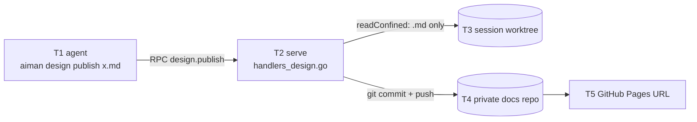
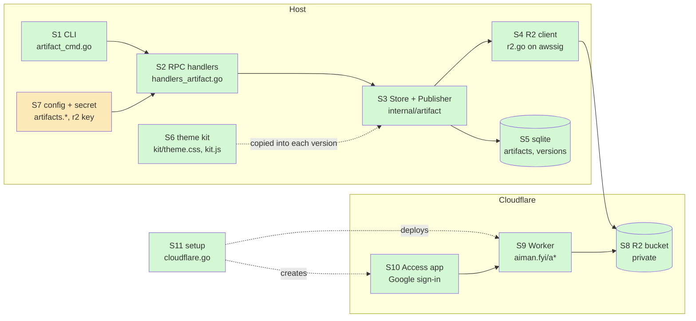
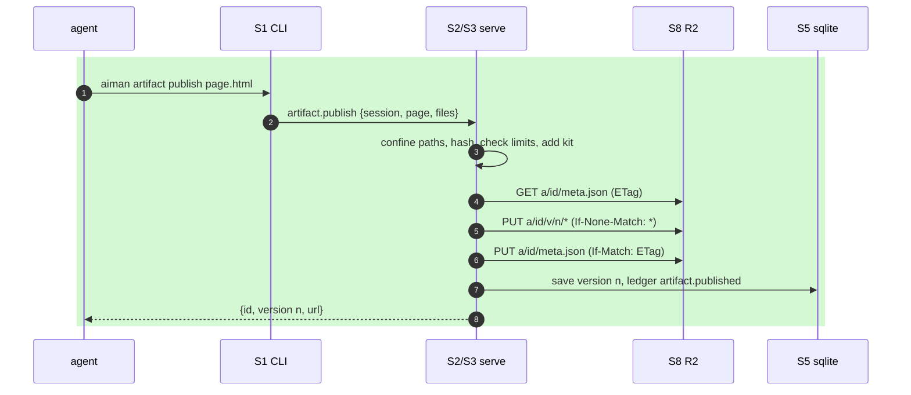
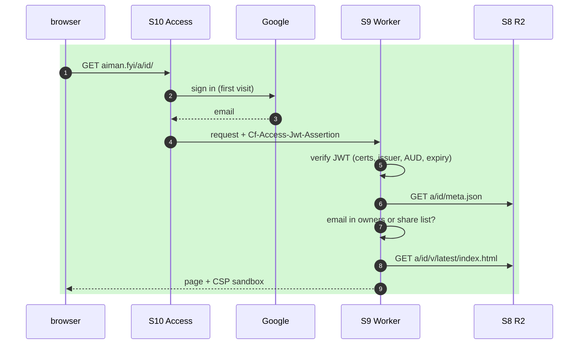
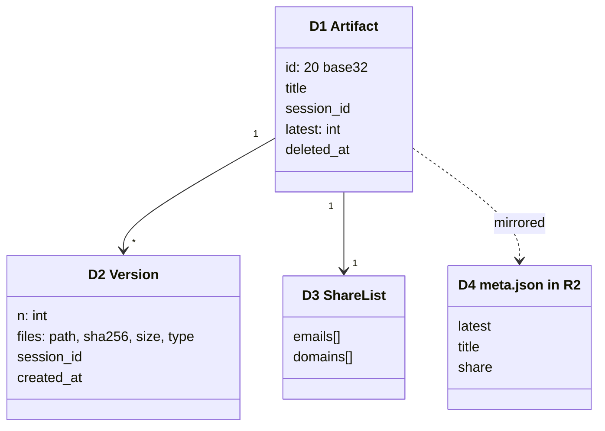
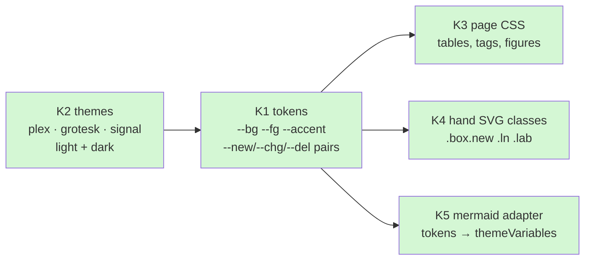

# artifacts: private HTML pages from a session, on Cloudflare behind Google sign-in

**Revision:** 7 · **Size:** project · **Status:** approved 2026-11-26 · **Task:** operator request 2026-11-26 · **Live PoC:** this page, `https://aiman.fyi/a/wx5j6mefp3qlkekr2cvr/`

**Legend:** green = new, amber = changed, red dashed = removed.

```text
classDef new fill:#d4f7d4
classDef changed fill:#fde9b8
classDef removed stroke-dasharray:4,fill:#f9d0d0
```

## In short

- Agents publish an HTML page plus files; they get a private URL. Like Claude's artifacts.
- Hosting: Cloudflare Worker + private R2 bucket on `aiman.fyi`.
- Sign-in: Cloudflare Access with Google. The Worker decides who sees which artifact.
- Isolation: each page runs in a CSP sandbox (opaque origin).
- Sessions publish privately. Only the operator shares, unshares, deletes.
- Cost: $0 on free plans (under 50 viewers).

## The problem

- Agents make reports, dashboards, diagrams. Today they can only leave a file on the host.
- `design.publish` handles one markdown file: no HTML, no assets, no per-page sharing.
- Claude's artifacts exist only in claude.ai. Codex, Pi, Grok sessions have nothing.

## How it works today



- **T2**: `internal/server/handlers_design.go:27`; confinement at `:139`.
- **T3**: only a `.md` inside the session's directory.
- **T4**: refused unless private or internal. Access = whoever reads the repo.
- Reusable: SigV4 signer `internal/harness/awssig/sign.go:74` (R2 speaks S3).

## Glossary

| Term | Meaning |
|---|---|
| Artifact | A page (`index.html`) plus its files, with id, title, owner session, versions. |
| Version | One immutable upload. The URL stays; `/v/<n>/` pins one. |
| R2 | Cloudflare object store with the S3 API. |
| Worker | JavaScript Cloudflare runs on each request to a route. |
| Access | Cloudflare login gate. Adds a signed JWT to each request. |
| Owner | Operator's Google account(s), `artifacts.owners`. Sees everything. |
| Share list | Per artifact: extra emails and domains. Empty = private. |
| Sandbox | CSP `sandbox` without `allow-same-origin`: the page gets an opaque origin. |
| AUD tag | Access app id; the Worker accepts only JWTs for it. |

## Proposed design

### Commands

```text
aiman artifact publish page.html [--file p=src …] [--title T] [--theme plex] [--id ID] [--expect-version N]
aiman artifact list | get <id>
aiman artifact share <id> --email a@x.com | --domain x.com      # operator
aiman artifact unshare <id> [--email …] [--domain …] [--all]     # operator
aiman artifact delete <id>                                       # operator
aiman artifact setup                                             # operator, once
```

- URL: `https://aiman.fyi/a/<id>/` = latest; `/a/<id>/v/3/` = version 3.
- `--id` adds a version. `--expect-version` refuses `artifact_conflict` if another write landed.
- Limits: 255 files, 25 MiB each, 64 MiB total, all inside the session's worktree.
- Pages have no browser storage (sandbox), same as Claude's.

### Architecture: structure



- **S1–S3**: publish, list, get for any session; share, unshare, delete, setup are `needs_operator`.
- **S3**: confines files (any type), assigns versions, records ledger rows.
- **S4**: minimal S3 client on the existing signer. No new dependency.
- **S5**: source of truth for ids, versions, share lists.
- **S6**: tokens and diagram styling; see Theme kit.
- **S7**: non-secret config pushed from the laptop; R2 key stays on the host (0600).
- **S9**: checks JWT, owner/share list, serves files with sandbox headers.
- **S10**: one app, Google only. Proves identity; never decides access.
- **S11**: one-time REST setup with a token from stdin; never stored.

### Architecture: publish flow



- **3**: paths must resolve inside the worktree; symlinks followed then checked.
- **4–6**: version files first, `meta.json` last, so readers never see a half version.
- **5**: `If-None-Match` stops overwriting an existing version.
- **6**: `If-Match` fails on a concurrent write: `artifact_conflict`.
- **7**: sqlite only after R2 accepted. Unshare and delete use the same order.

### Architecture: view flow



- **1**: Access covers `aiman.fyi/a` and `/a/*`; cookie `SameSite=None` so sandboxed subresources carry it.
- **5**: no header, bad signature, wrong AUD, expired: 403.
- **6–7**: missing `meta.json` or email not listed: 403 + `Clear-Site-Data`.
- **9**: `sandbox` CSP: no cookies, no storage, no reading other artifacts.
- Only GET and HEAD. `meta.json` is never served.

### Domain model



- **D1–D3**: sqlite rows (S5). An artifact belongs to the host that created it.
- **D2**: R2 keys `a/<id>/v/<n>/<path>`; never rewritten.
- **D4**: the only object the Worker reads for access. Written last.

### Theme kit



- **K1**: every colour is a token; diagrams use the same tokens, so dark mode is free.
- **K2**: chosen with `--theme` or `<html data-kit-theme>`; mode follows the OS or `data-kit-mode`.
- **K4**: role classes, never colours. One `<marker>` per arrow colour, `currentColor` fill.
- **K5**: Mermaid takes hex only; kit reads tokens, re-renders on theme/mode change, one render at a time.
- Diagrams fit the page width; click to enlarge. No sideways scroll.
- Kit files (`kit/theme.css`, `kit/kit.js`, about 360 KB) are copied into each version; old versions never change.
- Fonts: 13 OFL woff2 faces inlined in `theme.css` as `data:` URIs. A sandboxed page (origin `null`) cannot load same-host font files: fonts are fetched under CORS without the Access cookie. CSP `font-src 'self' data:`.

### Security

- Bucket private: no public access, no `r2.dev`, no custom domain.
- Worker: `workers.dev` and preview URLs off; host must be `aiman.fyi`; path `/a/<id>/…` only.
- CSP: `sandbox allow-scripts allow-forms allow-popups allow-modals allow-downloads`, `connect-src 'self'`, `form-action 'none'`, `worker-src 'none'`, `object-src 'none'`, `frame-ancestors 'none'`.
- Outside code: cdnjs, jsdelivr, unpkg (scripts, styles). Code from them still cannot send data out.
- Hosts hold only a bucket-scoped R2 key. No host can change the Worker or Access.
- `publish --id` only for the owning session (or a parent), or the operator.

## Proof of concept (2026-11-26)

| Piece | State |
|---|---|
| Account | `ef35b25d…` (bouwerp@gmail.com), zone `aiman.fyi` |
| R2 | `aiman-artifacts`, WEUR, private |
| Access | team `cool-tree-acb3`, app on `aiman.fyi/a` + `/a/*`, Google only, auto-redirect |
| Worker | `aiman-artifacts`, route `aiman.fyi/a*`, `workers.dev` off |
| DNS | proxied `AAAA aiman.fyi 100::` (route needs a hostname) |

- Proved: Google sign-in, sandboxed render with Mermaid, versions, all set up by REST (no wrangler).
- Found: sandboxed pages cannot `fetch` own files → inline data or use `<script>`/``/`<link>`.
- Found: kit script must be classic, not a module (module needs CORS).
- Found: class diagrams ignore `classDef` fill → kit CSS colours delta nodes.
- Open: Worker as Access destination; conditional writes via S3 API; second viewer.

## A scenario, end to end

1. Session writes `report/index.html`, `report/chart.svg`.
2. `aiman artifact publish report/index.html --title "Load test"` → id `k3x9…` v1 (publish flow 1–8).
3. Operator opens the link, signs in with Google, sees v1 (view flow 1–9).
4. Agent republishes with `--id k3x9… --expect-version 1` → v2; `/v/1/` still serves v1.
5. Operator: `aiman artifact share k3x9… --email lead@partner.com` → `meta.json` updated; partner sees this page only.
6. A session running `share` gets `needs_operator`.

## Alternatives considered

- **Cloudflare Pages:** undocumented upload API, whole-site deploys, 20k-file cap, Access misses production `pages.dev`.
- **Workers Static Assets:** one snapshot for all artifacts, 20k-file cap.
- **Access app per artifact:** 500-app cap; share = Access API call.
- **Worker does Google OAuth:** aiman owns OAuth, cookies, CSRF; one bug = public pages.
- **Subdomain per artifact:** hard isolation, but wildcard DNS/route/Access and long URLs. Sandbox gives the same on one host.
- **Extend `design.publish`:** markdown + git; no HTML, assets, versions or per-page sharing.

## Open questions

- None. Answers are in Decisions.

## Decisions

| Item | Severity | Triage | Reason |
|---|---|---|---|
| Access misses `workers.dev`, previews, public bucket | high | accept | All off; Worker 403s without verified JWT |
| Share must not edit the Access policy | high | accept | Access fixed at setup; share writes `meta.json` only |
| One host file with API token + R2 key | high | accept in part | Setup token never stored; hosts get bucket key only. Signed `meta.json` rejected: key would sit beside the R2 key |
| Nested wildcard not free | high | accept | Moot: paths on `aiman.fyi` |
| `meta.json` last is not a transaction | medium | accept | Conditional PUTs; R2 before sqlite |
| Worker contract gaps | medium | accept | Vars, host, method, path rules fixed |
| CSP lets a page POST out | medium | accept | `form-action`, `worker-src`, `object-src`, `base-uri` none |
| Confinement + gateway rules | medium | accept | Any type, same roots; off device allowlist |
| R2 accepts `awssig` PUTs? | low | accept | First task of piece A |
| Publish on host or laptop | question | host | Operator: "Serve on each host" |
| Which zone | question | `aiman.fyi` | Operator registered it |
| Paths vs subdomains | question | paths + sandbox | Operator: "yes" |
| Google vs Workspace | question | plain Google | Operator choice |
| Who shares | question | operator only | Operator choice |
| Outside scripts | question | CDN list | Operator: "A fixed CDN list" |
| Styles like Claude's artifacts | question | theme kit | Operator request |
| Diagrams fit width | question | fit + click to enlarge | Operator: "must be scaled to fit" |
| Terse text, marked diagrams | question | rev 7 | Operator: "prefer terse bullet points", "clear markers" |

## Breakdown

| Piece | Owns files | Group | Depends on | Size | Tier | Acceptance tests |
|---|---|---|---|---|---|---|
| A. Store, R2, publish/list/get | `internal/artifact/{store,publish,r2}.go`, migration, `handlers_artifact.go`, `artifact_cmd.go`, `api/openapi.yaml` | 1 | – | L | smart | `go test ./internal/artifact -run 'TestPublish\|TestR2'`, `go test ./internal/server -run TestArtifact` |
| B. Worker | `internal/artifact/worker/worker.js`, `worker_test.mjs` | 1 | – | M | smart | `node --test internal/artifact/worker/worker_test.mjs` |
| K. Theme kit | `internal/artifact/kit/{theme.css,kit.js,fonts/}` | 1 | – | M | smart | `node --test internal/artifact/kit/kit_test.mjs` (Playwright: 3 themes × 2 modes, fit width) |
| C. Setup, share | `internal/artifact/cloudflare.go`, share/unshare/delete handlers + CLI | 2 | A, B | M | smart | `go test ./internal/artifact -run 'TestSetup\|TestShare'` |
| D. Docs, skill | `SKILL.md ## Artifacts`, `AGENTS.md`, `README.md`, `docs/specs/artifacts.md` | 2 | A, K | S | worker | `go test ./internal/aimanskill` |
| E. TUI, phone list | `internal/ui/artifacts.go`, gateway allowlist | 3 | A | M | smart | `go test ./internal/ui -run TestArtifacts` |

- Group 1 runs in parallel; contracts are fixed above (R2 layout, `meta.json`, kit file names).

## What you should be able to explain

1. Why Access signs in but the Worker decides access.
2. How the sandbox isolates pages on one host, and what it costs.
3. Why version files go first and `meta.json` last.
4. Which actions are the operator's only.
5. How one set of tokens colours the page and every diagram.

## Contract (for the pieces)

Fixed before the children start. A piece that finds this wrong escalates; it does not change it alone.

### R2 layout and `meta.json`

- Version files: `a/<id>/v/<n>/<path>`; `index.html` is required. Kit files land at `a/<id>/v/<n>/kit/theme.css` and `kit/kit.js`.
- `a/<id>/meta.json`: `{"latest": <int>, "title": "<string>", "share": {"emails": [], "domains": []}, "deleted": <bool, omitted when false>}`.
- `<id>`: 20 characters of lower-case base32 (`[a-z2-7]{20}`).
- Emails and domains are stored lower case.

### Go package `internal/artifact` (piece A)

```go
var (
    ErrNotFound     = errors.New("artifact: not found")
    ErrPrecondition = errors.New("artifact: precondition failed") // R2 412
    ErrConflict     = errors.New("artifact: conflict")            // expect_version or meta ETag mismatch
    ErrLimits       = errors.New("artifact: over limits")
    ErrInvalid      = errors.New("artifact: invalid")
    ErrNotOwner     = errors.New("artifact: not owner")
)

const (
    MaxFiles     = 255
    MaxFileBytes = 25 << 20
    MaxTotal     = 64 << 20
)

type File struct {
    Path        string // published path, relative, slash separated
    Data        []byte
    ContentType string // empty: from the extension
}

type ShareList struct {
    Emails  []string `json:"emails"`
    Domains []string `json:"domains"`
}

type Meta struct {
    Latest  int       `json:"latest"`
    Title   string    `json:"title"`
    Share   ShareList `json:"share"`
    Deleted bool      `json:"deleted,omitempty"`
}

// Cond makes a PUT conditional. IfNoneMatch sends "If-None-Match: *";
// IfMatch sends "If-Match: <etag>".
type Cond struct {
    IfNoneMatch bool
    IfMatch     string
}

// Bucket is the R2 surface the publisher uses. Get of a missing key is
// ErrNotFound; a failed condition is ErrPrecondition.
type Bucket interface {
    Get(ctx context.Context, key string) (data []byte, etag string, err error)
    Put(ctx context.Context, key string, data []byte, contentType string, c Cond) (etag string, err error)
    Delete(ctx context.Context, keys []string) error
    List(ctx context.Context, prefix string) ([]string, error)
}

// NewR2 is a Bucket over R2's S3 API (path style: <endpoint>/<bucket>/<key>),
// signed with awssig (region "auto", service "s3", X-Amz-Content-Sha256 set).
func NewR2(endpoint, bucket string, creds awssig.Credentials, hc *http.Client) *R2

type Record struct {
    ID      string
    Title   string
    Session string // owning session id
    Latest  int
    Share   ShareList
    Created time.Time
    Deleted bool
}

type Version struct {
    N       int
    Session string
    Created time.Time
    Files   []FileInfo
}

type FileInfo struct {
    Path   string `json:"path"`
    SHA256 string `json:"sha256"`
    Size   int64  `json:"size"`
    Type   string `json:"type"`
}

// SQLStore keeps records and versions in serve's database (tables
// artifacts and artifact_versions, created by OpenSQLStore).
func OpenSQLStore(db *sql.DB) (*SQLStore, error)
func (s *SQLStore) Get(ctx context.Context, id string) (Record, error) // ErrNotFound
func (s *SQLStore) Save(ctx context.Context, r Record) error
func (s *SQLStore) AddVersion(ctx context.Context, id string, v Version) error
func (s *SQLStore) Versions(ctx context.Context, id string) ([]Version, error)
func (s *SQLStore) List(ctx context.Context) ([]Record, error) // newest first, deleted left out

type Publisher struct {
    Bucket Bucket
    Store  *SQLStore
    Host   string // "aiman.fyi"; URL is https://<Host>/a/<id>/
    Kit    []File // copied into every version under kit/
    Now    func() time.Time
    NewID  func() string
    // CanWrite reports whether caller may add a version to an artifact
    // owned by owner. Nil: only the owner.
    CanWrite func(owner, caller string) bool
}

type PublishRequest struct {
    ID            string // empty: new artifact
    Title         string
    Session       string // caller's session id; "" is the operator
    ExpectVersion int    // 0: no check
    Files         []File // must hold "index.html"
}

type Published struct {
    ID      string `json:"id"`
    Version int    `json:"version"`
    URL     string `json:"url"`
}

func (p *Publisher) Publish(ctx context.Context, r PublishRequest) (Published, error)
func (p *Publisher) Share(ctx context.Context, id string, add, remove ShareList, all bool) (Meta, error)
func (p *Publisher) Delete(ctx context.Context, id string) error
```

Publish order: read `meta.json` (ETag) → PUT every version file with `If-None-Match` → PUT `meta.json` with `If-Match` (or `If-None-Match` when new) → `Store.Save` + `AddVersion`. A failure after a file PUT leaves orphan files under an unused version number; that is acceptable (`meta.json` never points at them). The operator (`Session == ""`) passes `CanWrite`.

Share and Delete: R2 first (`meta.json` with `If-Match`), then the store. Delete marks `deleted` in `meta.json` and the record; it removes version files after.

### RPC (piece A publish/list/get, piece C the rest)

| Method | Params | Result | Who |
|---|---|---|---|
| `artifact.publish` | `session?`, `page` (path), `files?` `[{path, from}]`, `title?`, `id?`, `expect_version?`, `theme?` | `{"type":"artifact","artifact":{id,version,url}}` | any in-scope caller |
| `artifact.list` | – | `{"type":"artifacts","artifacts":[{id,title,session,latest,url,shared,created}]}` | any |
| `artifact.get` | `id` | `{"type":"artifact_info","artifact":{…,versions,share}}` | any |
| `artifact.share` | `id`, `emails?`, `domains?` | `{"type":"artifact_share","share":{emails,domains}}` | operator |
| `artifact.unshare` | `id`, `emails?`, `domains?`, `all?` | same | operator |
| `artifact.delete` | `id` | `{"type":"artifact_deleted","id"}` | operator |

Error codes: `artifact_conflict` (ErrConflict), `invalid_params` (ErrInvalid, ErrLimits, a path outside the session's directory), `session_scope` (ErrNotOwner), `needs_operator`, `not_found`, `unavailable` (no publisher wired). `page` and every `from` resolve like `readConfined` (symlinks followed, inside the working directory or worktree) but for any file type. `page` is published as `index.html`; each other file at its `path`, else its path relative to the page's directory.

### Setup (piece C)

```go
type CloudflareAPI struct {
    Base  string // "https://api.cloudflare.com/client/v4"
    Token string // never logged, never in an error
    HTTP  *http.Client
}

type SetupConfig struct {
    AccountID        string
    Zone             string   // "aiman.fyi"
    Host             string   // "aiman.fyi"
    Bucket           string   // "aiman-artifacts"
    TeamDomain       string   // "<team>.cloudflareaccess.com"
    IdentityProvider string   // Access IdP id (Google)
    Owners           []string // Worker OWNERS, lower case
    Viewers          []string // Access policy emails (owners plus anyone shared with)
    ViewerDomains    []string // Access policy email domains
}

type SetupResult struct {
    AppID    string
    AUD      string
    PolicyID string
}

// Setup is idempotent: it finds by name before it creates.
func Setup(ctx context.Context, api *CloudflareAPI, cfg SetupConfig, log io.Writer) (SetupResult, error)
```

Order: zone id → bucket (create if missing) → r2.dev off → Access policy `aiman-artifacts-viewers` → Access app `aiman artifacts` (destinations `<host>/a`, `<host>/a/*`; `allowed_idps` the IdP; `auto_redirect_to_identity`; cookie `SameSite=None`, `HttpOnly`; 24h) → Worker `aiman-artifacts` (multipart, `main_module` `worker.js`, bindings `BUCKET`, `ARTIFACT_HOST`, `OWNERS`, `TEAM_DOMAIN`, `POLICY_AUD`) → `workers.dev` and previews off → route `<host>/a*` → proxied `AAAA <host> 100::` when the zone has no record for the host. Errors carry Cloudflare's message, never the token.

Access admits the policy's viewers. Sharing with someone outside it needs `aiman artifact setup` again with that email (the operator's step; share never calls Cloudflare). Every Google account that signs in takes a Zero Trust seat.

CLI: `aiman artifact setup [--account ID] [--zone Z] [--host H] [--bucket B] [--team T] [--idp ID] [--owner EMAIL …] [--viewer EMAIL …] [--viewer-domain D …]` reads the API token from stdin, or `--cf-oauth` takes the `cf` CLI's OAuth token from `~/.config/cloudflare/config/default.json`. Missing flags come from the `artifacts` config. It prints the AUD and app id. `aiman artifact setup --host-key` reads `{"access_key_id","secret_access_key"}` from stdin and writes `~/.aiman/artifacts-r2.json` (0600); the operator makes that key in the dashboard (R2 → Manage API tokens, Object Read & Write, this bucket only).

### Host credentials: `cf` OAuth and the REST object API (piece A2)

Operator decision 2026-11-26 ("option 2"): hosts publish with the `cf` CLI's OAuth login instead of a bucket-scoped R2 key. Accepted risks: a host holds a token that can also change the Worker and Access; R2's REST object API ignores `If-None-Match` and `If-Match` (tested: both PUTs answered 200 and overwrote), so overwrite and race protection is serve's, not R2's.

```go
// TokenSource returns a bearer token for the Cloudflare API.
type TokenSource func(ctx context.Context) (string, error)

// CFOAuthToken reads oauth_token and expiration_time from the cf CLI's
// config file (~/.config/cloudflare/config/default.json). Within 2 minutes
// of expiry (or past it) it calls refresh (serve: runs `cf auth whoami`,
// which renews the token) and reads the file again. It never logs the token.
func CFOAuthToken(path string, refresh func(ctx context.Context) error) TokenSource

// NewCFObjects is a Bucket over the REST object API:
// <base>/accounts/<account>/r2/buckets/<bucket>/objects/<key>.
// It emulates Cond: IfNoneMatch reads the key first and refuses with
// ErrPrecondition when it exists; IfMatch reads the key's ETag first and
// refuses on a mismatch. Get returns the ETag header without quotes
// normalised to the quoted form "<hex>". List pages with ?prefix=&cursor=.
func NewCFObjects(base, account, bucket string, token TokenSource, hc *http.Client) *CFObjects
```

- The emulated checks race with other writers. Serve is the only writer of an artifact (one host owns it), and `Publisher` serialises Publish, Share and Delete per artifact id with an in-process lock, so the check and the write cannot interleave within serve.
- Wiring: `artifacts.auth` is `cf_oauth` (REST object API, `cf` must be on PATH) or `r2_key` (S3 API with `~/.aiman/artifacts-r2.json`, the default when that file exists). With `cf_oauth` and no `cf` config file, the RPCs answer `unavailable`.
