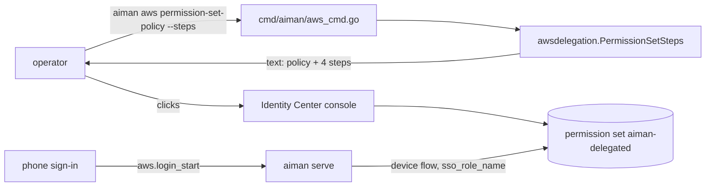
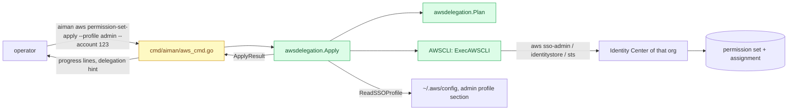

# `aiman aws permission-set-apply`: set up the delegated permission set with the AWS CLI

**Revision:** 1 · **Size:** small · **Status:** draft, consult pending
**Task:** operator request on 2026-11-09 ("Can we have scripts in the aiman repo that sets that up through the AWS cli?") · **Spec:** extends `docs/specs/phone-aws-login.md` (the permission set it needs)

## Problem

The phone's AWS sign-in (`aws.login_start`) only works for a profile whose account has the `aiman-delegated` permission set in IAM Identity Center, assigned to the operator's user. Today `aiman aws permission-set-policy --steps` prints the policy and four manual console steps. The operator has three accounts, each its own Identity Center, so that is three rounds of console clicking, and a typo in the session duration or the policy is only found when the phone sign-in fails.

## How it works today



Files: `cmd/aiman/aws_cmd.go` (`runAWS`), `internal/infra/awsdelegation/permissionset.go` (`PermissionSetPolicy`, `PermissionSetSteps`), `internal/infra/awsdelegation/policy.go` (`BuildRegionPolicy`, the region-locked document), `internal/infra/awsdelegation/sso_profile.go` (`ReadSSOProfile`, reads `sso_start_url` and `sso_region` of a laptop profile), `internal/infra/awsdelegation/iam.go` (the existing pattern for running `aws` with a profile).

## Glossary

- **Identity Center instance**: one per organisation; `sso-admin list-instances` returns its ARN and identity store id. The operator's three accounts are three instances.
- **Permission set**: a named role template in Identity Center. Assigning it to a user for an account creates the `AWSReservedSSO_<name>_<hash>` role in that account.
- **Account assignment**: (permission set, principal, account). Creating one is asynchronous; `describe-account-assignment-creation-status` reports `IN_PROGRESS`, `SUCCEEDED` or `FAILED`.
- **Admin profile**: a laptop `~/.aws/config` profile with rights to administer Identity Center in that organisation. aiman never reads its credentials; the AWS CLI does.
- **Delegation**: `remotes[].aws_delegation` on the laptop, pushed to serve; the phone sign-in needs its `sso_start_url`, `sso_region`, `sso_account_id` and `sso_role_name`.

## Proposed design

Legend: **new**, *changed*, ~~removed~~.

### Domain model

- **new** `awsdelegation.AWSCLI` interface: `Run(ctx context.Context, args ...string) ([]byte, error)`. Runs one `aws` invocation and returns stdout. **new** `awsdelegation.ExecAWSCLI{Profile string}` implements it with `exec.CommandContext(ctx, "aws", "--profile", p, "--output", "json", args...)`, like `iam.go`. Tests use a scripted fake.
- **new** `awsdelegation.ApplySpec{Profile, AccountID, Name, User string; Regions []string}`. Empty `Name` is `DefaultPermissionSetName`; empty `User` means the caller; session duration is the constant `PermissionSetSessionDuration = "PT12H"` (the phone-aws-login decision).
- **new** `awsdelegation.ApplyResult{InstanceARN, IdentityStoreID, PermissionSetARN, PrincipalID, UserName, AccountID string; CreatedPermissionSet, CreatedAssignment bool; Delegation DelegationHint}`.
- **new** `awsdelegation.DelegationHint{StartURL, Region, AccountID, RoleName string}`: the lines to put in `remotes[].aws_delegation`. `StartURL` and `Region` come from the admin profile's SSO section via `ReadSSOProfile`; empty when the admin profile is not SSO-based.
- **new** `awsdelegation.ApplyStep{Name string; Args []string}`: one planned `aws` call, for `--dry-run`.

### Structure



New file `internal/infra/awsdelegation/permissionset_apply.go`. *Changed* `cmd/aiman/aws_cmd.go`: `runAWS` dispatches `permission-set-policy` and **new** `permission-set-apply`; `awsUsage` lists both. *Changed* `PermissionSetSteps`: a first line says `Or run: aiman aws permission-set-apply --profile <admin profile> --account <id>`.

### Behaviour

`Apply(ctx, cli AWSCLI, spec ApplySpec, log io.Writer) (ApplyResult, error)` runs, in order, logging one line per step to `log`:

1. **Instance**: `sso-admin list-instances`. Exactly one instance is required; zero is the error `no Identity Center instance visible to profile <p>`; more than one is an error listing their ARNs (an `--instance` flag is not in scope; see Open questions).
2. **Account**: `spec.AccountID`, else `sts get-caller-identity` `Account`, logged as `account <id> (the admin profile's own account)`.
3. **Permission set**: page through `sso-admin list-permission-sets` and `describe-permission-set` each until one has `Name == spec.Name`. Found: when `SessionDuration != PT12H`, `update-permission-set --session-duration PT12H`. Missing: `create-permission-set --name <name> --session-duration PT12H --description "aiman delegated sessions"`; `CreatedPermissionSet` true.
4. **Policy**: `put-inline-policy-to-permission-set --inline-policy <PermissionSetPolicy(regions)>`, always, so a changed region list is applied. Empty regions is an error before any call: `no regions: pass --regions a,b or set them on a delegation`.
5. **Principal**: `spec.User`, else the last `/` segment of the caller ARN (`assumed-role/AWSReservedSSO_x_y/<user>`; a plain IAM user ARN `user/<name>` works the same; a root ARN is an error asking for `--user`). `identitystore list-users --identity-store-id <id> --filters AttributePath=UserName,AttributeValue=<user>`; zero matches is an error naming the user and the store.
6. **Assignment**: `sso-admin list-account-assignments --account-id <acct> --permission-set-arn <arn>` filtered by `PrincipalId`. Present: skip. Missing: `create-account-assignment --target-type AWS_ACCOUNT --target-id <acct> --principal-type USER --principal-id <id>`, then poll `describe-account-assignment-creation-status` every 2 seconds for up to 2 minutes until `SUCCEEDED` (`CreatedAssignment` true) or `FAILED` (error with `FailureReason`). Timeout is an error naming the request id; the assignment may still complete, and a rerun finds it.
7. **Hint**: `ReadSSOProfile(defaultAWSConfigPath, spec.Profile)` fills `Delegation.StartURL` and `Delegation.Region`; `AccountID` and `RoleName` always.

Every step is idempotent, so a rerun after any failure finishes the setup. `Plan(spec ApplySpec) []ApplyStep` returns steps 1 to 6 with placeholders `<instance-arn>`, `<identity-store-id>`, `<permission-set-arn>`, `<principal-id>` where a value comes from an earlier call; `--dry-run` prints them as `aws --profile <p> ...` lines and makes no call.

`aws` is run with `--output json` and errors carry the CLI's stderr first line. Outputs of `sso-admin`, `identitystore` and `sts get-caller-identity` hold ARNs, ids and names, never credentials; the command logs them. aiman never reads the admin profile's credentials, `~/.aws/credentials` or an SSO cache; it reads only the `sso_start_url` and `sso_region` keys of the admin profile's config section, which `ReadSSOProfile` already does.

### CLI

`aiman aws permission-set-apply --profile <admin profile> [--account <id>] [--regions a,b] [--name aiman-delegated] [--user <username>] [--dry-run] [--json]`

- `--profile` is required (`errUsage` without it). `--regions` defaults to the first delegation with regions in the laptop config, as `permission-set-policy` does.
- Progress goes to stdout as `Apply` logs it; the end prints:

```
Done. Put this in remotes[].aws_delegation for that account:
  sso_start_url: https://d-xxxx.awsapps.com/start
  sso_region: eu-west-1
  sso_account_id: 123456789012
  sso_role_name: aiman-delegated
Then push the config to the host (Agent API page, c) and sign in from the phone.
```

- `--json` prints `ApplyResult` as one JSON object instead of the text.
- Exit 1 with the error on stderr when a step fails.

Permissions the admin profile needs: `sso:ListInstances`, `sso:ListPermissionSets`, `sso:DescribePermissionSet`, `sso:CreatePermissionSet`, `sso:UpdatePermissionSet`, `sso:PutInlinePolicyToPermissionSet`, `sso:ListAccountAssignments`, `sso:CreateAccountAssignment`, `sso:DescribeAccountAssignmentCreationStatus`, `identitystore:ListUsers`, `sts:GetCallerIdentity`, plus `iam:CreateRole`, `iam:AttachRolePolicy`, `iam:PutRolePolicy`, `iam:GetRole`, `iam:ListRolePolicies`, `iam:DeleteRole`, `iam:DetachRolePolicy`, `iam:DeleteRolePolicy`, `iam:GetSAMLProvider`, `iam:CreateSAMLProvider`, `iam:UpdateSAMLProvider`, `iam:ListAttachedRolePolicies` on the target account, which Identity Center uses when it provisions the role (`AWSSSOMasterAccountAdministrator` covers them).

## Scenario

The operator runs `aiman aws permission-set-apply --profile acme-admin` on the laptop. The CLI signs in through the admin profile's own SSO if needed. aiman finds the single instance, reads account `123456789012` from the caller, finds no `aiman-delegated`, creates it with PT12H, puts the eu-west-1 policy, resolves `pieter@acme.io` from the caller ARN, finds the user id in the identity store, creates the assignment and polls for 20 seconds until `SUCCEEDED`. It prints the four delegation lines. The operator copies them into `remotes[].aws_delegation`, reloads serve, opens the phone's Host tab and signs in; `aws.login_start` now finds the role. They repeat the command twice with the other two admin profiles.

## Alternatives

- **A shell script under `scripts/`**: what was asked for literally. Lost because the repo tests Go, not bash; the policy document and the SSO-profile reader already live in Go; and `--dry-run` gives the script view anyway.
- **Let serve do it from the host**: lost because it would need admin credentials on the host, which the design keeps on the laptop only.
- **CloudFormation or Terraform**: lost because the operator has three stand-alone accounts and no IaC for them; one idempotent command is less to maintain.
- **Use the AWS SDK for Go instead of the CLI**: lost because the rest of `awsdelegation` shells out to the CLI, which also gives SSO sign-in for the admin profile for free.

## Open questions

1. Instance choice when `list-instances` returns more than one (an organisation with a delegated administrator sees one; an account-instance setup may see two). Default: error naming them; add `--instance <arn>` only when someone hits it.
2. Should the command also write the delegation into `~/.aiman/config.yaml`? Default: no, print it; the config has per-remote structure and the operator decides which remote gets it.

## Decisions

| Objection | Severity | Triage | Reason |
|---|---|---|---|
| (consult pending) | | | |

## Breakdown

| Piece | Owns files | Parallel group | Depends on | Complexity | Tier | Acceptance tests |
|---|---|---|---|---|---|---|
| P1 apply + CLI | `internal/infra/awsdelegation/permissionset_apply.go`, `cmd/aiman/aws_cmd.go`, `permissionset.go` (steps line), `AGENTS.md` | 1 | none | M | smart | `internal/infra/awsdelegation/permissionset_apply_acceptance_test.go`, `cmd/aiman/aws_apply_acceptance_test.go`; `go test ./internal/infra/awsdelegation/ ./cmd/aiman/` |

## Contracts

Exact signatures the acceptance tests compile against (`internal/infra/awsdelegation/permissionset_apply_acceptance_test.go`, `cmd/aiman/aws_apply_acceptance_test.go`, both behind `//go:build acceptance` until the child removes the tag).

```go
// internal/infra/awsdelegation/permissionset_apply.go
const PermissionSetSessionDuration = "PT12H"

type AWSCLI interface {
    Run(ctx context.Context, args ...string) ([]byte, error) // one aws invocation; stdout
}

type ExecAWSCLI struct{ Profile string }
func (e ExecAWSCLI) Run(ctx context.Context, args ...string) ([]byte, error)
// command builds the exec.Cmd: aws --profile <p> --output json <args...>
func (e ExecAWSCLI) command(ctx context.Context, args ...string) *exec.Cmd

type ApplySpec struct {
    Profile, AccountID, Name, User string
    Regions                        []string
    AWSConfigPath                  string        // empty: ~/.aws/config (os.UserHomeDir)
    PollInterval, PollTimeout      time.Duration // zero: 2s and 2m
}

type DelegationHint struct {
    StartURL  string `json:"sso_start_url"`
    Region    string `json:"sso_region"`
    AccountID string `json:"sso_account_id"`
    RoleName  string `json:"sso_role_name"`
}

type ApplyResult struct {
    InstanceARN          string         `json:"instance_arn"`
    IdentityStoreID      string         `json:"identity_store_id"`
    PermissionSetARN     string         `json:"permission_set_arn"`
    PrincipalID          string         `json:"principal_id"`
    UserName             string         `json:"user_name"`
    AccountID            string         `json:"account_id"`
    CreatedPermissionSet bool           `json:"created_permission_set"`
    CreatedAssignment    bool           `json:"created_assignment"`
    Delegation           DelegationHint `json:"delegation"`
}

type ApplyStep struct {
    Name string
    Args []string // full aws argument list, --profile included
}

func Plan(spec ApplySpec) ([]ApplyStep, error)
func Apply(ctx context.Context, cli AWSCLI, spec ApplySpec, log io.Writer) (ApplyResult, error)
```

Every `Run` call carries `--profile <spec.Profile>` (the fake checks it; `ExecAWSCLI` adds it with `--output json`). Errors from a call read `aws <service> <subcommand>: <first line of the CLI's output>`.

```go
// cmd/aiman/aws_cmd.go
var newAWSCLI = func(profile string) awsdelegation.AWSCLI { return awsdelegation.ExecAWSCLI{Profile: profile} }
```

`runAWS(args, cfg, out)` keeps its signature and dispatches `permission-set-apply`. `--dry-run` prints each planned step as one line `aws --profile <p> ...` and never calls `newAWSCLI`'s result. `--json` prints `ApplyResult` as one object. Text output ends with the `Done.` block in "CLI" and never prints `Done.` on failure. `awsUsage` names both subcommands and `--dry-run`.

## What the reader should be able to explain

1. Why the permission set lives in each account's Identity Center and why its session duration is PT12H.
2. Which `aws` calls the command makes, in order, and why each is safe to repeat.
3. Where the delegation hint's start URL comes from and why aiman never touches credentials.
4. Why the account assignment needs polling and what a timeout means.
