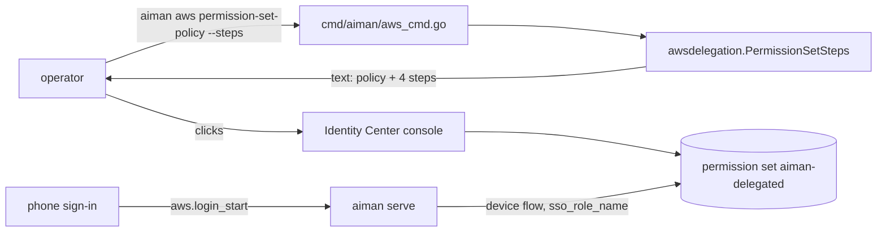
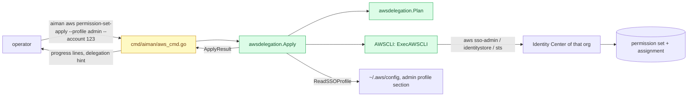

# `aiman aws permission-set-apply`: set up the delegated permission set with the AWS CLI

**Revision:** 8 (P3, admin profiles without SSO, after consult rounds 3 and 4; approved by the operator on 2026-11-09 ("yes" to "Approve the rev 8 design and I start building?"); rev 5 is as built, PRs #116 and #117 merged 2026-11-09) · **Size:** small · **Status:** approved by the operator on 2026-11-09 ("approve the permission-set-apply design") after two consult rounds (both revise, every objection accepted); rev 4 adds P2, writing the delegation into the laptop config, at the operator's request the same day ("is there no way we can do this through the aws cli and set these values automatically?", "yes"); rev 6 to 8 add P3 after the operator hit `Missing the following required SSO configuration values: sso_start_url, sso_region` on `aws sso login`: their three admin profiles are plain IAM credentials, and they have no start URL ("can we not have an aiman command that configures this through the aws cli", "yes design it")
**Task:** operator request on 2026-11-09 ("Can we have scripts in the aiman repo that sets that up through the AWS cli?") · **Spec:** extends `docs/specs/phone-aws-login.md` (the permission set it needs)

## Problem

The phone's AWS sign-in (`aws.login_start`) only works for a profile whose account has the `aiman-delegated` permission set in IAM Identity Center, assigned to the operator's user. Today `aiman aws permission-set-policy --steps` prints the policy and four manual console steps. The operator has three accounts, each its own Identity Center, so that is three rounds of console clicking, and a typo in the session duration or the policy is only found when the phone sign-in fails.

## How it works today



Files: `cmd/aiman/aws_cmd.go` (`runAWS`), `internal/infra/awsdelegation/permissionset.go` (`PermissionSetPolicy`, `PermissionSetSteps`), `internal/infra/awsdelegation/policy.go` (`BuildRegionPolicy`, the region-locked document), `internal/infra/awsdelegation/sso_profile.go` (`ReadSSOProfile`, reads `sso_start_url` and `sso_region` of a laptop profile), `internal/infra/awsdelegation/iam.go` (the existing pattern for running `aws` with a profile).

## Glossary

- **Identity Center instance**: one per organisation; `sso-admin list-instances` returns its ARN and identity store id. The operator's three accounts are three instances.
- **Permission set**: a named role template in Identity Center. Assigning it to a user for an account creates the `AWSReservedSSO_<name>_<hash>` role in that account.
- **Account assignment**: (permission set, principal, account). Creating one is asynchronous; `describe-account-assignment-creation-status` reports `IN_PROGRESS`, `SUCCEEDED` or `FAILED`.
- **Admin profile**: a laptop `~/.aws/config` profile with rights to administer Identity Center in that organisation. aiman never reads its credentials; the AWS CLI does.
- **Delegation**: `remotes[].aws_delegation` on the laptop, pushed to serve; the phone sign-in needs its `sso_start_url`, `sso_region`, `sso_account_id` and `sso_role_name`.

## Proposed design

Legend: **new**, *changed*, ~~removed~~.

### Domain model

- **new** `awsdelegation.AWSCLI` interface: `Run(ctx context.Context, args ...string) ([]byte, error)`. Runs one `aws` invocation and returns stdout. **new** `awsdelegation.ExecAWSCLI{Profile string}` implements it with `exec.CommandContext(ctx, "aws", "--profile", p, "--output", "json", args...)`, like `iam.go`. Tests use a scripted fake.
- **new** `awsdelegation.ApplySpec{Profile, AccountID, Name, User string; Regions []string}`. Empty `Name` is `DefaultPermissionSetName`; empty `User` means the caller; session duration is the constant `PermissionSetSessionDuration = "PT12H"` (the phone-aws-login decision).
- **new** `awsdelegation.ApplyResult{InstanceARN, IdentityStoreID, PermissionSetARN, PrincipalID, UserName, AccountID string; CreatedPermissionSet, CreatedAssignment bool; Delegation DelegationHint}`.
- **new** `awsdelegation.DelegationHint{StartURL, Region, AccountID, RoleName string}`: the lines to put in `remotes[].aws_delegation`. `StartURL` and `Region` come from the admin profile's SSO section via `ReadSSOProfile`; empty when the admin profile is not SSO-based.
- **new** `awsdelegation.ApplyStep{Name string; Args []string}`: one planned `aws` call, for `--dry-run`.

### Structure



New file `internal/infra/awsdelegation/permissionset_apply.go`. *Changed* `cmd/aiman/aws_cmd.go`: `runAWS` dispatches `permission-set-policy` and **new** `permission-set-apply`; `awsUsage` lists both. *Changed* `PermissionSetSteps`: a first line says `Or run: aiman aws permission-set-apply --profile <admin profile> --account <id>`.

### Behaviour

`Apply(ctx, cli AWSCLI, spec ApplySpec, log io.Writer) (ApplyResult, error)` runs, in order, logging one line per step to `log`. Empty `spec.Regions` is an error before any call: `no regions: pass --regions a,b or set them on a delegation`.

0. **Identity Center region**: `ReadSSOProfile(spec.AWSConfigPath, spec.Profile)` once. Its `Region` (the profile's `sso_region`, the `sso_session` form included) is passed as `--region <r>` on every `sso-admin` and `identitystore` call, because those APIs answer only in the instance's region and a profile's working `region` is usually another one. A profile with no SSO keys passes no `--region` and the CLI's default applies. `sts get-caller-identity` never gets it.
1. **Instance**: `sso-admin list-instances`. Exactly one instance is required; zero is the error `no Identity Center instance visible to profile <p> in <region>; check the profile's sso_region`; more than one is an error listing their ARNs (an `--instance` flag is not in scope; see Open questions).
2. **Account**: `spec.AccountID`, else `sts get-caller-identity` `Account`, logged as `account <id> (the admin profile's own account)`.
3. **Permission set**: `sso-admin list-permission-sets --instance-arn <i>` (one call; the CLI paginates on its own, no `--starting-token`), then `describe-permission-set --instance-arn <i> --permission-set-arn <arn>` for each until `.PermissionSet.Name == spec.Name`. Found: when `.PermissionSet.SessionDuration != PT12H`, `update-permission-set --instance-arn <i> --permission-set-arn <arn> --session-duration PT12H`. Missing: `create-permission-set --instance-arn <i> --name <name> --session-duration PT12H --description "aiman delegated sessions"`, ARN from `.PermissionSet.PermissionSetArn`; `CreatedPermissionSet` true.
4. **Policy**: `put-inline-policy-to-permission-set --instance-arn <i> --permission-set-arn <arn> --inline-policy <PermissionSetPolicy(regions)>`, always, so a changed region list is applied.
5. **Principal**: the user name is `spec.User`, else inferred from the caller ARN only when it is an Identity Center session, `assumed-role/AWSReservedSSO_<ps>_<hash>/<session>`, whose session name is the Identity Center user name. Any other caller (IAM user, another assumed role, root) is the error `cannot infer your Identity Center user name from <arn>; pass --user <Identity Center user name>`. The lookup is `identitystore get-user-id --identity-store-id <id> --alternate-identifier '{"UniqueAttribute":{"AttributePath":"userName","AttributeValue":"<user>"}}'`, principal id from `.UserId`; `ResourceNotFoundException` is the error `no user <name> in identity store <id>; pass --user with the Identity Center user name`. `list-users` is not used: it returns whole user records (emails, phones, addresses) that the log must not carry.
6. **Assignment**: `sso-admin list-account-assignments --instance-arn <i> --account-id <acct> --permission-set-arn <arn>`, looking for `.AccountAssignments[].PrincipalId == <id>`. Present: skip, `CreatedAssignment` false. Missing: `create-account-assignment --instance-arn <i> --target-type AWS_ACCOUNT --target-id <acct> --permission-set-arn <arn> --principal-type USER --principal-id <id>`. A `ConflictException` is a propagation race: an assignment exists or a create is still in flight. Retry the create up to 3 times at `PollInterval`; when it still conflicts, list the assignments again and, if the principal is now listed, treat it as present (step 7 then provisions). If it is still not listed, `list-account-assignment-creation-status --instance-arn <i> --filter Status=IN_PROGRESS` lists the in-flight requests; its rows carry only `RequestId`, `Status` and `CreatedDate`, so each is read once with `describe-account-assignment-creation-status`, and only a request whose `TargetId`, `PermissionSetArn` and `PrincipalId` are ours is waited on (poll as below); `CreatedAssignment` is true once it succeeds (no provisioning needed, the create provisions). Only when nothing is listed and no in-flight request is ours does the conflict become the error. Otherwise read `.AccountAssignmentCreationStatus` of the create response: `SUCCEEDED` is done; `FAILED` is the error with `.FailureReason` at once; `IN_PROGRESS` polls `describe-account-assignment-creation-status --instance-arn <i> --account-assignment-creation-request-id <RequestId>` every `PollInterval` (2s) for up to `PollTimeout` (2m) until `SUCCEEDED` (`CreatedAssignment` true) or `FAILED` (error with `.FailureReason`). Timeout is an error naming the request id; the assignment may still complete, and a rerun finds it. Creating an assignment provisions the role in the account.
7. **Provision**: when the assignment already existed (step 6 skipped or hit the conflict), the role in the account still holds the old policy and duration, so `provision-permission-set --instance-arn <i> --permission-set-arn <arn> --target-type AWS_ACCOUNT --target-id <acct>` pushes steps 3 and 4 to it. Its response `.PermissionSetProvisioningStatus` follows the same rule as a create: `SUCCEEDED` is done, `FAILED` is the error with `.FailureReason` at once, `IN_PROGRESS` polls `describe-permission-set-provisioning-status --instance-arn <i> --provision-permission-set-request-id <RequestId>` like step 6. Skipped when step 6 created the assignment, or waited for an in-flight create, in this run: a create provisions the permission set as it stands, and steps 3 and 4 ran before it.
8. **Hint**: `ReadSSOProfile` again fills `Delegation.StartURL` and `Delegation.Region`; `AccountID` and `RoleName` (`spec.Name`) always. The admin profile's `sso_role_name` is never copied: it is the admin's permission set. A read failure here, after the apply succeeded, is a `warning:` line in the log, not an error.

Every step is safe to repeat: lookups before creates, the policy and the provisioning re-applied each run, conflicts read as presence. `Plan(spec ApplySpec) ([]ApplyStep, error)` returns the union of the calls steps 1 to 7 can make, with placeholders `<instance-arn>`, `<identity-store-id>`, `<permission-set-arn>`, `<principal-id>` and `<request-id>` where a value comes from an earlier call, with the same `--profile` and `--region` flags; `--dry-run` prints them as `aws --profile <p> ...` lines, headed by a line saying it is every call the command may make and that a run skips the ones its lookups make unnecessary (a first apply creates and never provisions; a rerun provisions and never creates), and makes no call.

The command needs AWS CLI v2 (`get-user-id` takes a document-type argument and list calls rely on v2's automatic pagination) and an admin profile with a valid session: `aws sso-admin` under `--profile` does not run `aws sso login`, so an expired SSO session fails the first call with the CLI's own message telling the operator to log in. `aws` runs with `--output json` with separate stdout and stderr buffers: on success `Run` returns stdout alone, so a warning the CLI prints on stderr cannot break the JSON; on failure the error reads `aws <service> <subcommand>: <first line of stderr, else of stdout>` (the CLI writes `An error occurred (...)` to stderr). A response whose `RequestId` is empty where one is expected is an error at once, never a poll on an empty id. A `ReadSSOProfile` failure other than "no SSO keys" when reading the region is a `warning:` line, so an unreadable `~/.aws/config` is not mistaken for a profile without SSO. The outputs the command reads (`list-instances`, `get-caller-identity`, permission set records, `get-user-id`, assignment and provisioning statuses) hold ARNs, ids and names, never credentials; the log names the account, the permission set, the user name and the request ids, and never `UserId` from `get-caller-identity`. aiman never reads the admin profile's credentials, `~/.aws/credentials` or an SSO cache; it reads only the SSO keys of the admin profile's config section, which `ReadSSOProfile` already does. `--debug` is never passed to the CLI.

### CLI

`aiman aws permission-set-apply --profile <admin profile> [--account <id>] [--regions a,b] [--name aiman-delegated] [--user <username>] [--dry-run] [--json]`

- `--profile` is required (`errUsage` without it). `--regions` defaults to the first delegation with regions in the laptop config, as `permission-set-policy` does. `--user` names the Identity Center user to assign; the help text says this is how to target a dedicated sign-in user that holds only `aiman-delegated` (the phone-aws-login design's recommendation), and that without it the admin's own user is assigned when the admin profile is an Identity Center session.
- Progress lines go to stderr, so stdout holds only the result; on success stdout prints:

```
Done. Put this in remotes[].aws_delegation for that account:
  sso_start_url: https://d-xxxx.awsapps.com/start
  sso_region: eu-west-1
  sso_account_id: 123456789012
  sso_role_name: aiman-delegated
Then push the config to the host (Agent API page, c) and sign in from the phone.
```

- `--json` prints `ApplyResult` as one JSON object instead of the text.
- Exit 1 with the error on stderr when a step fails.

Permissions the admin profile needs: `sso:ListInstances`, `sso:ListPermissionSets`, `sso:DescribePermissionSet`, `sso:CreatePermissionSet`, `sso:UpdatePermissionSet`, `sso:PutInlinePolicyToPermissionSet`, `sso:ListAccountAssignments`, `sso:CreateAccountAssignment`, `sso:DescribeAccountAssignmentCreationStatus`, `sso:ProvisionPermissionSet`, `sso:DescribePermissionSetProvisioningStatus`, `identitystore:GetUserId` and `sts:GetCallerIdentity`. The `AWSReservedSSO_*` role in the account is created by Identity Center's own service-linked role, not by the caller. For the operator's stand-alone accounts `AdministratorAccess` on the admin profile covers all of it; in an organisation the management account's `AWSSSOMasterAccountAdministrator` does.

### P2: write the delegation into the laptop config (`--remote`)

`aiman aws permission-set-apply ... --remote <remote name> [--delegation-profile <name>]` writes the result into `~/.aiman/config.yaml` instead of asking the operator to copy the lines.

- **Before any `aws` call**: the config must have loaded (a nil config with `--remote` is the error `--remote needs a readable config: <reason>`), and the remote must exist by `name`, compared ignoring case; an unknown name is the error `no remote <name> in the config; remotes: <names>`. Nothing is written or called on either error.
- **After a successful apply** the command upserts one `config.AWSDelegation` on that remote: `Profile` is `--delegation-profile`, else the admin profile's name; `SourceProfile` is the admin profile; `SyncCredentials` true; `Regions` the regions the policy was built with; the four SSO facts from `ApplyResult.Delegation`. `(*Config).UpsertAWSDelegation(remote, d)` matches an existing entry by `Profile` across the remote's singular `aws_delegation` and its `aws_delegations` list, replaces those fields on it and keeps the entry's other fields (`duration_seconds`, `session_policy`, `role_name`, `region`, `managed_role`); with no match it appends to `aws_delegations`. Then `cfg.Save()` writes the file the way the TUI does (0600, whole config marshalled). Other remotes and other entries are untouched.
- A failed apply writes nothing. `--dry-run` with `--remote` prints the entry it would write as YAML under a `remote <name>:` line and writes nothing.
- Text output ends with `Wrote aws_delegations entry <profile> on remote <name> in <path>. Press c on the Agent API page to push it to the host.` instead of the `Put this in remotes[].aws_delegation` block. `--json` output is the `ApplyResult` object plus `"config": {"remote","profile","path"}`.
- Pushing stays the TUI's: `c` on the Agent API page runs `MarshalServeConfig`, which also fills any SSO fact still empty from the laptop's `~/.aws/config`.

### P3: admin profiles without SSO (rev 8, proposed)

The operator's laptop profiles `dev`, `lab` and `prod` are IAM credentials, not Identity Center sessions, so `ReadSSOProfile` is `ErrNoSSO` for them, step 0 passes no `--region`, step 1 finds zero instances in the profile's working region, and even a lucky region leaves the delegation hint without a start URL, so the phone's `aws.login_start` answers `aws_no_sso`. The operator also does not know the start URL. P3 lets the command find both itself. **This replaces rev 5's behaviour for such a profile** (acceptance test `TestApplyWithoutSSORegionUsesProfileDefault`: no `--region`, empty hint, apply succeeds), which was never useful: the hint it produced could not sign a phone in. That test is removed and replaced by the discovery tests.

What the command cannot do, and says so: Identity Center itself. An **organization instance** is enabled only in the console, from the management account ([enable Identity Center](https://docs.aws.amazon.com/singlesignon/latest/userguide/enable-identity-center.html)); there is no API for it. `aws sso-admin create-instance` makes an **account instance**, which holds no permission sets ([instance types](https://docs.aws.amazon.com/singlesignon/latest/userguide/identity-center-instances.html)) and is useless here. A stand-alone account must first become an organization (`aws organizations create-organization --feature-set ALL`, which the CLI can do but the command does not run: it makes the account a management account, which is not undone by deleting the organization while member accounts exist). The Identity Center user needs a password: a user created through `identitystore create-user` has none and no API sends the invitation ([users created with API or CLI](https://docs.aws.amazon.com/singlesignon/latest/userguide/userswithoutpwd.html); the console's "Send email OTP" setting is not an invitation API), so the user is added in the console with an email invitation. The console steps per account are: enable IAM Identity Center (organization instance) and note its region; Users → Add user → send an email invitation; set the password from that email. Everything after is the command.

Legend: **new**, *changed*.

- **new** `ApplySpec.SSORegion string`, `ApplySpec.StartURL string` (from `--sso-region`, `--start-url`) and `ApplySpec.VerifyStartURL func(ctx context.Context, region, startURL string) error` (nil skips verification; the CLI passes `awslogin.VerifyStartURL`). `SSORegion` and `StartURL` are ignored with a `warning:` line when the profile has SSO keys: the profile is the source of truth then, as today.
- *changed* step 0 reads the profile once into `(SSOProfile, noSSO bool)`: `noSSO` is true only for `errors.Is(err, ErrNoSSO)`. Any other read failure (no home, unreadable `~/.aws/config`) keeps rev 5's `warning:` line and rev 5's behaviour (no `--region`, no discovery, no derived start URL): an unreadable config is never mistaken for a plain IAM profile. A profile with SSO keys keeps rev 5's call order exactly (`list-instances` first; `TestApplyRefusesZeroOrManyInstances` and the other rev 5 tests stand).
- *changed* order **on the `noSSO` path only**: step 2 (**Account**, `sts get-caller-identity`) runs before step 1, because discovery needs the partition from the caller ARN (`arn:aws:` → home region `us-east-1`; `partitionHome(arn)`). Its output and log line are unchanged. A caller in another partition (`aws-cn`, `aws-us-gov`) is the error `phone sign-in supports the aws partition only (caller <arn>)`: the access portal URL shape and the host's OIDC client (`oidc.<region>.amazonaws.com`, `internal/awslogin/client.go`) are commercial-only, so nothing downstream could use the result.
- *changed* step 0 and 1, **Identity Center region and instance**, on the `noSSO` path:
  - `spec.SSORegion` set: `sso-admin list-instances --region <r>` as rev 5, region `<r>`.
  - Else **`ALL_REGIONS`**: `sso-admin list-instances --region-scope ALL_REGIONS --region <partition home>` ([ListInstances](https://docs.aws.amazon.com/singlesignon/latest/APIReference/API_ListInstances.html): `ALL_REGIONS` lists the instances the caller owns or that are shared with it across all Regions; `InstanceMetadata.PrimaryRegion` is the Region the instance was enabled in). The one-instance rule applies to the answer; the region is `PrimaryRegion`, else the `Regions[]` entry whose `IsPrimaryRegion` is true (`RegionName`), else, when an older payload carries neither, the fallback scan below finds the region of the instance already identified. The answer is reused as step 1.
  - **Fallback scan**, only when the CLI rejects the flag (stderr holds `Unknown options` and `region-scope`: the operator's AWS CLI predates the parameter; the installed 2.23.6 does): `account list-regions --region-opt-status-contains ENABLED ENABLED_BY_DEFAULT --region <partition home>`, `.Regions[].RegionName` decoded like every other answer (no `--query`); a failure is the error `cannot list the account's regions (<first line>); pass --sso-region <region of the Identity Center instance>, or update the AWS CLI`. Then `sso-admin list-instances --region <r>` for every region returned (never stopping early, so a member account's account instance in one region and the organization instance in another both surface and the one-instance rule reports them); a failing region counts as empty and its first error line is kept. The union of the answers is step 1's instance list. Zero everywhere is the error `no Identity Center instance in any of <n> regions for profile <p>; enable IAM Identity Center (an organization instance) in the console, add your user with an email invitation, then rerun; or pass --sso-region if the instance is in a region this profile cannot list`, plus the kept line.
  - Logged `Identity Center region <r> (<all regions|scanned n regions|--sso-region>)`; `<r>` goes on every later `sso-admin` and `identitystore` call. A profile with SSO keys behaves exactly as rev 5.
- **new** step 1b, **instance type**, after discovery (`noSSO` path only): an account instance passes the one-instance rule and then fails step 3 with a raw API error, so the command checks first. (a) `sso-admin describe-instance --instance-arn <arn> --region <r>` ([DescribeInstance](https://docs.aws.amazon.com/singlesignon/latest/APIReference/API_DescribeInstance.html)): `PermissionSetsEnabled`, decoded as `*bool` so a payload without the field is not read as false, present and false is the error `instance <arn> has permission sets disabled: it is an account instance, or an organization instance with multi-account permissions turned off, so it cannot hold aiman-delegated; enable IAM Identity Center as an organization instance from the management account (an account that enabled Identity Center before creating its organization keeps an account instance), add your user with an email invitation, then rerun`. (b) `organizations describe-organization` (no `--region`; Organizations is global): `AWSOrganizationsNotInUseException` is the error `account <id> is not in an organization, so <instance arn> is an account instance, which cannot hold permission sets; run aws organizations create-organization --feature-set ALL --profile <p> to make it a management account, enable IAM Identity Center (organization instance) in the console, add your user with an email invitation, then rerun`; success with `.Organization.MasterAccountId` different from the instance's `OwnerAccountId` is the error `instance <arn> is owned by account <owner>, not the organization's management account <master>: an account instance cannot hold permission sets; enable the organization instance from the management account`; `AccessDeniedException` is a `warning:` line and (b) is skipped (a delegated administrator passes: `DescribeOrganization` is allowed from any account in the organization and the org instance's owner is the management account). Any other failure of (a) or (b) is the CLI error.
- *changed* step 5. The error texts for a caller that is not an `AWSReservedSSO_*` session and for `ResourceNotFoundException` add the console path: `...; pass --user <Identity Center user name> (Users → Add user in the IAM Identity Center console, with an email invitation, when it does not exist yet)`. No `create-user`.
- *changed* step 8, **Hint**, for an `ErrNoSSO` profile: `Delegation.Region` is the discovered or given region; `Delegation.StartURL` is `spec.StartURL`, else **derived** `https://<IdentityStoreId>.awsapps.com/start`, the default access portal URL (`https://[Identity Store ID].awsapps.com/start`, [customizing the access portal URL](https://docs.aws.amazon.com/singlesignon/latest/userguide/howtochangeURL.html)). A customized portal is not visible through the API, so the derived or given URL is **verified** with `spec.VerifyStartURL(ctx, region, url)` when set. **new** `awslogin.VerifyStartURL(ctx, region, startURL) error` (`internal/awslogin/verify.go`) runs the same two unauthenticated calls serve's sign-in makes, in process with `net/http` and a 30s timeout each: `RegisterClient` (`clientName aiman-permission-set-apply`, `clientType public`, the only allowed type) then `StartDeviceAuthorization` against `oidc.<region>.amazonaws.com`. A `deviceCode` in the answer means the regional OIDC endpoint accepts the URL as an access portal; the authorization is never completed and expires on its own. The client secret lives in memory for the one call and is never written to the registration file, argv, a log or an error (the phone-aws-login rule "secrets never enter a child process" holds here too). On `StartDeviceAuthorization` only (RegisterClient takes no start URL), a 400 whose `x-amzn-ErrorType` header is `InvalidRequestException` or whose body `error` is `invalid_request` is `awslogin.ErrStartURLRejected` (`errorCode` learns `invalid_request`; today `oauthCodes` lacks it); `verify.go` builds no `Manager` and touches no registration file (`newRegistration` would write `~/.aiman/aws-sso-client.json`). Apply turns `ErrStartURLRejected` into the error `OIDC rejected start URL <url>; pass --start-url from the IAM Identity Center dashboard` (the API error is generic, so the message does not claim the portal was customized). Any other failure is a `warning:` line and the URL is kept, because the apply is done and a transient OIDC failure must not fail it. `Delegation.AccountID` and `RoleName` as before. With `--remote`, P2 writes the facts into the entry, so the phone's `aws.login_start` finds `sso_ready` true after `c`.
- *changed* `callArgs`: `--region <sso region>` on `sso-admin` and `identitystore` as today, `--region <partition home>` on `account`, none on `sts` and `organizations`.
- *changed* `Plan`, for an `ErrNoSSO` profile: `sts get-caller-identity` first, then `sso-admin list-instances --region-scope ALL_REGIONS --region <partition home>`, `account list-regions ... --region <partition home>`, `sso-admin list-instances --region <region>`, `sso-admin describe-instance --instance-arn <instance-arn> --region <region>`, `organizations describe-organization`, then the rev 5 steps with `--region <region>` (or the given `--sso-region`), and a final line `start URL verification: RegisterClient and StartDeviceAuthorization against oidc.<region>.amazonaws.com in process (no aws call)`. `--dry-run` makes none of them.
- *changed* CLI: `--sso-region <r>` (skip discovery) and `--start-url <url>` (skip the derivation; still verified). Help text says both are for admin profiles that are not Identity Center sessions. The `Done.` block is unchanged; `access portal <url> verified` precedes it on stderr. `--dry-run --remote` for an `ErrNoSSO` profile prints `sso_start_url: <derived from the identity store id and verified>` and `sso_region: <discovered>` in the YAML, with the comment line saying both come from the apply.
- Permissions added for the admin profile: `sso:DescribeInstance`, `organizations:DescribeOrganization` and, on the fallback, `account:ListRegions` (all in `AdministratorAccess`). The OIDC calls are unauthenticated.

```mermaid
flowchart LR
  classDef new fill:#dcfce7,stroke:#16a34a,color:#14532d
  classDef changed fill:#fef9c3,stroke:#ca8a04,color:#713f12
  prof[admin profile: IAM keys, no sso_* keys] --> sts[sts get-caller-identity: account, partition]:::changed
  sts --> r0[ReadSSOProfile = ErrNoSSO]:::changed
  r0 -->|--sso-region| r1[list-instances --region r]:::changed
  r0 -->|else| all[list-instances --region-scope ALL_REGIONS, PrimaryRegion]:::new
  all -->|CLI too old| scan[account list-regions, list-instances per region]:::new
  all --> typ[describe-instance PermissionSetsEnabled, describe-organization owner]:::new
  scan --> typ
  r1 --> typ
  typ --> rest[steps 3 to 7 as rev 5, --region r]
  rest --> hint[step 8: start URL = --start-url or https://IdentityStoreId.awsapps.com/start]:::changed
  hint --> verify[awslogin.VerifyStartURL: OIDC in process]:::new
  verify -->|deviceCode| done[Done. four facts, --remote writes them]
  verify -->|ErrStartURLRejected| err[error: pass --start-url from the dashboard]:::new
```



Scenario, rev 8: the operator runs `aws organizations create-organization --feature-set ALL --profile dev`, enables Identity Center in `dev` from the console (organization instance in eu-west-1), invites user `pieter` by email and sets the password, then runs `aiman aws permission-set-apply --profile dev --user pieter --remote devbox --delegation-profile dev`. The profile has no SSO keys, so the command asks `list-instances --region-scope ALL_REGIONS` in us-east-1, gets one instance with primary region eu-west-1, confirms through `describe-instance` that permission sets are enabled and through `describe-organization` that the management account owns it, creates the permission set, puts the policy, resolves `pieter`, creates the assignment, derives `https://d-9367abc123.awsapps.com/start`, verifies it through OIDC, and writes the `dev` entry with the four facts over the existing `dev` delegation on `devbox`. `c` on the Agent API page pushes it; the phone's Host tab shows `dev` as sign-in ready. Same for `lab` and `prod`. On a laptop with AWS CLI 2.23 the `--region-scope` flag is unknown, so the command lists the account's regions and asks every one; only eu-west-1 answers. Had the operator enabled Identity Center before creating the organization, `describe-instance` would report permission sets disabled and the command would stop with the console path instead of a raw error in step 3.

Alternatives for P3: writing an SSO admin profile into the laptop's `~/.aws/config` lost because nothing needs it: the laptop's TUI pushes credentials from the IAM profile as today, the host's phone login only needs the four facts in the delegation, and P2 already writes them. Creating the user with `identitystore create-user` lost for the password reason above. Scanning every region as the primary path lost to `ALL_REGIONS` with `PrimaryRegion` (round 3); the scan stays as the fallback for an older CLI. A built-in list of Identity Center regions lost to `account list-regions`. Running the OIDC verification through the CLI lost because it would put the client secret in argv (round 3). Skipping the verification lost because a customized portal would break the phone sign-in silently and the two OIDC calls are cheap and unauthenticated.

## Scenario

The operator runs `aws sso login --profile acme-admin`, then `aiman aws permission-set-apply --profile acme-admin` on the laptop. aiman reads `sso_region = eu-west-1` from that profile and asks Identity Center there: one instance, account `123456789012` from the caller, no `aiman-delegated` yet, so it creates it with PT12H and puts the eu-west-1 policy. The caller ARN is an `AWSReservedSSO_AdministratorAccess_…/pieter@acme.io` session, so the user name is `pieter@acme.io`; `get-user-id` gives the principal id, the assignment is created and polled for 20 seconds until `SUCCEEDED`, and no provisioning call is needed because the create provisioned the role. It prints the four delegation lines. The operator copies them into `remotes[].aws_delegation`, reloads serve, opens the phone's Host tab and signs in; `aws.login_start` now finds the role. They repeat the command twice with the other two admin profiles. A month later they add `af-south-1` to the regions and rerun: the permission set and assignment exist, the policy is put again, and because the assignment was already there the command provisions the permission set to the account and waits for `SUCCEEDED`, so the live role has the new region. For a dedicated sign-in user they pass `--user aiman-phone`.

## Alternatives

- **A shell script under `scripts/`**: what was asked for literally. Lost because the repo tests Go, not bash; the policy document and the SSO-profile reader already live in Go; and `--dry-run` gives the script view anyway.
- **Let serve do it from the host**: lost because it would need admin credentials on the host, which the design keeps on the laptop only.
- **CloudFormation or Terraform**: lost because the operator has three stand-alone accounts and no IaC for them; one idempotent command is less to maintain.
- **Use the AWS SDK for Go instead of the CLI**: lost because the rest of `awsdelegation` shells out to the CLI, which also gives SSO sign-in for the admin profile for free.

## Open questions

1. Instance choice when `list-instances` returns more than one (an organisation with a delegated administrator sees one; an account-instance setup may see two). Default: error naming them; add `--instance <arn>` only when someone hits it.
2. Should the command also write the delegation into `~/.aiman/config.yaml`? Rev 1 to 3 said no, print it. The operator asked for it to be set automatically, so rev 4 adds `--remote` (P2 below): the operator names the remote and the command writes the entry; without `--remote` the lines are still printed.

## Decisions

Consult round 1 (Grok 4.6, report `~/.aiman/consults/a0211239-5a60-4e16-ab24-327b405f6fb1.report.md`): verdict revise, 3 high, 4 medium, 1 low. All accepted in rev 2.

| Objection | Severity | Triage | Reason |
|---|---|---|---|
| A policy or duration change is not pushed to an already assigned account without `provision-permission-set`; a rerun left the live role stale | high | accept | Behaviour step 7: provision and poll `describe-permission-set-provisioning-status` whenever the assignment already existed; skipped only right after a create, which provisions |
| `sso-admin` and `identitystore` answer only in the Identity Center region; `--profile` alone uses the profile's working region and finds zero instances | high | accept | Behaviour step 0: `--region <sso_region>` from `ReadSSOProfile` on every Identity Center call; the zero-instance error names the region |
| Inferring the user from the caller ARN's last segment is wrong for IAM users, other assumed roles and external IdP session names, and can assign the set to the wrong user | high | accept | Step 5 infers only from an `AWSReservedSSO_*` role session; anything else requires `--user`; help text points `--user` at a dedicated sign-in user |
| `list-users --filters` is deprecated and dumps whole user records (PII) into the log | medium | accept | Step 5 uses `get-user-id` with `UniqueAttribute userName`; `ResourceNotFoundException` is the not-found path |
| Missing `--instance-arn` on every `sso-admin` call, wrong poll flag name, manual paging against the CLI's own pagination | medium | accept | Steps 3 to 7 spell out every flag; one `list-permission-sets` call, no paging flags; `--account-assignment-creation-request-id`; an immediate `SUCCEEDED` skips the poll |
| `ConflictException` on `create-account-assignment` when one exists or is in progress; the idempotency sentence was false without provisioning | medium | accept | Step 6 lists again on a conflict and treats present as present; the idempotency paragraph now rests on provisioning |
| The permissions list named IAM actions the service-linked role uses, not the caller, and an org-only managed policy | medium | accept | The CLI section lists the caller's `sso:*`, `identitystore:GetUserId` and `sts:GetCallerIdentity` actions and names `AdministratorAccess` for stand-alone accounts |
| Progress on stdout breaks `--json`; the hint must not copy `sso_role_name`; a hint read failure must not fail a finished apply; keep `--debug` off | low | accept | Progress to stderr; step 8 warns instead of failing and never copies the admin role name; the CLI never passes `--debug` |

Consult round 2 (Grok 4.6, report `~/.aiman/consults/7ed0cba6-01a4-4a62-b269-29f8f8af42f0.report.md`, against rev 2 and the acceptance tests): verdict revise, 1 high, 3 medium, 2 low. All accepted in rev 3. It confirmed the flags, JSON paths, the `--region` rule and that no provisioning is needed after a create in the same run.

| Objection | Severity | Triage | Reason |
|---|---|---|---|
| The conflict-path test did not require provisioning, and the CLI happy-path test tolerated a first-run provision, so the stale-role bug could ship on the lag path | high | accept | `TestApplyAssignmentConflictIsPresent` asserts one `provision-permission-set` with polls; the CLI happy path fails on any provision call |
| `ConflictException` is a propagation race: retry with backoff, and an in-flight create is invisible to `list-account-assignments`, so "list again or fail" dies on a rerun after a timeout | medium | accept | Step 6 retries the create 3 times, then lists, then `list-account-assignment-creation-status --filter Status=IN_PROGRESS` and polls that request; fails only with nothing listed and nothing in flight; two new tests |
| An immediate `FAILED` on the create or provision response was unspecified, so a build could hang until the timeout | medium | accept | Steps 6 and 7 treat the first response like a poll result; tests for immediate FAILED and immediate SUCCEEDED on both |
| `Run` returning stdout only would turn a real `AccessDeniedException` into `exit status 1` | medium | accept | Behaviour and Contracts: `CombinedOutput` as in `iam.go`, first line of it in the error |
| `get-user-id` and auto-pagination need CLI v2; the scenario wrongly said the CLI signs in on its own | low | accept | Behaviour names the v2 requirement and a valid session; the scenario says the admin profile is signed in first |
| `--dry-run` always lists `provision-permission-set`, which a first apply skips | low | accept | Behaviour: the plan is the union of possible calls and says so in its first line |

P2 build consult (report `~/.aiman/consults/f58eca0c-0c02-4bef-8cfc-36dc3b766f51.report.md`, on an acceptance test that could not pass): verdict approve, 1 high, 0 medium, 1 low.

| Objection | Severity | Triage | Reason |
|---|---|---|---|
| The rerun subtest in `cmd/aiman/aws_apply_config_acceptance_test.go` set `args[5]` (the `--remote` flag) instead of `args[4]` (the `--regions` value), so the second run got a stray argument and `errUsage` | high | accept | The test now sets `args[4]`; the CLI keeps refusing leftover positional arguments |
| Mutating a magic index on a shared argv slice is fragile | low | defer | The one-character fix is enough for this test; rebuilding the argv is a test-style change outside P2 |

Consult round 3 (Grok, report `~/.aiman/consults/8c826a33-fac4-4e4a-8408-b2986ad010a1.report.md`, against rev 6 P3): verdict revise, 3 high, 4 medium, 2 low. All accepted in rev 7. It confirmed the "CLI cannot do" list (organization instance console-only, `create-instance` is an account instance, no invitation API).

| Objection | Severity | Triage | Reason |
|---|---|---|---|
| `callArgs` adds `--region` only for `sso-admin` and `identitystore`; the OIDC and Account calls would inherit the profile's working region | high | accept | OIDC moved in process with the discovered region; `account` gets the partition home region; `sts` and `organizations` none |
| The region scan reinvents `ListInstances RegionScope=ALL_REGIONS`, whose `PrimaryRegion` is the `sso_region` | high | accept | `ALL_REGIONS` from the partition home region is the primary path; the scan runs only when the CLI rejects the flag (CLI 2.23.6 does) |
| `TestApplyWithoutSSORegionUsesProfileDefault` pins the rev 5 behaviour P3 replaces | high | accept | Named as a behaviour break in P3 and Deviations; the test is removed and replaced by discovery tests |
| `list-instances` can return an account instance, which cannot hold permission sets; step 3 would then fail with a raw error | medium | accept | Step 1b: `organizations describe-organization`; `NotInUse` or an owner other than the management account is an error with the console path |
| A `deviceCode` proves the endpoint accepts the URL as a portal, not that it is this instance's; `InvalidRequestException` is generic | medium | accept | Error text says `OIDC rejected start URL`, never "customized"; derivation kept |
| `--client-secret` on the CLI's argv contradicts phone-aws-login's "secrets never enter a child process" | medium | accept | `awslogin.VerifyStartURL` does both calls in process with `net/http`; `ApplySpec.VerifyStartURL` keeps `awsdelegation` free of the import |
| `--dry-run --remote` YAML shows empty `sso_start_url` and `sso_region` for an `ErrNoSSO` profile | medium | accept | Placeholders `<derived from the identity store id and verified>` and `<discovered>` with the comment line |
| Contracts lack `SSORegion` and `StartURL` | low | accept | Contracts list the three new `ApplySpec` fields |
| `--query` is a different parse path from the other calls | low | accept | `list-regions` decoded from JSON like every other answer |

Consult round 4 (Grok, report `~/.aiman/consults/e85dd42b-bbd1-4aa5-b233-b9610f91a34d.report.md`, against rev 7): verdict revise, 2 high, 3 medium, 2 low. All accepted in rev 8. It confirmed `ALL_REGIONS` from the partition home, `PrimaryRegion` as `sso_region`, the `Unknown options` detection, the in-process OIDC and that `awsSSOReady` is satisfied by the hint.

| Objection | Severity | Triage | Reason |
|---|---|---|---|
| `Owner != Master` misses an account instance owned by the management account (Identity Center enabled before `create-organization`, the operator's likely path) | high | accept | Step 1b(a): `describe-instance`, `PermissionSetsEnabled` as `*bool`, present and false refused with the console path; the owner check stays for member accounts |
| sts-first was written as a global reorder, breaking `TestApplyRefusesZeroOrManyInstances` and the rev 5 call order | high | accept | sts-first, discovery and step 1b run on the `noSSO` path only; SSO profiles keep rev 5 exactly |
| `ssoRegion` returns empty for both `ErrNoSSO` and an unreadable config, so discovery could scan a profile with SSO keys | medium | accept | Step 0 branches on `errors.Is(err, ErrNoSSO)`; other failures keep the warning and rev 5 behaviour |
| Older `ListInstances` payloads omit `PrimaryRegion`; demanding `--sso-region` wastes a found instance | medium | accept | `PrimaryRegion`, else `Regions[].IsPrimaryRegion`, else the scan locates the instance's region |
| `oauthCodes` lacks `invalid_request`, so a body-only 400 would be a warning that keeps a bad URL; a `Manager` would write the registration file | medium | accept | `ErrStartURLRejected` from the header type or the body code, on `StartDeviceAuthorization` only; no `Manager`, no file |
| Derivation and OIDC host are commercial-only while partition home names `aws-cn` and `aws-us-gov` | low | accept | A non-`aws` partition is an error naming the limit; the host's client is commercial-only too |
| The fallback scan stopped at the first non-empty region and could pick an account instance ahead of the org instance | low | accept | The scan asks every region and applies the one-instance rule to the union |

## Breakdown

| Piece | Owns files | Parallel group | Depends on | Complexity | Tier | Acceptance tests |
|---|---|---|---|---|---|---|
| P1 apply + CLI | `internal/infra/awsdelegation/permissionset_apply.go`, `cmd/aiman/aws_cmd.go`, `permissionset.go` (steps line), `AGENTS.md` | 1 | none | M | smart | `internal/infra/awsdelegation/permissionset_apply_acceptance_test.go`, `cmd/aiman/aws_apply_acceptance_test.go`; `go test ./internal/infra/awsdelegation/ ./cmd/aiman/` |
| P2 write the delegation (`--remote`) | `internal/infra/config/config.go` (`UpsertAWSDelegation`), `cmd/aiman/aws_cmd.go` (flags, write, output), `AGENTS.md`, `README.md` (config example) | 2 | P1 | S | worker | `internal/infra/config/aws_delegation_upsert_acceptance_test.go`, `cmd/aiman/aws_apply_config_acceptance_test.go`; `go test ./internal/infra/config/ ./cmd/aiman/` |
| P3 admin profiles without SSO (rev 8) | `internal/infra/awsdelegation/permissionset_apply.go` (order, discovery, instance type, derived and verified start URL, Plan), `internal/awslogin/verify.go` (`VerifyStartURL`), `cmd/aiman/aws_cmd.go` (`--sso-region`, `--start-url`, help, dry-run YAML), `permissionset_apply_acceptance_test.go` (remove `TestApplyWithoutSSORegionUsesProfileDefault` only), `AGENTS.md`, `README.md` (console prerequisites) | 3 | P1, P2 (merged) | M | smart | `internal/infra/awsdelegation/permissionset_apply_discovery_acceptance_test.go`, `internal/awslogin/verify_acceptance_test.go`, `cmd/aiman/aws_apply_discovery_acceptance_test.go`; `go test ./internal/infra/awsdelegation/ ./internal/awslogin/ ./cmd/aiman/` |

## Contracts

Exact signatures the acceptance tests compile against (`internal/infra/awsdelegation/permissionset_apply_acceptance_test.go`, `cmd/aiman/aws_apply_acceptance_test.go`; for P3 `permissionset_apply_discovery_acceptance_test.go`, `internal/awslogin/verify_acceptance_test.go` and `cmd/aiman/aws_apply_discovery_acceptance_test.go`, behind `//go:build acceptance` until the child removes the tag).

```go
// internal/infra/awsdelegation/permissionset_apply.go
const PermissionSetSessionDuration = "PT12H"

type AWSCLI interface {
    Run(ctx context.Context, args ...string) ([]byte, error) // one aws invocation; stdout
}

type ExecAWSCLI struct{ Profile string }
// Run executes command(ctx, args...).CombinedOutput(); on a non-zero exit the
// error is "aws <service> <subcommand>: <first line of that output>".
func (e ExecAWSCLI) Run(ctx context.Context, args ...string) ([]byte, error)
// command builds the exec.Cmd: aws --profile <p> --output json <args...>
func (e ExecAWSCLI) command(ctx context.Context, args ...string) *exec.Cmd

type ApplySpec struct {
    Profile, AccountID, Name, User string
    Regions                        []string
    AWSConfigPath                  string        // empty: ~/.aws/config (os.UserHomeDir)
    PollInterval, PollTimeout      time.Duration // zero: 2s and 2m
    SSORegion, StartURL            string        // P3: overrides for a profile without SSO keys
    VerifyStartURL                 func(ctx context.Context, region, startURL string) error // P3: nil skips
}

// internal/infra/awsdelegation (P3): the sentinel lives here so Apply can match it
// without importing awslogin (which imports awsdelegation).
var ErrStartURLRejected = errors.New("oidc rejected the start url")

// internal/awslogin/verify.go (P3)
var ErrStartURLRejected = awsdelegation.ErrStartURLRejected
// Verifier runs the two OIDC calls in process. Zero values: a 30s http.Client and
// https://oidc.<region>.amazonaws.com. It never builds a Manager or touches the
// registration file.
type Verifier struct {
    HTTP *http.Client
    OIDC func(region string) string
}
func (v Verifier) VerifyStartURL(ctx context.Context, region, startURL string) error
func VerifyStartURL(ctx context.Context, region, startURL string) error // Verifier{}.VerifyStartURL

// cmd/aiman/aws_cmd.go (P3): the hook tests replace; the command sets ApplySpec.VerifyStartURL to it.
var verifyStartURL = awslogin.VerifyStartURL

type DelegationHint struct {
    StartURL  string `json:"sso_start_url"`
    Region    string `json:"sso_region"`
    AccountID string `json:"sso_account_id"`
    RoleName  string `json:"sso_role_name"`
}

type ApplyResult struct {
    InstanceARN          string         `json:"instance_arn"`
    IdentityStoreID      string         `json:"identity_store_id"`
    PermissionSetARN     string         `json:"permission_set_arn"`
    PrincipalID          string         `json:"principal_id"`
    UserName             string         `json:"user_name"`
    AccountID            string         `json:"account_id"`
    CreatedPermissionSet bool           `json:"created_permission_set"`
    CreatedAssignment    bool           `json:"created_assignment"`
    Delegation           DelegationHint `json:"delegation"`
}

type ApplyStep struct {
    Name string
    Args []string // full aws argument list, --profile included
}

func Plan(spec ApplySpec) ([]ApplyStep, error)
func Apply(ctx context.Context, cli AWSCLI, spec ApplySpec, log io.Writer) (ApplyResult, error)
```

Every `Run` call carries `--profile <spec.Profile>`, and Identity Center calls also `--region <sso_region>` when the admin profile has one; `ExecAWSCLI` prepends `--profile <p> --output json` and passes the rest through (the fake checks both). Errors from a call read `aws <service> <subcommand>: <first line of the CLI's output>`.

```go
// cmd/aiman/aws_cmd.go
var newAWSCLI = func(profile string) awsdelegation.AWSCLI { return awsdelegation.ExecAWSCLI{Profile: profile} }
```

```go
// internal/infra/config/config.go (P2)
// UpsertAWSDelegation adds d to the named remote's aws_delegations, or updates
// the entry (singular or listed) whose Profile equals d.Profile. The remote name
// is matched ignoring case. An unknown remote or an empty d.Profile is an error
// and changes nothing.
func (c *Config) UpsertAWSDelegation(remote string, d AWSDelegation) error
```

P2 CLI flags: `--remote <name>`, `--delegation-profile <name>` (meaningful only with `--remote`). JSON with `--remote`: the `ApplyResult` fields plus `"config": {"remote": ..., "profile": ..., "path": ...}` where `path` is `config.GetConfigPath()`. The acceptance tests are `internal/infra/config/aws_delegation_upsert_acceptance_test.go` and `cmd/aiman/aws_apply_config_acceptance_test.go`.

`runAWS(args, cfg, out)` keeps its signature and dispatches `permission-set-apply`. `--dry-run` prints each planned step as one line `aws --profile <p> ...` and never calls `newAWSCLI`'s result. `--json` prints `ApplyResult` as one object. Text output ends with the `Done.` block in "CLI" and never prints `Done.` on failure. `awsUsage` names both subcommands and `--dry-run`.

## Deviations from the approved design

As built in PR #116 (P1) and PR #117 (P2), compared with rev 4:

- **In-flight conflict path** (Behaviour step 6): `list-account-assignment-creation-status` rows carry no target, so each in-flight request is described once and only one whose `TargetId`, `PermissionSetArn` and `PrincipalId` all equal ours is waited on; an empty field is not ours. Rev 3 only said "poll the in-flight request". Found in the review of #116; acceptance test `permissionset_apply_inflight_acceptance_test.go`.
- **`ExecAWSCLI.Run`** keeps stdout and stderr in separate buffers and returns stdout alone on success, so a CLI warning cannot break the JSON; the error's first line comes from stderr, else stdout. Rev 3 said `CombinedOutput`. It also drops a leading `--profile <same profile>` from the arguments, because `Apply` passes it on every call and `command` prepends it.
- **Guards added in review**: an empty `RequestId` where one is expected is an immediate error, never a poll on an empty id; a failure to read `~/.aws/config` while looking for the Identity Center region logs a `warning:` line instead of silently passing no `--region`.
- **`--regions` parsing**: values are trimmed and empties dropped once after the split, so the policy and the saved `aws_delegations` entry hold the same list (`--regions "eu-west-1, af-south-1"` saves `af-south-1`).
- **Config write failure** after a successful apply wraps the error to say the Identity Center side is done and a rerun with `--remote` is safe.
- **Acceptance test fix**: the P2 rerun subtest indexed the wrong argument (`args[5]` for `args[4]`); the child escalated through a consult and made the one-character fix, recorded in Decisions.
- **Test duration**: the CLI acceptance happy path takes about 6 seconds, because the CLI exposes no poll interval and the fake answers `IN_PROGRESS` once.

## What the reader should be able to explain

1. Why the permission set lives in each account's Identity Center and why its session duration is PT12H.
2. Which `aws` calls the command makes, in order, and why each is safe to repeat.
3. Where the delegation hint's start URL comes from (the profile's SSO keys, or the identity store id verified through `sso-oidc`) and why aiman never touches credentials.
4. Why the account assignment needs polling and what a timeout means.
5. Why enabling Identity Center and inviting the user stay console steps, and why the command refuses to guess past them.
