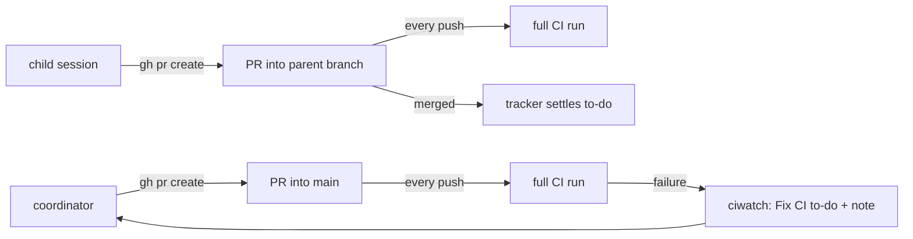
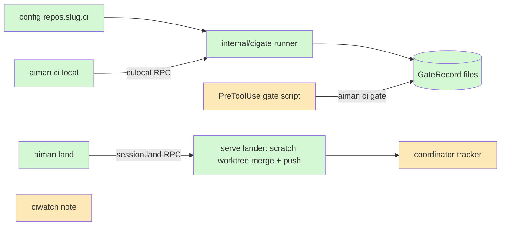
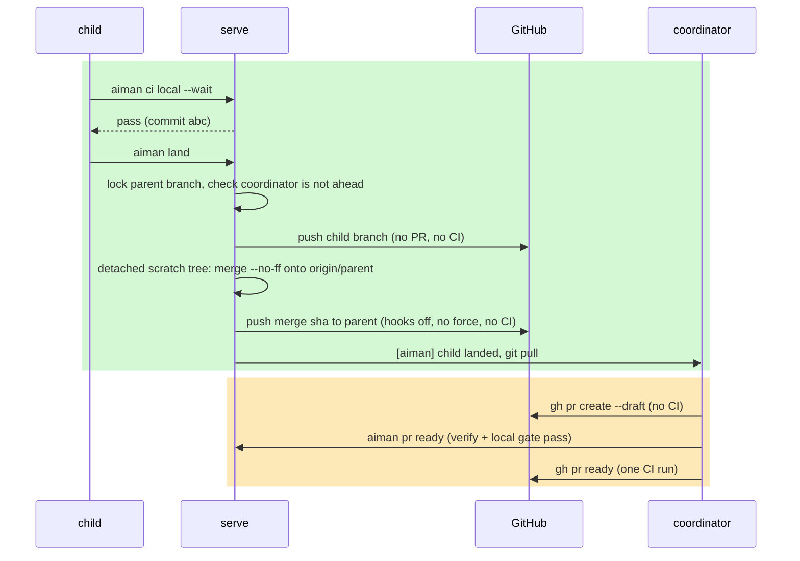

# ci-minutes: aiman spends GitHub Actions minutes once per change

**Revision:** 3 · **Size:** project · **Status:** approved
**Task:** realfi-co blew its Actions minutes in 10 days (Slack #C0C505N4QFK, Junaid's thread) · **Spec:** none yet

**Legend:** green = new, amber = changed, red dashed = removed.

## The problem

realfi-co used 57k Actions minutes from 1 to 10 November (131k in all of October). Almost all of it is pull-request CI: treasury-admin-dapp's `CI` costs about 54 job-minutes per push to a PR and `E2E` about 26; realfi's `CI (Offchain Branch)` about 57. aiman sessions under one login triggered 121 of the 207 treasury `CI` runs in a week, and about a third of them failed.

aiman makes three things expensive:

1. **Child PRs.** A coordinator's child opens a PR into the coordinator's branch. Both repos run PR CI for a PR into any branch, so each child pays a full run per push, and the final PR to main pays again.
2. **Early, non-draft PRs.** Agents open a ready PR as soon as they have something, then push every fix round to it. Each push is a full run. The repos are about to skip CI on draft PRs (separate change, in progress), but aiman never opens drafts.
3. **CI as the test runner.** Nothing stops an agent from pushing a change it has not checked locally. CI finds the failure, the watcher steers a fix, the fix is pushed, another full run starts.

## How it works today

- An agent opens its own PR with `gh pr create`. For Claude, a PreToolUse hook (`internal/agenthook/policy.go:31`, `verify-gate.sh`) blocks that call unless `aiman verify --gate` finds a passing review for the current tree hash (`cmd/aiman/verify_cmd.go:198`). Other agents are advisory.
- A child (`session create --for`) opens its PR into the parent's branch (skill: `internal/aimanskill/SKILL.md:302`). The tracker settles the child's to-do when that PR is merged, or open with a passing review when the parent verifies before PR (`internal/coordinator/track.go:174`, `landed`). It reads the PR with `gh pr view` in the child's worktree (`track.go:285`).
- The PR watcher (`internal/ciwatch`) polls watched PRs every 2 minutes. Each failed check becomes a `Fix CI: <name>` to-do and a steering note with the log tail (`internal/ciwatch/checks.go:65`), one check at a time.
- `verify.test_command` is one command per host, run by the reviewer in a snapshot. There is no per-repo list of what CI runs.



## Glossary

| Term | Meaning |
|---|---|
| Coordinator | A session that splits work into child sessions and opens the final PR. |
| Child | A session started with `session create --for <todo>`; it works on its own branch cut from the coordinator's. |
| Land | Get a child's commits onto the coordinator's branch. Today: a merged PR. |
| Local gate | The repo's CI checks run on the host before a push, from `repos.<slug>.ci.local`. |
| Gate record | The result of one local gate run for one commit, kept by serve. |
| Tree hash | `verify.TreeHash`: the hash of the working tree's content, used by verify to tie a result to exact files. |
| Draft PR | A GitHub PR not ready for review; with the repo change, CI does not run on it. |

## Proposed design

Three changes, one principle: a PR reaches CI once, when its content already passed the same checks locally.

### Domain model

```mermaid
classDiagram
    classDef new fill:#d4f7d4
    classDef changed fill:#fde9b8
    classDef removed stroke-dasharray:4,fill:#f9d0d0
    class RepoBootstrap {
      +CI RepoCI
    }
    class RepoCI {
      +Local []CICommand
      +Timeout duration
      +DraftsSkipCI bool
    }
    class CICommand {
      +Name string
      +Run string
      +Dir string
    }
    class GateRecord {
      +Session string
      +CommitSHA string
      +Status pass|fail|running
      +Results []CommandResult
      +StartedAt, FinishedAt
    }
    class LandResult {
      +Child string
      +ParentBranch string
      +MergeSHA string
    }
    class CoordinatorConfig {
      +ChildPRs bool
    }
    RepoBootstrap --> RepoCI
    RepoCI --> CICommand
    class RepoBootstrap:::changed
    class RepoCI:::new
    class CICommand:::new
    class GateRecord:::new
    class LandResult:::new
    class CoordinatorConfig:::new
```

- **Gate list.** `.aiman/ci-local.yaml` in the repository (the team's list, read from the commit being checked), with `repos.<slug>.ci.local` in the operator's config as an override. Each entry is `name`, `run`, optional `dir` relative to the repo root; `timeout` defaults to 45m.
- **`repos.<slug>.ci.drafts_skip_ci`** (default `false`): set it once the repo's workflows skip draft PRs. Only then does aiman treat a draft PR as free.
- **`GateRecord`**: one per session and **commit SHA**, at `~/.aiman/ci-local/<session>/<sha>.json` with a log per command beside it. The record for the current `HEAD` is never evicted; older ones are pruned to the newest 5.
- **`PRCache`** (serve, per `repo+branch`): number, `isDraft`, state, head sha. Written at once by `ci.gate kind:create`, `aiman pr ready` and ciwatch polls; on a miss serve runs `gh pr view --json number,isDraft,state,headRefOid` with a 3s budget.
- **`coordinator.child_prs`** (default `false`): `false` lands children through `aiman land` only; `true` keeps today's PR flow.

### Structure



- `internal/cigate` (new): runs the commands for a session's worktree, records the result, answers gate questions.
- `session.land` (new RPC) and the tracker change live in `internal/server` and `internal/coordinator`.
- The PreToolUse script parses the hook JSON's `command` field (not raw stdin) and gates `gh pr create`, `gh pr ready` and `git push`. It never calls `gh`: PR state comes from serve (`ci.gate` RPC, which reads the session's PR as ciwatch and the tracker record it). It exits 2 on a block and stays under its 15s timeout. It is installed when any repo has a gate list or `coordinator.child_prs` is false, independent of `verify.before_pr`.
- The hook is a guard rail, Claude only. The enforced paths are `aiman land` and `aiman pr ready`, which serve checks itself.

### Behaviour

**1. Children land locally** (`coordinator.child_prs: false`).

- A child cannot open a PR at all: `ci.gate kind:create` refuses every `gh pr create` from a session that has a parent (draft included) with `aiman: children land with aiman land, not a PR`, and the skill says the same. Only Claude's hook enforces it; another agent that ignores the skill can still open a PR, which is a known gap.
- The child commits, writes `.aiman_report.md`, and runs `aiman land`. `session.land` (caller must be a child; else `invalid_params`) checks, in order: the report validates (`ValidateReport`); the child's tree is clean with no untracked files; the verify review passed for `HEAD` when the parent verifies before PR; the gate record for `HEAD` is `pass` when the repo has a gate list.
- **Never the default branch.** `session.land` refuses `invalid_params` when the parent branch is the repo's default branch: land never pushes to `main`.
- **Lock.** Serve takes a blocking `flock` on one file per repo and branch, named like `worktreeBranchDir` flattens them (`internal/infra/git/manager.go:889`), e.g. `~/.aiman/land/realfi-co__treasury-admin-dapp@vault-limits.lock`. A second child waits until the first finishes or the land timeout (5 minutes) ends. The lock is held across fetch, parent check, merge and push.
- **Parent check.** After the lock and a fetch in the main clone, serve reads the coordinator's worktree: `symbolic-ref HEAD` must be `refs/heads/<parent>`, `origin/<parent>..HEAD` must be empty, and `status --porcelain` must show no tracked changes. Any of these failing, or git failing to answer (an `index.lock` while the coordinator commits), refuses `land_parent_diverged` and steers the coordinator: `[aiman] child <name> is waiting to land on <branch>: push or stash your changes.` The coordinator does not edit while children run, so this is rare.
- **Merge, as the fixer pushes today** (`PushFixTree`, `internal/infra/git/pr_worktree.go:239`): `worktree add --detach` at `origin/<parent>` under `~/.aiman/land/<child id>/`, `git merge --no-ff <child sha>` with aiman's committer identity set (as `internal/verify/snapshot.go:158` does), then from the main clone `git -c core.hooksPath=/dev/null push origin <merge sha>:refs/heads/<parent>`, never forced. A rejected push (someone else pushed) refetches and remerges, at most 3 times, then `land_busy`. The child branch itself is never pushed; the merge carries its commits. The scratch tree is removed on success, conflict and error alike. A conflict aborts and returns `land_conflict` with the files; the child merges `origin/<parent>` into its branch and lands again.
- **Record after push.** Only after the push succeeds does serve record `child.landed` (child, parent branch, merge sha) on both ledgers and steer the coordinator: `[aiman] child <name> landed on <branch> at <sha>. Run git pull --ff-only.`
- **Tracker.** With `child_prs: false`, `landed` is: the latest `child.landed` merge sha is an ancestor of `origin/<parent>` after a fetch in the main clone. The PR-merged arm is used only when `child_prs: true`. A branch push with no PR triggers no CI in either repo: their `on: push` workflows run only for `main`, `next` and `feat/native-evm` (realfi `deploy.yaml`, `eth-hardhat-invariants.yaml`; treasury-admin-dapp `deploy-preview.yaml`, checked 2026-11-10).

**2. One PR, ready once.**

- **Repo skips drafts** (`ci.drafts_skip_ci: true`): `gh pr create` must carry `--draft`; a draft is free and pushes to it are not gated. `aiman pr ready` makes it ready.
- **Repo does not skip drafts** (default): every open PR runs CI, draft or not. `gh pr create` is gated exactly like ready: verify plus a `pass` record for `HEAD`. The skill says: open the PR only when it is ready.
- `aiman pr ready` (new CLI, RPC `ci.ready`): requires a clean tree, `HEAD` pushed and equal to the PR head, verify passed for `HEAD` (as today's gate), and a `pass` record for `HEAD`. Then serve runs `gh pr ready`. A raw `gh pr ready` is blocked by the hook. The coordinator's final PR follows the same rule.

**3. The local gate.**

- `aiman ci local [--wait]` (RPC `ci.local {session}`) requires a clean tree and runs against `HEAD`'s commit in a detached snapshot worktree (`verify.AddDetachedWorktree`), so the agent keeps editing without racing it. `ci_running` refuses a second run for the same session, never editing. At most 2 gate runs per host run at once; more queue. Commands run with `bash -lc` at the agent's nice level, stop at the first failure, and the record is keyed by the commit SHA.
- **Snapshot isolation.** The snapshot never uses `ApplyWorktreeBootstrap`: it copies only the `repos.<slug>.copy` files (e.g. `.env.local`), never symlinks, and runs the gate file's `setup` (its own `node_modules`, from the package manager's cache) before the commands. The snapshot is removed when the run ends, fails or is cancelled.
- `aiman ci status` prints the record for `HEAD` and, for a failure, the failing command and the last 60 lines of its log.
- **Push gate** (`ci.gate {session, kind: push}`, local record only, never verify; the hook never calls `gh`): serve looks the branch up in its `PRCache`, asking `gh` itself on a miss (3s). When the branch has an open PR that runs CI (non-draft, or any PR when the repo does not skip drafts), the record for `HEAD` must be `pass`. Only a plain `git push`, `git push origin`, `git push -u origin HEAD` or `git push origin <current branch>` is judged; a refspec naming another commit and a compound command (`&&`, `;`, pipes) are refused with `push the current branch in its own command after committing`. No PR passes. When the lookup fails and the repo has a gate list, the push is treated as gated.
- **ciwatch** sends one note per finished run listing every failed check, ending: `Fix every failed check, run aiman ci local --wait, then push once. Pushes are refused until the gate passes for the new commit.`



## A scenario, end to end

A coordinator on `realfi-co/treasury-admin-dapp`, branch `vault-limits`, whose `.aiman/ci-local.yaml` lists `bun install --frozen-lockfile`, `bun run lint`, `bun run typecheck`, `bun run test:unit`, `cd api && bunx vitest run`.

1. It starts children `vault-limits-api` and `vault-limits-ui` with `--for`. Each works on its own branch cut from `vault-limits`.
2. `vault-limits-api` finishes and runs `aiman ci local --wait`. `typecheck` fails; it fixes and reruns; after committing, all pass for commit `9f1c…`. Verify passes for the same tree.
3. It runs `aiman land`. Serve takes the `vault-limits` lock, sees the coordinator is level with origin, pushes `vault-limits-api`, merges it into `origin/vault-limits` in `~/.aiman/land/<id>/`, pushes `vault-limits`. No PR exists, so no workflow runs. The coordinator gets `[aiman] child vault-limits-api landed on vault-limits at 3b2e…`, and the tracker ticks the to-do.
4. `vault-limits-ui` runs `aiman land`; its merge conflicts in `app/src/limits.ts`. It gets `land_conflict`, merges `origin/vault-limits`, reruns the gate, lands.
5. The coordinator pulls, runs `aiman ci local --wait`, opens `gh pr create --draft --base main` (no CI), then `aiman pr ready` (treasury-admin-dapp skips drafts once its workflow change lands). One CI run and one preview deploy happen. Today this flow costs at least three full runs plus one per fix push.

## Alternatives considered

- **Coordinator merges children itself with git.** Lost: the coordinator's worktree may be mid-edit, and an agent resolving another agent's conflicts goes wrong quietly. Serve merges in a scratch worktree and hands conflicts back to the child who wrote the code.
- **Push child branches and open PRs as drafts.** Lost: still clutters GitHub with PRs nobody reviews, and depends on every repo skipping drafts.
- **Reuse `verify.test_command` as the gate.** Lost: it is one command per host, runs inside the reviewer's snapshot after an LLM review, and its result means "reviewed", not "CI would pass". The gate is per repo and cheap to rerun; verify still runs before ready.
- **A git `pre-push` hook in the worktree.** Lost: worktrees share hooks with the main checkout, and repos set `core.hooksPath` (husky).
- **Calling `gh pr view` from the push hook.** Lost (consult): too slow inside the hook's 15s budget, and a cached draft flag lets pushes through after ready. Serve's own PR record answers instead.
- **Gate keyed by the live tree hash, run in the session worktree.** Lost (consult): what is pushed is a commit, and a 45-minute run in the live worktree races the agent. A commit in a snapshot cannot change.
- **Run the gate in the review sandbox.** Deferred: offline sandbox cannot `bun install`; the session already runs this code on the host.

## Open questions

1. **Default for `coordinator.child_prs`.** `false` saves the most and is what this design assumes. `true` keeps a reviewable PR per child on GitHub. Cost of `false`: child work is reviewed only by verify and the coordinator's final PR.
2. **Who writes `.aiman/ci-local.yaml` for realfi and treasury-admin-dapp?** Proposed: a small PR per repo from Junaid's list, reviewed by the team, since it becomes the team's shared pre-PR check.

## Decisions

| Objection | Severity | Triage | Reason |
|---|---|---|---|
| Serve cannot check out the coordinator's branch; use a detached tree and push the sha from the main clone with hooks off | high | accept | Behaviour 1 now mirrors `PushFixTree`. |
| Serve's push races the coordinator's checkout and other children | high | accept | Per-branch lock, `land_parent_diverged` when the coordinator is ahead or dirty. |
| Drafts are not free until the repos skip them | high | accept | `ci.drafts_skip_ci` per repo; without it every PR create is gated like ready. |
| Children can still open draft PRs and restore child CI | high | accept | Every `gh pr create` from a child is blocked when `child_prs` is false; PR arm of `landed` only when true. |
| A `git push` hook calling `gh` will time out, false-block or be bypassed | high | accept | Hook parses `command`, exits 2, never calls `gh`; serve answers from its PR record; enforcement sits in `aiman land` and `aiman pr ready`. |
| Live tree hash, HEAD tree and continued editing disagree | high | accept | Record keyed by commit SHA, clean tree required, run in a detached snapshot. |
| Which clone the tracker fetches; record only after push | medium | accept | Main clone fetch; `child.landed` only after a successful push. |
| Cached `gh pr view` draft flag is wrong after ready | medium | accept | No `gh` in the hook; fail closed only for a PR serve last saw as gated. |
| Gate script installed only with `before_pr` | medium | accept | Installed from gate lists or `child_prs: false`. |
| `--push` would also run verify | medium | accept | Push checks the local record only. |
| Operator-local list drifts from CI | medium | accept | Repo-owned `.aiman/ci-local.yaml`, operator config overrides. |
| Keeping 5 records evicts the current HEAD's | low | accept | Current HEAD's record is never pruned. |
| One note per run saves no minutes by itself | low | accept | Note now says pushes are refused until the gate passes; push gate enforces it. |
| Push gate reads ciwatch state that interactive sessions never fill and that has no `isDraft` | high | accept | Serve-owned `PRCache` per repo and branch, written by create and ready, `gh` on a miss inside serve (3s), unknown is gated. |
| Snapshot bootstrap shares the live `node_modules` | high | accept | Snapshot copies only `copy` files, never symlinks, runs the gate's own `setup`; removed on every exit. |
| Lock path not unique, non-blocking lock fails the second child | high | accept | Flattened name like `worktreeBranchDir`, blocking flock with a 5-minute land timeout. |
| Branch pushes may bill CI; extra child-branch push | high | accept | Checked both repos' `on: push` (main, next, feat/native-evm only); land pushes only the merge sha and never to the default branch. |
| `land_parent_diverged` does not pin the coordinator to the parent branch | medium | accept | `symbolic-ref`, `origin/<parent>..HEAD`, `status --porcelain`, refuse on any git error. |
| Child PR block is Claude-only | medium | accept | `ci.gate kind:create` refuses; other agents rely on the skill, recorded as a known gap. |
| `rev-parse HEAD` is not the pushed refspec | medium | accept | Only plain current-branch pushes are judged; other refspecs and compound commands are refused. |
| Local list without E2E still pays a failing CI run | medium | accept | Gate file must cover every required job; what cannot run locally is listed under `not_local` and shown. |
| Merge identity and scratch cleanup | low | accept | Committer identity set; scratch removed on every exit. |
| B and C both own SKILL.md | low | accept | C owns `SKILL.md`; B ships no skill text. |

## Breakdown

| Piece | Owns files | Parallel group | Depends on | Complexity | Tier | Acceptance tests |
|---|---|---|---|---|---|---|
| A. Local gate: repo file and config, snapshot runner, records, `ci.local`/`ci.status`/`ci.gate` RPC and CLI | `internal/cigate/*`, `internal/infra/config/repos.go`, `cmd/aiman/ci_cmd.go`, `internal/server/handlers_ci_local.go`, openapi | 1 | none | M | smart | `go test ./internal/cigate/ -run Acceptance`, `go test ./internal/infra/config/ -run TestRepoCI` |
| B. Land: `session.land`, lock, detached merge and sha push, tracker `landed`, `coordinator.child_prs`, skill text | `internal/server/handlers_land.go`, `internal/coordinator/track.go`, `internal/infra/git/land.go`, `cmd/aiman/land_cmd.go` | 1 | none (gate check stubbed until A) | L | smart | `go test ./internal/infra/git/ -run TestLand`, `go test ./internal/coordinator/ -run TestLandedLocal`, `go test ./internal/server/ -run TestSessionLand` |
| C. Hook and ready: JSON-parsing hook, install rule, child PR block, `aiman pr ready`, ciwatch note batching, skill text | `internal/agenthook/policy.go`, `internal/agenthook/install.go`, `cmd/aiman/pr_cmd.go`, `internal/ciwatch/checks.go`, `internal/aimanskill/SKILL.md` (Coordinator and PR sections) | 2 | A, B (skill file) | M | smart | `go test ./internal/agenthook/ -run TestDraftGate`, `go test ./cmd/aiman/ -run TestPRReady`, `go test ./internal/ciwatch/ -run TestOneNotePerRun` |

## What you should be able to explain after reading

1. Why a child PR into a coordinator branch costs a full CI run in realfi-co repos, and why landing locally costs none.
2. What `aiman land` checks before it merges, and what happens on a conflict.
3. Why PRs open as drafts and what `aiman pr ready` requires.
4. When a `git push` is gated and when it passes freely.
5. Why the gate record is keyed by commit and runs in a snapshot, and when a draft PR is free.
