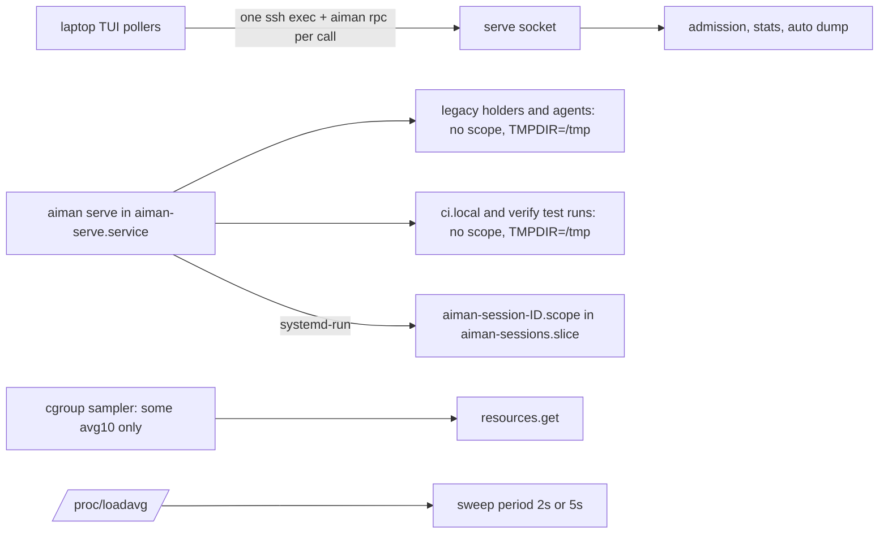
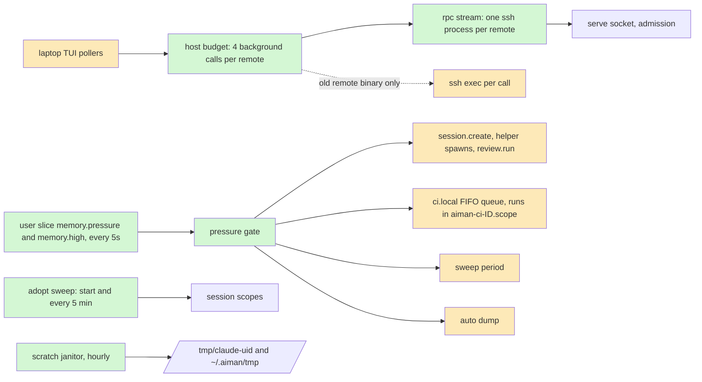

# Client pile-up guard: close the gaps the load guard and session limits left open

**Revision:** 2 (rev 1 checked against the code at v0.49.0, `b6c3f11`) · **Size:** project · **Status:** draft, not approved
**Task:** operator, 2026-11-13: "aiman recently introduced updates to mitigate these kinds of things - how can it improve?" after a second swamp of `regent0` with v0.49.0 installed.
**Builds on:** `docs/specs/serve-load-guard.md` (v0.39.0) and `docs/superpowers/specs/2026-11-12-session-resource-limits.md` (#152, #154). Read both first; this spec does not repeat them.

Legend: **new**, *changed*, ~~removed~~. Diagram classes:

```
classDef new fill:#d4f7d4
classDef changed fill:#fde9b8
classDef removed stroke-dasharray:4,fill:#f9d0d0
```

## The problem

At 11:30 SAST on 2026-11-13, `regent0` reached a load average of 484, with 52 processes in `D` state. The host had 33G available, but `user-1004.slice` was at 25G, above its 24G `MemoryHigh` and below its 32G `MemoryMax`, with memory PSI `full avg10` at 96%. File cache in the slice was close to 0, and 8.5G of pages had to be reread from disk (`workingset_refault_file`), so every exec stalled while its binary was paged back in. The operator recovered the host by killing 169 `aiman rpc` processes and deleting 6.3G of old `/tmp/claude-1004` scratch. PSI dropped from 96% to 33% within a minute.

What the host recorded and what the code says, ranked by weight. Each item says what rev 1 claimed and what the code check found.

1. **Most memory was outside every scope. Confirmed, and wider than legacy sessions.** `aiman-serve.service` held 13G: 12 `claude` agents and 14 holders started before #152, which stay in serve's cgroup until restarted (AGENTS.md gotcha 13). `aiman session adopt-scope` exists and nothing calls it but the CLI (`internal/server/handlers_adopt.go:87`, `cmd/aiman/session_cmd.go:540`). Two things rev 1 missed:
   - Serve's own children always run in serve's cgroup, on any version: `ci.local` runs (`internal/cigate/proc_unix.go:13`, a plain exec with `Setpgid`), the verify test command (`internal/verify/evidence.go:57`), agent updates and the design publisher. A `make ci` is charged to `aiman-serve.service`, with no memory limit and with `/tmp` as its `TMPDIR`.
   - cgroup v2 does not move memory that is already charged. Adopting a 2G agent moves the process; its 2G stays charged to `aiman-serve.service` until the agent frees it. Adoption bounds what the session allocates from then on. Only a restart moves the whole charge.
   The serve unit is `MemoryLow=512M`, `CPUWeight=200`, `IOWeight=200`, `KillMode=process` (`internal/infra/remotesvc/remotesvc.go:111,124`); those settings apply to everything in the unit, legacy agents and CI runs included.
2. **The laptop TUI starts a process per call, and those pile up before admission. Confirmed in mechanism, wrong in detail.** `usecase.ServeRPC` (`internal/usecase/serve_rpc.go:55`) runs `printf … | base64 -d | aiman rpc <method> --params-stdin` through `ssh.Manager.Execute` (30s local timeout, no remote timeout) for every call. Under page-cache thrash each exec sits in `D` while its binary is paged in, so it never reaches serve's socket, and admission, the per-caller bucket and the auto dump (all on the socket) see nothing: `aiman host stats` showed `inflight 1` in the same minute. Corrections:
   - A local timeout does not multiply the call: the SSH manager retries only on transport error text, not on a deadline (`internal/infra/ssh/manager.go:194-229`).
   - `ci.get`, `todo.get` and `usage.get` are not on a timer. Selection and events trigger them, and each has an in-flight guard per session. The guard clears when the local call times out while the remote process is still stalled, so every trigger after that adds one. The guards are per session or per host and nothing bounds a remote as a whole.
   - Unguarded today: `todo.summary` (one call per `todo_changed` of an unselected session, `internal/ui/todo_fetch.go:63`; 25 agents mirroring their task lists make this the burst), git status (30s tick, several execs), the three daemon probes per host, the `$` view's `limits.get` and `usage.get`.
   - `resources.get` is missing from the `aiman rpc` allowlist (`cmd/aiman/rpc_cmd.go:16-43`), so the TUI's 10s poll per host (`internal/ui/resources.go:54`) starts a process that answers `unknown method` before it dials. The memory gauge of #152 has never drawn on a laptop, and the poll is pure cost.
   - `notify.since` is not a TUI call (notifications ride the event stream), and `aiman-gateway` dials serve's socket in process (`internal/gateway/rpc.go:44`). Rev 1's gateway back-off is dropped.
   - Whether sshd signals the remote child when the local ssh dies cannot be read from the code. A process in `D` ignores signals until its page fault returns in any case. Once running, `aiman rpc` is bounded by a 2s dial and a 30s deadline (`internal/server/client.go:251,256`).
3. **Claude scratch in `/tmp`. The lead in rev 1 is wrong: no agent spawn path misses `CLAUDE_CODE_TMPDIR`.** Every agent pty, including handover children, consults, reviewers, fixers and review sessions, is created through `CreateSession` → `aiman pty create` → `handlePTYCreate`, which applies `tmpEnv` (`internal/server/handlers_pty.go:59-68`). The handover directories dated 2026-11-12 18:01 and 18:25 predate the v0.46.0 tag (18:58 SAST the same day). What still writes to `/tmp`:
   - holders started before the upgrade: their environment is fixed at start, and adoption does not change it;
   - serve's own children (item 1): `go test` under `ci.local` builds in `$TMPDIR`, which is `/tmp`;
   - the `review.debug` pty, the one direct `pty.Create` that passes no env (`internal/server/review_debug.go:92`).
   Nothing ever deletes `/tmp/claude-<uid>`: `forgetResources` removes only `~/.aiman/tmp/<id>` and the limit override (`internal/server/resources.go:136-144`). Rev 1's `native_agent_id` does not exist; the field is `AgentSessionID`.
4. **Load average is the wrong signal. Confirmed, and the replacement signal is not there yet.** The only decision on `/proc/loadavg` is the sweep period (`internal/server/loadavg.go:31`). The cgroup sampler parses only the `some` line of `memory.pressure` (`internal/cgroup/sample.go:232-250`), every 10s, and does not run at all without a user systemd or with `resources.enabled: false`. The `Alerter` zeroes pressure for the slices, clears at once and belongs to the sampler goroutine, so it cannot serve as a gate.
5. **The local CI gate starts heavy jobs with no regard for the host. Partly wrong.** A host cap exists: `Runner.MaxParallel` is 2 (`cmd/aiman/serve.go:186`), and a third run blocks in an unordered channel wait while its record already says `running` (`internal/cigate/runner.go:380-397`), so a queued run cannot be told from a running one. Nothing looks at pressure, and (item 1) the runs are unlimited and charged to serve.

## How it works today



- Laptop calls: `internal/usecase/serve_rpc.go`, `internal/infra/ssh/manager.go`, pollers in `internal/ui/{resources,todo_fetch,pr_watch,usage_fetch,usage_limits,preview_refresh}.go`.
- Scopes and adoption: `internal/cgroup/{systemd,adopt,sample,alerts}.go`, `internal/server/{resources,handlers_adopt,handlers_resources}.go`.
- CI runs: `internal/cigate/runner.go`, `internal/server/handlers_ci_local.go`.
- Diagnostics: `internal/server/{dump,admission,loadavg}.go`, `internal/hoststats`.

## Glossary

- **Scope**: the systemd transient unit `aiman-session-<id>.scope` a session's processes run in; it carries the memory limits.
- **Unscoped**: a running holder whose cgroup is not a session scope.
- **PSI**: pressure stall information. `some` is the share of time at least one task in the cgroup was stalled on memory; `full` is the share of time every runnable task was. One session throttled at its own limit raises the user slice's `some`; only a host-wide stall raises its `full`.
- **Pressure gate**: serve's open or closed answer to "may new heavy work start now".
- **Host budget**: the laptop's cap on background calls in flight per remote.
- **RPC stream**: one long-lived `aiman rpc --stream` process per remote that carries the laptop's calls.

## Proposed design

### Domain model

```mermaid
classDiagram
  classDef new fill:#d4f7d4
  classDef changed fill:#fde9b8
  classDef removed stroke-dasharray:4,fill:#f9d0d0
  class PressureGate {
    closed bool
    since time
    memory_some, memory_full float
    slice_over_high bool
  }
  class HostBudget { slots 4 per remote; cooldown 60s after a timeout }
  class RPCStream { one ssh process per remote; requests by id }
  class CIQueue { FIFO; parallel 1; position }
  class ResourcesReport { unscoped[]; serve_unit; gate }
  class ScratchJanitor { hourly; freed_bytes }
  PressureGate:::new
  HostBudget:::new
  RPCStream:::new
  CIQueue:::changed
  ResourcesReport:::changed
  ScratchJanitor:::new
```

### Structure



### Behaviour

**P0: adopt unscoped sessions automatically.** Safe to run unattended, with the conditions below; the check found no way for it to move the wrong process or to throttle a session on adoption.

- **new** `Server.adoptSweep`, 30s after serve starts and every 5 minutes: for each running holder, read `cgroup.Of(holderPID)` (one file read); when it is not under the sessions slice, run the adopt path for that scope key with `resources.session` defaults merged with the session's override (the handler's body after its operator check, extracted so the sweep and `session.adopt_scope` share it). The ledger row `resources.adopted` carries actor `aiman`. Steady state costs one file read per holder and no exec.
- The sweep does not run when `cgroup.Probe` failed or `resources.enabled` is false, and it checks once that serve itself is inside the user manager's subtree: under the nohup supervisor the kernel refuses the move, so serve logs one line and never tries. A session whose adoption fails is logged once and not retried until serve restarts.
- Why it is safe: `Systemd.Adopt` is idempotent (`moved` 0 when all are inside), re-lists the tree for up to 5 passes against forks, and a later sweep takes stragglers. Helper ptys share their parent's key; helpers with a row get their own scope, as at create. The `AIMAN_ID` environ match reads only processes in serve's own cgroup that descend from no holder. The new scope starts near zero charge, so its limits cannot throttle the session at the moment of adoption.
- What it does not do, said in the CLI and the docs: memory already charged stays with `aiman-serve.service`, and the session keeps its old `TMPDIR`. `aiman resources` prints, per adopted or unscoped legacy session, `restart to move its memory and scratch`.
- *changed* `resources.get` gains `unscoped: [{id, name}]` (running holders outside a scope, including while adoption is impossible) and `serve_unit` (a `Usage` for serve's own cgroup, read like the slices), so the residue is visible. `aiman resources` prints both. The TUI header gauge turns to the warning colour while `unscoped` is not empty.
- ~~`aiman update` prints a count of unscoped sessions~~: dropped. `aiman update` replaces the laptop binary and never talks to serve, and the sweep at serve start makes the message moot.

**P1: one RPC stream per remote, not a process per call.**

- **new** `aiman rpc --stream` (`cmd/aiman/rpc_stream.go`): reads one `{"id","method","params"}` line at a time from stdin, checks the method against `rpcMethods`, runs each call in its own goroutine with `server.CallRaw` (a socket dial per call, inside the one process), and writes `{"id",…response}` lines to stdout under a mutex, so answers may come out of order. At most 8 calls in flight; a ninth answers `server_busy` at once. Its first line is `{"stream":1}`. EOF on stdin ends it. Serve's protocol and socket loop do not change.
- **new** `usecase.rpcStream`, one per remote: a dedicated `ssh … exec aiman rpc --stream` started like the `session.events` stream (`ssh.Manager`, its own connection, not the ControlMaster, because `ResetControlSocket` ends every multiplexed channel), on first use. A call writes its line and waits for its id under the caller's deadline; a call that times out is forgotten on the laptop and its late answer dropped, and no process is left on the host. When the stream dies, pending calls fail and it restarts with backoff (1s, 2s, 5s, then 30s).
- *changed* `ServeRPC` uses the stream. It falls back to the per-call exec only when the remote binary has no `--stream` (the process exits without the hello line and its output matches `rpcUnsupportedMarkers`), remembered per remote until a daemon probe shows another serve version. While the stream is down for any other reason calls fail fast with `ErrServeUnreachable`; they never fall back to exec, because that is the pile-up.
- *changed* `rpcMethods` gains `resources.get` and every other method the TUI passes to `ServeRPC`; an acceptance test parses the `ServeRPC` call sites so a new one cannot be forgotten.
- Result: polling costs no process on the host, and every laptop call passes admission, where `aiman host stats` counts it.

**P2: a budget per remote on the laptop.** Replaces rev 1's single-flight per method and adaptive intervals with one mechanism that also covers calls that are not RPCs.

- **new** `usecase.HostBudget`: 4 slots per remote for background calls. Background means started by a tick or an event, not by a key: `resources.get`, `todo.summary`, `todo.get`, `ci.get`, `usage.get` and its `session.get`, the `limits.get` and `agents.status` polls, git status, daemon probes and the preview capture. A background call that finds no slot is skipped (the next tick or event asks again); a call the operator made by pressing a key does not take a slot and is never skipped.
- A call that ends in a local timeout keeps its slot for 60 more seconds, because its remote process may still be stalled. With 4 slots and a 30s timeout, a host that answers nothing gets at most 4 new processes every 90 seconds from one TUI, whatever the pollers do, and none once P1's stream is up.
- *changed* `todo.summary` gets the per-session guard and trailing fetch `todo.get` already has, so a burst of `todo_changed` events costs one call per session.
- The existing per-session and per-host guards stay; the budget sits under them.

**P3: gate new heavy work on memory pressure.**

- **new** `internal/cgroup/pressure.go`: `ReadPressure(dir)` parses the `some` and `full` lines of `memory.pressure`. **new** `Server.runPressure` reads the user slice (`user-<uid>.slice`, found from `/proc/self/cgroup`, so it works under the nohup supervisor and with `resources.enabled: false`) every 5 seconds: `memory.pressure`, `memory.current` and `memory.high`. Where there is no such cgroup it reads `/proc/pressure/memory`; elsewhere than Linux the gate is always open. It does not depend on the sampler.
- The gate closes when `full avg10 >= 20`, or when `memory.current >= memory.high` (the slice is being throttled, which is what the incident was). It opens after 30 seconds in a row with `full avg10 < 10` and `memory.current < 95%` of `memory.high`. It is its own small state machine with a mutex; the `Alerter` is not reused. `some` is reported and never gates: one session held at its own `memory_high`, which is harmless by design, drives the slice's `some` up.
- Config `host.load.pressure_gate`: `{enabled (unset is on), memory_full_avg10: 20, reopen_full_avg10: 10, hold: 30s}`, pushed with `host` by `MarshalServeConfig`.
- While closed:
  - `session.create` (consults included) and every hidden-helper spawn through `serverSessions.CreateChild` (reviewers through `verify.start`, fixers, `review.assess`), `review.run` and `review.coverage` answer **new** `host_under_pressure` with `data: {retry_after_ms: 30000, memory_full_avg10, memory_some_avg10, since}`. The client does not retry it. `session.create {force: true}` and `review.run {force: true}` pass; `force` from a session caller is `needs_operator`.
  - A handover write still writes the mechanical file and starts no child; the run is recorded `failed` with error `host under pressure`, which is the existing fallback path.
  - `session.restart`, `session.terminate`, revive and `pty.create` are never gated: restarting or ending a session is how memory comes back.
  - The state sweep runs at its 5s period (the load average keeps doing the same).
- On closing serve emits one notification `host_pressure` (NeedsYou true, empty session id, text `<host> is under memory pressure: full <n>%, slice <cur>/<high>; new sessions, reviews and CI runs wait`), at most once per 10 minutes, and logs opening and closing. The phone sink does not push the kind.
- *changed* `host.stats` and `resources.get` carry `gate: {closed, since, memory_some_avg10, memory_full_avg10, slice_over_high}`; `aiman host stats` prints `pressure: memory some <n>% full <n>%` and `gate: open|closed since <t>`. The TUI header gauge reads `pressure` in the warning colour while the gate is closed.
- Skill text: on `host_under_pressure`, do not retry in a loop; wait at least `retry_after_ms`, or for the next note.

**P3b: CI and verify runs get a queue, a scope and a disk TMPDIR.**

- *changed* `cigate.Runner`: a FIFO queue. `host.load.ci_parallel` (default 1) runs at a time per host; a run starts only while the gate is open. `Prepare` writes the record as **new** status `queued`; it turns `running` when its turn comes. `ci.status` gains `queue_position` (1 is next), and `aiman ci local --wait` prints `queued (position n)` while it polls. A `queued` record whose run is not in this serve reads as failed, like `running`. `ci_running` now also covers a queued run of the same session.
- *changed* Each run, and the verify test command, starts through the scoper as `aiman-ci-<session id>.scope` in `aiman-sessions.slice` with the `resources.session` limits, and with `TMPDIR` set to the session's `~/.aiman/tmp/<scope key>`. The run stops being charged to serve, cannot take the host past the sessions slice's limit, and builds on disk. Without a user systemd it runs as today, with the `TMPDIR` only. The scope is the run's own, not the session's, so a CI run cannot throttle the agent that is waiting on it.

**P4: scratch cleanup.**

- *changed* `review.debug` passes `tmpEnv` like every other pty.
- *changed* `forgetResources` (forget and terminate) also removes `/tmp/claude-<uid>/<slug>/<AgentSessionID>` when the row has an `AgentSessionID`, with the slug rule `transcript.Locate` uses; an empty slug directory left behind is removed. It covers sessions that started before the TMPDIR change.
- **new** scratch janitor (`internal/server/scratch.go`), 10 minutes after serve starts and every hour, `resources.scratch_janitor` unset is on:
  - `/tmp/claude-<uid>/<slug>/<id>`: removed when `<id>` is not the `AgentSessionID` of a session whose holder runs and nothing in its tree was modified in the last 24 hours (the walk stops at the first recent file); empty slug directories go too.
  - `~/.aiman/tmp/<id>`: only directories, only when `<id>` is no stored session, no running pty and not a scope key, and nothing inside was modified in 24 hours. Files there (`aiman-pty-<id>.json`, `host-update-<tag>.sh`) are never touched.
  - It never follows symlinks, never leaves those two roots, and logs one line per pass with the bytes freed, which `host.stats` reports as `scratch: {freed_bytes, last_run}`.
  - Known cost: a Claude process aiman does not run, idle for a day, loses its old task output. The operator's tmpfiles rule (2 days) already does the same.

**P5: diagnostics that see client-side pile-ups.**

- *changed* the auto dump also fires when the gate's `full avg10` has stayed at or above 50 for 30 seconds (`autoDump.due(now, atCap || psiHigh)`), under the same 10-minute spacing.
- **new** process census in `internal/hoststats`: from `/proc/<pid>/stat` only, the count of processes whose comm is `aiman`, by state (`R`, `S`, `D`) and by parent (comm and pid, top 5), leaving out serve and the holders. The dump and `host.stats` (`aiman_procs`) include it. Over 32 of them serve logs, at most once a minute, `procs: 169 aiman processes outside holders, 52 in D, parents: sshd-session 3834565 (26)`.
- ~~by subcommand~~: dropped. The subcommand is in `/proc/<pid>/cmdline`, which `hoststats` never reads because arguments can hold secrets. State and parent already name the incident.

### Contracts

```go
// internal/server
type PressureGate struct {
    Closed          bool      `json:"closed"`
    Since           time.Time `json:"since"`
    MemorySomeAvg10 float64   `json:"memory_some_avg10"`
    MemoryFullAvg10 float64   `json:"memory_full_avg10"`
    SliceOverHigh   bool      `json:"slice_over_high"`
}
const CodeHostUnderPressure = "host_under_pressure" // data: retry_after_ms, memory_full_avg10, memory_some_avg10, since

// internal/cgroup
type Pressure struct{ SomeAvg10, FullAvg10 float64 }
func ReadPressure(dir string) (Pressure, error)

// internal/usecase
type HostBudget struct{ /* 4 slots per remote, 60s cooldown after a timeout */ }
func (b *HostBudget) TryAcquire(remote string) (release func(timedOut bool), ok bool)
```

- `resources.get`: `unscoped`, `serve_unit`, `gate`. `host.stats`: `gate`, `scratch`, `aiman_procs`. `ci.status`: record status `queued`, `queue_position`.
- `aiman rpc --stream` lines: request `{"id":"7","method":"todo.get","params":{…}}`, response `{"id":"7","result":…}` or `{"id":"7","error":{…}}`.
- Config: `host.load.pressure_gate`, `host.load.ci_parallel`, `resources.scratch_janitor`.

## A scenario, end to end

Serve restarts into this release on `regent0` with 12 legacy agents. Thirty seconds later the adopt sweep moves each into its own scope; `aiman resources` lists them with `restart to move its memory and scratch`, and `serve_unit` still shows the 13G they hold. Three children finish and run `aiman ci local --wait`: one runs in `aiman-ci-<id>.scope` with its build files in `~/.aiman/tmp`, the other two print `queued (position 1)` and `(position 2)`. A legacy agent starts a large build and the user slice passes its `MemoryHigh`. Within 5 seconds the gate closes: the queued CI runs stay queued, a coordinator's `session create --for` answers `host_under_pressure` and it waits, the operator gets one `host_pressure` notification, and the TUI header reads `pressure`. On the laptop every poll rides the one `aiman rpc --stream` process, so `aiman host stats` shows the operator's calls and the host gains no process; had the stream been down, the budget would have let 4 calls start and then held their slots. The operator restarts the big legacy session, which lands in a scope with its scratch on disk. Thirty seconds after pressure falls the gate opens and the next CI run starts.

## Alternatives considered

- **Rate-limit the operator at the socket** (open question 1 of the load guard): lost. The calls never reached the socket.
- **Forward serve's socket with `ssh -L`**: lighter on the host, lost for this cut: it depends on each host's sshd configuration and on the socket path limit (gotcha 15). A follow-up if the stream proves heavy.
- **Carry requests on the `session.events` channel**: lost; it is one-way, and mixing calls into it couples two failure modes.
- **Single-flight per method plus adaptive poll intervals** (rev 1): lost to the host budget. The guards per session already exist, most of the listed calls are not on a timer, and a per-method rule does not bound a remote or cover git status and probes.
- **A remote `timeout` around `aiman rpc`**: lost; it is one more exec under thrash, a process in `D` ignores the signal until it runs, and a running `aiman rpc` is already bounded at 32s.
- **Gate on PSI `some`** (rev 1): lost; a single session at its own limit trips it. `full` and the slice's own `memory.high` are the host-wide signals.
- **Reuse the `Alerter` for the gate** (rev 1): lost; it clears at once, drops slice pressure and is not safe off the sampler goroutine.
- **Gate `session.restart`** (rev 1): lost; restart is the remedy.
- **Run CI inside the session's own scope**: lost; a `make ci` would throttle the agent waiting on it, and the run could not be told apart in `resources.get`.
- **Raise the slice limits**: lost; the host had room, the scoped sessions were never the problem.
- **Kill or force-restart unscoped sessions on upgrade**: lost; adoption keeps the operator's work and says what a restart would add.

## Open questions

1. **Gate thresholds.** Close at `full avg10 >= 20` or slice at `memory.high`; open below 10 for 30s. The incident read 96 and, a minute after recovery, 33. There is no baseline for a normal busy day on `regent0`. Option: ship with these defaults and enforce (recommended; `force` and the config are the escape), or ship `enabled: false` for a week and read `host.stats` first.
2. **`ci_parallel` default.** 1 (recommended; the operator's draft) or keep 2. With 1, four children landing in a row wait in line for `make ci`.
3. **Should the preview capture and git status move onto the stream too?** They are not RPCs today. Default: no for this cut; the budget bounds them at 4 per remote.
4. **Should the stream carry `session.events` and `pty.attach`?** Default: no.
5. **Janitor and Claude sessions aiman does not run.** Default: treat them like any other idle scratch (24h). Alternative: only delete ids aiman once knew, which leaves most of the 424 directories in place.

## Decisions

Rev 1 to rev 2, from the code check (no consult yet):

| Rev 1 said | Finding | Change |
|---|---|---|
| Handover, consult or review spawns may miss the session env | Every agent pty passes `handlePTYCreate` and `tmpEnv`; the dated directories predate v0.46.0 | P4 drops the spawn-path work, keeps cleanup, adds `review.debug` and serve's own children (P3b) |
| Nothing queues a second `ci.local` | `MaxParallel` 2 with an invisible unordered wait | P3b makes the queue FIFO, visible and gated |
| Adopt with the session's stored limits from `internal/cgroup/adopt.go` | Selection, limits, operator check and ledger are in `handlers_adopt.go`; charged memory does not move; fails under nohup | P0 extracts the handler body, reports `serve_unit` and `unscoped`, checks serve's own cgroup once |
| Poll ticks stack `ci.get`, `todo.get`, `usage.get`; add single-flight and adaptive intervals; same for the gateway | They are event driven and guarded per session; `todo.summary`, git status and probes are not; the gateway dials in process | P2 is a per-remote budget with a cooldown; gateway dropped |
| `resources.get` polls reach serve | Not in the `aiman rpc` allowlist: every poll fails before the dial | P1 adds it, with a test over the call sites |
| Stream over the ControlMaster | `ResetControlSocket` would end it; the events stream uses its own connection | P1 uses a dedicated connection |
| Gate on `some avg10 >= 40`, reuse alert logic, read from the sampler | Only `some` is parsed; sampler is off without systemd; `some` trips on one throttled session | P3 has its own reader, gates on `full` and on the slice at `memory.high` |
| Gate `session.restart` and handover spawns with `host_under_pressure` | Restart frees memory; handover children are not RPCs | Restart is not gated; a handover falls back to the mechanical file |
| Count `aiman` processes by subcommand | Needs `/proc/<pid>/cmdline`, which `hoststats` never reads | P5 counts by state and parent |
| `aiman update` prints the unscoped count | It never talks to serve | Dropped |
| Find the vendor id through `native_agent_id` | The field is `AgentSessionID` | Corrected |

Consult rounds: pending.

## Breakdown

| Piece | Owns files | Parallel group | Depends on | Complexity | Tier | Acceptance tests |
|---|---|---|---|---|---|---|
| A host budget and allowlist | `internal/usecase/host_budget.go` (new), `internal/ui/{resources,todo_fetch,pr_watch,usage_fetch,usage_limits,agent_updates,preview_refresh}.go`, the git status and probe commands in `internal/ui/dashboard.go`, `cmd/aiman/rpc_cmd.go` | 0 | none | M | worker | `internal/usecase/host_budget_acceptance_test.go`, `internal/ui/poll_budget_acceptance_test.go`, `cmd/aiman/rpc_allowlist_acceptance_test.go`; `go test ./internal/usecase/ ./internal/ui/ ./cmd/aiman/` |
| B auto-adopt | `internal/server/handlers_adopt.go`, `internal/server/handlers_resources.go`, `internal/cgroup/sample.go` (`serve_unit`), `cmd/aiman/resources_cmd.go`, `cmd/aiman/resources_wire.go`, `internal/ui/resources.go` (gauge colour) | 0 | none | S | worker | `internal/server/adopt_sweep_acceptance_test.go`, `cmd/aiman/resources_unscoped_acceptance_test.go`; `go test ./internal/server/ ./cmd/aiman/` |
| F scratch cleanup | `internal/server/scratch.go` (new), `internal/server/resources.go` (`forgetResources`), `internal/server/review_debug.go`, `internal/server/handlers_host.go` (`scratch`), config | 0 | none | S | worker | `internal/server/scratch_janitor_acceptance_test.go`; `go test ./internal/server/` |
| C rpc stream | `cmd/aiman/rpc_stream.go` (new), `internal/usecase/rpc_stream.go` (new), `internal/usecase/serve_rpc.go`, `internal/infra/ssh/manager.go` (stream start) | 1 | A | M | smart | `cmd/aiman/rpc_stream_acceptance_test.go`, `internal/usecase/rpc_stream_acceptance_test.go`; `go test ./cmd/aiman/ ./internal/usecase/` |
| D pressure gate | `internal/cgroup/pressure.go` (new), `internal/server/pressure.go` (new), `internal/server/{loadavg,protocol,handover,review_run,handlers_verify,handlers_session,handlers_host,handlers_resources}.go`, `internal/infra/config/config.go`, `cmd/aiman/host_cmd.go`, `internal/ui/resources.go` (banner), `api/openapi.yaml`, skill text, `AGENTS.md` | 1 | B, F | M | smart | `internal/cgroup/pressure_acceptance_test.go`, `internal/server/pressure_gate_acceptance_test.go`; `go test ./internal/cgroup/ ./internal/server/` |
| E CI queue and scopes | `internal/cigate/{runner,proc_unix}.go`, `internal/server/handlers_ci_local.go`, `cmd/aiman/ci_cmd.go`, `internal/verify/evidence.go`, `cmd/aiman/serve.go` (wiring) | 2 | D | M | smart | `internal/cigate/queue_acceptance_test.go`, `internal/server/ci_queue_acceptance_test.go`; `go test ./internal/cigate/ ./internal/server/` |
| G diagnostics | `internal/hoststats/proc.go`, `internal/server/dump.go`, `internal/server/handlers_host.go` (`aiman_procs`), `cmd/aiman/host_cmd.go` | 2 | D | S | worker | `internal/hoststats/census_acceptance_test.go`, `internal/server/dump_pressure_acceptance_test.go`; `go test ./internal/hoststats/ ./internal/server/` |

What each acceptance file proves:

- `host_budget_acceptance_test.go`: with a fake executor that blocks, a fifth background call for one remote is skipped, another remote is unaffected, a timed-out call's slot stays taken for the cooldown, and a key-driven call is never skipped.
- `poll_budget_acceptance_test.go`: a burst of `todo_changed` events for unselected sessions starts at most one `todo.summary` per session and at most 4 calls per remote.
- `rpc_allowlist_acceptance_test.go`: every method literal passed to `usecase.ServeRPC` in non-test code is in `rpcMethods`.
- `adopt_sweep_acceptance_test.go`: a holder whose pid is outside the sessions slice is adopted exactly once and recorded with actor `aiman`; `resources.get` lists it under `unscoped` before and not after; a serve outside the user manager never calls adopt and logs once; a failed adoption is not retried on the next pass.
- `resources_unscoped_acceptance_test.go`: `aiman resources` prints the unscoped rows, the `serve_unit` line and the restart hint.
- `scratch_janitor_acceptance_test.go`: old scratch of an unknown id is removed in both roots, a live session's and a recently modified one stay, files in `~/.aiman/tmp` stay, a symlink out of the root is not followed, forget removes the legacy `/tmp` directory by `AgentSessionID`, and `host.stats` reports the bytes.
- `rpc_stream_acceptance_test.go` (cmd): two requests on one stream answer by id, the slower one second; an unlisted method is refused without a dial; a ninth call in flight is `server_busy`; EOF ends the process.
- `rpc_stream_acceptance_test.go` (usecase): 50 calls start one remote process; a timed-out call leaves the stream usable; a remote without `--stream` falls back to exec once and remembers it; a dead stream fails calls fast and never execs.
- `pressure_acceptance_test.go`: `ReadPressure` parses `some` and `full` and tolerates a file with no `full` line.
- `pressure_gate_acceptance_test.go`: the gate closes on `full >= 20` and on current at high, stays closed until 30s under the reopen values, never closes on `some` alone; `session.create`, a helper spawn and `review.run` answer `host_under_pressure` with the data; `force` passes for the operator and is `needs_operator` for a session; `session.restart` is not gated; a handover writes the file and starts no child; one notification per closing.
- `queue_acceptance_test.go` and `ci_queue_acceptance_test.go`: runs start in arrival order, one at a time; a queued record says `queued` with its position; nothing starts while the gate is closed and the head starts when it opens; the launcher receives the scope name and the `TMPDIR`.
- `census_acceptance_test.go`: counts by state and parent from a fake `/proc`, with a planted `cmdline` never read.
- `dump_pressure_acceptance_test.go`: the auto dump fires after 30s of `full >= 50`, respects the 10-minute spacing, and the dump holds the census.

The acceptance tests are written and committed on this branch after the design is approved and before the first child starts.

## What you should be able to explain after reading

1. Why admission and `aiman host stats` saw nothing during the incident, and what makes the laptop's calls visible now.
2. What adopting a session moves and what it leaves behind, and why a restart is still worth it.
3. Why the gate reads `full` and the slice's `memory.high` and not `some` or the load average.
4. Where a `make ci` was charged before and where it runs now.
5. What bounds the number of `aiman` processes one TUI can leave on a stalled host, with and without the stream.
