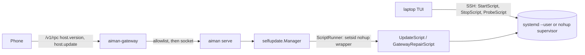
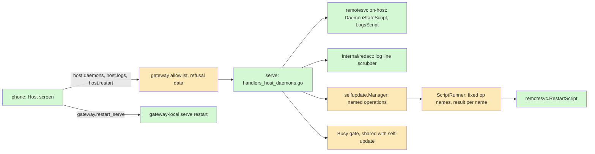
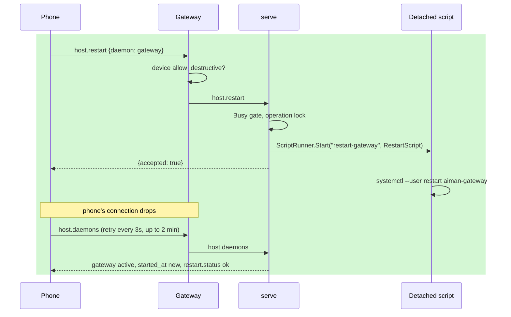

# daemon-control: run serve and the gateway from the phone

**Revision:** 2 · **Size:** project · **Status:** in review
**Task:** operator request, 2026-11-13: "control and update/restart, see logs, state etc for serve and gateway on the mobile phone app" · **Spec:** this page

**Legend:** green = new, amber = changed, red dashed = removed. Every diagram uses these three classes:

```text
classDef new fill:#d4f7d4
classDef changed fill:#fde9b8
classDef removed stroke-dasharray:4,fill:#f9d0d0
```

## The problem

Away from the laptop, the operator can see serve's version and ask for an update, and nothing else. When serve or the gateway misbehaves there is no way from the phone to see whether it is running, how long it has been up, what it last logged, or to restart it. Every one of those today needs the laptop TUI (Admin Menu → Agent API) or an SSH shell.

A second, smaller problem surfaced on 2026-11-13: a phone paired without `allow_destructive` that tries to create a session is told "Update serve and the gateway". The real cause is the device permission. The gateway answers every device refusal with the generic code `forbidden`, and the phone reads `forbidden` as "the host lacks this method". The operator chased a non-existent update problem.

## How it works today



- **Laptop control is SSH only.** `remotesvc.StartScript` (`internal/infra/remotesvc/remotesvc.go:198`), `StopScript` (`:234`) and `ProbeScript` (`:281`) are bash scripts the TUI runs over SSH (`internal/ui/remote_services.go:164`). The probe prints `DRIVER`, `ACTIVE`, `VERSION` (serve adds `SOCKET`, `RTK`, `SELFUPDATE`), then `---LOGS---` and a log tail; `ParseProbe` (`:407`) reads it into `domain.Daemon`.
- **Only self-update runs on the host.** `selfupdate.ScriptRunner` (`internal/selfupdate/runner.go:61`) writes the script and a wrapper under `~/.aiman/tmp/`, starts `nohup bash <wrapper>` with `Setsid`, and the wrapper renames `{tag, exit, at}` into a result file whatever the exit. That is how a script survives the serve restart it causes (`KillMode=process`).
- **Logs.** Under systemd, output goes to the journal (`journalctl --user -u aiman-<kind>`). Under the nohup supervisor it goes to `~/.aiman/<kind>.log`. serve also writes `~/.aiman/serve.log` itself (`cmd/aiman/serve.go:91`). No log line scrubber exists; serve and the gateway avoid logging secrets by convention.
- **RPCs.** `host.version` and `host.update` (`internal/server/handlers_host_update.go:76`, `:113`); `host.update` is `needs_operator` for a session caller and passes the self-update Busy gate. `host.stats` has host-wide numbers and RPC stats but nothing about serve's own process (no pid, start time or RSS).
- **Gateway.** It proxies every method to serve except `push.register`/`push.unregister`. `admitDevice` (`internal/gateway/rpc.go:44`) refuses a method outside the device allowlist with HTTP 403, code `forbidden`. The destructive set (`internal/gateway/allowlist.go`, pinned by `TestAllowlistDestructiveSet`) already holds `host.update`.
- **Phone.** Settings shows one card per server with `HostVersionRow` (version line, an Update button). `isMissingMethod` (`lib/sessionFailures.ts:32`) treats any JSON `forbidden` as a missing method.

## Glossary

| Term | Meaning |
|---|---|
| daemon | One of the three long-running aiman processes on a host: `serve`, `gateway`, `trigger`. `remotesvc.Kind` names them. |
| driver | How a daemon is supervised: `systemd` (a `--user` unit) or `nohup` (aiman's supervisor loop). |
| detached script | A bash script started through `ScriptRunner`: new session, nohup, result file. Survives serve exiting. |
| device | A phone paired with the gateway; it holds a device token, not the host token. |
| `allow_destructive` | Per-device flag; without it a device cannot call anything equivalent to a shell on the host. |
| Busy gate | Self-update's check that defers an install while long calls, AWS logins, handover starts or agent updates are running. |

## Proposed design

### Domain model

```mermaid
classDiagram
    classDef new fill:#d4f7d4
    classDef changed fill:#fde9b8
    classDef removed stroke-dasharray:4,fill:#f9d0d0
    class DaemonState {
      kind serve|gateway|trigger
      installed bool
      driver systemd|nohup|none
      active string
      version string
      pid int
      started_at time
      rss_bytes int
      restart: RestartAttempt
    }
    class RestartAttempt {
      kind string
      at time
      status started|ok|failed
      exit int
    }
    class LogTail {
      kind string
      source journal|file
      lines []string
      redacted int
    }
    class DeviceRefusal {
      code forbidden (unchanged)
      data.method string
      data.needs allow_destructive
    }
    class Operation {
      name update|restart-serve|restart-gateway|restart-trigger
      status started|ok|failed
      result file per name
    }
    DaemonState --> RestartAttempt
    class DaemonState:::new
    class RestartAttempt:::new
    class LogTail:::new
    class DeviceRefusal:::changed
    class Operation:::new
```

### Structure



**New serve RPCs** (`internal/server/handlers_host_daemons.go`):

| Method | Params | Result | Gate |
|---|---|---|---|
| `host.daemons` | `{}` | `{type:"host_daemons", host, daemons:[DaemonState]}` | read; device read method |
| `host.logs` | `{daemon, lines?}` (default 200, max 1000) | `{type:"host_logs", daemon, source, lines, redacted}` | `allow_destructive` on the gateway; `needs_operator` for a session caller |
| `host.restart` | `{daemon, force?}` | `{type:"host_restart", accepted, reason, daemon}` | `allow_destructive`; `needs_operator` for a session caller |

- **State.** For gateway and trigger, `host.daemons` runs `systemctl --user show -p ActiveState,MainPID,ActiveEnterTimestamp aiman-<kind>` (else reads the pid file) and `<binary> --version`, each bounded to 2s, then reads RSS and start time from `/proc/<pid>` in Go. serve reports its own pid, start time and RSS from the process itself. Results are cached 5s; `{refresh:true}` skips the cache, and the phone passes it on pull-to-refresh and while polling after a restart. A kind that is not installed is `installed:false`, not an error.
- **Logs.** `remotesvc.LogsScript(kind, n)`: `journalctl --user -u aiman-<kind> -n <n> --no-pager -o short-iso` when the unit exists, else `tail -n <n>` of `~/.aiman/<kind>.log`. `host.logs` is gated by `allow_destructive` exactly like `pty.run`, which could run `journalctl` itself; redaction protects the phone's screen and its screenshots, not the permission boundary. Every line passes `redact.Line`: Slack tokens (`xox[abposr]-…`) and webhook paths (`hooks.slack.com/services/…`), GitHub tokens (`gh[pousr]_…`, `github_pat_…`), LLM keys (`sk-ant-…`, `sk-…`, `xai-…`), Expo push tokens, AWS key ids (`AKIA…`/`ASIA…`) and 40-character secret keys after `aws_secret_access_key`, `Bearer …`, URL userinfo (`scheme://user:pass@`), `password=`/`passwd=`/`secret=`/`token=`/`access_token=`/`code=`/`key=` values, PEM blocks, and the gateway token by exact value (the one secret stored in plaintext on the host). Pair codes and device tokens are stored hashed, so only the patterns catch them. Each hit becomes `[redacted]`; the count is returned. Lines are capped at 2 KiB each and 256 KiB in all.
- **Restart.** `host.restart` checks the Busy gate (as `host.update` does) and refuses with `reason: busy` and the counts unless `force`. Accepted, it calls a new `selfupdate.Manager.StartOperation(name, script)`. `name` is one of a fixed set (`restart-serve`, `restart-gateway`, `restart-trigger`); install tags keep their own `vX.Y.Z` check. Under the manager's operation lock it persists the operation as a started attempt in `host-update.json` (kind `restart`), so a serve that comes back mid-restart sees it, as it already does for an update, and will not start an auto-update until it settles. The runner writes a result file and log per name (`~/.aiman/ops/<name>.result.json`, `~/.aiman/logs/<name>.log`), so a restart result is never read as an update result. `Finish` and every poll settle it into `ok` or `failed`, and `DaemonState.restart` reads that. A second operation while one is started is `reason: running`. `remotesvc.RestartScript(kind)` restarts in place and does not rewrite the unit: `systemctl --user restart aiman-<kind>` under systemd, else it kills the supervised child and lets the nohup supervisor start it again 2s later. There is no stop: a stopped gateway cannot be started again from the phone.
- **Hung serve.** The gateway answers `gateway.restart_serve {}` itself without calling serve (destructive). It runs the same `RestartScript(serve)` detached (`Setsid`, nohup), refuses a second call within 60s, and answers `{type:"gateway_restart_serve", accepted}`. It is the phone's way out when serve is alive but not answering; `host.restart` is the normal path.
- **Gateway** (`internal/gateway`): a device refusal keeps HTTP 403 and code `forbidden`, so shipped phones behave as today, and gains `data: {method, needs:"allow_destructive"}` when the method is in the destructive set (absent for a method outside the allowlist entirely). `host.daemons` joins the read set; `host.logs`, `host.restart` and `gateway.restart_serve` join the destructive set.
- **Phone**: a Host screen per server, opened from the server card in Settings: three daemon rows (state, version, uptime, RSS, driver, last restart), a Restart button per row (confirm sheet; on `busy` a second sheet offers Restart anyway), the existing Update button, and Logs per daemon (monospace, newest at the bottom, pull to refresh). The phone's `rpc()` passes a 403's JSON `code`, `message` and `data` through to `PairingError` (today it keeps only the code). `failureText` checks, before the transport copy: `forbidden` with `data.needs == "allow_destructive"`, or `forbidden` for a method in the phone's own copy of the destructive set (an old gateway sends no `data`), shows `Ask the host to allow this phone: aiman-gateway devices allow-destructive <id> on`; any other `forbidden` with a JSON code stays "update serve and the gateway". If serve does not answer, the Host screen offers Restart serve through the gateway. The phone's vendored `api/openapi.yaml` is refreshed from aiman's.

### Behaviour



Restart and logs serve a healthy or half-healthy host: inspect, then bounce. A crashed daemon is restarted by systemd (`Restart=on-failure`) or the nohup supervisor; a wedged serve is reached through `gateway.restart_serve`; a dead gateway is out of the phone's reach.

## A scenario, end to end

serve on regent0 stops answering session calls quickly. The operator opens Settings → regent0 → Host. `host.daemons` shows serve `active`, up 3 days, RSS 1.9 GB; gateway `active`. They open serve's Logs: `host.logs {daemon:"serve", lines:200}` runs `journalctl --user -u aiman-serve -n 200`; two lines carrying a Slack webhook URL come back with the path secret `[redacted]`, `redacted: 2`. They tap Restart on serve: `host.restart {daemon:"serve"}` returns `accepted:false, reason:"busy"` (one `session.create` in flight). They tap Restart anyway: `force:true`, accepted. `StartOperation("restart-serve")` records the started attempt and the runner starts the detached script; `systemctl --user restart aiman-serve` restarts serve; the agents keep running in their holders. The phone's next `host.daemons` fails while serve is down, then shows a new `started_at` and `restart.status: ok`.

## Alternatives considered

- **Have the gateway run every operation itself.** It would keep working when serve is dead. Lost because self-update's state and lock live in serve; the gateway gets only the one escape hatch, `gateway.restart_serve`.
- **A new refusal code `device_not_allowed`.** Clearer, but shipped phones key on `forbidden` for the host-update copy and would regress to the tailnet-login message. `data.needs` carries the same fact without breaking them.
- **Stream logs over `session.events`.** Live tail is nicer, but a 200-line pull with refresh covers the diagnostic use and needs no new stream lifecycle.
- **Return the probe's log tail inside `host.daemons`.** Mixes a cheap read-method answer with sensitive text that needs `allow_destructive`.

## Open questions

1. **May a phone without `allow_destructive` read logs?** Logs hold session names, repo paths, hosts and occasionally a URL. Proposed: gated (the consult agrees: redaction is not a boundary).
2. **Restart while busy.** Proposed: refuse with the reason and counts, phone offers Restart anyway (`force`). Alternative: always restart (in-flight long calls like `session.create` are cut off; holders and agents survive).

## Decisions

| Objection | Severity | Triage | Reason |
|---|---|---|---|
| Restart cannot share ScriptRunner as is: tag-only names, one result file, `opMu` dies with serve; make it a persisted Manager operation with per-name results | high | accept | Restart section: `StartOperation`, fixed names, started attempt in `host-update.json`, per-name result; piece A owns `manager.go` and `settle.go`. |
| `device_not_allowed` breaks shipped phones; phone `rpc()` drops message and data, so the old-gateway heuristic cannot fire | high | accept | Code stays `forbidden` with `data.needs`; phone passes code, message and data through and checks the destructive set before the transport copy; piece C owns `services/api.ts`. |
| Redaction misses Slack webhook paths, AWS secrets, passwords, PEM, LLM keys; pair codes are stored hashed | medium | accept | Pattern list widened; exact match only for the gateway token; logs stay gated. |
| A hung serve is the case the phone is for, and every new RPC dies with serve | medium | accept | Added `gateway.restart_serve` (gateway-local, destructive, 60s cooldown) to piece B; problem statement scoped. |
| `host.daemons` cache and 5s scripts show stale state while polling after a restart | low | accept | 2s bounds, `/proc` read in Go, `refresh:true` skips the cache. |
| Restart through `StartScript` rewrites the unit and migrates nohup hosts | low | accept | `RestartScript` restarts in place (`systemctl restart` or kill the supervised child); no unit rewrite. |

## Breakdown

| Piece | Owns files | Parallel group | Depends on | Complexity | Tier | Acceptance tests |
|---|---|---|---|---|---|---|
| A: serve daemon RPCs | `internal/server/handlers_host_daemons.go` (new), `server.go` dispatch, `internal/infra/remotesvc/onhost.go` (new), `internal/redact/` (new), `internal/selfupdate/runner.go`, `manager.go`, `settle.go`, `cmd/aiman/host_update.go` wiring, `cmd/aiman/host_cmd.go` (`aiman host daemons|logs|restart`), `api/openapi.yaml`, AGENTS.md | 1 | none | L | smart | `go test ./internal/server -run 'TestHostDaemons|TestHostLogs|TestHostRestart'`, `go test ./internal/redact`, `go test ./internal/infra/remotesvc -run TestOnHost`, `go test ./internal/selfupdate -run TestOperation` |
| B: gateway refusal data, allowlist, restart_serve | `internal/gateway/rpc.go`, `handler.go`, `allowlist.go`, `allowlist_test.go`, `restart_serve.go` (new) | 2 | A | M | smart | `go test ./internal/gateway -run 'TestDeviceRefusalData|TestAllowlist|TestRestartServe'` |
| C: phone Host screen | aiman-phone: `app/host/[server].tsx` (new), `components/DaemonRow.tsx`, `components/LogView.tsx`, `hooks/useHostDaemons.ts`, `lib/sessionFailures.ts`, `lib/hostVersion.ts`, `services/api.ts` (403 pass-through), `api/openapi.yaml`, `api/types.generated.ts`, `app/(tabs)/settings.tsx` | 2 | A contract (this page) | M | smart | `npx jest tests/hostDaemons tests/sessionFailures` |

B and C start after A lands, in parallel (different repositories). All children run on smart (Opus). I write and commit each piece's acceptance tests on base branch `daemon-control` (aiman) and `daemon-control` (aiman-phone) before the children start.

## What you should be able to explain after reading

1. Why restarting serve from serve works: the restart runs in a detached script (new session, nohup, result file) that outlives serve, and `KillMode=process` keeps agents alive.
2. Which of the three new methods a read-only phone can call, and why logs are not one of them.
3. How the phone tells a permission refusal (`forbidden` plus `data.needs`, or a known destructive method) from a missing method, and why their confusion caused the 2026-11-13 report.
4. What redaction does and does not catch in `host.logs`.
5. Why `gateway.restart_serve` exists beside `host.restart`, and what is still out of the phone's reach (a dead gateway).
