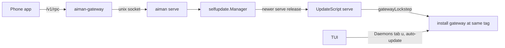
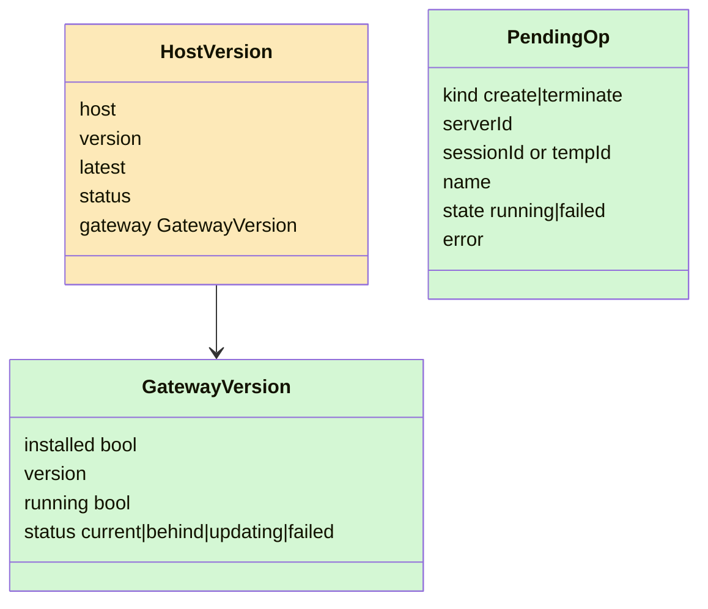
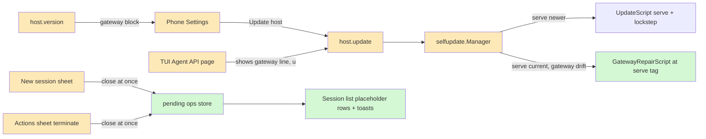

# gateway-update: Gateway updates on its own, and the phone stops waiting on create and terminate

**Revision:** 2 · **Size:** project · **Status:** in review
**Repos:** bouwerp/aiman, bouwerp/aiman-phone

**Legend:** green = new, amber = changed, red dashed = removed.

```text
classDef new fill:#d4f7d4
classDef changed fill:#fde9b8
classDef removed stroke-dasharray:4,fill:#f9d0d0
```

## The problem

1. **The gateway falls behind and nothing catches it up.** `aiman-gateway` is updated only as a side effect of a serve update. If serve is already current and the gateway is older (installed later from an old tag, updated by hand, or left behind by an update that never reached it), the host's auto-update reports `current` and never touches it. The phone app, which talks only to the gateway, has no update control at all and cannot even see the gateway's version.
2. **Create and terminate block the phone.** The new-session sheet waits for `session.create` (up to 5 minutes) before it closes. The actions sheet refuses to close while `session.terminate` runs (up to 90 seconds). The TUI does both in the background: a "creating" placeholder row appears at once, and terminate steps run while the user keeps working.

## How it works today



- Host auto-update: `internal/selfupdate/manager.go:175` (`judge`) compares only serve's own version with the latest release. A newer release runs `remotesvc.UpdateScript(KindServe, tag)` (`internal/infra/remotesvc/remotesvc.go:228`), whose `gatewayLockstep` reinstalls an installed gateway at the same tag and restarts it only if it was running. A failed lockstep is retried. A gateway that is behind while serve is current is never judged.
- `host.version` / `host.update` (`internal/server/handlers_host_update.go:61`, `:94`) describe serve only.
- TUI: the Daemons tab lists a "phone gateway" row and `u` updates it (`internal/ui/dashboard.go:5339`). The laptop also auto-updates a running gateway older than the laptop's own aiman (`internal/ui/serve_autoupdate.go:38`). Neither is visible from the Agent API page, and both need the laptop TUI running.
- Phone: `hooks/useSessionControl.ts:63` (`useCreateSession`) and `:100` (terminate) are awaited by `components/NewSessionSheet.tsx:226` and `components/SessionActionsSheet.tsx:244`.
- The gateway forwards `/v1/rpc` with `CallRaw`, which does not carry the HTTP request's context (`internal/gateway/rpc.go:40`). A phone that disconnects mid-call does not cancel the create or terminate on serve.

## Glossary

| Term | Meaning |
|---|---|
| serve | `aiman serve`, the agent API on the host |
| gateway | `aiman-gateway`, the phone's tailnet proxy in front of serve |
| lockstep | the step in serve's update script that reinstalls the gateway at serve's tag |
| drift | an installed gateway whose version differs from serve's |
| placeholder row | a list row the client draws for work it started and has not seen confirmed |

## Proposed design

### Domain model



### Structure



### Behaviour

**Gateway follows serve on the host (aiman, serve).**
- `Attempt` gains `Kind` (`serve` or `gateway`). `Kind: gateway` records `From` as the gateway's version and `To` as serve's tag.
- A gateway read runs outside `opMu`, under a 5s `CommandContext`: `$HOME/.local/bin/aiman-gateway --version` (the install target), falling back to PATH only when that file is missing; also whether it runs. The version is parsed with `ParseVersion`; unparseable output or a timeout is `unknown`, never `behind`. The read is cached for 5 seconds.
- Drift is `remotesvc.Outdated(gateway, serve)`: strictly older only. A newer gateway is left alone.
- `judge`: a newer serve release keeps today's path (full serve script with lockstep). When serve is already at the latest tag and the gateway is behind, or the last attempt failed at that tag (a failed lockstep), the verdict applies `GatewayRepairScript(serveTag)` = `set -e` plus `gatewayLockstep(serveTag)`: install, restart only if it was running, never touch serve. A failed `Kind: gateway` attempt retries with the same script after the retry interval. `host.update` takes the gateway path at once even inside that interval.
- Same gate (`Busy`, `MaxDefer`), runner, result file and settle path. Drift repair never starts while a serve attempt is started.
- `host.version.status` describes serve only; a gateway repair does not make it `updating`. New block `gateway: {installed, version, running, status}` with status `current|behind|updating|failed|unknown`, read live (5s cache), so a call right after `host.update` reports the truth. `host.update` repairs drift when serve is current (`reason: gateway`, `target` serve's tag); during a running repair it answers that the gateway update is already running.
- Notify mode: once per `<gateway version>@<serve tag>`, in a new `NotifiedGateway` field beside `Notified`.
- `OnApplied` text branches on `Kind`: `gateway updated v0.41.0 → v0.42.0 on <host>` or `gateway update failed: …`. `api/openapi.yaml` adds the `gateway` block and `kind` on the attempt.
- The phone sink keeps skipping `host_update`; the phone sees the result in Settings.

**TUI (aiman).**
- The Agent API page's serve line adds `gateway v0.42.0` (or `gateway behind: v0.41.0`, `gateway not installed`) from the probe or `host.version`. `u` there stays the SSH update, which also pushes serve's config.
- The laptop's gateway auto-update (`serve_autoupdate.go`) does nothing when the host's self-update manager is on and serve is a release; the host owns it. The Daemons tab's manual `u` stays as an override.

**Phone: update control (aiman-phone).** Settings, per paired server: `aiman v0.42.0 · gateway v0.42.0 · latest v0.42.0` from `host.version`, read when Settings opens and on pull-to-refresh. When serve or the gateway is behind, an `Update` button calls `host.update`; the app shows `Updating gateway to v0.42.0…` or `Updating aiman to v0.43.0…` (never the raw reason), then re-reads after the reconnect. Without `allow_destructive` the button is replaced by `Ask the host to allow updates: aiman-gateway devices allow-destructive <id> on`.

**Phone: async create and terminate (aiman-phone).**
- A pending-ops store above the sheets (not the sheet's `useMutation`) holds create and terminate ops in flight, in memory.
- Create: Create validates, starts the op and closes the sheet. One op covers `session.create` and the optional group move. The list shows `Creating <name or branch>…` under the server. On success the placeholder goes, the real row appears and a toast `Created <name>` opens it on tap. On a transport failure, `unreachable` or `timeout` (iOS suspends a long fetch), the app refetches the list and matches a live row on server plus branch, name or repo (the TUI's `creatingPlaceholderMatchesLive` rule); a match replaces the placeholder. The same reconcile runs when the app returns to the foreground. Only with no match does the placeholder become an error row: tap reopens the form as typed, swipe dismisses. A server refusal (`invalid_params`, `worktree_exists`) is an error row at once.
- Terminate: Confirm starts the op and closes the sheet. The row dims and shows `Terminating…`, and its actions are off while pending. On success the row goes; a kept worktree or children left shows the existing blocking notice, not a toast. On `worktree_dirty` the row undims and the actions sheet reopens on the existing dirty step (paths, two-tap discard). Other errors show a toast and the row returns.

## One scenario end to end

The host runs serve v0.42.0 and gateway v0.41.0. At the next poll the manager reads `aiman-gateway v0.41.0`, judges `gateway behind`, finds nothing busy and starts the repair script at v0.42.0. The gateway restarts; the phone's connection drops and comes back within seconds. `host.version` now reports `gateway: {version: v0.42.0, status: current}`, the host emits `gateway updated v0.41.0 → v0.42.0`, and the phone's Settings line shows both at v0.42.0.

Later the operator creates a session from the phone. The sheet closes on Create, the list shows `Creating fix-login…`, and the operator opens another session meanwhile. Forty seconds later the placeholder becomes the real `fix-login` row and a toast says `Created fix-login`.

## Alternatives

- **Gateway updates itself.** Its own manager would duplicate the release check, the gate and the result file, and two managers would race on the same install. Serve already owns updates; it should own the gateway's too.
- **Server-side async create (`session.create` returns at once with a job id).** It would also survive the app being killed, but it changes a contract the laptop and CLI share, and the TUI's background create is client-side too. The gateway already lets the call finish when the phone goes away, so client-side async gives the same result with no protocol change.
- **Restart the gateway after every serve update regardless.** Fixes nothing when the gateway is behind and serve is not updating.

## Open questions

None. The Update button shows only when something is behind; pull-to-refresh re-reads.

## Decisions

| Objection | Severity | Triage | Reason |
|---|---|---|---|
| Gateway repair reuses the serve-only apply/retry path; a failed repair restarts serve, a failed lockstep blocks a gateway-only fix for an hour | high | accept | `Attempt.Kind`, gateway-only script when serve is at the tag, gateway retries with the gateway script |
| `gatewayLockstep` alone has no `set -e`; a failed install still bounces the gateway | high | accept | `GatewayRepairScript` = `set -e` + lockstep, tested |
| Laptop gateway auto-update races the host; string inequality downgrades a newer gateway | high | accept | `Outdated` only; laptop defers to the host manager |
| PATH binary may differ from the install target; raw strings; exec under `opMu` | high | accept | read `~/.local/bin` first, parse, 5s timeout outside the lock, unknown is not behind |
| `host.version` would be stale after `host.update` | high | accept | live read with a 5s cache |
| Agent API `u` via `host.update` drops the config push | high | accept | `u` stays SSH; page only shows the gateway line |
| iOS suspends long fetches; error-row retry duplicates sessions | high | accept | reconcile against the list on transport failure and on foreground; one op for create plus move |
| `OnApplied` says "serve updated" for a gateway repair | medium | accept | text by `Kind`; `kind` in openapi |
| Notify-once key is serve-only | medium | accept | `NotifiedGateway` |
| Alert loses two-tap discard and long path lists | medium | accept | reopen the existing dirty step |
| Gateway repair shows host `updating` | medium | accept | host status is serve's; gateway has its own status |
| `host_update` never reaches the phone as a push | low | defer | Settings shows it; a push for routine updates is noise |
| Raw `reason` is not copy | low | accept | app maps reasons to text |

## Breakdown

| Piece | Owns files | Parallel group | Depends on | Complexity | Tier | Acceptance tests |
|---|---|---|---|---|---|---|
| A. Serve repairs gateway drift; `host.version` gateway block; `host.update` repairs; openapi | `internal/selfupdate/*`, `internal/server/handlers_host_update.go`, `internal/infra/remotesvc/remotesvc.go` (repair script), `internal/selfupdate/state.go`, `cmd/aiman/host_update.go`, `api/openapi.yaml` | 1 | none | M | smart | `internal/selfupdate/gateway_drift_acceptance_test.go`, `internal/server/host_version_gateway_acceptance_test.go` |
| B. TUI Agent API page gateway line; `u` uses `host.update` | `internal/ui/agent_api.go`, `internal/ui/serve_autoupdate.go` | 2 | A's contract | S | worker | `internal/ui/agent_api_gateway_acceptance_test.go` (gateway line; laptop skips gateway auto-update under a host manager) |
| C. Phone: Settings version line and Update button | `app/(tabs)/settings*`, `services/api.ts` (hostVersion, hostUpdate), `components/HostVersionRow.tsx` | 1 | A's contract (fixed here) | S | smart | `tests/unit/hostVersion.acceptance.test.ts` |
| D. Phone: async create and terminate | `hooks/useSessionControl.ts`, `hooks/usePendingOps.ts`, `components/NewSessionSheet.tsx`, `components/SessionActionsSheet.tsx`, `components/TerminateStep.tsx`, session list row | 1 | none | M | smart | `tests/unit/pendingOps.acceptance.test.ts` (incl. dropped create reconciles to the live row) |

A, C and D run in parallel (C codes against the contract above and is tested against a fake). B follows A.

## What you should be able to explain

1. Why a gateway can be behind while the host says `current` today, and which check now catches it.
2. Why the repair runs inside serve's manager rather than a gateway updater of its own.
3. Why the phone's async create needs no server change (the gateway does not cancel the call).
4. What the phone shows when terminate is refused for a dirty worktree.
