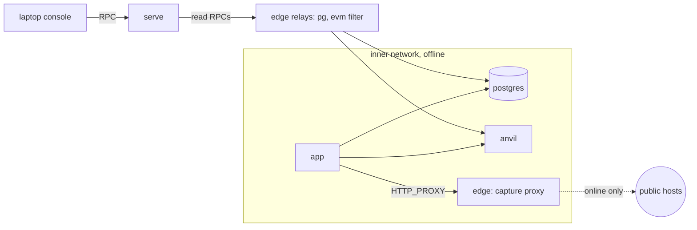
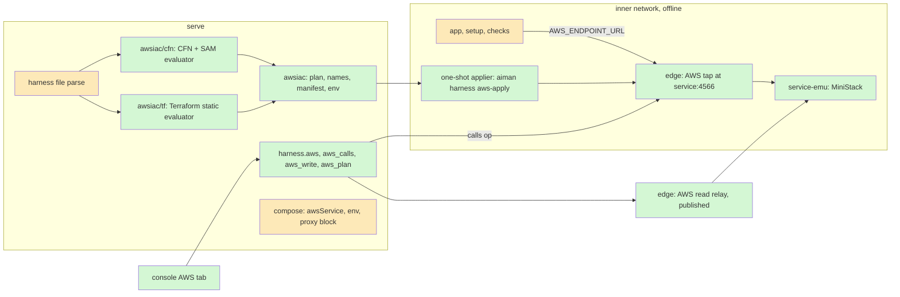

# harness-aws: local S3, DynamoDB, SQS and SNS in a harness run, built from the repo's IaC

**Revision:** 1 · **Size:** project · **Status:** approved
**Task:** harness piece P10 (AWS emulation and inspection) · **Spec:** `docs/specs/harness-aws.md`

**Legend:** green = new, amber = changed, red dashed = removed.

## The problem

Many of the repositories aiman works on are AWS applications: they keep state in DynamoDB tables and S3 buckets and pass work through SQS queues and SNS topics. Their infrastructure is declared in the repository itself, mostly as CloudFormation and SAM templates, some as Terraform.

A harness run cannot test such an app today:

1. The run's inner network is offline, so the app cannot reach AWS, and it must not: a run never holds real credentials.
2. The harness has `database` (postgres, sqlite) and `evm` (anvil) services, but nothing that speaks the AWS APIs.
3. Even with an emulator, someone would have to recreate every table, bucket, queue and topic by hand in setup scripts, duplicating the IaC and drifting from it.
4. The console cannot show what the app did: the capture proxy sees only traffic to external hosts, and nothing lists buckets, objects, tables or items.

Testers feel it as "the harness cannot run our service"; agents feel it as hand-written setup scripts that break when the template changes.

## How it works today

- A harness file (`internal/harness/file.go`) declares `app`, `services` and `scenarios`. A service is a plain container, a `database` (`file.go:175`) or an `evm` node (`file.go:208`, validated by `validateEVM`, `evm.go:60`, composed by `evmService`, `evm.go:107`).
- Serve composes the run (`internal/harness/compose.go`): app and services sit only on the offline inner network; the edge container alone joins the outer network and publishes one relay per app port, postgres service and EVM service (`compose.go:288-298`). An EVM relay is a filter (`--evm-relay`, `compose.go:463`; `internal/harness/edge/evm.go`) that admits only `edge.EVMReadMethods`.
- A start runs `debugger, networks, edge, services, fixtures, setup, build, app, ports` (`manager_start.go:81`). Fixtures are SQL through psql in their service or scripts in the app container (`manager_start.go:236`).
- The capture proxy (`internal/harness/edge/proxy.go`) gets every app call to a host outside `NO_PROXY` (`compose_proxy.go:57`); scenario services are in `NO_PROXY`, so app-to-service traffic is never captured. Online, it dials only public addresses (`DialPublic`, `proxy.go:451`).
- Read RPCs (`harness.db`, `harness.evm_txs`, `harness.evm_trace`) read through the edge's published relays; writes are operator-only (`harness.db {write:true}`, `db.go:179`), the SQLite path through a one-shot container of the edge image (`sqliteReaderArgs`, `db_sqlite.go:91`).
- The console (`internal/console`) registers one route set and one tab per feature (`console/evm.go`, `console/db.go`).
- Every image is vetted (`internal/harness/images`); images aiman pins by digest in code are vetted as `Builtin`.



## Glossary

| Term | Meaning |
|---|---|
| Emulator | A container that answers the AWS APIs locally. P10 ships MiniStack. |
| MiniStack | MIT-licensed Python AWS emulator, https://github.com/ministackorg/ministack, image `ministackorg/ministack`, one HTTP gateway on 4566. |
| AWS service (harness) | A `services.<name>` entry with an `aws` block: the emulator plus aiman's wiring. |
| Stack | One IaC source the harness reads: a CloudFormation/SAM template or a Terraform directory, with a name. |
| Logical id | A resource's name inside its stack: the CFN key (`OrdersTable`) or the Terraform address (`aws_sqs_queue.events`, `module.q.aws_sqs_queue.dlq`). |
| Physical name | The name the resource gets in the emulator (table name, bucket name, queue name, topic name). |
| Plan | The ordered list of emulator API calls serve derives from the stacks and the seed file, plus the resource manifest and warnings. |
| Manifest | `resources.json`: every planned resource's logical id, physical name and attributes (ARN, URL, stream ARN), plus evaluated outputs. |
| Tap | The edge listener the app reaches at `http://<service>:4566`; it forwards every call to the emulator unchanged and records it. |
| Call log | The tap's record of each AWS API call: service, operation, resource, status, error code, latency, sizes. |
| Read relay | The edge's published port for the AWS service: admits only read operations, rebuilt and re-signed. |
| Applier | `aiman harness aws-apply`, a hidden subcommand run in a one-shot container of the edge image on the inner network; it executes a plan or an operator write. |
| SigV4 | AWS Signature Version 4, the request signing every SDK does. |
| Short-form tag | CFN YAML's `!Ref`, `!Sub`, `!GetAtt`, … for `Ref`, `Fn::Sub`, `Fn::GetAtt`, …. |

## Proposed design

One sentence: an `aws` service runs a pinned MiniStack on the inner network behind an edge tap; serve turns the repository's CFN/SAM templates and Terraform into a plan of create calls, an applier container executes it with the seed data, the app gets endpoint, fake credentials and resource names in its environment, and the console browses the result through a read-only relay and shows the tap's call log.

### Emulator choice

Research (2026-11-18, checked on the projects' own pages and run locally; the full comparison is in the Alternatives section):

- MiniStack v1.5.41, MIT, repository created 2026-03-24, about 5.2k stars, one lead maintainer (514 commits, next 265), releases every 1-3 days. Image `ministackorg/ministack:1.5.41`, OCI index `sha256:aef90fec1a4581c5fa7b4f79d347898f8475111bac95bbab3736f4a44f5f8573`, amd64 and arm64, about 69 MB compressed, `python:3.13-alpine` base.
- Measured: healthy 1.9 s after start, 34 MiB idle, 40-60 MiB after a workload, runs with `--read-only --tmpfs /tmp --user <uid> --cap-drop ALL --security-opt no-new-privileges --network none`.
- Measured with boto3, `AUTH=true`: versioning, `If-None-Match` (`PreconditionFailed`), presigned GET, tampered presign refused (403), 5 MiB multipart, `ConditionExpression` (`ConditionalCheckFailedException`), `TransactWriteItems` all-or-nothing (`TransactionCanceledException`), GSI query, Streams `NEW_AND_OLD_IMAGES` record.
- Documented (README and `ministack/services/*.py`): S3 notifications to SQS, SNS, Lambda and EventBridge; Object Lock; DynamoDB LSIs, TTL, PartiQL, Streams with all view types; SQS FIFO, DLQs; SNS. No S3 Select; no DynamoDB throttling.
- Behaviour that shapes the design: `SERVICES=` limits loaded services; the account id is derived from the access key id (so the app and aiman must use the same key); `AUTH=true` refuses unknown key ids; `/_ministack/reset` and `/_ministack/config` are admin endpoints on the same port; an IoT mTLS listener opens on 8883 whatever `SERVICES` says; no telemetry; S3 and DynamoDB need no Docker socket.

`kind` is an enum with one value, `ministack`. A second kind (floci, moto) is a later piece that adds an image pin, a compose function and an env map; tap, relay, plan and console do not change.

### Domain model

```mermaid
classDiagram
    classDef new fill:#d4f7d4
    classDef changed fill:#fde9b8
    classDef removed stroke-dasharray:4,fill:#f9d0d0
    class Service {
        Image
        Database
        EVM
        AWS
    }
    class AWS {
        Kind
        Services []string
        Region
        VerifySignatures *bool
        Stacks []Stack
        Env map[string]string
        FunctionEnv []string
        Seed string
    }
    class Stack {
        Name
        CloudFormation string
        Terraform string
        Parameters map
        Imports map
        VarFiles []string
        Vars map
    }
    class ScenarioAWS {
        Parameters map[stack]map
        Vars map[stack]map
        Seed string
    }
    class Plan {
        Resources []PlannedResource
        Outputs map
        Calls []Call
        Warnings []Warning
        Env map[string]string
    }
    class PlannedResource {
        Stack
        LogicalID
        Type
        Physical
        Attrs map
        Generated bool
    }
    class Warning {
        Stack
        Resource
        Attribute
        Message
    }
    class Call {
        Service
        Operation
        Request
    }
    class AWSCall {
        ID
        Client
        Service
        Operation
        Resource
        Status
        ErrorCode
        Duration
        Sizes
        Presigned
        Account
    }
    Service *-- AWS
    AWS *-- Stack
    Plan *-- PlannedResource
    Plan *-- Warning
    Plan *-- Call
    class Service:::changed
    class AWS:::new
    class Stack:::new
    class ScenarioAWS:::new
    class Plan:::new
    class PlannedResource:::new
    class Warning:::new
    class Call:::new
    class AWSCall:::new
```

### Structure



New packages and files:

- `internal/harness/aws.go`, `aws_compose.go`: the `aws` block, validation, compose service, env.
- `internal/harness/awsiac/`: `plan.go` (model, names, ordering, manifest, env), `cfn*.go` (YAML/JSON loader with short-form tags, intrinsics, conditions, SAM), `tf*.go` (HCL loader, variables, locals, expressions, modules), `seed.go`.
- `internal/harness/awssig/`: SigV4 signer for fixed credentials.
- `internal/harness/edge/aws_tap.go`, `aws_relay.go`, `aws_ops.go` (S3 REST, JSON and query protocol operation classifier shared by tap and relay).
- `internal/harness/aws_apply.go`: `AWSApplyMain` (the hidden subcommand) and `awsApplierArgs` (the `docker run`, after `sqliteReaderArgs`).
- `internal/harness/aws_read.go`: serve's reads through the relay.
- `internal/server/handlers_harness_aws.go`, `cmd/aiman/harness_aws_cmd.go`, `internal/console/aws.go`, `internal/console/web/aws.{js,css}`.

### The harness file

```yaml
version: 1
app:
  run: python3 /src/app.py
  ports: [{name: web, container: 8080}]
services:
  aws:
    aws:
      kind: ministack                       # enum; ministack only in P10
      services: [s3, dynamodb, sqs, sns]
      region: eu-west-1                     # default us-east-1
      verify_signatures: true               # default true (AUTH=true)
      stacks:
        - name: orders                      # [a-z][a-z0-9-]{0,24}; AWS::StackName
          cloudformation: infra/template.yaml   # SAM, CFN YAML/JSON, or cdk.out/<Stack>.template.json
          parameters: {Stage: test}
          imports: {SharedVpcId: vpc-0}      # values for Fn::ImportValue names
        - name: shared
          terraform: infra/tf/shared        # a directory of .tf files
          var_files: [infra/tf/test.tfvars]
          vars: {env: test}
      env:                                  # app env from the manifest
        ORDERS_TABLE: orders.OrdersTable              # Ref value
        ORDERS_STREAM: orders.OrdersTable.StreamArn   # attribute
        UPLOAD_BUCKET: orders.outputs.UploadBucketName
        EVENTS_QUEUE_URL: shared.aws_sqs_queue.events.url
      function_env: [orders.OrdersFunction] # copy a Lambda/SAM function's Environment.Variables
      seed: .aiman/aws/seed.yaml
    limits: {memory: 512m}                  # default for an aws service
scenarios:
  - id: upload
    services: [aws]
    aws:                                    # per aws service, by service name
      aws:
        parameters: {orders: {Stage: e2e}}
        vars: {shared: {env: e2e}}
        seed: .aiman/aws/seed-upload.yaml   # replaces the service's seed
    steps:
      - do: Upload a file at {{web}}
        expect: It is listed under Uploads and a row appears in the orders table
```

Validation (`validateAWS`, strict parsing as every block):

- `kind` is `ministack`. `image` on an aws service must be empty: aiman runs `harness.AWSImage(kind)`, pinned by index digest in code and vetted as builtin. Operator config `harness.aws.images.ministack` overrides it and is vetted as a listed image.
- `services` is a non-empty subset of `s3, dynamodb, sqs, sns`; `dynamodb` also loads `dynamodbstreams`. Anything else is refused with the reason (Lambda, ECS, RDS and EC2 need the Docker socket or egress).
- `region` matches `^[a-z]{2}(-[a-z]+)+-\d$`.
- A service is one of `database`, `evm`, `aws`. At most one aws service per scenario.
- A stack has exactly one of `cloudformation` and `terraform`, names a path inside the repository (no `..`, no absolute path, read from the commit), and stack names are unique. `parameters` and `imports` belong to CFN stacks, `var_files` and `vars` to Terraform stacks.
- `env` keys are environment variable names not starting with `AWS_` or `AIMAN_`; values parse as a reference (below). `function_env` names CFN `AWS::Lambda::Function` or `AWS::Serverless::Function` resources.
- The service's own `env` may not set `SERVICES`, `AUTH`, `GATEWAY_PORT`, `EDGE_PORT`, `BIND_HOST`, `PERSIST_STATE`, `STATE_DIR`, `S3_PERSIST`, `S3_DATA_DIR`, `LAMBDA_*`, `DOCKER_HOST`, `MINISTACK_*`, `CLOUDTRAIL_*`, `SFTP_ENABLED`, `USE_SSL`.
- A scenario's `aws.<service>` names an aws service in its `services`; its stack keys name stacks of that service.
- Service names ending `-emu` are reserved.

**Every harness file**, with or without an aws service, is refused (`harness_invalid`, naming the variable and where) when the app, a service, a check or a debug block sets `AWS_PROFILE`, `AWS_DEFAULT_PROFILE`, `AWS_ACCESS_KEY_ID`, `AWS_SECRET_ACCESS_KEY`, `AWS_SESSION_TOKEN`, `AWS_SECURITY_TOKEN`, `AWS_ROLE_ARN`, `AWS_ROLE_SESSION_NAME`, `AWS_WEB_IDENTITY_TOKEN_FILE`, `AWS_CONTAINER_CREDENTIALS_RELATIVE_URI`, `AWS_CONTAINER_CREDENTIALS_FULL_URI`, `AWS_CONTAINER_AUTHORIZATION_TOKEN*`, `AWS_SHARED_CREDENTIALS_FILE`, `AWS_CONFIG_FILE`, `AWS_IGNORE_CONFIGURED_ENDPOINT_URLS` or `AWS_EC2_METADATA_*`, or when any env value, parameter, var or import value matches an AWS access key id (`\b(AKIA|ASIA|AROA|AIDA|ANPA|ANVA|AGPA)[A-Z0-9]{16}\b`). The repository can still read real credentials only if a script fetches them, which the offline network and the proxy block prevent.

References (`env`, seed `table`/`bucket`/`queue`/`topic`):

| Form | Value |
|---|---|
| `<stack>.<logical id>` | CFN: the `Ref` value (table, bucket, queue URL, topic ARN). Terraform: the resource's `id`. |
| `<stack>.<logical id>.<attribute>` | CFN `Fn::GetAtt` names (`Arn`, `StreamArn`, `QueueName`, `QueueUrl`, `TopicName`, `TopicArn`, `DomainName`, `RegionalDomainName`); Terraform attribute names (`arn`, `name`, `url`, `stream_arn`, `bucket`, …). |
| `<stack>.outputs.<name>` | A CFN `Outputs` entry or a Terraform `output` block, evaluated. |

A reference that does not resolve is an error at `harness.up` (`harness_invalid`, naming the reference), never an empty variable.

### App environment and credential isolation

Every container of a run that has an aws service (app, services other than the emulator, checks, debug checks, script fixtures) gets these, and aiman's value wins over the file's (the file may not set them anyway):

| Variable | Value |
|---|---|
| `AWS_ENDPOINT_URL`, `AWS_ENDPOINT_URL_S3`, `AWS_ENDPOINT_URL_DYNAMODB`, `AWS_ENDPOINT_URL_DYNAMODB_STREAMS`, `AWS_ENDPOINT_URL_SQS`, `AWS_ENDPOINT_URL_SNS` | `http://<service>:4566` (the tap) |
| `AWS_REGION`, `AWS_DEFAULT_REGION` | the region |
| `AWS_ACCESS_KEY_ID`, `AWS_SECRET_ACCESS_KEY` | `test`, `test` |
| `AWS_CONFIG_FILE` | `/aiman-aws/config`: `[default]` with `region`, `endpoint_url` and `s3 =` / `addressing_style = path` |
| `AWS_SHARED_CREDENTIALS_FILE` | `/aiman-aws/credentials`: `[default]` with the `test` pair |
| `AWS_EC2_METADATA_DISABLED` | `true` |
| `AIMAN_AWS_RESOURCES` | `/aiman-aws/resources.json` (the manifest) |
| every `env` entry and every `function_env` variable | the resolved reference or evaluated value |

`/aiman-aws` is a read-only bind of `<run>/aws/`, which serve writes before the services start (config and credentials) and after the plan is applied (manifest). The `function_env` variables merge in file order; a key set twice with different values is a warning and the later wins; a key that collides with `env` loses to `env`. Values in `function_env` that do not resolve are warnings and the key is left out.

Why real credentials cannot reach the run:

1. Serve builds the compose environment only from the file and its own constants, and compose interpolation is escaped, so serve's own `AWS_*` never leak into a container.
2. No container mounts `~/.aws`, an SSO cache or serve's environment; `/aiman-aws` holds only the `test` pair.
3. The file refusals above apply to every harness file.
4. The inner network has no route out; IMDS is unreachable and disabled for SDKs.
5. Whenever a scenario runs an aws service, the capture proxy refuses AWS hosts, online and offline (below).
6. Call-log text, logs and console values pass `redact.Lines`, which already masks AWS key ids and secrets.

SDK notes the harness documentation carries: the `AWS_ENDPOINT_URL*` variables are the AWS SDKs and Tools standard (https://docs.aws.amazon.com/sdkref/latest/guide/feature-ss-endpoints.html); SDKs older than that standard (AWS SDK for Go v1, JavaScript v2, boto3 before 1.28) need the endpoint in code. S3 is path-style only, because Docker's DNS has no wildcard names for `<bucket>.<service>`: botocore and the CLI read `addressing_style` from the config file; Go v2 needs `UsePathStyle`, JavaScript v3 `forcePathStyle`. The console points at both when it sees them fail.

### Compose

`awsService` (beside `evmService`):

- The emulator is compose service `<name>-emu`: entrypoint kept (`python -m ministack`), env `SERVICES=<list>`, `AUTH=true` unless `verify_signatures: false`, `MINISTACK_REGION=<region>`, `GATEWAY_PORT=4566`, `S3_PERSIST=1`, `S3_DATA_DIR=/data/s3` on the named volume `data-<name>`, `LOG_LEVEL=WARNING`.
- Hardening as every service: host uid, read-only root, tmpfs `/tmp`, `cap_drop: ALL`, `no-new-privileges`, limits (default memory 512m, counted in `harness.run_memory`), only the inner network, never the Docker socket.
- Health check unless `ready` is set: `python -c` urllib `GET http://127.0.0.1:4566/_ministack/health`, passing only when every requested service reports `available`.
- The edge joins the inner network with the alias `<name>` and runs `--aws-tap <name>=<name>-emu:4566`. The app therefore reaches the tap at `http://<name>:4566`, and `<name>` stays in `NO_PROXY` as every scenario service does.
- Relays: `--aws-relay <name>=<name>-emu:4566`, kind `harness.RelayKindAWS`, published like the EVM relay and listed in `run.ports`; the console hides it from app links.
- Proxy: `RunSpec.Proxy.BlockSuffixes` gets `amazonaws.com`, `amazonaws.com.cn`, `api.aws`, `on.aws`.

### Behaviour

```mermaid
sequenceDiagram
    participant T as tester / agent
    participant S as serve
    participant D as docker compose
    participant E as edge
    participant M as MiniStack
    participant A as applier
    participant P as app
    T->>S: harness.up {scenario}
    rect rgb(212,247,212)
    S->>S: read stacks from the commit, evaluate CFN/SAM and Terraform, build plan (resources, calls, warnings, env)
    S-->>T: refuse harness_invalid on a bad reference or missing parameter
    end
    S->>D: up edge, services
    rect rgb(212,247,212)
    D->>M: start service-emu, health check
    S->>D: run applier (edge image, aiman harness aws-apply, src read-only, plan on stdin)
    A->>E: create calls via the tap (signed with test/test)
    E->>M: forward, record in call log (client aiman)
    A-->>S: per-call result; manifest with ARNs and URLs
    S->>S: write resources.json, resolve env
    end
    S->>D: setup, build, app (env includes endpoints and names)
    P->>E: SDK calls to http://aws:4566
    E->>M: forward unchanged, record call
    T->>S: harness.aws {op: s3_objects} / harness.aws_calls
    rect rgb(212,247,212)
    S->>E: read relay (allowlisted, re-signed) / calls op
    E->>M: read
    end
```

#### Plan: from IaC to emulator calls

Serve reads every stack from the commit (never the working tree; a dirty run reads the exported tree), evaluates it into `PlannedResource`s and builds the plan:

1. Collect resources of the supported types from all stacks of the service (CFN/SAM and Terraform, below). Other types are listed once per type as `not emulated` notes (info, not warnings).
2. Assign physical names (naming rule below).
3. Resolve attributes (ARN, queue URL, stream ARN) from physical names: `arn:aws:<svc>:<region>:000000000000:<name>`, queue URL `http://<service>:4566/000000000000/<name>`. The stream ARN is known only after `CreateTable`; the applier fills it from the answer and the manifest gets the real one.
4. Order calls by dependencies (`Ref`, `GetAtt`, `DependsOn`, Terraform references and `depends_on`): queues and topics, queue policies and attributes (redrive needs the DLQ ARN), subscriptions, tables, buckets, bucket configuration (versioning, then notifications, which MiniStack validates by sending a test message to the destination).
5. Append seed calls (objects, items, messages).
6. Evaluate outputs and the `env` and `function_env` references.

The plan is pure Go with no Docker: `aiman harness aws plan [<scenario>] [--json]` (RPC `harness.aws_plan {session?, scenario?}`, any in-scope caller, reads the commit, needs no run) prints resources, physical names, outputs, env and warnings, so an agent can check a template change before `harness up`.

#### Naming rule for generated names

When the IaC gives no explicit name (CFN without `TableName`/`BucketName`/`QueueName`/`TopicName`, SAM `SimpleTable` without `TableName`, Terraform `aws_s3_bucket` without `bucket`, `aws_sqs_queue`/`aws_sns_topic` without `name`), the physical name is deterministic:

```
<stack>-<logical id>-<suffix>
suffix = first 12 characters of lowercase base32 (no padding) of sha256("<stack>/<logical id>")
```

- Terraform logical ids use the address with `.` and `[` `]` replaced by `-` (`module-q-aws_sqs_queue-dlq`); `_` becomes `-` for buckets.
- Buckets are lower-cased and cut so the whole name fits 63 characters (the cut is taken from the logical-id part, the suffix stays); tables fit 255, queues 80 including `.fifo`, topics 256 including `.fifo`.
- `bucket_prefix`/`name_prefix` in Terraform: `<prefix><suffix>`, cut to the limit.
- A FIFO queue or topic gets `.fifo` appended.

The names are stable across runs and machines, but the app should not hard-code them: **the app learns every name through the environment the harness file maps (`env`, `function_env`) or through `AIMAN_AWS_RESOURCES`**. This matches how the app finds them in AWS (Lambda environment from `!Ref`, CFN outputs, Terraform outputs).

#### CloudFormation and SAM

Loader: `gopkg.in/yaml.v3` `Node` trees, so short-form tags are read from `Node.Tag`; JSON templates (including `cdk.out/*.template.json`) through the same tree. Templates up to 1 MiB, nesting up to 64, YAML aliases refused (billion-laughs), duplicate keys refused.

Supported:

- **Parameters**: `Default`, then the stack's `parameters`, then the scenario's override. `AllowedValues`, `AllowedPattern`, `MinLength`/`MaxLength`, `MinValue`/`MaxValue` are checked; a violation is an error naming the parameter. `NoEcho` values are never printed. A parameter with no value is an error at plan time (no guess). `AWS::SSM::Parameter::Value<…>` and `AWS::EC2::*` parameter types need an explicit value.
- **Pseudo parameters**: `AWS::Region` (service region), `AWS::AccountId` (`000000000000`), `AWS::StackName` (stack name), `AWS::StackId` (a fixed ARN), `AWS::Partition` (`aws`), `AWS::URLSuffix` (`amazonaws.com`), `AWS::NoValue` (removes the key).
- **Intrinsics**, long and short form: `Ref`, `Fn::GetAtt` (list or `A.B` string), `Fn::Sub` (string and `[string, map]` forms, `${!Literal}`), `Fn::Join`, `Fn::Select`, `Fn::Split`, `Fn::If`, `Fn::Equals`, `Fn::And`, `Fn::Or`, `Fn::Not`, `Condition`, `Fn::FindInMap` (with `Mappings`), `Fn::Base64`, `Fn::GetAZs` (`<region>a`, `b`, `c`), `Fn::ImportValue` (from the stack's `imports`; otherwise unresolvable), `Fn::ToJsonString` and `Fn::Length` when `AWS::LanguageExtensions` is in `Transform`.
- **Conditions**: evaluated from parameters; a resource whose `Condition` is false is left out (info note); `Fn::If` picks a branch.
- **Outputs**: evaluated; `Export` ignored; an output whose `Condition` is false is absent.
- **Resources**:
  - `AWS::DynamoDB::Table`: `TableName`, `KeySchema`, `AttributeDefinitions`, `BillingMode`, `ProvisionedThroughput`, `GlobalSecondaryIndexes`, `LocalSecondaryIndexes`, `StreamSpecification`, `TimeToLiveSpecification` (a second call), `TableClass`, `DeletionProtectionEnabled`, `SSESpecification` (dropped with an info note), `Tags`.
  - `AWS::DynamoDB::GlobalTable`: the local replica only, as a table (warning: replicas in other regions are not created).
  - `AWS::Serverless::SimpleTable`: `TableName`, `PrimaryKey {Name, Type: String|Number|Binary}` (default `id` String), `ProvisionedThroughput` (else `PAY_PER_REQUEST`), `SSESpecification`, `Tags`.
  - `AWS::S3::Bucket`: `BucketName`, `VersioningConfiguration`, `NotificationConfiguration.QueueConfigurations` and `TopicConfigurations` (events, filter rules), `CorsConfiguration`, `LifecycleConfiguration`, `ObjectLockEnabled` and `ObjectLockConfiguration`, `Tags`. `LambdaConfigurations` and `EventBridgeConfiguration` are warnings (no Lambda or EventBridge in the run) and dropped.
  - `AWS::S3::BucketPolicy`: applied as `PutBucketPolicy`.
  - `AWS::SQS::Queue`: `QueueName`, `FifoQueue`, `ContentBasedDeduplication`, `DeduplicationScope`, `FifoThroughputLimit`, `DelaySeconds`, `MaximumMessageSize`, `MessageRetentionPeriod`, `ReceiveMessageWaitTimeSeconds`, `VisibilityTimeout`, `RedrivePolicy`, `RedriveAllowPolicy`, `Tags`; KMS settings dropped with an info note.
  - `AWS::SQS::QueuePolicy`: `SetQueueAttributes Policy` per queue.
  - `AWS::SNS::Topic`: `TopicName`, `FifoTopic`, `ContentBasedDeduplication`, inline `Subscription` (`Protocol`, `Endpoint`), `Tags`.
  - `AWS::SNS::Subscription`: `TopicArn`, `Protocol`, `Endpoint`, `RawMessageDelivery`, `FilterPolicy`, `FilterPolicyScope`, `RedrivePolicy`. Protocols `sqs` only; `lambda`, `http(s)`, `email`, `sms` are warnings and dropped.
  - `AWS::SNS::TopicPolicy`: applied as the topic's `Policy` attribute.
  - `AWS::Lambda::Function` and `AWS::Serverless::Function`: never created; read only for `function_env` (`Environment.Variables`, with SAM `Globals.Function.Environment.Variables` merged under it). SAM function `Events` of types S3, SQS, SNS and DynamoDB are info notes (`not emulated: event source <type> for <function>`).
- **SAM**: a template whose `Transform` includes `AWS::Serverless-2016-10-31` gets `Globals` (`Function`, `SimpleTable`) applied before evaluation. `AWS::Serverless::Application` and other nested stacks are info notes.
- **CDK**: `cdk.out/<Stack>.template.json` is plain CFN JSON. `AWS::CDK::Metadata` and `Rules` are ignored; CDK's asset parameters (`AssetParameters…`, `BootstrapVersion`) take their defaults or an override.

Unresolvable values (an `Fn::ImportValue` with no import, a `Ref` to a skipped resource or an unsupported type's attribute, `Fn::GetAtt` of an attribute aiman does not model, a `Fn::Transform` macro):

- In a property that decides identity or schema (any name, `KeySchema`, `AttributeDefinitions`, index definitions, `FifoQueue`, `FifoTopic`): a warning naming stack, resource and property, and the resource is skipped. Anything referring to a skipped resource is in turn skipped or warned about.
- In any other property: a warning naming stack, resource and property, and the property is left out.
- A warning is never a guess: no default name stands in for an unresolved one.

#### Terraform

Static parse of every `.tf` and `.tf.json` file in the stack directory with `github.com/hashicorp/hcl/v2` (`hclparse`, `hclsyntax`, `gohcl` for blocks) and `github.com/zclconf/go-cty` for values. No `terraform init`, no providers, no state, no network.

- **Variables**: `default`, then `terraform.tfvars`, `terraform.tfvars.json`, `*.auto.tfvars(.json)` in lexical order, then the stack's `var_files` in order, then `vars`, then the scenario's `vars` (later wins, as Terraform's precedence). A variable with no value is an error at plan time naming it. `validation` blocks are not evaluated (info note); `sensitive` values are never printed.
- **Expressions**: literals, `var.*`, `local.*` (evaluated lazily, cycles refused), references to supported resources' attributes (from the plan), string templates and directives, conditionals, `for` expressions over known values, splat over `count`/`for_each` instances, and a fixed function table from `go-cty`'s stdlib: `format`, `formatlist`, `lower`, `upper`, `title`, `trimspace`, `trim*`, `replace`, `substr`, `split`, `join`, `concat`, `merge`, `lookup`, `element`, `length`, `keys`, `values`, `contains`, `distinct`, `flatten`, `coalesce`, `try`, `can`, `tostring`, `tonumber`, `tobool`, `tolist`, `toset`, `tomap`, `jsonencode`, `jsondecode`, `min`, `max`. Anything else (`file`, `templatefile`, `timestamp`, `uuid`, data sources, provider-defined functions) is unresolvable.
- **`count` and `for_each`** with known values expand into instances (`aws_sqs_queue.q[0]`, `aws_sqs_queue.q["a"]`); an unknown value is a warning and the resource is skipped.
- **Modules**: `source` starting with `./` or `../` is read recursively (inputs evaluated in the caller, outputs exposed as `module.<name>.<output>`), up to depth 8, never leaving the repository. Registry, git and URL sources are warnings naming the module call; references to their outputs are unresolvable.
- **Ignored**: `terraform`, `provider` (the run's region always applies; `default_tags` is ignored), `data` blocks (references to them are unresolvable), `moved`, `import`, `check`, `lifecycle`.
- **Resources**:
  - `aws_dynamodb_table`: `name`, `hash_key`, `range_key`, `attribute`, `billing_mode`, `read_capacity`, `write_capacity`, `global_secondary_index`, `local_secondary_index`, `stream_enabled`, `stream_view_type`, `ttl`, `table_class`, `deletion_protection_enabled`, `tags`.
  - `aws_s3_bucket`: `bucket`, `bucket_prefix`, `object_lock_enabled`, `tags`, and the provider v3 inline `versioning` block.
  - `aws_s3_bucket_versioning`, `aws_s3_bucket_notification` (`queue`, `topic`; `lambda_function` and `eventbridge` warned and dropped), `aws_s3_bucket_policy`, `aws_s3_bucket_cors_configuration`, `aws_s3_bucket_lifecycle_configuration`.
  - `aws_sqs_queue`: `name`, `name_prefix`, `fifo_queue`, `content_based_deduplication`, `delay_seconds`, `max_message_size`, `message_retention_seconds`, `receive_wait_time_seconds`, `visibility_timeout_seconds`, `redrive_policy`, `redrive_allow_policy`, `tags`; `aws_sqs_queue_policy`, `aws_sqs_queue_redrive_policy`.
  - `aws_sns_topic`: `name`, `name_prefix`, `fifo_topic`, `content_based_deduplication`, `policy`, `tags`; `aws_sns_topic_subscription` (`sqs` protocol; others warned and dropped); `aws_sns_topic_policy`.
- **Attributes** exposed for references: tables `id`, `name`, `arn`, `stream_arn`, `stream_label`; buckets `id`, `bucket`, `arn`, `bucket_domain_name`, `bucket_regional_domain_name`; queues `id` (URL), `url`, `arn`, `name`; topics `id` (ARN), `arn`, `name`; subscriptions `id`, `arn`.
- **Outputs**: `output` blocks evaluated, reachable as `<stack>.outputs.<name>`.

The same unresolvable rule as CFN applies, warnings naming the file and line, the resource address and the attribute.

#### Seed data

IaC creates resources; the seed file holds their contents. `aws.seed` (or the scenario's) names a YAML file in the repository:

```yaml
objects:
  - bucket: orders.UploadBucket            # reference or literal name
    from: testdata/s3/uploads              # directory; keys are paths relative to it
    prefix: seed/
    content_type: auto                     # auto (by extension) or a literal type
items:
  - table: orders.OrdersTable
    file: testdata/ddb/orders.jsonl        # one item per line
    format: plain                          # plain JSON (default) or dynamodb (AttributeValue JSON)
messages:
  - queue: shared.aws_sqs_queue.events
    file: testdata/sqs/events.jsonl        # one message body per line, or {body, attributes, group_id, dedup_id}
```

Files are read from the exported tree through `os.Root` (no symlinks, no `..`). Plain JSON maps to AttributeValues by type (string `S`, number `N`, bool `BOOL`, null `NULL`, array `L`, object `M`); `{"$b64": "…"}` is `B`, `{"$ss": […]}`, `{"$ns": […]}`, `{"$bs": […]}` are sets. Bounds: 5000 objects and 256 MiB of object bytes, 100k items, 10k messages, 50 tables, 50 buckets, 50 queues. A seed entry naming a skipped resource is an error.

#### Applier

The plan executes in a one-shot container of the run's edge image (the static aiman binary read-only, as the SQLite reader): `aiman harness aws-apply` on the inner network only, read-only root, `cap_drop ALL`, `no-new-privileges`, 256m, the exported tree mounted read-only at `/src` for seed files, the plan JSON on stdin. It signs every call with `test`/`test` (`internal/harness/awssig`), sends it to the tap (so the calls appear in the call log as client `aiman`), stops at the first failure, and prints a JSON result per call plus the stream ARNs and queue URLs it learned. The start step is `aws` (between `services` and `fixtures`); a failure fails the run at step `aws <n>: <stack>.<logical id> <operation>` with the emulator's error code. `run.json` gains `aws: {service, resources, warnings, notes}` and serve writes `resources.json`.

Script fixtures and `setup` keep working and run after the plan, with the AWS environment.

#### Tap and call log

`edge.AWSTap` listens on the edge's inner address at 4566 for each aws service (the network alias makes `<service>` resolve to it) and forwards with `httputil.ReverseProxy`, keeping `Host`, path, query, headers and body so SigV4 stays valid. Bodies stream; `Expect: 100-continue` and `aws-chunked` uploads pass through. It refuses `/_ministack/config`, `/_ministack/cfn-*`, `/_ministack/lambda-*`, `/_ministack/eks-auth`, `/_ministack/rds/*` and `/_ministack/transfer/*` with 403; `/_ministack/health`, `/_ministack/ready`, `/_ministack/reset` and the `messages` inspection paths pass, because test suites call them.

Each request becomes an `edge.AWSCall`:

- id, start, duration, client (container name from the inner address; `aiman` for the applier);
- service from the SigV4 credential scope, else `X-Amz-Target`, else the protocol shape;
- operation: JSON protocols from `X-Amz-Target` (`DynamoDB_20120810.PutItem` → `PutItem`, `AmazonSQS.SendMessage`); query protocol (SNS, older SQS) from `Action`; S3 from method, path shape and subresource keys (`edge.S3Operation`, table-driven: `GET /b?list-type=2` → `ListObjectsV2`, `PUT /b/k` with `x-amz-copy-source` → `CopyObject`, `POST /b/k?uploads` → `CreateMultipartUpload`, …);
- resource: bucket and key, table and index, queue, topic;
- status, error code (S3 `<Code>`, JSON `__type`, query `<Code>`, from the first 8 KiB of the answer), request and response sizes, `presigned` (`X-Amz-Signature` in the query), account (from the credential scope; a key other than `test` is flagged);
- params: JSON requests with every attribute value replaced by its type (`Item`, `Items`, `Key` values kept only as types, `ExpressionAttributeValues`, transaction items), message bodies and attributes replaced by their sizes, S3 query and the headers `Range`, `If-*`, `x-amz-version-id`, `Content-Type`, `Content-Length`; cut at 4 KiB and passed through `edge.RedactFlow`'s rules and `redact.Lines`. No object bodies, item values or message bodies.

The edge keeps the newest 2000 calls. Control op `aws_calls` (after id, limit) reads them; `composeDown` saves `aws_calls.json` beside `capture.json` before compose down.

#### Read relay and serve reads

`--aws-relay` (`edge.KindAWS`) rebuilds every request; nothing passes as sent:

- S3: `GET` or `HEAD`; paths `/`, `/<bucket>`, `/<bucket>/<key>`; query keys only from `list-type, prefix, delimiter, continuation-token, start-after, max-keys, encoding-type, fetch-owner, versions, key-marker, version-id-marker, versionId, location, versioning, notification, cors, lifecycle, tagging, policy, encryption, object-lock, uploads, partNumber, attributes`; headers only `Range`, `If-Match`, `If-None-Match`, `x-amz-object-attributes`, `x-amz-max-parts`. Presign parameters and every path starting `/_` are refused.
- DynamoDB: `POST /` with `X-Amz-Target` in `DynamoDB_20120810.{ListTables, DescribeTable, DescribeTimeToLive, DescribeContinuousBackups, ListTagsOfResource, GetItem, BatchGetItem, TransactGetItems, Query, Scan}` or `DynamoDBStreams_20120810.{ListStreams, DescribeStream, GetShardIterator, GetRecords}`. `ExecuteStatement` and `BatchExecuteStatement` are refused (PartiQL writes). The JSON body, at most 64 KiB, is decoded refusing duplicate keys and re-encoded.
- SQS and SNS: nothing (no browser in P10, and SQS `ReceiveMessage` changes visibility).
- Everything else, WebSocket upgrades included, is 403.
- `Authorization` and every unlisted `x-amz-*` header are dropped; the relay signs the rebuilt request with `test`/`test` in the run's region, so reads see the app's account under `AUTH=true`.
- Answers over 32 MiB are refused whole, except S3 object bodies, which stream up to `harness.aws.download_max` (64 MiB).

`harness.aws {session? | run?, service?, op, …}` (`HarnessAWSTimeout` 20s), on a `ready` run, any in-scope caller (`refuseOutOfScope`), no ledger row:

| op | params | answer |
|---|---|---|
| `resources` | | the manifest: stack, logical id, type, physical name, attributes, generated flag; outputs; env (values of `NoEcho`/`sensitive` sources shown as `[redacted]`); warnings and notes |
| `s3_buckets` | | name, created, versioning, notification destinations |
| `s3_objects` | `bucket, prefix?, delimiter? ("/"), token?, limit? (≤1000)` | keys, common prefixes, size, etag, modified, next token |
| `s3_versions` | `bucket, key` | versions and delete markers |
| `s3_object` | `bucket, key, version?, offset?, limit? (≤256 KiB)` | head (type, size, metadata, tags, lock state) and a text page through `redact.Lines`; `binary: true` with no data when the first 8 KiB holds a NUL |
| `s3_download` | `bucket, key, version?, offset, limit (≤1 MiB)` | base64 page, up to `download_max` in all |
| `ddb_tables` | | names |
| `ddb_describe` | `table` | key schema, attributes, GSIs, LSIs, stream ARN and view type, TTL, item count |
| `ddb_scan` | `table, index?, limit? (≤200), start?` | items, `last_key` |
| `ddb_query` | `table, index?, pk {name, value}, sk? {op: = < <= > >= begins_with between, values}, forward?, limit?, start?` | items, `last_key` |
| `ddb_get` | `table, key` | item |
| `ddb_stream` | `table, limit? (≤200)` | newest stream records: event, keys, old and new images, sequence |

Items are shown as plain JSON (binary as base64, sets tagged); each string is cut at 4 KiB and passes `redact.Lines`; every attribute whose name matches `password|passwd|secret|token|api_key` is `[redacted]` and listed in `redacted_attributes`. Replies stop at 1 MiB (`truncated`).

`harness.aws_calls {session? | run?, after_id?, limit? (≤200, default 50)}` answers `{"type":"harness_aws_calls", run, service, calls, next, more, total, dropped}`, live from the edge, stopped from `aws_calls.json`.

#### Operator writes

`harness.aws_write {run?, service?, op, …}`: `s3_put {bucket, key, content_type?, data (base64, ≤16 MiB)}`, `s3_delete {bucket, key, version?}`, `ddb_put {table, item}`, `ddb_delete {table, key}`, `sqs_send {queue, body, attributes?}`, `reset` (`POST /_ministack/reset`, then the plan applied again). A session caller gets `needs_operator` before the run is looked up. Serve runs the applier with the one-call plan on stdin. Ledger `harness.aws_write` (run, service, op, bucket/table/queue, `key_sha256`; never values). `HarnessAWSWriteTimeout` 60s (reset: 5 minutes).

#### Online mode and real AWS

The tap, the relay and the applier reach only `<service>-emu`. Whenever a scenario runs an aws service, the capture proxy refuses (`refused`, 502 `aiman: real AWS is blocked in a run with an AWS emulator; use AWS_ENDPOINT_URL`) any host equal to or ending in `.amazonaws.com`, `.amazonaws.com.cn`, `.api.aws` or `.on.aws`, in offline and online mode alike, before any stub lookup. An app that ignores the endpoint variables therefore shows up as a refused flow in the Network tab and as a hint in the AWS tab.

#### Image vetting and memory

`harness.AWSImage("ministack")` is pinned by OCI index digest in aiman's code and asked for with `images.ImageRequest.Builtin`, as the edge and the debug adapter images: fetched, scanned, approved unless blocked, no approval gate. The pin moves with aiman releases, after the Docker tests pass on the new digest. `harness.aws.images.ministack` in operator config (pushed by `MarshalServeConfig`) replaces it and is vetted as a listed image, so a session's run asks for approval.

The emulator's default memory limit is 512m and counts in `harness.run_memory`; measured use is 35-60 MiB plus tables. S3 bytes live on the `data-<name>` volume (`S3_PERSIST=1`). The pressure gate's harness reading already sees the container.

#### Console

Shown for a ready run with an aws service. Routes (same token, Host, Origin and run checks): `GET /api/aws?run&service&op&…` (read ops), `GET /api/aws/calls?run&after&limit`, `POST /api/aws/write {run, service, op, …}`. `web/aws.js`, `web/aws.css`.

- **Resources**: stack, logical id, type, physical name and the env variables pointing at it; warnings first, then notes. Each row links to the S3 or DynamoDB view.
- **S3**: buckets; object browser by prefix; object panel with head, versions, tags, paged text preview; Download (pages assembled into a Blob, `application/octet-stream`, never rendered inline); operator Upload and Delete behind a confirm.
- **DynamoDB**: tables; describe; Scan with paging; Query form (index, partition key, sort-key condition); item JSON; stream records; operator Put and Delete behind a confirm.
- **Calls**: polled every 2s while shown, newest first; time, client, service, operation, resource, status, error code, latency, size; filters (service, errors only, client); detail with params. One-line hints for a region mismatch (`PermanentRedirect`, `AuthorizationHeaderMalformed`), a non-`test` account, a virtual-hosted S3 request, a `SignatureDoesNotMatch` (names `verify_signatures`), and a refused flow to an AWS host in the capture.

SQS and SNS have no browser; their calls show in Calls, and MiniStack's own `/_ministack/sqs/messages` stays reachable from the app only.

#### Surfaces and allowlists

- `harness.aws`, `harness.aws_calls`, `harness.aws_write`, `harness.aws_plan` are on `aiman rpc`'s allowlist (`cmd/aiman/rpc_cmd.go`) and off the gateway device list (`internal/gateway/allowlist.go`; its test parses `dispatch`).
- CLI: `aiman harness aws plan [<scenario>] [--json]`, `aiman harness aws resources [--run ID] [--json]`, `aiman harness aws calls [--after N] [--limit N] [--run ID] [--json]`, `aiman harness aws s3 ls <bucket>[/<prefix>]`, `aiman harness aws s3 get <bucket>/<key> [--out FILE]`, `aiman harness aws ddb scan|query|get …`, `aiman harness aws write …` (operator).
- `api/openapi.yaml` is not touched: none of these is a phone method.
- Ledger kinds (`internal/domain/events.go`): `harness.aws_applied` (run, service, resources, calls, warnings count), `harness.aws_write`.

## A scenario, end to end

Repository `acme/orders` keeps `infra/template.yaml` (SAM):

```yaml
Transform: AWS::Serverless-2016-10-31
Parameters:
  Stage: {Type: String, Default: dev, AllowedValues: [dev, test, e2e]}
Conditions:
  IsDev: !Equals [!Ref Stage, dev]
Resources:
  OrdersTable:
    Type: AWS::DynamoDB::Table
    Properties:
      TableName: !Sub orders-${Stage}
      BillingMode: PAY_PER_REQUEST
      AttributeDefinitions: [{AttributeName: pk, AttributeType: S}, {AttributeName: status, AttributeType: S}]
      KeySchema: [{AttributeName: pk, KeyType: HASH}]
      GlobalSecondaryIndexes:
        - IndexName: by-status
          KeySchema: [{AttributeName: status, KeyType: HASH}]
          Projection: {ProjectionType: ALL}
      StreamSpecification: {StreamViewType: NEW_AND_OLD_IMAGES}
  UploadQueue: {Type: AWS::SQS::Queue}
  UploadBucket:
    Type: AWS::S3::Bucket
    Properties:
      VersioningConfiguration: {Status: Enabled}
      NotificationConfiguration:
        QueueConfigurations: [{Event: s3:ObjectCreated:*, Queue: !GetAtt UploadQueue.Arn}]
  OrdersFunction:
    Type: AWS::Serverless::Function
    Properties:
      Environment:
        Variables: {TABLE: !Ref OrdersTable, BUCKET: !Ref UploadBucket, QUEUE_URL: !Ref UploadQueue}
Outputs:
  UploadBucketName: {Value: !Ref UploadBucket}
```

and `.aiman/harness.yaml` with service `aws` (`stacks: [{name: orders, cloudformation: infra/template.yaml}]`, `function_env: [orders.OrdersFunction]`, `seed: .aiman/aws/seed.yaml`) and scenario `upload` overriding `Stage: e2e`.

1. The agent runs `aiman harness aws plan upload`. Serve reads the commit and prints: `OrdersTable` → `orders-e2e`; `UploadQueue` → `orders-UploadQueue-<suffix>` (generated); `UploadBucket` → `orders-uploadbucket-<suffix>` (generated, lower case); `OrdersFunction` → not emulated, environment read; env `TABLE=orders-e2e`, `BUCKET=orders-uploadbucket-…`, `QUEUE_URL=http://aws:4566/000000000000/orders-UploadQueue-…`; no warnings.
2. `aiman harness up upload --wait`. The image is builtin and already approved. Serve composes `aws-emu` (MiniStack, `SERVICES=s3,dynamodb,dynamodbstreams,sqs,sns`, `AUTH=true`), the edge with alias `aws`, the tap and the relay.
3. Step `aws`: the applier runs `CreateQueue`, `GetQueueAttributes` (ARN), `CreateTable` (learns the stream ARN), `CreateBucket`, `PutBucketVersioning`, `PutBucketNotificationConfiguration` (MiniStack sends its test event to the queue), then the seed: 3 objects under `seed/`, 20 items. `resources.json` is written.
4. The app starts with `AWS_ENDPOINT_URL=http://aws:4566`, `TABLE`, `BUCKET`, `QUEUE_URL`, `test` credentials and path-style config.
5. The tester uploads a file in the web app. The app's `PutObject` goes to the tap, is logged, reaches MiniStack, which puts an event on the queue; the app's poller `ReceiveMessage`s it and writes an item with `status: received`.
6. In the console AWS tab the tester sees the object under the bucket, downloads it, queries `by-status` for `received`, sees the stream record `INSERT`, and in Calls the sequence `PutObject 200 → ReceiveMessage 200 → PutItem 200 → DeleteMessage 200`.
7. A bug: the app's presigned download link fails. Calls shows `GetObject 403 SignatureDoesNotMatch presigned`, with the hint that the presign used a different region. The tester marks step 2 `fail` with a note; the session gets the to-do.
8. `aiman harness down`: `aws_calls.json` is saved; the volume goes with the project.

## Alternatives considered

| Option | Why it lost |
|---|---|
| **floci** (https://github.com/hectorvent/floci; MIT, created 2026-02-18, ~31.9k stars, four main contributors, Java native, `floci/floci:2.5.0` `sha256:a0fbf944…19`, measured 0.5 s healthy, 47 MiB) | Passed the same S3/DynamoDB checks and is better staffed, but accepted a tampered presigned URL by default, needs a writable data directory, and its UI sidecar wants the Docker socket. Kept as the first candidate for a second `kind`. |
| **LocalStack** (https://blog.localstack.cloud/the-road-ahead-for-localstack/) | Since March 2026 one image that requires an auth token; the free tier is "intended for non-commercial use"; community updates stopped and the GitHub repository is archived (last release v4.14.0, 2026-02-26). A run must hold no account token, and an old pinned tag gets no fixes. |
| **moto server** (https://docs.getmoto.org/en/latest/docs/server_mode.html; Apache-2.0) | Viable; in memory, port 5000, has a recorder. Second candidate for another `kind`. |
| **DynamoDB Local** (https://docs.aws.amazon.com/amazondynamodb/latest/developerguide/DynamoDBLocal.UsageNotes.html) | DynamoDB only (a second service for S3, SQS, SNS); Amazon's own licence rather than an OSI one; documented gaps (no `TransactionConflictException`, case-insensitive table names, no tagging); telemetry unless disabled. |
| **MinIO**, **Garage**, **s3proxy** | S3 only. MinIO publishes no community images since October 2025 and its repository is archived; Garage has no versioning, notifications or Object Lock. |
| Call log from MiniStack's CloudTrail emulation (`CLOUDTRAIL_RECORDING=1`) | Kind-specific, some event names imprecise in a local test, lives in the emulator the app can reset. |
| Call log by routing AWS traffic through the capture proxy | The proxy dials only public addresses by design; making exceptions for inner hosts weakens that boundary. |
| Applying the plan over the edge control socket | Control requests are capped at 64 KiB and seed objects are larger; the one-shot applier reads them from `/src` directly. |
| Running `terraform plan`/`apply` against the emulator | Needs `terraform init` and provider downloads (egress), runs provider code in the run, and is slow; the operator ruled it out. |
| `aws cloudformation deploy` inside MiniStack | Ties import to one emulator's CloudFormation fidelity, hides warnings in emulator logs, and gives no plan an agent can check without Docker. |
| Generated names copying AWS's random suffix | Not reproducible across runs; tests and seed files could not refer to them. |
| Automatic env for every resource (`AIMAN_AWS_<STACK>_<ID>`) | Floods the environment and invents names the app does not use; the explicit `env`/`function_env` map plus the manifest file covers both cases. |

## Open questions

None blocks P10. Points the operator may want to revisit later:

1. **Generated-name suffix.** The rule here (`<stack>-<logical id>-<12 base32 of sha256>`) is aiman's own. If a repo's tests already assume another rule, they should read the env instead.
2. **Strict mode.** Warnings never fail a run. A later `aws.strict: true` could fail `harness.up` on any warning, for CI-like runs.
3. **More kinds.** floci or moto when MiniStack's cadence or maintenance becomes a problem.
4. **Browsers for SQS and SNS.** Calls covers them in P10; a queue peek would need a non-mutating read MiniStack offers only through `/_ministack/sqs/messages`.

## Decisions

| Question | Decision | Decided by |
|---|---|---|
| Which emulator | MiniStack first; `kind` stays an enum | operator |
| Which AWS services run | S3, DynamoDB (with Streams), SQS, SNS; browsers for S3 and DynamoDB only | operator |
| How resources are created | Read the repo's IaC from the start: CFN/SAM (YAML, JSON, short-form tags, parameters with defaults and per-scenario overrides, conditions, SAM SimpleTable, DynamoDB tables, S3 buckets with versioning and notifications, SQS, SNS and subscriptions; CDK synth output as CFN JSON) and Terraform by static HCL parse (no init, no providers, no network; literals, variable defaults and tfvars; local modules only) | operator |
| Unresolvable IaC values | A warning naming the resource and attribute, never a guess; identity properties skip the resource, others drop the property | operator (rule), author (identity split) |
| Contents (objects, items) | An optional declarative seed file per service, overridable per scenario | operator |
| How the app finds generated names | Deterministic naming rule, plus explicit `env` mapping from refs, CFN/TF outputs and `function_env`, plus `AIMAN_AWS_RESOURCES` manifest | operator (requirement), author (mechanism) |
| AWS identity variables in harness files | Refused in every harness file, also key-id-shaped values | operator |
| Call log source | Edge tap in the data path | operator (accepted recommendation) |
| Bodies in the call log | None: metadata and params with values replaced by types | operator (accepted recommendation) |
| Signature checking | `AUTH=true` by default; `verify_signatures: false` opt-out | operator (accepted recommendation) |
| S3 addressing | Path-style only; documented and hinted | operator (accepted recommendation) |
| Real AWS hosts | Blocked by the capture proxy whenever a scenario runs an aws service, online and offline | operator (accepted recommendation) |
| Download cap | 64 MiB (`harness.aws.download_max`) | operator (accepted recommendation) |
| Phone | All AWS methods off the gateway device list | operator (accepted recommendation) |
| Image | aiman pins MiniStack by index digest, vetted as builtin; operator config override vetted as a listed image | operator (accepted recommendation) |
| Plan execution | One-shot applier container of the edge image, through the tap | author |
| Plan without a run | `harness.aws_plan` / `aiman harness aws plan` | author |
| Terraform library | `github.com/hashicorp/hcl/v2` (MPL-2.0, used unmodified) and `github.com/zclconf/go-cty` (MIT) | operator (library), author (licence check) |

## Breakdown

Parallel groups run in order G1 → G2 → G3 → G4; pieces in one group own disjoint files. Docker acceptance tests need `AIMAN_TEST_DOCKER=1`.

| Piece | Owns files | Parallel group | Depends on | Complexity | Tier | Acceptance tests |
|---|---|---|---|---|---|---|
| **A1** File, compose, env, credential refusal | `internal/harness/aws.go`, `aws_compose.go`, `aws_test.go`, `file.go` (`Service.AWS`, `Scenario.AWS`), `file_validate.go` (env refusals for every file), `compose.go` (call into `awsService`, relay and tap flags), `compose_proxy.go` (block suffixes), `internal/infra/config/harness.go` (`harness.aws.*`), `internal/harness/images` pin entry | G1 | none | M | worker | `go test ./internal/harness -run 'TestAWS(File\|Compose\|Env\|Refuse)'`; `AIMAN_TEST_DOCKER=1 go test ./internal/harness -run TestAWSDockerEndpoint` (app lists buckets through `AWS_ENDPOINT_URL`; no egress) |
| **A2** Tap and call log | `internal/harness/edge/aws_tap.go`, `aws_ops.go`, `aws_ops_test.go`, `aws_tap_test.go`, `edge/control.go` (`aws_calls` op), `internal/harness/manager_aws_calls.go`, `internal/server/handlers_harness_aws_calls.go`, `cmd/aiman/harness_aws_calls_cmd.go` | G2 | A1 | M-L | smart | `go test ./internal/harness/edge -run 'TestS3Operation\|TestAWSTap'`; `go test ./internal/server -run TestHarnessAWSCalls`; `AIMAN_TEST_DOCKER=1 go test ./internal/harness -run TestAWSDockerTapLogs` |
| **A3** Signer, read relay, reads | `internal/harness/awssig/`, `internal/harness/edge/aws_relay.go` (+ tests), `internal/harness/aws_read.go` (+ tests), `internal/server/handlers_harness_aws.go` (+ tests), `cmd/aiman/harness_aws_cmd.go` (read subcommands), `cmd/aiman/rpc_cmd.go`, `internal/gateway/allowlist_test.go` | G2 | A1 | L | smart | `go test ./internal/harness/awssig` (AWS SigV4 test-suite vectors); `go test ./internal/harness/edge -run TestAWSRelay`; `go test ./internal/server -run TestHarnessAWS`; `AIMAN_TEST_DOCKER=1 go test ./internal/harness -run TestAWSDockerRelayReadOnly` |
| **A4** Plan model, naming, applier, seed, manifest, env | `internal/harness/awsiac/plan.go`, `names.go`, `seed.go`, `env.go` (+ tests), `internal/harness/aws_apply.go` (+ tests), `internal/harness/manager_start.go` (`aws` step), `cmd/aiman/harness_aws_apply.go` (hidden subcommand), `handlers_harness_aws_plan.go` | G2 | A1 | M | smart | `go test ./internal/harness/awsiac -run 'TestNames\|TestPlanOrder\|TestSeed\|TestEnvRefs'`; `AIMAN_TEST_DOCKER=1 go test ./internal/harness -run TestAWSDockerSeed` |
| **A5** CloudFormation and SAM import | `internal/harness/awsiac/cfn_load.go`, `cfn_eval.go`, `cfn_resources.go`, `cfn_sam.go`, `testdata/cfn/` (+ tests) | G3 | A4 | L | smart | `go test ./internal/harness/awsiac -run 'TestCFN'` (golden plans for short-form YAML, JSON, conditions, parameters and overrides, SAM SimpleTable and Globals, a committed `cdk.out` template, every unresolvable case); `AIMAN_TEST_DOCKER=1 go test ./internal/harness -run TestAWSDockerCFNImport` |
| **A6** Terraform import | `internal/harness/awsiac/tf_load.go`, `tf_eval.go`, `tf_resources.go`, `tf_modules.go`, `testdata/tf/` (+ tests), `go.mod`, `go.sum` | G3 | A4 | L | smart | `go test ./internal/harness/awsiac -run 'TestTF'` (variable precedence, locals, `count`/`for_each`, local modules, registry module warning, data source warning, function table); `AIMAN_TEST_DOCKER=1 go test ./internal/harness -run TestAWSDockerTFImport` |
| **A7** Console AWS tab | `internal/console/aws.go` (+ tests), `internal/console/web/aws.js`, `aws.css`, `web/app.js` (tab registration), `web/index.html` | G3 | A2, A3, A4 | M-L | worker | `go test ./internal/console -run TestAWS` |
| **A8** Operator writes and reset | `internal/harness/aws_write.go` (+ tests), `handlers_harness_aws_write.go` (+ tests), `cmd/aiman/harness_aws_write_cmd.go`, `internal/domain/events.go` | G3 | A3, A4 | S-M | worker | `go test ./internal/harness ./internal/server -run 'TestAWSWrite'` (session caller gets `needs_operator`; ledger has no values) |
| **A9** E2E fixture, Playwright spec, docs | `cmd/aiman-harness-e2e/fixtures.go` (`aws` fixture), `e2e/console/tests/aws.spec.ts`, `e2e/console/tests/aws-helpers.ts`, `AGENTS.md` (Harness AWS section), `internal/aimanskill/SKILL.md` (harness AWS usage) | G4 | A5, A6, A7, A8 | M | worker | `go run -tags e2e ./cmd/aiman-harness-e2e --fixture aws --up` then `cd e2e/console && npx playwright test tests/aws.spec.ts` |

Total: about the size of P4 (database browser) and P9 (EVM traces) together, plus two L import pieces.

## Test plan

**Unit (no Docker, in `make ci`)**

- File: every validation rule, the env refusal list in app, service, check and debug blocks, key-id-shaped values in env, parameters, vars and imports; reference grammar.
- Compose golden (`compose_golden_test.go` style): emulator service hardening, env, volume, health check; edge alias, tap and relay flags; proxy block list; `/aiman-aws` mount on every container.
- `awssig`: the AWS SigV4 test suite vectors (`get-vanilla`, query-string, header normalisation, `UNSIGNED-PAYLOAD`).
- Operation classifier: table of S3 REST shapes, JSON targets and query actions to operation names.
- Relay filter: allowed and refused requests per protocol, duplicate JSON keys, oversized bodies, `/_ministack/*`, `ExecuteStatement`, WebSocket upgrade, header stripping, re-signing.
- Tap: param redaction (attribute values to types, message bodies to sizes, redaction regexes), call store bounds, refused admin paths.
- CFN: loader (short-form tags incl. nested `!If [c, !Ref A, !Ref "AWS::NoValue"]`, `!Sub` both forms, `!GetAtt A.B`, YAML anchors refused, duplicate keys), parameter precedence and constraints, conditions, mappings, pseudo parameters, SAM transform and Globals, a CDK template, each resource type to calls, every unresolvable case producing the named warning and skipping or dropping as specified. Golden plans under `testdata/cfn/`.
- Terraform: precedence of defaults, tfvars, auto tfvars, var files and overrides; locals; templates; functions in and out of the table; `count` and `for_each`; local modules with inputs and outputs; registry module and data source warnings; provider v3 inline versioning. Golden plans under `testdata/tf/`.
- Names: generated names per service limits, lower-casing, FIFO suffixes, prefixes, stability.
- Seed: plain JSON to AttributeValue mapping, typed markers, bounds, `os.Root` refusal of symlinks and `..`.
- Server handlers: scope (`session_scope`), `needs_operator` for writes, timeouts, `aws_plan` without a run; `aiman rpc` allowlist test; gateway allowlist test proves all four methods are off the device list.
- Console: routes, token, Host and Origin checks, run-changed 409, parameter validation, write confirm requires `POST`.

**Docker (`AIMAN_TEST_DOCKER=1`)**

- `TestAWSDockerEndpoint`: app container lists buckets through the tap; a direct `curl https://s3.amazonaws.com` is refused by the proxy in offline and online mode; the emulator container has no route out.
- `TestAWSDockerTapLogs`: app `PutObject`, presigned GET (valid and tampered: 200 and 403), `TransactWriteItems` failing; the call log has each with operation, status and error code and no body bytes.
- `TestAWSDockerRelayReadOnly`: through the published port, list and get succeed; `PUT`, `DELETE`, `PutItem`, `ExecuteStatement`, `SendMessage`, `/_ministack/reset` and `/_ministack/config` are 403; reads see the app's account.
- `TestAWSDockerSeed`: objects, items and messages from a seed file; bounds refused cleanly.
- `TestAWSDockerCFNImport`: the scenario template above; S3 event reaches the queue; GSI query and stream record work; the manifest and env match the plan.
- `TestAWSDockerTFImport`: a Terraform directory with a table (GSI, stream, TTL), a queue with a DLQ, a topic with an SQS subscription and a bucket with versioning and a notification; an SNS publish reaches the queue.
- `TestAWSDockerWrite`: operator put and delete, reset re-applies the plan.

**E2E (the console against a real run; the e2e driver and `e2e/console` arrive in a parallel PR)**

- Driver fixture `aws` in `cmd/aiman-harness-e2e/fixtures.go`: a repository with the SAM template above, a Terraform directory with a second table and a queue, a seed file, and a small Python app (run in the pinned MiniStack image, which ships Python and boto3, so the fixture needs no package download) that uploads a file, polls the queue and writes an item; scenario `upload`. Images: the MiniStack pin and the edge image.
- `e2e/console/tests/aws.spec.ts`: open the AWS tab; Resources lists both stacks with physical names, no warnings, and the env mapping; S3 shows the seeded objects, previews a text object and downloads it; trigger the app's upload through its web port; Calls shows `PutObject`, `ReceiveMessage`, `PutItem` in order with 200s; DynamoDB `by-status` query returns the new item and the stream view shows the `INSERT`; operator delete of an object asks for confirmation and the object disappears; a second scenario with an unresolvable `!ImportValue` shows its warning in Resources. Videos and traces go to `E2E_OUT` as for the other specs.

## Risks

| Risk | Effect | Mitigation |
|---|---|---|
| MiniStack is 8 months old with one lead maintainer and releases every 1-3 days | Pin goes stale; a bug fix may not land; the project could stop | Pin by digest, bump with aiman releases only after Docker tests pass; `kind` enum keeps floci and moto one piece away |
| Emulator fidelity gaps (no throttling, single stream shard, notification timing) | False confidence: a test passes locally and fails in AWS | Harness docs state the gaps; the console labels the tab "emulated"; testers still run cloud staging |
| CVE scan of a Python image blocks the builtin approval | Runs with an aws service cannot start after a database refresh marks the digest `stale` | Normal `accept_risk` path; bump the pin; operator override |
| IaC import scope creep (every property of every type) | A long tail of "unsupported property" requests | Fixed property lists above; everything else is an info note or a named warning; `aws plan` shows it before a run |
| Terraform static evaluation diverges from `terraform` semantics | A value differs from what Terraform would compute | Only literals, variables, locals, known functions and local modules are evaluated; everything else is a named warning, never a guess; golden tests against real configurations |
| Generated names differ from the names an app expects | App fails to find a resource | Names are deterministic and exposed via `env`, `function_env` and the manifest; `aws plan` prints them |
| The tap is in the data path | An edge restart or bug breaks the app's AWS calls | Plain reverse proxy, streaming, no body buffering; covered by the Docker tests; the edge already carries the capture proxy |
| SDKs ignoring `AWS_ENDPOINT_URL` or virtual-hosted S3 | App tries real AWS or a bucket host name | Proxy refuses AWS hosts with a clear message; console hints; documented per SDK |
| MPL-2.0 dependency (`hashicorp/hcl/v2`) | Licence obligations if modified | Used unmodified as a module; noted in the dependency review |
| Large seeds or many objects | Memory or start time grows | Seed bounds; S3 bytes on a volume; 512m default limit counted in the run budget |
| An app with Docker access edits the emulator directly | Bypasses operator-only writes | Same bound as today: vetting and the relay bound what the harness exposes, not what a session with Docker can do |

## Deviations

Where the built code differs from the approved design, per piece.

**A1**

1. **Data volume ownership.** A fresh named volume belongs to root and the emulator runs as the run's uid, so `S3_DATA_DIR` on `data-<name>` was not writable. A one-shot `<name>-emu-init` (MiniStack image, `user 0:0`, `cap_drop ALL` plus `CHOWN`, `no-new-privileges`, `network_mode: none`, 64m) chowns `/data` before the emulator starts (`depends_on: service_completed_successfully`), as `cache-init` does for the app's caches. Service names ending `-emu-init` are reserved beside `-emu`.
2. **Tap without call log.** A1 ships a minimal `edge.AWSTap` (`internal/harness/edge/aws_tap.go`): an `httputil.ReverseProxy` on the edge's inner address at 4566 that forwards unchanged and refuses the admin paths. Without it the app could not reach `<name>:4566`. A2 adds the call log, the `aws_calls` control op and `aws_calls.json` to the same type.
3. **No read relay yet.** `--aws-relay`, `harness.RelayKindAWS` and the aws relay in `relaysFor` belong to A3, which owns the filter; A1 publishes no port for the aws service, so an edge started by A1 never sees a flag it cannot parse.
4. **`AIMAN_AWS_RESOURCES`, `env` and `function_env` are not set yet.** They need the plan's manifest and resolved references (A4). A1 parses and validates them only. A4 adds the variables to `AWSEnv`'s callers and writes `resources.json` into the same `aws/` directory.
5. **`/aiman-aws` source.** The config and credentials files are `Project.Files` (`aws/config`, `aws/credentials`, mode 0444) beside the compose file, bound read-only from `<run>/sandbox/aws`, not `<run>/aws/`. A4 should write `resources.json` into `<run>/sandbox/aws/`.
6. **Run field name.** `run.json` gains `aws_services` (the scenario's aws service names), leaving the key `aws` free for A4's `{service, resources, warnings, notes}` object.
7. **Logs name the emulator.** `harness.logs` and the saved stop logs use `<name>-emu` for an aws service (`Run.containers`).
8. **Key-id refusal covers every string.** The access key id pattern is checked against every string in the parsed file (keys and values, commands, step text), not only env, parameter, var and import values; identity variable names are checked in service env, aws env and both `wrap_env` lists.
9. **Override vetting.** `harness.aws.images.<kind>` is passed both as `Options.AWSImages` and appended to the allowed list given to the manager and the vetter (`harness.AllowedWithAWS`), which is what "vetted as a listed image" means in code.

**A4**

1. **Plan model.** The design's `Plan.Calls []Call{Service, Operation, Request}` is `Plan.Steps []Step{N, Resource, Service, Operation, Seed}`; the applier builds each request from the plan's typed resources (`awsiac/calls.go`), so the plan JSON carries no wire format. Values that name another resource are `awsiac.Value` parts resolved after naming, and stream and subscription ARNs after the apply. Bucket CORS, lifecycle and object-lock retention configuration are not in the model yet (only `ObjectLockEnabled` at create); A5 and A6 note them.
2. **Signer.** The applier signs with a small SigV4 signer private to `awsiac` (`sign.go`); `internal/harness/awssig` belongs to A3, which can replace it.
3. **Applier container.** It is the compose service `<name>-emu-apply` (profile `aws-apply`) run with `compose run --rm -T --no-deps`, not a `docker run` built by `awsApplierArgs`: compose already knows the project's inner network and the edge's alias. Names ending `-emu-apply` are reserved. A plan with no steps runs no container.
4. **Who gets the plan's env.** `aws.env` and `function_env` values are known only after the apply, which runs after the services start. The compose file is written again with them (`RunSpec.AWSAppEnv`) for the app and every check service (setup, build and script fixtures run in the app's container and see them); the other services keep the endpoint, key and `AIMAN_AWS_RESOURCES` variables without the plan's env.
5. **function_env names.** A function variable starting `AWS_` or `AIMAN_` is left out with a note, since the harness sets those.
6. **Manifest.** `resources.json` is `<run>/sandbox/aws/resources.json` (A1 deviation 5) with canonical attribute names (`ref`, `arn`, `name`, `url`, `stream_arn`, `stream_label`, `domain_name`, `regional_domain_name`), outputs per stack, the env and the sensitive names.
7. **Seed.** A literal target must be the physical name of a planned resource of the right kind. Items go in `BatchWriteItem` batches of 25 (unprocessed items retried), messages in `SendMessageBatch` batches of 10 (FIFO defaults: group `seed`, dedup `seed-<line>`), objects streamed with `UNSIGNED-PAYLOAD`.
8. **No importer yet.** Until A5 and A6 register theirs, a stack is one warning (`this aiman cannot import <format> yet`) and adds nothing; a reference into it refuses the run.
9. **Plan without a scenario.** `harness.aws_plan` with no scenario plans every aws service of the file without scenario overrides.

## What you should be able to explain after reading

1. How the app reaches the emulator, and why it never holds or reaches real AWS credentials or hosts.
2. How serve turns a SAM template or a Terraform directory into emulator calls, what happens to a value it cannot resolve, and how the app learns a generated name.
3. Why the call log comes from an edge tap rather than the capture proxy or the emulator, and what it records.
4. Why the published port can only read, and how operator writes reach the emulator instead.
5. What the e2e spec proves that the Docker tests do not.
