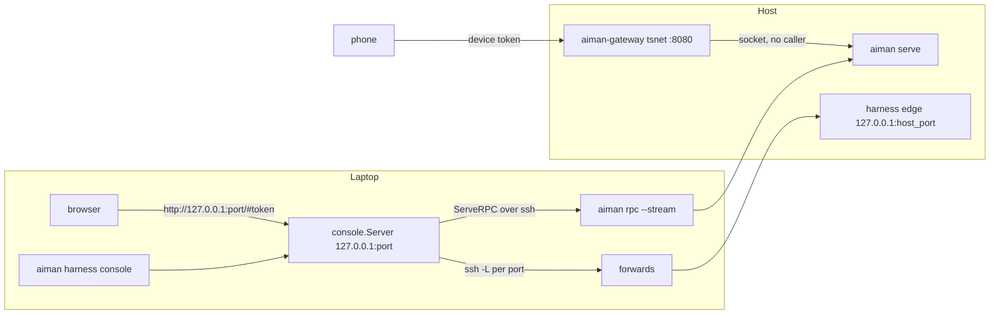
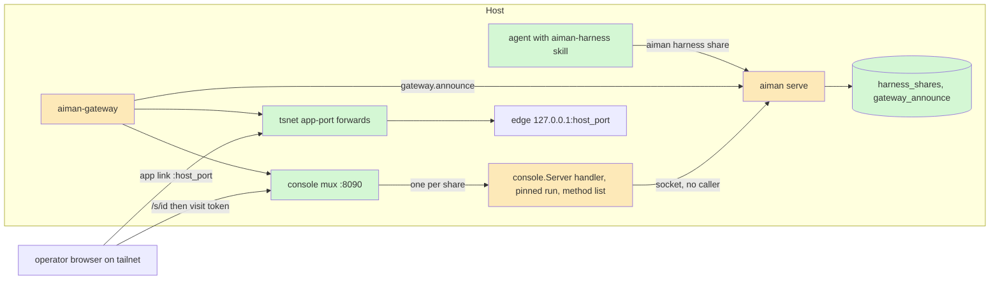
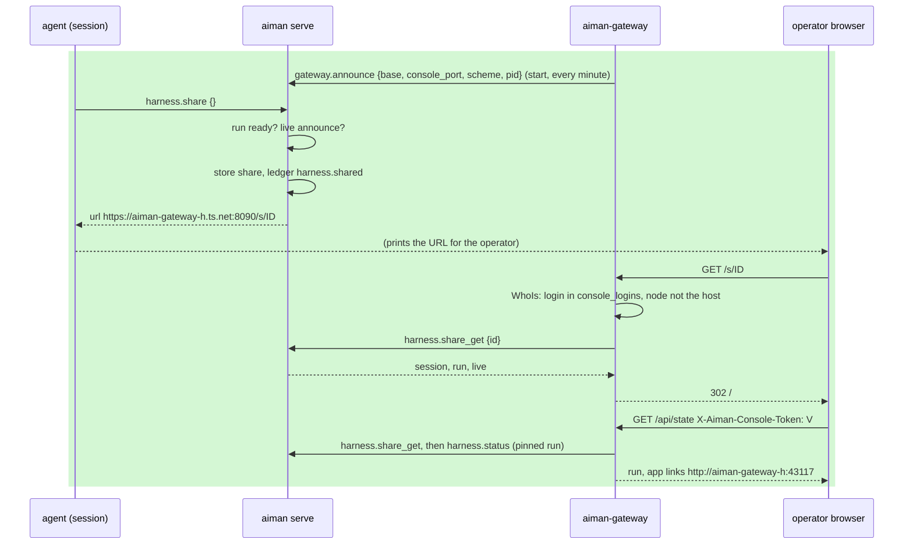

# harness-share: a harness skill and a console URL over the tailnet

**Revision:** 3 · **Size:** project · **Status:** in review
**Task:** operator request in session `app-debug-harness` (2026-11-20) · **Spec:** `docs/specs/harness-share.md` (written with the build)

**Legend:** green = new, amber = changed, red dashed = removed. Every diagram uses these three classes:

```text
classDef new fill:#d4f7d4
classDef changed fill:#fde9b8
classDef removed stroke-dasharray:4,fill:#f9d0d0
```

## The problem

Two gaps stop an agent from handing a tester a working harness.

1. No agent can be told "set up the harness". The setup steps live in `harness.md` inside the `aiman` skill. An agent finds them only if it already decided to read that file.
2. When the harness is up, the tester still has to know and type `aiman harness console --remote <host> --session <name>` on a laptop that has ssh to the host. The session cannot give them anything to click.

The operator wants any aiman session to be able to set up the harness on request and finish by printing a URL the laptop (or any tailnet device of the operator's) opens directly.

## How it works today



- **Console.** `console.New` (`internal/console/server.go:63`) refuses any listener that is not on 127.0.0.1 (`server.go:120`). It reaches serve through the `console.RPC` interface (`server.go:30`), on the laptop `usecase.ServeRPC` over ssh (`cmd/aiman/harness_console.go:47`). It reaches the run's app, DAP and editor ports through `Forwarder` (`server.go:35`), on the laptop one `ssh -L` per port. Every request needs `Host` `127.0.0.1:<port>` (`auth.go:150`), every write a matching `Origin` (`auth.go:155`), every API call the token in `X-Aiman-Console-Token` (`auth.go:19`), and the CSP names `ws://127.0.0.1:<port>` (`auth.go:24`).
- **Run ports.** The edge publishes each relay on host `127.0.0.1:<host_port>` (`harness.RunPort`, `internal/harness/run.go:105`). Host code already dials those directly (`harness/db.go:284`).
- **Gateway.** `aiman-gateway` is a tsnet node `aiman-gateway-<host>` serving plain HTTP on `:8080` on the tailnet (`cmd/aiman-gateway/main.go:215`, `listen.go:9`); the tailnet's WireGuard encrypts it. It accepts the host token or a paired device token (`internal/gateway/auth.go:47`) and, off Funnel, also requires the caller's tailnet login to pass `allow_logins` (`auth.go:79`). It calls serve over the socket with no caller, so serve treats it as the operator (`handler.go:82`). Devices may call only the harness reads (`allowlist.go:25`). It does not record its own URL anywhere; pairing builds `<hostname>:<port>` (`cli.go:84`).
- **Skills.** `internal/aimanskill` installs one skill, `aiman` (`SKILL.md`, `design-template.md`, `harness.md`), into every agent's user and project skill directory (`install.go`), from serve start (`cmd/aiman/serve.go:401`) and at session create (`internal/infra/skills/engine.go:91`). `internal/worktree` treats those files as scaffolding (`worktree.go:202`).

## Glossary

| Term | Meaning |
|---|---|
| Harness run | A sandboxed copy of the app and its services on the host, started by `aiman harness up` |
| Console | The web page (`internal/console`) a tester uses to drive a run: steps, verdicts, logs, debugger, database, AWS |
| Edge / relay port | The run's container that publishes the app's ports and the debugger on host loopback |
| Gateway | `aiman-gateway`, the host's tsnet node the phone talks to |
| tsnet / MagicDNS | Tailscale in-process node; MagicDNS gives it the name `aiman-gateway-<host>.<tailnet>.ts.net` |
| WhoIs | Tailscale's answer to "which login and node sent this connection" |
| Share | New: a record that says one session's run may be opened through the gateway. It holds no secret |
| Share URL | New: `https://aiman-gateway-<host>.<tailnet>.ts.net:8090/s/<share id>`; the id is not a secret |
| Console login | A tailnet login in the new `gateway.console_logins`; only these may open a share |
| Visit token | New: a console token the gateway mints for one browser after its WhoIs check; never leaves the gateway and that browser |
| Announce | New: the gateway telling serve its URL and pid at start (`gateway.announce`) |

## Proposed design

Three parts: a new skill, a share record in serve, and the gateway hosting the console for a share.

### Domain model

```mermaid
classDiagram
    classDef new fill:#d4f7d4
    classDef changed fill:#fde9b8
    classDef removed stroke-dasharray:4,fill:#f9d0d0
    class Share {
      id
      session
      run
      created_at
      cap_at optional
      revoked
    }
    class GatewayAnnounce {
      base
      console_port
      scheme
      pid
      at
    }
    class VisitToken {
      token
      share
      login
      node
      expires_at
    }
    class Skill {
      name
      dir
      files
    }
    class ConsoleOptions {
      RPC
      Forwarder
      Token
      Hosts
      Port
      HTTPS
      Methods
    }
    Share --> "1" Run : opens
    VisitToken --> "1" Share
    class Share:::new
    class GatewayAnnounce:::new
    class VisitToken:::new
    class Skill:::changed
    class ConsoleOptions:::changed
```

- **Share** (new, sqlite `harness_shares`): one row per share, naming one session and pinning one run. The id is 32 random bytes, base64url (as the console token), and not a secret: the session prints it. It ends when the run stops, on `aiman harness unshare`, when the session is dropped, or at `cap_at` when `harness.share_ttl` is set (unset: no cap).
- **GatewayAnnounce** (new, sqlite `gateway_announce`, one row): at start, once tsnet is up, the gateway calls `gateway.announce {base, console_port, scheme, pid}` and repeats it every minute. Serve treats a row older than 3 minutes, or a pid that is gone, as no gateway.
- **VisitToken** (new, gateway memory only): when a browser opens `/s/<id>` and passes the checks, the gateway mints a console token for that share, login and node (12h, renewed by use) and redirects to `/#token=<token>`. The session never sees it.
- **Skill** (changed): `aimanskill` installs a list of skills. `aiman` keeps its three files; `aiman-harness` gets `SKILL.md` and the same `harness.md`.
- **ConsoleOptions** (changed): `Hosts`, `Port` and `HTTPS` replace the fixed loopback `Host`/`Origin` checks and the CSP's `ws://` hosts (`wss://` when https). `Methods` limits which serve methods the console may call; with no listener the console exposes only `Handler()`.

### Structure



- **`aiman-harness` skill** (`internal/aimanskill/harness/SKILL.md`, new). Gated on `AIMAN_ENV=1`. Description triggers on "set up / add / fix / debug the harness, app runner, test scenario". Body is the procedure: detect the stack and ports, find services and external calls, write `.aiman/harness.yaml` with one scenario (and an `app.debug` block for the stack), `aiman harness list --dirty` until clean, `up --dirty --wait`, `check`, commit, `up --wait` on the commit (`--debug` only when the operator asked to debug), then `aiman harness share` and give the operator the printed URL. It points to `harness.md` for the file format and refusals. The `aiman` skill's Harness section says to use it.
- **`harness.share {session?, run?}`** (serve, new; CLI `aiman harness share`). Needs a `ready` run of the session (else `harness_not_running`), passes `refuseOutOfScope`, takes any in-scope caller. With no live announce it is `unavailable` "the gateway is not running on this host; the operator can run aiman harness console". It revokes the session's previous share, stores the new one, records `harness.shared` (session, run, share id) and answers `{"type":"harness_share", url, share, run}`. `harness.unshare {session?}` revokes. `harness.share_get {id}` answers `{session, run, state}` and is operator only (`needs_operator` for a session caller). `gateway.announce` is operator only. None is a gateway device method; the device allowlist test names them as refused.
- **Gateway console** (`internal/gateway/console*.go`, changed `cmd/aiman-gateway`). Starts only when `gateway.console_logins` (new, in `config.GatewayConfig`, pushed by `MarshalServeConfig`) is non-empty and Funnel is off; otherwise no `:8090` listener and no announce of a console port. Every request, static files included, passes WhoIs: the login must be in `console_logins` and the node must not be the host: WhoIs returns the node's `StableID` (the `WhoIs` type gains it; a missing node fails closed), and the gateway refuses its own tsnet `Status.Self.StableID` and, when the system tailscaled socket exists, that daemon's `Self.StableID`. Hostnames are never compared. `GET /s/<id>` asks `harness.share_get` (no cache), mints a visit token and redirects. Each `/api/*` call and the `/api/dap` WebSocket is routed by its visit token to that share's `console.Server`, created on first use with `RPC` = the serve socket client, the run pinned, and `Methods` = the tester's set on that run (`harness.status`, `list`, `logs`, `capture`, `check`, `verdict`, `down`, `debug`, `files`, `file`, `db` (read and write), `evm_txs`, `evm_trace`, `aws`, `aws_calls`, `aws_write`, and `check` with `debug: true`, named on purpose). `harness.up` and `harness.down` are not in it: the agent owns the run's lifecycle, and the page hides both buttons. The gateway passes the WhoIs login as `tester` on `harness.verdict`; serve records it as the actor on the ledger and the to-do, and the steer reads `[aiman] tester <login> marked … fail at <sha>: "<note>"`. Each call's `run` must equal the pinned run. Share state lives in the gateway's memory: serve publishes a hub event `harness_share {id, state}` on share, unshare, cap and run stop, the gateway subscribes to `session.events` and also polls `harness.share_get` for each live share every 10s. When a share ends, the gateway drops its visit tokens, closes its console, every `/api/dap` bridge and every TCP forward at once. HTTP calls read that in-memory state.
- **tsnet app forwards** (new). While a share is live and its run ready, the gateway listens on the tailnet at the `host_port` of each app port only, and admits a connection only from a node whose login holds a live visit token for that share (never db, evm, aws or dap relays; never 8080 or 8090; never under Funnel) and proxies TCP to `127.0.0.1:<host_port>`. Each connection passes the same WhoIs check. The page's app links show `http://<gateway name>:<host_port>`: the forward is plain TCP to the edge's HTTP port, so console TLS does not apply. They close when the share ends.
- **Debugger.** The DAP relay is not forwarded. The Debug tab works through the token-checked `/api/dap` bridge. Editor attach from the laptop (the editor port) is not offered for a shared console; the tab says to use `aiman harness console` for an editor. A later piece can add a token-checked editor listener.
- **Console remote mode** (`internal/console`, changed). `Options.Hosts`, `Port` and `HTTPS` drive `hostOK`, `originOK` and `pageCSP`; `Hosts` holds the MagicDNS short name, every `CertDomains()` entry and the node's tailnet IPv4 and IPv6 addresses. A host `Forwarder` (`console.HostForwarder`) maps each port to `127.0.0.1:<host_port>` without opening anything, so `/api/dap` dials the edge directly; `Forwarder` stays required. `Options.Methods` refuses any other method with 403 before calling serve. `New` keeps the loopback refusal unless `Hosts` is set and no listener is given. The page changes only to hide up and the editor entry when the state says `shared`.

### Behaviour



## A scenario, end to end

1. The operator types in session `orders-api`: "set up the harness". The agent loads `aiman-harness`.
2. It finds `go.mod`, `cmd/api/main.go` listening on `:8080`, a Postgres driver and a call to `api.stripe.com`. It writes `.aiman/harness.yaml` with app `build`/`run`, port `web`, service `db` (`postgres:16`), scenario `refund` with a stub for `/v1/refunds`, and `app.debug: {lang: go}`.
3. `aiman harness list --dirty` reports one error (missing `ready`); it fixes it. `aiman harness up refund --dirty --wait` reaches `ready`; `aiman harness check` exits 0. It commits, runs `aiman harness down`, then `aiman harness up refund --wait` on the commit.
4. `aiman harness share` answers `https://aiman-gateway-regent0.tail1234.ts.net:8090/s/k3v9…`. The agent prints it.
5. The operator clicks it on the laptop. The gateway checks the login and node, finds the live share, mints a visit token and redirects. The page shows `web` as `http://aiman-gateway-regent0.tail1234.ts.net:43117` (forwarded only now, and only for this login).
6. The operator opens the app, records a verdict. The gateway allowed `harness.verdict` because it is in the tester set and names the pinned run; the agent's note reads `tester operator@example.com marked …`.
7. The agent runs `aiman harness down`. Serve publishes `harness_share {state: ended}`; the gateway closes the console, the Debug tab's socket and the forward at once, and the next API call gets 401.

## Alternatives considered

- **Laptop TUI opens the console on an event.** No new network surface, but no URL the session can print and it needs the TUI running. The operator chose the tailnet.
- **Serve listens on the tailnet itself.** Serve has no tsnet and should not gain a second network face; the gateway already owns tailnet identity checks.
- **Console under a path prefix of `:8080`** (`/console/<share>/`). The page and the app links use absolute paths; a separate port keeps the page unchanged and keeps console cookies-free CSP simple.
- **Path proxy for app ports** (`/app/<port>/`). Breaks apps that emit absolute URLs; a TCP forward at the same port number does not.
- **Device token for the browser.** Browsers cannot pair; a share token plus WhoIs gives the same "who" with no pairing.

## Open questions

None. Both answered 2026-11-20 (see Decisions).

## Decisions

| Objection | Severity | Triage | Reason |
|---|---|---|---|
| Use the tailnet (option 2) rather than the TUI or a printed command | operator | accept | Operator's choice 2026-11-20 |
| Skill only inside aiman sessions | operator | accept | Operator's choice 2026-11-20 |
| Who may open a share: new required `gateway.console_logins`, empty means no shared console | operator | accept | Operator's choice 2026-11-20 |
| Console page https when `CertDomains()` is non-empty (`ListenTLS`), else http | operator | accept | Operator's choice 2026-11-20 |
| [high] share token is a full operator bearer the agent holds | high | accept | URL carries no secret; access is WhoIs login in `console_logins` plus not-the-host node on every request, a gateway-minted visit token, and a tester method set pinned to the run |
| [high] DAP forwarded on the tailnet without the token | high | accept | DAP not forwarded; debugger only via `/api/dap`; laptop editor attach deferred to a later piece |
| [high] app forwards only WhoIs-checked, all relays, Funnel | high | accept | App ports only, never 8080/8090, none under Funnel, open only while the share is live, WhoIs per connection |
| [medium] gateway-url.json IPC and cached share_resolve | medium | accept | `gateway.announce` RPC with pid and heartbeat; `harness.share_get` by id, operator only, no cache |
| [medium] Hosts, port and scheme for handler-only console | medium | accept | `Options.Hosts/Port/HTTPS`, `wss://` under https |
| [low] skill shares a debug run by default | low | accept | `--debug` only when asked |
| [low] 12h ttl kills a live run's URL | low | accept | Share follows the run; `harness.share_ttl` is an optional cap |
| [high] host-node refusal by hostname | high | accept | Refuse by node `StableID` (tsnet Self and system tailscaled Self); missing node fails closed |
| [high] app links inherit console https | high | accept | App links are `http://`; console TLS only on `:8090` |
| [high] per-call share_get leaves DAP and TCP open | high | accept | Hub event `harness_share` plus 10s poll; on end close tokens, console, DAP bridges, forwards |
| [medium] verdict speaks as the operator | medium | accept | Verdict carries the WhoIs login as `tester`; `down` removed from the tester set |
| [medium] check debug:true allowed implicitly | medium | accept | Named on purpose in the tester set |
| [medium] app forwards ignore the visit token | medium | accept | Forward admits only logins holding a live visit token for the share |
| [medium] DAP needs a Forwarder with no listener | medium | accept | `console.HostForwarder` maps ports to `127.0.0.1:<host_port>` |
| [low] share id length | low | accept | 32 bytes base64url |
| [low] tailnet IP Host refused | low | accept | Tailnet IPs added to `Hosts` |

## Breakdown

| Piece | Owns files | Parallel group | Depends on | Complexity | Tier | Acceptance tests |
|---|---|---|---|---|---|---|
| P1 skill and installer | `internal/aimanskill/**`, `internal/infra/skills/engine.go`, `internal/worktree/worktree.go` | A | none | M | smart | `go test ./internal/aimanskill ./internal/infra/skills ./internal/worktree -run 'TestHarnessSkill'` |
| P2 share in serve | `internal/server/handlers_harness_share.go`, `internal/server/handlers_harness.go` (verdict tester), `internal/server/handlers_gateway_announce.go`, `internal/infra/sqlite/shares.go`, `internal/gateway/allowlist_test.go`, `cmd/aiman/harness_share_cmd.go`, `api/openapi.yaml`, `internal/domain/events.go` | A | none | M | worker | `go test ./internal/server -run TestHarnessShare && go test ./internal/infra/sqlite -run TestHarnessShares` |
| P3 console remote mode | `internal/console/server.go`, `auth.go`, `api.go`, `dap*.go`, `web/*` | A | none | M | smart | `go test ./internal/console -run 'TestRemoteHosts|TestMethodSet'` |
| P4 gateway console and forwards | `internal/gateway/console*.go`, `cmd/aiman-gateway/*.go` | B | P2, P3 | L | smart | `go test ./internal/gateway -run 'TestConsoleShare|TestConsoleForward'` |
| P5 docs | `AGENTS.md`, `internal/aimanskill/harness.md`, `docs/specs/harness-share.md` | C | P1-P4 | S | worker | `make ci` |

## What you should be able to explain after reading

1. Why the URL is served by the gateway and not by serve or the laptop.
2. Why the share URL holds no secret, and what the WhoIs check, the host-node refusal and the visit token each prove.
3. Why app ports are TCP-forwarded at the same port number instead of path-proxied.
4. When a share stops working (run stop, unshare, session drop, optional cap, gateway exit).
5. Which harness actions a shared console allows, and why `up`, `down` and the DAP port are left out.
