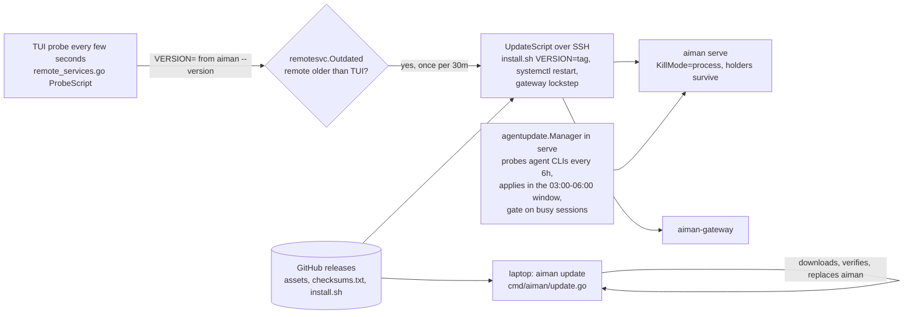
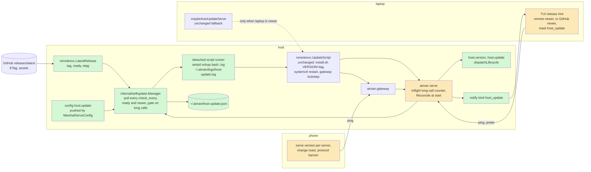

# host-self-update: serve and the gateway update themselves on release

**Revision:** 1 · **Size:** project · **Status:** draft, awaiting consult and operator approval
**Task:** operator request on 2026-11-08 ("ideal if aiman serve and gateway could update automatically when a new version is available ... as soon as a new release appears. TUI and mobile app should be backwards compatible but notify of new release") · **Spec:** `docs/specs/host-self-update.md` (this page)

**Legend:** green = new, amber = changed, red dashed = removed. Every diagram uses these three classes:

```text
classDef new fill:#d4f7d4
classDef changed fill:#fde9b8
classDef removed stroke-dasharray:4,fill:#f9d0d0
```

In a sequence diagram, which has no classes, wrap new steps in `rect rgb(212,247,212)` and changed steps in `rect rgb(253,233,184)`.

## The problem

A release of aiman reaches a host only through the laptop. The TUI probes each remote's serve and gateway every few seconds and, when they run an older release than the TUI itself, runs the update script over SSH (`internal/ui/serve_autoupdate.go:36`). Three things have to be true for that to happen: the operator has run `aiman update` on the laptop, the TUI is open, and the laptop is online. Releases cut by autonomous sessions, like v0.34.0 today, sit on GitHub until all three line up. Meanwhile every fix in serve, the holder, the gateway and the phone's RPCs is missing from the host while it looks healthy.

Nothing tells the operator a release exists either. The TUI compares versions only to decide whether to push its own release down, and never warns when a remote is newer or when GitHub has something newer than the TUI. The phone never stores or shows a serve version; it learns a serve is too old only when a method comes back `unknown method` (`lib/sessionFailures.ts:28`).

Once hosts update themselves the common case flips: the host runs a newer release than the laptop and the phone. The clients must keep working against a newer serve, and both must tell the operator a new release is out.

## How it works today



Files:

- Laptop-driven remote update: `internal/ui/serve_autoupdate.go:36` (`maybeAutoUpdateServe`: serve and gateway only, running only, strictly older only, once per host and kind every 30 minutes), `internal/ui/remote_services.go:199` (`serviceOpScript`), `:225` (`remoteServiceOpCmd`, which also pushes `MarshalServeConfig(host)` before every serve op), `internal/infra/config/config.go:600` (`features.auto_update_remotes`, default on).
- The update script: `internal/infra/remotesvc/remotesvc.go:227` (`UpdateScript`: `set -e`, then `InstallPipeAt(tag)`, then `StartScript`, then for serve `gatewayLockstep`), `:239` (gateway installed at the same tag, restarted only if it was running), `internal/infra/remotesvc/install_pin.go:31` (`InstallPipeAt`: `curl` the release's `install.sh`, pipe to `sh` with `VERSION=<tag>`), `:61` (`LatestReleaseTag`: GET `releases/latest`, 30s, tag validated against `^v\d+\.\d+\.\d+$`), `internal/infra/remotesvc/version.go:63` (`Outdated`: both sides must parse, a dev build or a newer remote is never outdated).
- The unit: `internal/infra/remotesvc/remotesvc.go:105` (`KillMode=process` for serve only, so holders survive a restart), `:112` (`Restart=on-failure`), `:174` (`StartScript`: rewrite unit, `daemon-reload`, `leftoverCleanup`, `start`, `enable`).
- Release pipeline: `.github/workflows/release.yml` publishes the archives first and runs the `checksums` job afterwards; `install.sh` with `VERSION=` refuses a release without `checksums.txt` and never falls back to a source build. Until that job finishes a release exists but cannot be installed.
- The pattern to copy: `internal/agentupdate/manager.go:75` (`Manager`: probe, state file, policy, gate, hooks), `internal/agentupdate/policy.go:16` (mode off/notify/auto), `internal/agentupdate/gate.go:20`, `internal/agentupdate/state.go:41` (`~/.aiman/agent-versions.json`, atomic save), `cmd/aiman/agent_updates.go:72` (`wireAgentUpdateNotify`), `cmd/aiman/serve.go:222` (wiring order).
- Version on the wire: `internal/server/server.go:340` (`ping` returns `{type:"pong", version, protocol}`), `internal/server/protocol.go:8` (`ProtocolVersion = 1`), `cmd/aiman/main.go:29` (`version` from ldflags, `dev` for a local build). No Go client calls `ping`; the phone calls it only from the Settings Test button (`app/(tabs)/settings.tsx:38`) and when adding a direct server (`hooks/useAuth.tsx:58`).
- Notifications: `internal/domain/notification.go:16` (`agent_update`, `NeedsYou` false), `internal/notify/recorder.go:135` (`Emit`, empty session id skips `min_interval`), `internal/gateway/notify.go:107` (phone sink skips `agent_update`), `internal/ui/session_events.go:230` (`notifyToast` toasts only `NeedsYou` kinds).
- Phone compatibility today: `services/api.ts:442` (`rpc` maps errors), `lib/sessionFailures.ts:28` (`isMissingMethod`: `invalid_params` with `unknown method`, or a coded 403), responses are cast TypeScript types with no runtime validation, so unknown fields are ignored; unknown event types with a session id fall through `applyActivity` (`lib/mergeEvents.ts:16`). OTA: `expo-updates` with `checkAutomatically: ON_LOAD`, and `lib/appUpdates.ts:7` downloads on open and applies on the next foreground; CI publishes to the `main` channel on every push to `main`.

## Glossary

| Term | Meaning |
|---|---|
| Release | A GitHub release of `bouwerp/aiman` tagged `vX.Y.Z`, carrying `aiman`, `aiman-trigger` and `aiman-gateway` archives, `checksums.txt` and `install.sh`. |
| Ready release | A release whose `checksums.txt` asset exists. Only a ready release can be installed by the pinned installer. |
| Host | The machine running `aiman serve` and, usually, `aiman-gateway` as systemd user units. |
| Self-update | Serve on the host noticing a newer ready release and running the same update script the laptop runs today, on itself. |
| Lockstep | The update script installs `aiman-gateway` at the same tag as serve and restarts it only if it was running (`gatewayLockstep`). |
| Protocol | `ProtocolVersion`, the integer `ping` returns. It names the RPC contract, not the release. Within one protocol number serve only adds. |
| Dev build | A binary whose version does not parse as `vX.Y.Z` (`dev`). It never updates itself and the laptop never updates it. |
| Long call | An RPC whose handler runs longer than the default 30s and mutates state midway: `session.create`, `session.restart`, `session.terminate`, `design.publish`, `review.fix`, `review.assess`, `review.post`, `review.push`, `review.approve`, `review.run`, `review.coverage`, `aws.login_start` (the list `callDeadline` names, `internal/server/client.go:324`, minus the read-only `repo.list` and `aws.status`). |
| Hint | A one-line notice in a client that a newer release exists than the client itself runs. |

## Proposed design

Serve polls GitHub for the latest release, waits until it is ready, defers while a long call is running, then runs the existing update script detached from itself. The new serve reconciles the attempt on start and records a `host_update` notification. The laptop path stays as a fallback. Clients tolerate a newer serve by contract and show a hint.

### Domain model

```mermaid
classDiagram
    classDef new fill:#d4f7d4
    classDef changed fill:#fde9b8
    classDef removed stroke-dasharray:4,fill:#f9d0d0

    class Release {
        Tag string
        Ready bool
        ETag string
        PublishedAt time
    }
    class Policy {
        Mode off|notify|auto
        CheckEvery duration
        RetryAfter duration
    }
    class Attempt {
        At time
        From string
        To string
        Status started|ok|failed
        Error string
    }
    class State {
        CheckedAt time
        ETag string
        Latest Release
        Notified string
        Attempt Attempt
    }
    class Manager {
        Version string
        Fetcher
        Runner
        Busy func() int
        OnNewVersion func(Release)
        OnApplied func(Attempt)
        Status() HostUpdateStatus
        Request(ctx) Outcome
        Run(ctx)
        Reconcile()
    }
    class HostUpdateStatus {
        Version string
        Protocol int
        Latest string
        LatestReady bool
        Mode string
        Status current|available|not_ready|deferred|updating|failed|held|unknown
        CheckedAt time
        Attempt Attempt
    }
    class HostUpdateConfig {
        Mode string
        CheckEvery duration
    }
    class NotifyKind {
        host_update
    }
    Manager --> State
    Manager --> Policy
    State --> Release
    State --> Attempt
    Manager --> HostUpdateStatus
    HostUpdateConfig --> Policy
    class Release:::new
    class Policy:::new
    class Attempt:::new
    class State:::new
    class Manager:::new
    class HostUpdateStatus:::new
    class HostUpdateConfig:::new
    class NotifyKind:::changed
```

- `Release` is what one poll learns. `Ready` is true when the release's asset list holds `checksums.txt`. `ETag` lets the next poll send `If-None-Match`, so an unchanged answer is a 304 that GitHub does not count against the unauthenticated rate limit.
- `Policy` is the config: `host.update.mode` (`off`, `notify`, `auto`; default `auto`), `host.update.check_every` (default 10 minutes, floor 1 minute), and the fixed `RetryAfter` of one hour for a failed install of the same tag. There is no window: the operator asked for updates as soon as a release appears.
- `Attempt` records one install: who started it, from which version to which tag, and how it ended. `started` is written before the script runs, so the next serve can tell whether the install took.
- `State` is `~/.aiman/host-update.json`, written atomically like `agent-versions.json`.
- `Manager` is `internal/selfupdate.Manager`. `Busy` is serve's count of long calls in flight. `Reconcile` runs once at serve start.

### Structure



New files:

- `internal/selfupdate/manager.go`, `policy.go`, `state.go`, `runner.go` (the package; no import of `internal/server`).
- `internal/infra/remotesvc/release.go`: `LatestRelease(ctx, etag string) (Release, bool, error)`. It calls the same URL `LatestReleaseTag` uses with `If-None-Match`, returns `(_, false, nil)` on 304, and reads `tag_name` and `assets[].name`. `LatestReleaseTag` becomes a thin wrapper.
- `internal/server/handlers_host_update.go`: `host.version` and `host.update`, joined to the `dispatchLifecycle` cases next to `host.stats`.
- `cmd/aiman/host_update.go`: wiring (`newHostUpdates`, `wireHostUpdateNotify`) and the CLI `aiman host version [--json]`, `aiman host update [--json]`.
- `internal/ui/release_hint.go`: the hint rule and its rendering.
- Phone: `lib/serveVersion.ts`, `hooks/useServeVersion.ts`, a root `components/ProtocolBanner.tsx`.

Changed files:

- `internal/server/server.go`: `inflight` counter around long calls (`Call` path and the stream path for `pty.attach` is not counted; see Behaviour); `ping` unchanged.
- `internal/server/client.go`: `longCall(method) bool`, derived from the same switch `callDeadline` uses, so the two lists cannot drift.
- `internal/infra/config/config.go`: `HostConfig{Update HostUpdateConfig}` under the YAML key `host`; `ServeConfig` carries it; `MarshalServeConfig` pushes it.
- `internal/domain/notification.go`: `NotifyHostUpdate = "host_update"`, in `AllNotifyKinds`, `NeedsYou` false, label `host update`.
- `internal/gateway/allowlist.go`: `host.version` read, `host.update` destructive.
- `internal/gateway/notify.go`: the phone sink skips `host_update` like `agent_update`.
- `internal/ui/session_events.go`: `notifyToast` toasts `host_update` although `NeedsYou` is false, because the toast is the laptop's release hint.
- `api/openapi.yaml`: both methods, `HostVersionResult`, `HostUpdateResult`; the phone copies the spec and regenerates types.
- `AGENTS.md`, `internal/aimanskill/SKILL.md` (one line: a host updates itself; `aiman host version` shows it).

### Behaviour

**Poll.** `Run` fires `FirstProbeDelay` (2 minutes) after serve starts, then every `check_every`. A poll calls `LatestRelease` with the stored ETag. A 304 updates `CheckedAt` only. A new answer stores `Latest`. The manager then decides:

1. `Version` does not parse (`dev`): status `unknown`, nothing else. A developer's host is never clobbered.
2. `Latest.Tag` is not strictly newer than `Version` (`remotesvc.Outdated(Version, Latest.Tag)` false): status `current`.
3. Newer but not ready: status `not_ready`. The next poll looks again. No notification yet.
4. Newer and ready, mode `notify`: status `available`; `OnNewVersion` once per tag (`Notified`).
5. Newer and ready, mode `auto`: apply, below.
6. Mode `off`: no polling at all, status `held`.

**Gate.** Before applying, the manager asks `Busy()`. A non-zero count defers: status `deferred`, retry every 30 seconds for up to `check_every`, then the next poll takes over. The count covers long calls only. Open attach streams (TUI `pty.attach` over SSH, the phone's terminal WebSocket) do not defer the restart: the holder keeps the terminal, the TUI shows the detach and reattaches on the next key, the phone reconnects as it does after any network blip. Plain RPCs that lose their connection during the two or three seconds of restart get `server_not_running` and the CLI's existing retry behaviour. A `started` attempt for the same tag that is younger than `OpTimeout` (3 minutes) also defers, so two serve processes cannot both run the script.

**Apply.** The manager writes `Attempt{Status: started, From: Version, To: tag}` to the state file, then runs `remotesvc.UpdateScript(KindServe, tag)` through the runner: `setsid nohup bash <script file> >> ~/.aiman/logs/host-update.log 2>&1 &`, the script file written under `~/.aiman/tmp/` with mode 0600. The script is the one the laptop runs today, unchanged: it verifies the archive against `checksums.txt`, swaps the binary, stops and starts the serve unit, and installs and restarts the gateway in lockstep. Detaching matters: `StartScript` stops the unit serve is the main process of. With `KillMode=process` only serve is killed, and `setsid` keeps the script out of serve's process group so a non-systemd host (nohup fallback) does not take the script down with it. The runner records the script's exit code in the log; the manager process is gone by then, so the outcome is read at the next start.

**Reconcile.** On start, `Reconcile` reads the state file. An attempt in `started`:

- with `To == Version`: `Status: ok`, `OnApplied`, which emits `host_update` with text `serve updated v0.34.0 → v0.35.0 on <host>` under an empty session id (the recorder's path for host-wide events, `min_interval` skipped).
- with `To != Version` and `At` older than `OpTimeout`: `Status: failed`, error `install did not take (running <Version>)`; `OnApplied` emits `serve update to v0.35.0 failed on <host>: <first log line>`. The same tag is not retried before `RetryAfter`.
- with `To != Version` and `At` younger than `OpTimeout`: left alone, the script may still be running (serve restarted for another reason). The first poll reconsiders it.

A `failed` attempt for `Latest.Tag` younger than `RetryAfter` leaves status `failed` and skips apply. A newer tag resets it.

**`host.version {}`** returns `{type:"host_version", host, version, protocol, latest, latest_ready, mode, status, checked_at, attempt}`. Any caller may read it, sessions included; it is a device read method. With no manager (mode `off`) `latest` is empty and `status` is `held`.

**`host.update {}`** forces a poll and, in any mode but `off`, an apply of a ready newer release through the same gate. It returns `{type:"host_update", accepted, reason, target}` within 25s and runs the install in the background. A session caller gets `needs_operator`. On the gateway it needs `allow_destructive`. The TUI's `u` on the Agent API page keeps its SSH path, because it also pushes the serve config.

**Config.** `host.update.mode` and `host.update.check_every` live in the laptop's `~/.aiman/config.yaml` and reach the host through `MarshalServeConfig(host)`, like `agents.update`. A host that never received a config has the defaults, so a fresh install updates itself. An invalid mode falls back to `notify`, as the agent updater does.

**Laptop fallback.** `maybeAutoUpdateServe` is unchanged. With self-updating hosts its condition (remote strictly older than the TUI) is rarely true, but it still covers a host that cannot reach GitHub while the laptop can push the installer over SSH.

**Compatibility contract.** `ProtocolVersion` stays 1. Within protocol 1 serve may add methods, result fields, event types and error codes, and may never remove or rename one or change the meaning of an existing field. A client built for protocol 1 therefore works against every later protocol-1 serve, and only needs to tolerate what it does not know, which the phone's cast types and the TUI's `json.Unmarshal` into structs already do. The contract is pinned by a test: `internal/apicompat` compares `api/openapi.yaml` with the copy at the previous release tag (`git show <tag>:api/openapi.yaml`, tag from `git describe --tags --abbrev=0`) and fails when a method, event type, result schema or schema property of the old spec is missing from the new one, or when `info.version` moved backwards. CI fetches tags for it. A deliberate break bumps `ProtocolVersion`, and clients that see a protocol above the one they know show a banner instead of guessing (phone below; the TUI and serve ship in one release, so the TUI's hint already says to update).

**TUI hint.** `release_hint.go` computes one `Hint{Tag, Source}` from two inputs: the newest serve version among probed remotes, and the latest GitHub release tag fetched once at startup and every 6 hours (`remotesvc.LatestReleaseTag`, failures ignored). When either is strictly newer than `m.version` (and `m.version` parses; a dev TUI gets no hint), the help line's version slot reads `v0.34.0 · v0.35.0 available: aiman update` and a toast fires once per tag. A `host_update` notification event toasts `serve on <host> updated to v0.35.0` through `notifyToast`. The TUI does not update itself: `aiman update` replaces the running binary and the operator should choose the moment.

**Phone.** `useServeVersion` calls `ping` when a server becomes active and on each foreground (the existing `useAppUpdates` hook already observes `AppState`), stores `{version, protocol, seenAt}` per server in the servers store, and the server card in Settings shows `serve v0.35.0`. When the stored version changes, one toast says `<nickname> now runs aiman v0.35.0`. When `pong.protocol` is greater than the app's `SUPPORTED_PROTOCOL` (1), the root layout shows a persistent banner `This app is too old for <nickname>. Update the app.`; the app itself still arrives by OTA on the next foreground, so the banner is the fallback for a native build whose fingerprint changed. Everything else keeps the existing degradation paths (`isMissingMethod`, `unsupported` transcript, amber errors).

## A scenario, end to end

1. 10:00. The operator pushes `v0.35.0`. The Release workflow publishes the archives at 10:07 and `checksums.txt` and `install.sh` at 10:11.
2. 10:05. Serve on `remote1` (v0.34.0) polls with its ETag. GitHub returns 200: `tag_name: v0.35.0`, assets without `checksums.txt`. State: `Latest{v0.35.0, Ready:false}`, status `not_ready`. Log: `host-update: v0.35.0 published, checksums not ready`.
3. 10:15. Poll: 200, `checksums.txt` present. Newer, ready, mode `auto`. `Busy()` is 1: a `session.create` for a child is running. Status `deferred`, retry in 30s.
4. 10:15:30. `Busy()` is 0. State: `Attempt{started, from v0.34.0, to v0.35.0}`. Runner writes `~/.aiman/tmp/host-update-v0.35.0.sh` and starts it with `setsid nohup`. Log: `host-update: installing v0.35.0`.
5. The script downloads `install.sh` for v0.35.0, runs it with `VERSION=v0.35.0`, which verifies `aiman-linux-amd64.tar.gz` against `checksums.txt` and swaps `~/.local/bin/aiman`. `StartScript` stops `aiman-serve.service` (serve exits, the five holders keep running), rewrites the unit and starts it. `gatewayLockstep` installs `aiman-gateway` v0.35.0 and restarts it because it was running.
6. 10:15:36. The new serve starts, `Reconcile` finds `started → v0.35.0` and `Version == v0.35.0`: `Status: ok`. `OnApplied` emits `host_update`: `serve updated v0.34.0 → v0.35.0 on remote1`. The ledger has no session for it; the notification log does.
7. The child whose `aiman todo done` hit the restart saw `server_not_running` and retried a second later. The operator's attach dropped; the TUI shows the detach and the next key reattaches to the same holder.
8. The TUI (v0.34.0) receives the `notify` event and toasts `serve on remote1 updated to v0.35.0`. Its next probe reads `VERSION=v0.35.0`, newer than itself: the help line reads `v0.34.0 · v0.35.0 available: aiman update`. The operator runs `aiman update` when convenient.
9. The phone comes to the foreground at 10:40. `useAppUpdates` applies the OTA bundle published from aiman-phone `main` earlier (if any). `useServeVersion` pings: `version v0.35.0, protocol 1`. The server card shows `serve v0.35.0`; a toast says `remote1 now runs aiman v0.35.0`. Protocol 1 is supported, no banner. Every RPC the app makes exists on the new serve by contract.
10. `aiman host version` on the host prints `v0.35.0 (latest v0.35.0, current, checked 10:45, updated from v0.34.0 at 10:15)`.

## Alternatives considered

- **Keep the laptop in charge and only add hints.** Loses the ask: a host would still wait for the laptop. Rejected.
- **A systemd timer running `install.sh` nightly.** No gate against a running `session.create`, no knowledge of readiness (it would install an unready release and fail), no notification, nothing in the state the RPCs could report. Rejected; the manager does those four things and reuses the same script.
- **A GitHub webhook or Actions step that pushes to hosts.** Needs an inbound path to every host or SSH credentials in CI. Rejected.
- **Poll through `gh api` for the 5000/h authenticated limit.** `gh` is on hosts for ciwatch, but its absence or an expired login would silently stop updates. The ETag makes unchanged polls free; 10 minutes is 6 counted requests per hour per host at most. Rejected; may be revisited if hosts share a NAT and hit the 60/h limit.
- **`systemd-run --user` for the update script instead of `setsid nohup`.** Cleaner cgroup separation, but it needs systemd and the nohup hosts would need a second path. `setsid nohup` works on both. Rejected.
- **Let the TUI update itself when it sees a newer release.** The operator asked for notification; replacing a running binary under the operator is a surprise. Rejected; `aiman update` is one command and the hint names it.
- **Defer the restart while an attach is open.** An attach can stay open all day, which would make "as soon as a release appears" false for exactly the hosts the operator uses most. Rejected; the holder keeps the terminal and reattach is one key.
- **Bump `ProtocolVersion` per release so clients can detect every skew.** Would make every client refuse every newer serve, the opposite of backwards compatibility. Rejected; the protocol number marks breaks, the compat test prevents accidental ones.
- **Update `aiman-trigger` in lockstep too.** The laptop path excludes it on purpose: it runs scheduled autonomous work and a restart could cut a run. Deferred; it keeps being updated by the TUI's `u` on the Daemons tab.

## Open questions

Each has a default; the design proceeds with it unless the operator says otherwise.

1. **Poll interval.** Default 10 minutes (`host.update.check_every`). A shorter interval (1 minute) is allowed by the floor and costs at most 60 counted requests per hour per host, the whole unauthenticated budget for hosts behind one address. Decides how long after `checksums.txt` lands a host moves.
2. **Long-call gate scope.** Default: defer only while a long call runs; open attaches do not defer. The alternative, deferring on attaches too, is listed under alternatives. Decides whether an operator mid-attach can see a restart.
3. **Phone push for `host_update`.** Default: the phone sink skips it like `agent_update`, and the phone learns from `ping` on foreground. The alternative, pushing it, means a phone notification per host per release, which the per-state notification preferences cannot filter. Decides whether a release produces phone pushes.

## Decisions

| Objection | Severity | Triage | Reason |
|---|---|---|---|

## Breakdown

Acceptance tests are committed on `aiman-next-level` (Go, behind `//go:build acceptance`) and `fu-...` style branches in aiman-phone before the first child starts. Children run them, remove the tag in their PR, and may not edit them.

| Piece | Owns files | Parallel group | Depends on | Complexity | Tier | Acceptance tests |
|---|---|---|---|---|---|---|
| P1 self-update core | `internal/selfupdate/*`, `internal/infra/remotesvc/release.go`, `internal/domain/notification.go` (kind only) | A | – | L | smart | `internal/selfupdate/manager_acceptance_test.go`, `internal/infra/remotesvc/release_acceptance_test.go`; `go test ./internal/selfupdate/ ./internal/infra/remotesvc/` |
| P2 serve wiring, config, RPCs, CLI | `internal/server/handlers_host_update.go`, `internal/server/server.go` (inflight counter), `internal/server/client.go` (`longCall`), `internal/server/handlers_lifecycle.go` (cases), `internal/infra/config/config.go`, `cmd/aiman/host_update.go`, `cmd/aiman/main.go`, `cmd/aiman/serve.go`, `internal/gateway/allowlist.go`, `internal/gateway/notify.go`, `api/openapi.yaml`, `AGENTS.md`, `internal/aimanskill/SKILL.md` | B | P1 | M | smart | `internal/server/host_update_acceptance_test.go`, `internal/infra/config/host_update_config_acceptance_test.go`; `go test ./internal/server/ ./internal/infra/config/ ./internal/gateway/ ./cmd/aiman/` |
| P3 compat guard | `internal/apicompat/*`, `internal/server/openapi_compat_test.go`, `.github/workflows/ci.yml` (fetch tags) | A | – | M | worker | `internal/apicompat/superset_acceptance_test.go`; `go test ./internal/apicompat/` |
| P4 TUI hint and toast | `internal/ui/release_hint.go`, `internal/ui/a1_prompt.go` (version slot), `internal/ui/session_events.go` (`notifyToast`), `internal/ui/startup.go` or `dashboard.go` (GitHub check timer) | B | P1 (notification kind) | M | smart | `internal/ui/release_hint_acceptance_test.go`; `go test ./internal/ui/ -run 'ReleaseHint|NotifyToast'` |
| P5 phone version, toast, banner | aiman-phone: `lib/serveVersion.ts`, `hooks/useServeVersion.ts`, `components/ProtocolBanner.tsx`, `app/_layout.tsx`, `app/(tabs)/settings.tsx`, `lib/servers.ts` (stored version), `constants/protocol.ts`, `api/openapi.yaml` copy and `api/types.generated.ts` | A | – (spec copy lands with P2; the piece's own fields come from `ping`, which exists) | M | smart | `tests/unit/serveVersion.acceptance.test.ts`; `ACCEPTANCE=1 npx jest --runInBand tests/unit/serveVersion.acceptance.test.ts`, `npm run check` |

Group A runs first (P1, P3, P5 in parallel). Group B (P2, P4) starts when P1 has merged. The coordinator writes the as-built page and the release notes.

## What you should be able to explain after reading

1. Why a host could not update itself before, and the three conditions the laptop path still needs.
2. What "ready" means for a release and why serve waits for `checksums.txt` instead of installing at the first sight of a tag.
3. Why the update script is started with `setsid nohup` and how serve survives being stopped by a script it started (`KillMode=process`, the holders, `Reconcile` at start).
4. What the long-call gate defers and what it deliberately does not (attaches), and where the two lists come from (`callDeadline`).
5. What "protocol 1" promises, how the compat test enforces it, and what the TUI and the phone do when they see a newer serve or a newer protocol.
