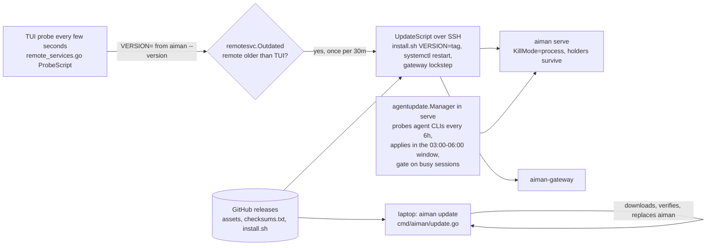
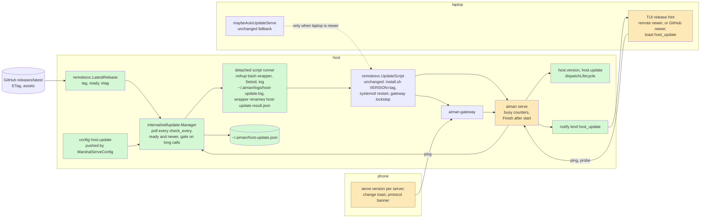

# host-self-update: serve and the gateway update themselves on release

**Revision:** 3 · **Size:** project · **Status:** two consult rounds complete (0028f072 on rev 1: revise, 2 high, 4 medium, 3 low; c383a8f0 on rev 2: revise, 3 high, 4 medium, 4 low), all 20 objections accepted and folded in; awaiting operator approval
**Task:** operator request on 2026-11-08 ("ideal if aiman serve and gateway could update automatically when a new version is available ... as soon as a new release appears. TUI and mobile app should be backwards compatible but notify of new release") · **Spec:** `docs/specs/host-self-update.md` (this page)

**Legend:** green = new, amber = changed, red dashed = removed. Every diagram uses these three classes:

```text
classDef new fill:#d4f7d4
classDef changed fill:#fde9b8
classDef removed stroke-dasharray:4,fill:#f9d0d0
```

In a sequence diagram, which has no classes, wrap new steps in `rect rgb(212,247,212)` and changed steps in `rect rgb(253,233,184)`.

## The problem

A release of aiman reaches a host only through the laptop. The TUI probes each remote's serve and gateway every few seconds and, when they run an older release than the TUI itself, runs the update script over SSH (`internal/ui/serve_autoupdate.go:36`). Three things have to be true for that to happen: the operator has run `aiman update` on the laptop, the TUI is open, and the laptop is online. Releases cut by autonomous sessions, like v0.34.0 today, sit on GitHub until all three line up. Meanwhile every fix in serve, the holder, the gateway and the phone's RPCs is missing from the host while it looks healthy.

Nothing tells the operator a release exists either. The TUI compares versions only to decide whether to push its own release down, and never warns when a remote is newer or when GitHub has something newer than the TUI. The phone never stores or shows a serve version; it learns a serve is too old only when a method comes back `unknown method` (`lib/sessionFailures.ts:28`).

Once hosts update themselves the common case flips: the host runs a newer release than the laptop and the phone. The clients must keep working against a newer serve, and both must tell the operator a new release is out.

## How it works today



Files:

- Laptop-driven remote update: `internal/ui/serve_autoupdate.go:36` (`maybeAutoUpdateServe`: serve and gateway only, running only, strictly older only, once per host and kind every 30 minutes), `internal/ui/remote_services.go:199` (`serviceOpScript`), `:225` (`remoteServiceOpCmd`, which also pushes `MarshalServeConfig(host)` before every serve op), `internal/infra/config/config.go:600` (`features.auto_update_remotes`, default on).
- The update script: `internal/infra/remotesvc/remotesvc.go:227` (`UpdateScript`: `set -e`, then `InstallPipeAt(tag)`, then `StartScript`, then for serve `gatewayLockstep`), `:239` (gateway installed at the same tag, restarted only if it was running), `internal/infra/remotesvc/install_pin.go:31` (`InstallPipeAt`: `curl` the release's `install.sh`, pipe to `sh` with `VERSION=<tag>`), `:61` (`LatestReleaseTag`: GET `releases/latest`, 30s, tag validated against `^v\d+\.\d+\.\d+$`), `internal/infra/remotesvc/version.go:63` (`Outdated`: both sides must parse, a dev build or a newer remote is never outdated).
- The unit: `internal/infra/remotesvc/remotesvc.go:105` (`KillMode=process` for serve only, so holders survive a restart), `:112` (`Restart=on-failure`), `:174` (`StartScript`: rewrite unit, `daemon-reload`, `leftoverCleanup`, `start`, `enable`).
- Release pipeline: `.github/workflows/release.yml` publishes the archives first and runs the `checksums` job afterwards; `install.sh` with `VERSION=` refuses a release without `checksums.txt` and never falls back to a source build. Until that job finishes a release exists but cannot be installed.
- The pattern to copy: `internal/agentupdate/manager.go:75` (`Manager`: probe, state file, policy, gate, hooks), `internal/agentupdate/policy.go:16` (mode off/notify/auto), `internal/agentupdate/gate.go:20`, `internal/agentupdate/state.go:41` (`~/.aiman/agent-versions.json`, atomic save), `cmd/aiman/agent_updates.go:72` (`wireAgentUpdateNotify`), `cmd/aiman/serve.go:222` (wiring order).
- Version on the wire: `internal/server/server.go:340` (`ping` returns `{type:"pong", version, protocol}`), `internal/server/protocol.go:8` (`ProtocolVersion = 1`), `cmd/aiman/main.go:29` (`version` from ldflags, `dev` for a local build). No Go client calls `ping`; the phone calls it only from the Settings Test button (`app/(tabs)/settings.tsx:38`) and when adding a direct server (`hooks/useAuth.tsx:58`).
- Notifications: `internal/domain/notification.go:16` (`agent_update`, `NeedsYou` false), `internal/notify/recorder.go:135` (`Emit`, empty session id skips `min_interval`), `internal/gateway/notify.go:107` (phone sink skips `agent_update`), `internal/ui/session_events.go:230` (`notifyToast` toasts only `NeedsYou` kinds).
- Phone compatibility today: `services/api.ts:442` (`rpc` maps errors), `lib/sessionFailures.ts:28` (`isMissingMethod`: `invalid_params` with `unknown method`, or a coded 403), responses are cast TypeScript types with no runtime validation, so unknown fields are ignored; unknown event types with a session id fall through `applyActivity` (`lib/mergeEvents.ts:16`). OTA: `expo-updates` with `checkAutomatically: ON_LOAD`, and `lib/appUpdates.ts:7` downloads on open and applies on the next foreground; CI publishes to the `main` channel on every push to `main`.

## Glossary

| Term | Meaning |
|---|---|
| Release | A GitHub release of `bouwerp/aiman` tagged `vX.Y.Z`, carrying `aiman`, `aiman-trigger` and `aiman-gateway` archives, `checksums.txt` and `install.sh`. |
| Ready release | A release whose `checksums.txt` asset exists. Only a ready release can be installed by the pinned installer. |
| Host | The machine running `aiman serve` and, usually, `aiman-gateway` as systemd user units. |
| Self-update | Serve on the host noticing a newer ready release and running the same update script the laptop runs today, on itself. |
| Lockstep | The update script installs `aiman-gateway` at the same tag as serve and restarts it only if it was running (`gatewayLockstep`). |
| Protocol | `ProtocolVersion`, the integer `ping` returns. It names the RPC contract, not the release. Within one protocol number serve only adds. |
| Dev build | A binary whose version does not parse as `vX.Y.Z` (`dev`). It never updates itself and the laptop never updates it. |
| Long call | An RPC whose handler runs longer than the default 30s and mutates state midway: `session.create`, `session.restart`, `session.terminate`, `design.publish`, `review.fix`, `review.assess`, `review.post`, `review.push`, `review.approve`, `review.run`, `review.coverage`, `aws.login_start` (the list `callDeadline` names, `internal/server/client.go:324`, minus the read-only `repo.list` and `aws.status`). |
| Hint | A one-line notice in a client that a newer release exists than the client itself runs. |

## Proposed design

Serve polls GitHub for the latest release, waits until it is ready, defers while a long call is running, then runs the existing update script detached from itself. The new serve reconciles the attempt on start and records a `host_update` notification. The laptop path stays as a fallback. Clients tolerate a newer serve by contract and show a hint.

### Domain model

```mermaid
classDiagram
    classDef new fill:#d4f7d4
    classDef changed fill:#fde9b8
    classDef removed stroke-dasharray:4,fill:#f9d0d0

    class Release {
        Tag string
        Ready bool
        ETag string
        PublishedAt time
    }
    class Policy {
        Mode off|notify|auto
        CheckEvery duration
        RetryAfter duration
    }
    class Attempt {
        At time
        From string
        To string
        PID int
        Status started|ok|failed
        Exit int
        Error string
    }
    class Result {
        Tag string
        Exit int
        At time
    }
    class State {
        CheckedAt time
        ETag string
        Latest Release
        Notified string
        Attempt Attempt
    }
    class Manager {
        Version string
        Fetcher
        Runner
        Busy []func() int
        OnNewVersion func(Release)
        OnApplied func(Attempt)
        Status() HostUpdateStatus
        Request(ctx) Outcome
        Run(ctx)
        Finish(ctx)
    }
    class HostUpdateStatus {
        Version string
        Protocol int
        Latest string
        LatestReady bool
        Mode string
        Status current|available|not_ready|deferred|updating|failed|held|unknown
        CheckedAt time
        Attempt Attempt
    }
    class HostUpdateConfig {
        Mode string
        CheckEvery duration
    }
    class NotifyKind {
        host_update
    }
    Manager --> State
    Manager --> Policy
    Manager --> Result
    State --> Release
    State --> Attempt
    Manager --> HostUpdateStatus
    HostUpdateConfig --> Policy
    class Release:::new
    class Policy:::new
    class Attempt:::new
    class Result:::new
    class State:::new
    class Manager:::new
    class HostUpdateStatus:::new
    class HostUpdateConfig:::new
    class NotifyKind:::changed
```

- `Release` is what one poll learns. `Ready` is true when the release's asset list holds `checksums.txt`. `ETag` lets the next poll send `If-None-Match`, so an unchanged answer is a 304 that GitHub does not count against the unauthenticated rate limit.
- `Policy` is the config: `host.update.mode` (`off`, `notify`, `auto`; default `auto`), `host.update.check_every` (default 10 minutes, floor 1 minute), and the fixed `RetryAfter` of one hour for a failed install of the same tag. There is no window: the operator asked for updates as soon as a release appears.
- `Attempt` records one install: from which version to which tag, the wrapper's `PID`, and how it ended. `started` is written before the script runs, so whichever serve process is alive when it ends can tell whether the install took. `Exit` is the script's exit code once known.
- `Result` is what the detached wrapper writes when the script ends, whatever the exit: `~/.aiman/host-update.result.json` with the tag, the exit code and the time, written to a temp file and renamed into place. It is the only evidence that the gateway lockstep, which runs after serve has already restarted, succeeded, and the only evidence of an install that failed before the restart.
- `State` is `~/.aiman/host-update.json`, written atomically like `agent-versions.json`.
- `Manager` is `internal/selfupdate.Manager`. `Busy` is a list of counters serve registers (long calls in flight, pending AWS logins, starting handover runs, agent updates running); the gate waits while any is non-zero, up to a cap. One settle path (`settle`) reads the `Result` for a `started` attempt; it runs from `Finish` at start, from a watcher goroutine the manager starts right after the wrapper (for an install that fails before serve restarts), and from every poll.

### Structure



New files:

- `internal/selfupdate/manager.go`, `policy.go`, `state.go`, `runner.go` (the package; no import of `internal/server`).
- `internal/infra/remotesvc/release.go`: `LatestRelease(ctx, etag string) (Release, bool, error)`. It calls the same URL `LatestReleaseTag` uses with `If-None-Match`, returns `(_, false, nil)` on 304, and reads `tag_name` and `assets[].name`. `LatestReleaseTag` becomes a thin wrapper. `ProbeScript` for serve also prints `SELFUPDATE=<contents of ~/.aiman/host-update.json on one line, or empty>`, and `ParseProbe` fills `domain.Daemon.SelfUpdate` (the attempt's status, tag and time) so the laptop can see an install in flight.
- `internal/server/handlers_host_update.go`: `host.version` and `host.update`, joined to the `dispatchLifecycle` cases next to `host.stats`.
- `cmd/aiman/host_update.go`: wiring (`newHostUpdates`, `wireHostUpdateNotify`) and the CLI `aiman host version [--json]`, `aiman host update [--json]`.
- `internal/ui/release_hint.go`: the hint rule and its rendering.
- Phone: `lib/serveVersion.ts`, `hooks/useServeVersion.ts`, a root `components/ProtocolBanner.tsx`.

Changed files:

- `internal/server/server.go`: `inflight` counter around long calls (the `pty.attach` stream is not counted; see Behaviour); `Server.Inflight() int`; `ping` unchanged.
- `internal/server/client.go`: `longCall(method) bool`, derived from the same switch `callDeadline` uses, so the two lists cannot drift; `handover.write` joins that switch (its deadline stays 30s, it is listed for the gate).
- `internal/awslogin`: `Engine.Pending() int`, the device flows in `pending`, `approved` or `minting` (an ended or expired flow never counts; `maxFlow` bounds them at 10 minutes). `internal/handoverchild`: `Manager.Starting() int`, runs in `StatusStarting` younger than the handover timeout. `internal/agentupdate`: `Manager.Updating() int`, agents whose update is running.
- `internal/ui/serve_autoupdate.go`: `maybeAutoUpdateServe` also returns nil while `Daemon.SelfUpdate` reports a `started` attempt younger than `OpTimeout`, so the laptop never pushes a second script into a host mid-install.
- `internal/infra/remotesvc/remotesvc.go`: a unit test that the `pkill -f` pattern of `leftoverCleanup` does not match the runner's argv.
- `internal/infra/config/config.go`: `HostConfig{Update HostUpdateConfig}` under the YAML key `host`; `ServeConfig` carries it; `MarshalServeConfig` pushes it.
- `internal/domain/notification.go`: `NotifyHostUpdate = "host_update"`, in `AllNotifyKinds`, `NeedsYou` false, label `host update`.
- `internal/gateway/allowlist.go`: `host.version` read, `host.update` destructive.
- `internal/gateway/notify.go`: the phone sink pushes only kinds on an explicit allowlist (`waiting_input`, `error`, `ci_escalation`, `review_done`, `ended`, `idle`: the kinds `phoneStateFor` maps today) and drops every other kind, `host_update` and `agent_update` included. Today an unknown kind becomes `waiting_input` and is pushed as "Aiman needs input" with an empty session link; after this change a kind a future serve adds is silent on an old gateway.
- `internal/ui/session_events.go`: `notifyToast` toasts `host_update` although `NeedsYou` is false, because the toast is the laptop's release hint.
- `api/openapi.yaml`: both methods, `HostVersionResult`, `HostUpdateResult`; the phone copies the spec and regenerates types.
- `AGENTS.md`, `internal/aimanskill/SKILL.md` (one line: a host updates itself; `aiman host version` shows it).

### Behaviour

**Poll.** `Run` fires `FirstProbeDelay` (2 minutes) after serve starts, then every `check_every`. A poll calls `LatestRelease` with the stored ETag. A 304 updates `CheckedAt` only. A new answer stores `Latest`. The manager then decides:

1. `Version` does not parse (`dev`): status `unknown`, nothing else. A developer's host is never clobbered.
2. `Latest.Tag` is not strictly newer than `Version` (`remotesvc.Outdated(Version, Latest.Tag)` false): status `current`.
3. Newer but not ready: status `not_ready`. The next poll looks again. No notification yet.
4. Newer and ready, mode `notify`: status `available`; `OnNewVersion` once per tag (`Notified`).
5. Newer and ready, mode `auto`: apply, below.
6. Mode `off`: no polling at all, status `held`.

**Gate.** Before applying, the manager sums its `Busy` counters. A non-zero sum defers: status `deferred`, retry every 30 seconds for up to `check_every`, then the next poll takes over. Serve registers four counters:

1. Long calls in flight (`Server.Inflight`), from the `callDeadline` switch plus `handover.write`: a restart in the middle of a create, restart, terminate, publish, review step or handover write would leave half-written state. Each has a deadline, so this counter cannot stay non-zero on its own.
2. Pending AWS device logins (`awslogin.Engine.Pending`, flows in `pending`, `approved` or `minting`): serve's `Close` fails every pending login, so a restart while the operator has a code on screen would drop the flow. `maxFlow` ends them within 10 minutes.
3. Handover runs still `StatusStarting` and younger than the handover timeout (`handoverchild.Manager.Starting`): `Resume` fails those with "serve restarted before the child started". A run stuck in `prepare` past the timeout is a bug the gate should not inherit.
4. Agent updates running (`agentupdate.Manager.Updating`): an npm or installer run cut in half leaves a broken agent.

A deferral is capped: 30 minutes after the first deferral for a tag (`MaxDefer`), only the first counter is honoured, so a stuck counter cannot hold a host on an old release, and a restart still never cuts a long call. Everything else survives a restart through disk plus `Resume` or `Load` at the next start, and gets no counter: children and consults live in holders; the consult tracker, ciwatch, review fixers, verify runs, the steering queue and memory jobs are sqlite or files whose loops are rebuilt at start (the tracker's `firstAsk` is per process, so one steer note may repeat; that is not corruption); a `pty.create` cut short leaves a holder the next `ScanIDs` adopts. Open attach streams (TUI `pty.attach` over SSH, the phone's terminal WebSocket) do not defer the restart: the holder keeps the terminal, the TUI shows the detach and reattaches on the next key, the phone reconnects as it does after any network blip. Plain RPCs that lose their connection during the two or three seconds of restart get `server_not_running` and the CLI's existing retry behaviour. A `started` attempt whose wrapper `PID` is alive, or that is younger than `ResultWait`, also defers, so two scripts never run at once; the laptop's `maybeAutoUpdateServe` honours the same attempt through the probe.

**Apply.** The manager removes any stale `Result` file, writes `Attempt{Status: started, From: Version, To: tag}` to the state file, runs `remotesvc.UpdateScript(KindServe, tag)` through the runner, then saves the state again with the `PID` the runner returned (a crash between the two writes leaves a `started` attempt with no PID, which the `ResultWait` rule settles). The state file's JSON names are `checked_at`, `etag`, `latest`, `notified`, `attempt{at, from, to, pid, status, exit, error}`; the probe passes the file through verbatim. The runner writes the script to `~/.aiman/tmp/host-update-<tag>.sh` (mode 0600) and a wrapper beside it:

```sh
#!/bin/sh
bash "<script>"; ec=$?
printf '{"tag":"%s","exit":%d,"at":"%s"}\n' "<tag>" "$ec" "$(date -u +%Y-%m-%dT%H:%M:%SZ)" > "<result>.tmp" && mv -f "<result>.tmp" "<result>"
exit $ec
```

No `set -e` in the wrapper, so the result is written whatever the script did, and the rename makes a half-written file impossible. The runner starts `exec.Command("nohup", "bash", <wrapper path>)` with `SysProcAttr{Setsid: true}` (the holder's own detach, `internal/ptyhold/detach_unix.go`; no `setsid` binary is needed, so macOS nohup hosts work) and stdout and stderr appended to `~/.aiman/logs/host-update.log`, and records the child's PID. The script body is never passed through `bash -c` or argv: `leftoverCleanup` runs `pkill -f '[a]iman serve'`, and the body contains that phrase in the unit heredoc, while `bash ~/.aiman/tmp/host-update-v0.35.0.wrapper.sh` does not; a `remotesvc` test pins that the pattern does not match the runner's argv. The script is the one the laptop runs today, unchanged: it verifies the archive against `checksums.txt`, swaps the binary, stops and starts the serve unit, and installs and restarts the gateway in lockstep. On a host with no gateway binary the lockstep is a no-op and exits 0; that is success, and nothing inspects a gateway version. Detaching matters: `StartScript` stops the unit serve is the main process of. With `KillMode=process` only serve is killed; on a nohup host the new session keeps the wrapper out of serve's process group, so `kill <pid>` of serve leaves it alone. Cgroup membership cannot be shed, which is exactly the holder contract, and a `selfupdate` test starts a process the way the runner does and checks it is alive after a fake `systemctl stop` plus the leftover `pkill`. Right after starting the wrapper the manager starts a watcher goroutine that runs `settle` every 2 seconds until the attempt is settled or `ResultWait` passes: if the install fails before the restart, this process is still alive and is the one that records it.

**Settle.** One function settles a `started` attempt; `Finish` (a goroutine at serve start), the watcher, every poll and `host.update` call it. It reads the `Result` file. A file that does not parse, whose `Tag != Attempt.To` or whose `At < Attempt.At` is ignored as "not yet" (a leftover from an earlier try can never settle a new attempt). Then:

- `Result.Exit == 0` and `Version == To`: `Status: ok`. `OnApplied` emits `host_update` with text `serve updated v0.34.0 → v0.35.0 on <host>` under an empty session id (the recorder's path for host-wide events, `min_interval` skipped). The emit happens only now, after the script has ended, so the old gateway, which would have pushed an unknown kind as "Aiman needs input", has already been replaced by the new one (or was not running).
- `Result.Exit != 0` and `Version == To`: serve took the update but the gateway lockstep failed. `Status: failed`, `Exit` recorded, error `gateway lockstep failed (exit N): <last log line>`; `OnApplied` emits `serve update to v0.35.0 on <host>: gateway install failed`. The next poll sees `Latest == Version` but a `failed` attempt whose `To` is `Latest.Tag`: after `RetryAfter` it re-applies the same tag, which reinstalls serve at its own version (a no-op swap), restarts it and runs the lockstep again. Serve and gateway therefore do not stay skewed until the next release. This re-apply exists only for a non-zero exit; a serve-only host never enters it.
- `Result.Exit != 0` and `Version != To`: the install itself failed (download, checksum, swap). `Status: failed`, error from the last log line; `OnApplied` emits the failure. Retried after `RetryAfter`.
- `Result.Exit == 0` and `Version != To`: the script says it succeeded but this process is still the old one. The restart is in progress; keep waiting. If `ResultWait` passes, `Status: failed`, error `restart did not happen (running <Version>)`.
- No `Result` by `Attempt.At + ResultWait` and the wrapper `PID` is gone: `Status: failed`, error `no result (running <Version>)`. With the PID still alive the attempt stays `started` and the gate keeps deferring; `host.version` reports `updating`.

A `failed` attempt for `Latest.Tag` younger than `RetryAfter` leaves status `failed` and skips apply. A newer tag resets it.

**`host.version {}`** returns `{type:"host_version", host, version, protocol, latest, latest_ready, mode, status, checked_at, attempt}`. Any caller may read it, sessions included; it is a device read method. With no manager (mode `off`) `latest` is empty and `status` is `held`.

**`host.update {}`** forces a poll and, in any mode but `off`, an apply of a ready newer release through the same gate. It returns `{type:"host_update", accepted, reason, target}` within 25s and runs the install in the background. A session caller gets `needs_operator`. On the gateway it needs `allow_destructive`. The TUI's `u` on the Agent API page keeps its SSH path, because it also pushes the serve config.

**Config.** `host.update.mode` and `host.update.check_every` live in the laptop's `~/.aiman/config.yaml` and reach the host through `MarshalServeConfig(host)`, like `agents.update`. A host that never received a config has the defaults, so a fresh install updates itself. An invalid mode falls back to `notify`, as the agent updater does.

**Laptop fallback.** `maybeAutoUpdateServe` keeps its rule (remote strictly older than the TUI, running, once per 30 minutes) and gains one refusal: it does nothing while the probe's `SELFUPDATE=` line shows a `started` attempt younger than `OpTimeout`, because the on-disk `aiman --version` the probe reads stays old until the install swaps the binary, and two scripts would `pkill` each other. With self-updating hosts the rule is rarely true, but it still covers a host that cannot reach GitHub while the laptop can push the installer over SSH.

**Compatibility contract.** `ProtocolVersion` stays 1. Within protocol 1 serve only adds. The rule has five parts, the first three pinned by `internal/apicompat`, which reads the previous release's files with `git show <tag>:<path>`. The previous release is the newest tag matching `^v\d+\.\d+\.\d+$` by version order (`git tag --list 'v*.*.*' --sort=-v:refname`) that does not point at `HEAD`, so a tagged release commit compares against the release before it and never against itself; `git describe` is not used because it names the nearest reachable tag. CI checks out with `fetch-depth: 0` so the tags exist; with `GITHUB_ACTIONS` set a missing previous tag fails the test, elsewhere it skips with a notice.

1. **Wire.** `api/openapi.yaml` is a superset of the previous copy: every method, event type, error code, result schema and schema property still exists with the same type and the same `$ref` target; no request property becomes required and no new required request property appears; `info.version` does not move backwards. The TUI's `json.Unmarshal` into structs and the phone's cast types already ignore what they do not know.
2. **Gateway allowlist.** `internal/gateway/allowlist.go`'s device read, write and destructive sets are supersets of the previous tag's (parsed from the Go source at both revisions), so a method an older phone calls is never refused by a newer gateway.
3. **Holder files.** `internal/ptyhold` `request.json`, `meta.json` and `activity.json` only gain fields: every JSON name in the previous tag's `Spec`, `Meta` and `Activity` structs still exists with the same type. Holders keep running the old `aiman` inode until they exit, so a new serve reads files an older holder writes for days.
4. **Database.** sqlite migrations are additive: `CREATE TABLE IF NOT EXISTS`, `ALTER TABLE ADD COLUMN`, never `DROP`, a type change or a new `NOT NULL` without default. A new column either carries a `DEFAULT` or is normalised from NULL at open time, the pattern `null_columns_test.go` protects. Queries name their columns (no `SELECT *` into a fixed `Scan` list), so an older serve ignores columns it does not know. Installing an older serve onto a newer database is unsupported (`remotesvc.Outdated` never downgrades, and `aiman downgrade` is a laptop command). This part is a documented rule, checked in review, not by the test.
5. **Streams.** The attach framing (`internal/server/attach_framing.go`: `[len BE][kind][payload]`, kinds 0x01 input and 0x02 resize) and the `session.events` object (its existing fields and their meanings) are frozen under protocol 1; new kinds and fields may be added. Documented rule, checked in review.

A deliberate break bumps `ProtocolVersion`, and clients that see a protocol above the one they know show a banner instead of guessing (phone below; the TUI and serve ship in one release, so the TUI's hint already says to update). The window during which a new serve runs beside the old gateway lasts the lockstep's few seconds and is covered by the same rule: the old gateway forwards methods it knows, and the phone sink's allowlist keeps an unknown notification kind silent.

**TUI hint.** `release_hint.go` computes one `Hint{Tag, Source}` from two inputs: the newest serve version among probed remotes, and the latest GitHub release tag fetched once at startup and every 6 hours (`remotesvc.LatestReleaseTag`, failures ignored). When either is strictly newer than `m.version` (and `m.version` parses; a dev TUI gets no hint), the help line's version slot reads `v0.34.0 · v0.35.0 available: aiman update` and a toast fires once per tag. A `host_update` notification event toasts `serve on <host> updated to v0.35.0` through `notifyToast`. The TUI does not update itself: `aiman update` replaces the running binary and the operator should choose the moment.

**Phone.** `useServeVersion` calls `ping` when a server becomes active and on each foreground (the existing `useAppUpdates` hook already observes `AppState`), stores `{version, protocol, seenAt}` per server in the servers store, and the server card in Settings shows `serve v0.35.0`. When the stored version changes, one toast says `<nickname> now runs aiman v0.35.0`. When `pong.protocol` is greater than the app's `SUPPORTED_PROTOCOL` (1), the root layout shows a persistent banner `This app is too old for <nickname>. Update the app.`; the app itself still arrives by OTA on the next foreground, so the banner is the fallback for a native build whose fingerprint changed. Everything else keeps the existing degradation paths (`isMissingMethod`, `unsupported` transcript, amber errors).

## A scenario, end to end

1. 10:00. The operator pushes `v0.35.0`. The Release workflow publishes the archives at 10:07 and `checksums.txt` and `install.sh` at 10:11.
2. 10:05. Serve on `remote1` (v0.34.0) polls with its ETag. GitHub returns 200: `tag_name: v0.35.0`, assets without `checksums.txt`. State: `Latest{v0.35.0, Ready:false}`, status `not_ready`. Log: `host-update: v0.35.0 published, checksums not ready`.
3. 10:15. Poll: 200, `checksums.txt` present. Newer, ready, mode `auto`. `Busy()` is 1: a `session.create` for a child is running. Status `deferred`, retry in 30s.
4. 10:15:30. `Busy()` is 0. State: `Attempt{started, from v0.34.0, to v0.35.0}`. Runner writes `~/.aiman/tmp/host-update-v0.35.0.sh` and starts it with `setsid nohup`. Log: `host-update: installing v0.35.0`.
5. The script downloads `install.sh` for v0.35.0, runs it with `VERSION=v0.35.0`, which verifies `aiman-linux-amd64.tar.gz` against `checksums.txt` and swaps `~/.local/bin/aiman`. `StartScript` stops `aiman-serve.service` (serve exits, the five holders keep running), rewrites the unit and starts it. `gatewayLockstep` installs `aiman-gateway` v0.35.0 and restarts it because it was running.
6. 10:15:36. The new serve starts; `Finish` finds `started → v0.35.0` and waits for the result. 10:15:52: the wrapper renames `Result{v0.35.0, exit 0}` into place after the gateway restarted. `settle` sets `Status: ok` and `OnApplied` emits `host_update`: `serve updated v0.34.0 → v0.35.0 on remote1`. The ledger has no session for it; the notification log does. The new gateway reads it from `notify.since` and drops it (not on its push allowlist).
7. The child whose `aiman todo done` hit the restart saw `server_not_running` and retried a second later. The operator's attach dropped; the TUI shows the detach and the next key reattaches to the same holder.
8. The TUI (still v0.34.0) drops the `host_update` event, because that release toasts only `NeedsYou` kinds. Its next probe reads `VERSION=v0.35.0`, newer than itself: the help line reads `v0.34.0 · v0.35.0 available: aiman update` (the hint ships in this release, so the operator sees it from the first self-update after installing it). The operator runs `aiman update` when convenient; from then on the TUI also toasts the event's text.
9. The phone comes to the foreground at 10:40. `useAppUpdates` applies the OTA bundle published from aiman-phone `main` earlier (if any). `useServeVersion` pings: `version v0.35.0, protocol 1`. The server card shows `serve v0.35.0`; a toast says `remote1 now runs aiman v0.35.0`. Protocol 1 is supported, no banner. Every RPC the app makes exists on the new serve by contract.
10. `aiman host version` on the host prints `v0.35.0 (latest v0.35.0, current, checked 10:45, updated from v0.34.0 at 10:15)`.

## Alternatives considered

- **Keep the laptop in charge and only add hints.** Loses the ask: a host would still wait for the laptop. Rejected.
- **A systemd timer running `install.sh` nightly.** No gate against a running `session.create`, no knowledge of readiness (it would install an unready release and fail), no notification, nothing in the state the RPCs could report. Rejected; the manager does those four things and reuses the same script.
- **A GitHub webhook or Actions step that pushes to hosts.** Needs an inbound path to every host or SSH credentials in CI. Rejected.
- **Poll through `gh api` for the 5000/h authenticated limit.** `gh` is on hosts for ciwatch, but its absence or an expired login would silently stop updates. The ETag makes unchanged polls free; 10 minutes is 6 counted requests per hour per host at most. Rejected; may be revisited if hosts share a NAT and hit the 60/h limit.
- **`systemd-run --user` for the update script instead of `setsid nohup`.** Cleaner cgroup separation, but it needs systemd and the nohup hosts would need a second path. `setsid nohup` works on both. Rejected.
- **Restart the gateway before serve so the new gateway is in place when `host_update` is emitted.** Would put a new gateway in front of an old serve for the install's duration and change the laptop path too. Rejected; emitting only after the script's exit is read (`Finish`) closes the window without reordering.
- **Let the TUI update itself when it sees a newer release.** The operator asked for notification; replacing a running binary under the operator is a surprise. Rejected; `aiman update` is one command and the hint names it.
- **Defer the restart while an attach is open.** An attach can stay open all day, which would make "as soon as a release appears" false for exactly the hosts the operator uses most. Rejected; the holder keeps the terminal and reattach is one key.
- **Bump `ProtocolVersion` per release so clients can detect every skew.** Would make every client refuse every newer serve, the opposite of backwards compatibility. Rejected; the protocol number marks breaks, the compat test prevents accidental ones.
- **Update `aiman-trigger` in lockstep too.** The laptop path excludes it on purpose: it runs scheduled autonomous work and a restart could cut a run. Deferred; it keeps being updated by the TUI's `u` on the Daemons tab.

## Open questions

Each has a default; the design proceeds with it unless the operator says otherwise.

1. **Poll interval.** Default 10 minutes (`host.update.check_every`). A shorter interval (1 minute) is allowed by the floor and costs at most 60 counted requests per hour per host, the whole unauthenticated budget for hosts behind one address. Decides how long after `checksums.txt` lands a host moves.
2. **Long-call gate scope.** Default: defer only while a long call runs; open attaches do not defer. The alternative, deferring on attaches too, is listed under alternatives. Decides whether an operator mid-attach can see a restart.
3. **Phone push for `host_update`.** Default: the phone sink skips it like `agent_update`, and the phone learns from `ping` on foreground. The alternative, pushing it, means a phone notification per host per release, which the per-state notification preferences cannot filter. Decides whether a release produces phone pushes.

## Decisions

| Objection | Severity | Triage | Reason |
|---|---|---|---|
| Consult 0028f072: Reconcile marks `ok` as soon as the new serve runs, but the gateway lockstep runs after that under `set -e`; a failed gateway install is never seen and the next poll never retries | high | accept | The runner now writes `Result{tag, exit}` when the script ends; `Finish` settles the attempt from it; a non-zero exit with serve already on `To` is `failed` and re-applies the same tag after `RetryAfter` |
| Consult 0028f072: `host_update` emitted at serve start reaches the old gateway, whose sink maps an unknown kind to `waiting_input` and pushes "Aiman needs input" with an empty session link | high | accept | Emit moves to `Finish`, after the script's exit, when the old gateway is gone; the phone sink gets an explicit allowlist of pushed kinds so a future kind is silent on an old gateway |
| Consult 0028f072: `pkill -f '[a]iman serve'` in `leftoverCleanup` would hit the script if its body ever went through `bash -c` or argv | medium | accept | Runner is pinned to `exec.Command("setsid","nohup","bash",<file>)`; a `remotesvc` test checks the pattern against that argv |
| Consult 0028f072: add a test that a process started like the runner survives `StartScript(KindServe)`'s stop and pkill | low | accept | In P1's acceptance tests with a fake `systemctl` on PATH |
| Consult 0028f072: `aws.login_start` is busy only during the RPC; the device flow keeps polling in serve and `Close` fails pending logins | medium | accept | `awslogin.Engine.Pending` is a busy counter |
| Consult 0028f072: `handover.write` is a 20s mutating call not in `callDeadline`; `Resume` fails `StatusStarting` runs after a restart | medium | accept | `handover.write` joins the long-call switch and `handoverchild.Manager.Starting` is a busy counter |
| Consult 0028f072: list the in-process work that survives through disk plus `Resume` so P2 adds no extra counters | low | accept | Listed under Gate |
| Consult 0028f072: an openapi superset misses new required request fields, a dropped allowlist method and the holder file contract | medium | accept | Compatibility contract now has four parts; `apicompat` checks request `required`, the allowlist sets and the `ptyhold` JSON names at the previous tag |
| Consult 0028f072: write the protocol-1 sqlite rule and that downgrade onto a newer database is unsupported | low | accept | Part 4 of the compatibility contract |
| Consult c383a8f0: `Finish` runs only at start, so an install that fails before the restart leaves the attempt `started` forever and a second wrapper can start after 3 minutes | high | accept | One `settle` path runs from `Finish`, from a watcher goroutine right after the wrapper starts, and from every poll; `Attempt.PID` is recorded and a live PID defers any new apply |
| Consult c383a8f0: the `Result` write is not atomic, not matched to the attempt, and a `set -e` wrapper never writes on failure | high | accept | Wrapper has no `set -e`, writes a temp file and renames it; `settle` ignores a result whose tag or time does not match the attempt and treats a parse error as not yet |
| Consult c383a8f0: `git describe --tags --abbrev=0` is a self-comparison on a tagged commit and fails in shallow CI, where skip-on-missing makes the guard a no-op | high | accept | Previous tag is the newest `v*.*.*` by version order not pointing at HEAD; CI uses `fetch-depth: 0`; under `GITHUB_ACTIONS` a missing tag fails |
| Consult c383a8f0: say that a host with no gateway binary is success, so P1 does not add a gateway version check that fails forever on serve-only hosts | medium | accept | Stated under Apply and Settle |
| Consult c383a8f0: busy counters have no TTL; a stuck `Starting` or overlapping creates can defer forever | medium | accept | `Pending` counts only live flow states, `Starting` ignores runs past the handover timeout, `MaxDefer` of 30 minutes after which only `Inflight` is honoured |
| Consult c383a8f0: the laptop's `maybeAutoUpdateServe` can push a second script while the host's own install runs | medium | accept | Probe prints `SELFUPDATE=` from the state file; the TUI skips while a `started` attempt is younger than `OpTimeout` |
| Consult c383a8f0: the wire check misses type and `$ref` changes; attach framing and the events object are not covered | medium | accept | `apicompat` asserts types and `$ref` targets; part 5 freezes attach framing and the events object |
| Consult c383a8f0: use `SysProcAttr{Setsid}` plus `nohup` instead of a `setsid` binary, which macOS lacks | low | accept | Runner argv is `nohup bash <wrapper>` with `Setsid: true` |
| Consult c383a8f0: `agents.update` is a long in-process install not in `callDeadline`; `pty.create` is uncounted but healed by the holder scan | low | accept | `agentupdate.Manager.Updating` is the fourth counter; `pty.create` documented as healed |
| Consult c383a8f0: part 4 should require named-column queries and either `DEFAULT` or open-time NULL normalisation | low | accept | Part 4 reworded |
| Consult c383a8f0: an old TUI will not toast `host_update`, and the hub event carries no text | low | accept | Scenario step 8 corrected; `SessionEvent.Text` carries the text for the new TUI; the probe hint is the compatibility path |

## Breakdown

Acceptance tests are committed on `aiman-next-level` (Go, behind `//go:build acceptance`) and `fu-...` style branches in aiman-phone before the first child starts. Children run them, remove the tag in their PR, and may not edit them.

| Piece | Owns files | Parallel group | Depends on | Complexity | Tier | Acceptance tests |
|---|---|---|---|---|---|---|
| P1 self-update core | `internal/selfupdate/*`, `internal/infra/remotesvc/release.go`, `internal/infra/remotesvc/remotesvc.go` (probe `SELFUPDATE=` line and parse), `internal/infra/remotesvc/remotesvc_test.go` (pkill argv test), `internal/domain/notification.go` (kind only), `internal/domain/daemon.go` (`SelfUpdate`) | A | – | L | smart | `internal/selfupdate/manager_acceptance_test.go`, `internal/selfupdate/runner_acceptance_test.go`, `internal/infra/remotesvc/release_acceptance_test.go`; `go test ./internal/selfupdate/ ./internal/infra/remotesvc/` |
| P2 serve wiring, config, RPCs, CLI, busy counters | `internal/server/handlers_host_update.go`, `internal/server/server.go` (inflight counter, `SessionEvent.Text`), `internal/server/client.go` (`longCall`, `handover.write`), `internal/server/handlers_lifecycle.go` (cases), `internal/awslogin` (`Pending`), `internal/handoverchild` (`Starting`), `internal/agentupdate` (`Updating`), `internal/infra/config/config.go`, `cmd/aiman/host_update.go`, `cmd/aiman/main.go`, `cmd/aiman/serve.go`, `internal/gateway/allowlist.go`, `internal/gateway/notify.go` (push allowlist), `api/openapi.yaml`, `AGENTS.md`, `internal/aimanskill/SKILL.md` | B | P1 | M | smart | `internal/server/host_update_acceptance_test.go`, `internal/infra/config/host_update_config_acceptance_test.go`, `internal/gateway/notify_allowlist_acceptance_test.go`; `go test ./internal/server/ ./internal/infra/config/ ./internal/gateway/ ./internal/awslogin/ ./internal/handoverchild/ ./cmd/aiman/` |
| P3 compat guard | `internal/apicompat/*`, `internal/server/openapi_compat_test.go`, `.github/workflows/ci.yml` (fetch tags) | A | – | M | smart | `internal/apicompat/compat_acceptance_test.go`; `go test ./internal/apicompat/` |
| P4 TUI hint and toast | `internal/ui/release_hint.go`, `internal/ui/a1_prompt.go` (version slot), `internal/ui/session_events.go` (`notifyToast`), `internal/ui/serve_autoupdate.go` (skip during a host's own install), `internal/ui/startup.go` or `dashboard.go` (GitHub check timer) | B | P1 (notification kind, `Daemon.SelfUpdate`), P2 (`SessionEvent.Text`) | M | smart | `internal/ui/release_hint_acceptance_test.go`; `go test ./internal/ui/ -run 'ReleaseHint|NotifyToast'` |
| P5 phone version, toast, banner | aiman-phone: `lib/serveVersion.ts`, `hooks/useServeVersion.ts`, `components/ProtocolBanner.tsx`, `app/_layout.tsx`, `app/(tabs)/settings.tsx`, `lib/servers.ts` (stored version), `constants/protocol.ts`, `api/openapi.yaml` copy and `api/types.generated.ts` | A | – (spec copy lands with P2; the piece's own fields come from `ping`, which exists) | M | smart | `tests/unit/serveVersion.acceptance.test.ts`; `ACCEPTANCE=1 npx jest --runInBand tests/unit/serveVersion.acceptance.test.ts`, `npm run check` |

Group A runs first (P1, P3, P5 in parallel). Group B (P2, P4) starts when P1 has merged. The coordinator writes the as-built page and the release notes.

## Contracts

Exact names the acceptance tests pin. Children implement these; anything else inside a piece is the child's call.

### `internal/selfupdate` (P1)

```go
type Release struct { Tag string; Ready bool; ETag string; PublishedAt time.Time }

// Fetcher asks GitHub for the latest release. changed is false on a 304 (the
// stored etag still holds); rel is then zero.
type Fetcher interface { Latest(ctx context.Context, etag string) (rel Release, changed bool, err error) }

// Runner starts the update script detached and makes sure a Result is written
// when it ends. It returns the wrapper's PID once the script is started.
type Runner interface { Start(tag, script string) (pid int, err error) }

type Mode string
const ( ModeOff Mode = "off"; ModeNotify Mode = "notify"; ModeAuto Mode = "auto" )
type Policy struct { Mode Mode; CheckEvery time.Duration; RetryAfter time.Duration }
const ( DefaultCheckEvery = 10 * time.Minute; MinCheckEvery = time.Minute; DefaultRetryAfter = time.Hour
        DefaultFirstProbeDelay = 2 * time.Minute; DefaultDeferRetry = 30 * time.Second; ResultWait = 3 * time.Minute )

type AttemptStatus string
const ( AttemptStarted AttemptStatus = "started"; AttemptOK AttemptStatus = "ok"; AttemptFailed AttemptStatus = "failed" )
type Attempt struct { At time.Time; From, To string; PID int; Status AttemptStatus; Exit int; Error string }
type Result struct { Tag string; Exit int; At time.Time }
type State struct { CheckedAt time.Time; ETag string; Latest Release; Notified string; Attempt *Attempt }
func LoadState(path string) (State, error)   // missing file is a zero State, nil error
func (s State) Save(path string) error       // temp file, fsync, rename
func ReadResult(path string) (Result, bool, error) // false when absent or unparsable
const MaxDefer = 30 * time.Minute
// Alive reports whether a PID is running; tests replace it.
var Alive = func(pid int) bool

const ( StatusCurrent = "current"; StatusAvailable = "available"; StatusNotReady = "not_ready"; StatusDeferred = "deferred"
        StatusUpdating = "updating"; StatusFailed = "failed"; StatusHeld = "held"; StatusUnknown = "unknown" )
type Status struct { Version string; Latest string; LatestReady bool; Mode Mode; Status string; CheckedAt time.Time; Attempt *Attempt }
type Outcome struct { Accepted bool; Reason string; Target string }

type Manager struct {
    Version string; Fetcher Fetcher; Runner Runner
    Script func(tag string) string   // nil means remotesvc.UpdateScript(remotesvc.KindServe, tag)
    StatePath, ResultPath string; Policy Policy
    Busy []func() int
    OnNewVersion func(Release); OnApplied func(Attempt)
    Logf func(string, ...any); Now func() time.Time
    FirstProbeDelay, DeferRetry time.Duration // zero means the defaults
}
func (m *Manager) Status() Status
func (m *Manager) Poll(ctx context.Context) Status            // settle, then one check and apply decision; never blocks on the gate
func (m *Manager) Request(ctx context.Context) Outcome        // settle, then forced poll and apply through the gate
func (m *Manager) Run(ctx context.Context)                    // FirstProbeDelay, then CheckEvery; deferred retries every DeferRetry
func (m *Manager) Finish(ctx context.Context)                 // settles a started attempt from the Result file, waits up to ResultWait after Attempt.At

// ScriptRunner is the production Runner.
func NewScriptRunner(tmpDir, logPath, resultPath string) *ScriptRunner
// Command is the process factory, exec.Command by default; tests replace it. Start sets SysProcAttr.Setsid.
type ScriptRunner struct { Command func(name string, args ...string) *exec.Cmd /* unexported fields */ }
func (r *ScriptRunner) Start(tag, script string) (int, error)
// Argv returns the argv Start uses, for the pkill test: nohup bash <wrapper path>.
func (r *ScriptRunner) Argv(tag string) []string
// WrapperPath is <tmpDir>/host-update-<tag>.wrapper.sh; the script is <tmpDir>/host-update-<tag>.sh.
func (r *ScriptRunner) WrapperPath(tag string) string
```

Pinned details: `Result` marshals as `{"tag","exit","at"}`, the names the wrapper prints; `Status.Status` is `updating` from the moment a `Poll` or `Request` starts the runner until the attempt settles; `Request` never waits on the gate (a non-zero `Busy` answers `Accepted: false` with a reason at once, as do mode `off`, a dev build, nothing newer and not ready) and in both `notify` and `auto` a ready newer release is accepted and started; `Notified` is persisted, so a fresh `Manager` on the same state file does not notify a tag again; a 304 keeps `ETag` and `Latest` and moves `CheckedAt` only; a 200 stores the response `ETag`; a failed attempt always carries a non-empty `Error`; a settled attempt never fires `OnApplied` again.

Rules the tests check: `Poll` on a `dev` version is `unknown` and calls nothing; `Policy.Mode == off` is `held` and `Fetcher` is never called; a newer unready release is `not_ready` with no `OnNewVersion`; a newer ready release in `notify` is `available` and `OnNewVersion` fires once per tag across polls; in `auto` with `Busy` summing to zero the runner starts with the tag and a `started` attempt (with the PID the runner returned) is saved first; with `Busy` non-zero the status is `deferred` and nothing starts; after `MaxDefer` of deferral only `Busy[0]` is honoured; a `started` attempt whose PID `Alive` reports running defers (status `updating`); a `failed` attempt for the same tag younger than `RetryAfter` skips; older than `RetryAfter` re-applies even when `Version == Latest.Tag`; a `failed` attempt for an older tag is ignored when a newer tag appears. Settle (through `Finish` and through `Poll`): a result with exit 0 and `Version == To` is `ok` and `OnApplied` fires once; exit non-zero with `Version == To` is `failed` with `Exit` set and `OnApplied` fires; exit non-zero with `Version != To` is `failed`; a result whose `Tag` differs from `To` or whose `At` is before `Attempt.At` is ignored; an unparsable file is ignored; no result by `ResultWait` with the PID gone is `failed`; with no `started` attempt settle touches nothing. `ScriptRunner.Start` writes the script with mode 0600 under `tmpDir`, writes the wrapper shown under Apply, and starts `Command("nohup", "bash", <wrapper>)` with `Setsid` and stdout and stderr on the log; with the real `exec.Command` and a script `exit 3`, the `Result` file appears with `Exit == 3` and the tag, and the returned PID was a real process.

### `internal/infra/remotesvc` (P1)

```go
type Release struct { Tag string; Assets []string; ETag string; PublishedAt time.Time }
func (r Release) Ready() bool     // Assets holds "checksums.txt"
// LatestRelease GETs releases/latest with If-None-Match when etag is set.
// A 304 returns (Release{}, false, nil). A tag that fails releaseTagRe is an error.
func LatestRelease(ctx context.Context, etag string) (Release, bool, error)
```

`LatestReleaseTag` keeps its signature and calls `LatestRelease`. The existing test variable `latestReleaseURL` keeps working for both.

```go
// ProbeScript(KindServe) prints SELFUPDATE=<one-line JSON of ~/.aiman/host-update.json, or empty>.
// ParseProbe fills Daemon.SelfUpdate.
type SelfUpdateAttempt struct { Status string; To string; At time.Time }   // in internal/domain, on Daemon as SelfUpdate *SelfUpdateAttempt
```

### `internal/server` and `cmd/aiman` (P2)

- `host.version {}` → `{"type":"host_version","host":string,"version":string,"protocol":1,"latest":string,"latest_ready":bool,"mode":string,"status":string,"checked_at":RFC3339 or "","attempt":{"at","from","to","status","exit","error"} or null}`. Any caller. With no manager set: `mode` `off`, `status` `held`, `latest` empty.
- `host.update {}` → `{"type":"host_update","accepted":bool,"reason":string,"target":string}`. A session caller (`isSessionCall`) is `needs_operator`. With no manager, `invalid_params` "host updates are off on this host". Both join `dispatchLifecycle`.
- `Server.Inflight() int`; `longCall(method string) bool` true for exactly the `callDeadline` cases except `repo.list` and `aws.status`, plus `handover.write`.
- `internal/awslogin`: `func (e *Engine) Pending() int` (states `pending`, `approved`, `minting` only). `internal/handoverchild`: `func (m *Manager) Starting() int` (runs `StatusStarting` younger than the manager's timeout). `internal/agentupdate`: `func (m *Manager) Updating() int`. serve registers `Busy` in this order: `srv.Inflight`, `awsEngine.Pending`, `handovers.Starting`, `agentUpdates.Updating`.
- `config`: `type HostUpdateConfig struct { Mode string; CheckEvery time.Duration }` with YAML `host: {update: {mode, check_every}}`; `type HostConfig struct { Update HostUpdateConfig }`; `Config.Host HostConfig`; `ServeConfig.Host`; `(HostUpdateConfig) ModeOrDefault() string` (`auto`; an unknown mode is `notify`), `CheckEveryOrDefault() time.Duration` (10m default, 1m floor). `MarshalServeConfig` carries it.
- `internal/gateway/notify.go`: `var pushKinds = map[domain.NotifyKind]bool{...}`, exactly the kinds `phoneStateFor` maps today: `waiting_input`, `ci_escalation`, `review_done`, `ended`, `error`; `phoneSink.Send` returns nil without sending for any kind not in it; `host_update` and `agent_update` are not in it.
- `Server.SetHostUpdates(m *selfupdate.Manager, host string)`: wires the manager; nil or never called means mode `off` for both RPCs. The manager works with only `Version`, `Fetcher`, `Runner`, `Script`, `StatePath`, `ResultPath`, `Policy`, `Logf` and `Now` set (`Busy` nil means zero; `Run` and `Finish` are optional goroutines). `host.update` in auto mode with a ready newer release answers `accepted: true, target: <tag>` and the runner starts within 5s; a `needs_operator` refusal never reaches the runner. `checked_at` is RFC3339 or `""` when zero; `attempt` is JSON `null` when there is none. `Inflight` counts calls over the socket (in `dispatch` or `handleConn`), reads 0 again within 2s of the reply, and never counts `session.list`.
- `server.SessionEvent` gains `Text string \`json:"text,omitempty"\``, filled for `notify` events with the notification's formatted text (`notify.Format`, which never holds terminal text). Additive on the wire; `api/openapi.yaml` lists it. P4's toast for `host_update` shows that text.
- `internal/gateway/allowlist.go`: `host.version` in `deviceReadMethods`, `host.update` in `deviceDestructiveMethods`.
- `internal/domain/notification.go` (P1 adds it): `NotifyHostUpdate NotifyKind = "host_update"`, in `AllNotifyKinds`, `NeedsYou` false, `EventLabel` `host update`.
- CLI: `aiman host version [--json]` prints `v0.34.0 · latest v0.35.0 (ready) · auto · available · checked <time>` and the attempt line when there is one; `aiman host update [--json]` prints `accepted: <target>` or `refused: <reason>`.

### `internal/apicompat` (P3)

```go
// Problems are human-readable lines; empty means compatible.
func CompareSpecs(oldYAML, newYAML []byte) []string          // methods, event types, error codes, schemas, properties (same type and $ref), request required
func CompareAllowlists(oldGo, newGo []byte) []string        // each device set a superset
func CompareJSONNames(oldGo, newGo []byte, types []string) []string // every json name of the named structs still present with the same type
func PreviousTag(dir string) (tag string, ok bool)          // newest tag matching ^v\d+\.\d+\.\d+$ by version order that does not point at HEAD
func ShowAtTag(dir, tag, path string) ([]byte, error)       // git show <tag>:<path>
```

`internal/server/openapi_compat_test.go` runs the three comparisons against `PreviousTag`; with none it fails when `GITHUB_ACTIONS` is set and skips with a notice otherwise. `.github/workflows/ci.yml` checks out with `fetch-depth: 0`.

### `internal/ui` (P4)

```go
type ReleaseHint struct { Tag string; Source string } // Source "remote" or "github"
// releaseHint: the newest of remotes and github that is strictly newer than self; false for a dev self or nothing newer.
func releaseHint(self string, remotes []string, github string) (ReleaseHint, bool)
func (h ReleaseHint) Line(self string) string  // "v0.34.0 · v0.35.0 available: aiman update"
```

`notifyToast` returns a toast for `host_update` showing the event's `Text` (`serve updated v0.34.0 → v0.35.0 on remote1`). The help line's version slot shows `Line` when a hint exists. A GitHub check runs at startup and every 6 hours; errors are ignored. `maybeAutoUpdateServe(d)` returns nil when `d.SelfUpdate` is a `started` attempt with `At` within `remotesvc.OpTimeout` of now.

### aiman-phone (P5)

```ts
// lib/serveVersion.ts
export const SUPPORTED_PROTOCOL = 1;
export type ServeVersion = { version: string; protocol: number; seenAt: string };
export function parsePong(pong: { version?: string; protocol?: number }, now: Date): ServeVersion | null; // null when version is missing
export function describeServeVersion(v: ServeVersion | undefined): string;   // "serve v0.35.0" or "serve: unknown"
export function versionChangeToast(prev: ServeVersion | undefined, next: ServeVersion, nickname: string): string | null; // null on first sight or no change
export function protocolTooNew(v: ServeVersion | undefined): boolean;        // protocol > SUPPORTED_PROTOCOL
export function protocolBannerText(nickname: string): string;                 // "This app is too old for <nickname>. Update the app."
```

`hooks/useServeVersion.ts` pings the active server on activation and on foreground and stores the result per server (`lib/servers.ts` gains `serve?: ServeVersion`). Settings shows `describeServeVersion` on each server card. `components/ProtocolBanner.tsx` is mounted in `app/_layout.tsx`.

## What you should be able to explain after reading

1. Why a host could not update itself before, and the three conditions the laptop path still needs.
2. What "ready" means for a release and why serve waits for `checksums.txt` instead of installing at the first sight of a tag.
3. Why the update script is started as `nohup bash <wrapper>` in its own session, why the wrapper renames the `Result` into place whatever happened, and how one `settle` path lets either the old serve (install failed) or the new serve (install took, lockstep ran) record the outcome.
4. What the gate defers (long calls, pending AWS logins, starting handover runs, agent updates), what it deliberately does not (attaches, holders, anything rebuilt from disk), how `MaxDefer` keeps a stuck counter from holding a host back, and how the laptop stays out of a host's own install.
5. What "protocol 1" promises in its five parts, how `apicompat` enforces three of them against the previous release tag (and why not `git describe`), and what the TUI and the phone do when they see a newer serve or a newer protocol.
