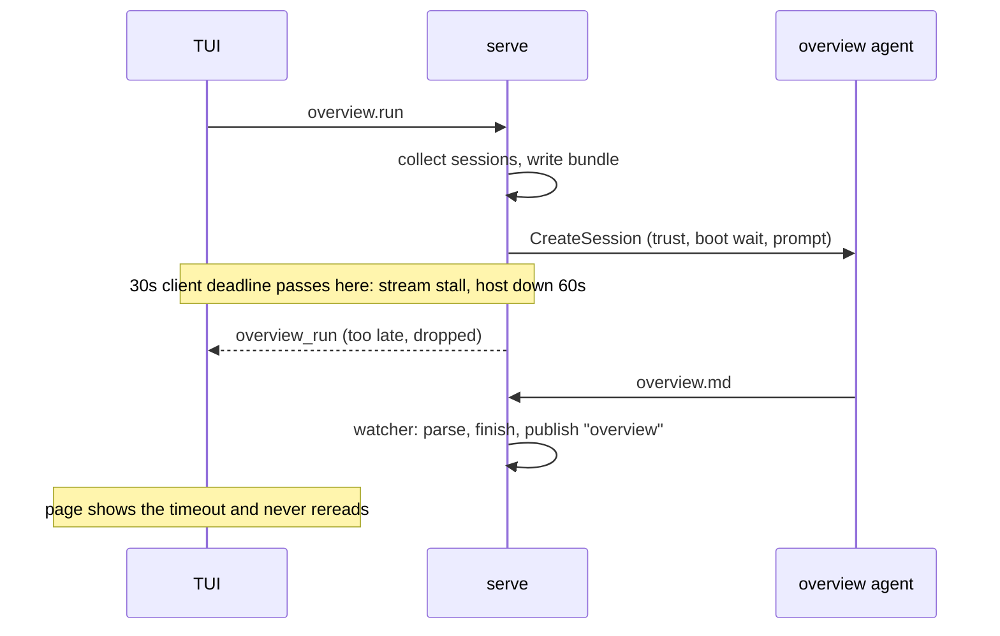
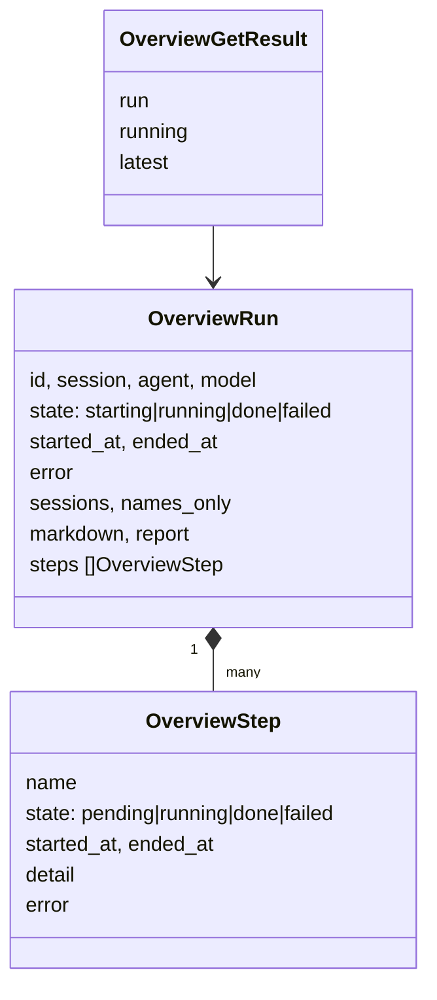
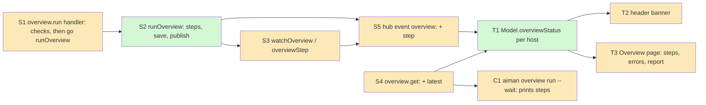
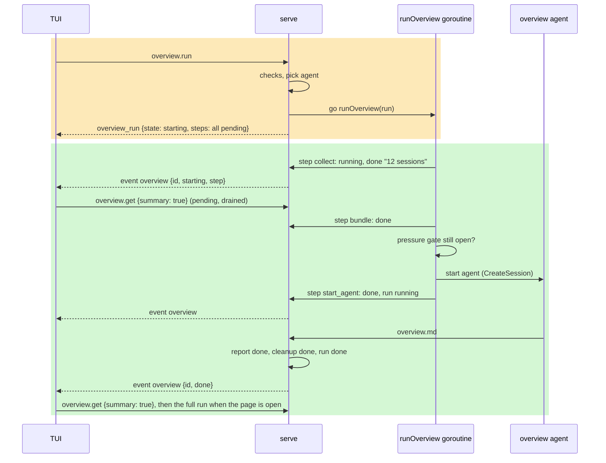

# overview-status: overview runs in the background, with steps and a status banner

**Revision:** 3 (as built) · **Size:** project · **Status:** built
**Task:** operator report 2026-11-23: "the overview never shows" · **Spec:** none (this page)

**Legend:** green = new, amber = changed, red dashed = removed. Every diagram uses these three classes:

```text
classDef new fill:#d4f7d4
classDef changed fill:#fde9b8
classDef removed stroke-dasharray:4,fill:#f9d0d0
```

In a sequence diagram, which has no classes, wrap new steps in `rect rgb(212,247,212)` and changed steps in `rect rgb(253,233,184)`.

## The problem

The operator presses `O`, then `r`, and the overview never appears in the TUI. Serve did finish both runs that were started on 2026-11-23: `aiman overview list` on the host shows `7cfcb7d4` and `f07e54de`, both `done`, each about 55s long. The report exists. The TUI does not get it.

There are three causes:

1. `overview.run` answers only after the agent has started. `handleOverviewRun` builds the bundle and calls `startConsult`, which runs `CreateSession`: the trust step, the boot wait and the first prompt. That can take more than 30s. `overview.run` is not in `slowCall`, so the client waits 30s (`callDeadline`). The laptop's RPC stream sees no answer and counts a stall: it kills the ssh process and marks the host down for 60s.
2. When the start call fails, the page shows the error and stops. It does not poll, because it has no run to poll. Every later read in the next 60s fails with `ErrServeUnreachable`. Nothing reads the host again until the operator presses `R`, or the `overview` hub event arrives on a live event stream.
3. The operator sees no progress and no history. A run has only four states (`starting`, `running`, `done`, `failed`). The header shows `overview: n need you` only after a read, and only when n > 0. There is no "running" indicator and no "last run at" time.

## How it works today

- Serve: `internal/server/overview.go:93` `handleOverviewRun` does everything in the request: pick the agent, collect sessions (`overviewInputs`), write the bundle and brief, start the hidden session (`startConsult`, `internal/server/consult.go:187`). Then it starts `watchOverview` (5s ticks) and answers.
- `overview.get` (`overview.go:480`) answers the named run, else the running run, else the newest `done` run (a newer `failed` run is hidden).
- Hub event `overview {id, status}` goes out at start and at the end (`publishOverview`).
- TUI: `internal/ui/overview.go`. `O` opens the page and reads `overview.get`. `r` calls `overview.run` with a 60s context, but the stream deadline is 30s. The page polls every 5s only while it is open and the run is in progress. `overviewHeaderPart` shows the needs-you count from the newest done run it has read.



## Glossary

| Term | Meaning |
|---|---|
| run | One overview: a hidden agent session that reads `sessions.md` and writes `overview.md`. |
| step | One phase of a run with its own state, times, detail and error. New. |
| banner | The overview part of the TUI header. Today it shows only `overview: n need you`. |
| stall | The RPC stream gets no answer before the call deadline. It kills ssh and holds the host down for 60s. |
| hub event | A message on serve's `session.events` stream. The TUI subscribes per host. |

## Proposed design

`overview.run` answers within a second with a `starting` run. All slow work moves into a goroutine that serve owns. The run records each step as it happens, saves it and publishes it. The TUI keeps an overview status per host, independent of the page. The header always shows it, and the page shows the steps and errors.

### Domain model



Steps, in order, all listed as `pending` when the run is created. `name` is a stable token on the wire; `label` is the text a client shows.

| `name` | `label` | Detail when done | Fails when |
|---|---|---|---|
| `collect` | collect sessions | `12 sessions` (plus `3 by name only`) | the session table cannot be read |
| `bundle` | write bundle | `412 KiB` | the scratch directory or a file write fails |
| `start_agent` | start agent | `claude (fable)` | the pressure gate closed since the request (`host_under_pressure`), `CreateSession` fails, or the boot wait times out |
| `report` | write report | `4 sections, 3 need you`; while running, `reminded: <parse error>` after a bad report | the agent ends, or `overview.timeout` passes |
| `cleanup` | clean up | none | never: problems are logged, as today, and the run state does not change |

A failed step sets the run to `failed`, and the run's `error` is `<label>: <step error>`. The later steps stay `pending`.

`overview.get` gains `latest`: the newest run of any state, with `state`, times, `error`, `steps` and a new `needs_you` count, and without `markdown` and `report`. The banner uses it, so a newer failure is never hidden behind an older done run. `overview.get {summary: true}` answers only `latest` (no `run`), so the banner read stays small. The `run` field keeps its current meaning, so the phone and CLI do not change.

The hub event `overview` gains `step` (`SessionEvent.Step`, `omitempty`). Clients treat the event as a signal to read again, not as the state.

### Structure



- **S1** keeps the fast refusals in the request: `needs_operator`, `invalid_params` (bad params, an unknown or missing agent), `overview_running`, `host_under_pressure`. It sets `running` under `overviewMu` and saves `<run>.json` (`starting`, every step `pending`) before it starts the goroutine, so two calls cannot both pass `overview_running`. All other errors become a failed step.
- **S2** follows `handoverchild.Manager` (`goBG`, `Close`): a context serve owns, never the request's, cancelled only at serve close, and a `WaitGroup`. `Server.CloseOverview` cancels and waits, and `Serve` calls it before `ptyMgr.CloseAll`. On cancel, S2 fails the running step and calls `finishOverview`. A `recover` fails the run and clears the lock. Every step change takes `overviewMu`, changes the run, copies it, unlocks, saves the copy and publishes it; a client never gets the live pointer. S2 saves again as soon as `startConsult` gives a session id.
- **S2b** `Server.OverviewStarting()` counts runs before `start_agent` ends. `cmd/aiman/serve.go` adds it to the host update gate's `Busy`, as `handovers.Starting`.
- **S2c** `CleanStaleOverviews` fails the step that was `running` with `serve restarted`. When `session` is empty, it looks for a hidden session named `overview-<run>` with role `overview` and retires it.
- **S3** marks `report` and `cleanup` through the same step helper.
- **T1** keeps one status per host (`latest` and the time it was read). It reads `overview.get {summary: true}` with a 30s deadline, never 60s, and at most one read per host at a time. The reads are: once at start (`budgetTry`; a host with no free slot is tried again on the next resources tick, as `fetchResourcesAll` does); on each `overview` hub event (through `markPending` and `drainPending`, never dropped); and every 10s while the run is in progress, as a backup. The run time in the banner counts up locally from `started_at`, with no read.
- **T2** shows the gauge host's status on every view that draws the header.
- **T3** reads the run from T1. It has no poll of its own. Opening the page and `R` read the full run (`overview.get`) with a foreground slot and a 30s deadline. When T1 sees a newer run, or a change of state, the open page reads the full run again.
- **C1** prints `started <run id>` at once. With `--wait`, it prints each step as it changes (label, state, detail, error), from `overview.get {run}` every 2s.

### Behaviour



The banner (T2) shows one of these:

| Gauge host status | Banner |
|---|---|
| no run read yet, or no run ever | nothing |
| running | `overview ▸ start agent 0:24` (current step, run time) |
| newest run done | `overview 10:36 · 3 need you` (warning colour when n > 0) |
| newest run failed | `overview failed 10:40` (error colour) |

The time is the end time, in local time, with the date when it is not today.

The page (T3) shows the run header (state, start, agent, sessions), then the step list: `✓` done with its duration and detail, `▸` running with its time so far, `✗` failed with its error in red, `·` pending. Under it come the report (done), or the error and "press r to run again" (failed). When the newest run failed and an older run is done, the page shows the failure first, then the older report with its time.

## A scenario, end to end

1. The operator opens the TUI. For each host, the TUI reads `overview.get`. The header shows `overview 10:36 · 17 need you` for regent0.
2. The operator presses `O`, then `r`. Serve checks the caller and picks `claude` from `agents.smart`. It writes `<run>.json` with six pending steps, starts `runOverview` and answers. This takes less than a second.
3. The page shows `▸ collect sessions`. The banner shows `overview ▸ collect sessions 0:00`. The operator presses `esc` and goes back to the sessions list.
4. `runOverview` reads 24 sessions and writes `sessions.md` (412 KiB). After each step, the hub event makes the TUI read `overview.get {summary: true}` again. The banner moves to `▸ start agent`.
5. `CreateSession` takes 34s. `start agent` is done with `claude (fable)`, and the run is `running`. The banner shows `▸ write report 0:41`.
6. The agent writes `overview.md`. The watcher parses it, then retires the session and removes the scratch directory. The run is `done`.
7. The banner shows `overview 10:52 · 3 need you`. The operator presses `O` and reads the report.

If the agent cannot start (for example, the boot wait times out), step 5 is `✗ start agent: boot wait timed out`. The run is `failed`, and the banner shows `overview failed 10:51`.

## Alternatives considered

- **Add `overview.run` to `slowCall` only.** This fixes the stall but keeps the TUI waiting up to a minute with no progress, and does not give steps or a banner. It lost because the operator asked for progress and a background run.
- **Stream the steps over the RPC call.** The RPC protocol has one answer per call. A streamed call needs a new protocol path. Hub events and `overview.get` already exist. It lost on cost.
- **Keep step state in memory only.** A serve restart would lose it, and `CleanStaleOverviews` could not say which step was running. Saving the run JSON at each step costs little (six small writes).

## Open questions

None open. I chose these defaults; overrule any of them:

- The banner is in the header on every view, for the gauge host only (the selected session's host), as the memory gauge is.
- No automatic or scheduled runs. Only `r` and `aiman overview run` start a run.
- The phone is out of scope. It gets `steps` and `latest` in the API, but its screens do not change.

## Decisions

| Objection | Severity | Triage | Reason |
|---|---|---|---|
| The goroutine must not keep the request context; it needs a serve-owned context, a WaitGroup, a save before `go`, and a wait at serve close | high | accept | S2 now follows `handoverchild.Manager`; `CloseOverview` runs before `ptyMgr.CloseAll`. |
| `CleanStaleOverviews` must fail the running step and find a session that was saved before the run recorded its id; the host update gate must wait for the start | high | accept | S2b and S2c. |
| `latest` without `report` loses the needs-you count the banner shows | high | accept | `latest` carries `needs_you`, `steps`, `error` and times. |
| TUI reads break the host budget and the 30s stream deadline; events are dropped; a 3s poll is too much | high | accept | T1: 30s deadline, `budgetTry`, pending and drain for events, 10s backup poll, a local clock for the run time. |
| The pressure gate is checked only in the request | medium | accept | `start_agent` checks `PressureOpen` again and fails with `host_under_pressure`. |
| `write report` and `read report` are one loop with two names | medium | accept | Merged into `report`. |
| The CLI prints `0 sessions` at start | medium | accept | C1 prints the run id, and the steps with `--wait`. |
| A full `overview.get` per host at start sends up to 128 KiB of markdown | medium | accept | `overview.get {summary: true}`; retry on the resources tick. |
| The page poll and the host poll double the reads | medium | accept | One loop per host; the page reads T1. |
| Step writes need the lock and a copy; two `overview.run` calls can race | medium | accept | S1 and S2: lock, copy, save, publish; `running` set before the answer. |
| Step names with spaces become wire ids | low | accept | `name` tokens plus a `label`. |
| `SessionEvent` has no `Step` field | low | accept | Added, `omitempty`; the event is a signal only. |
| A panic leaves the one-run lock set | low | accept | `recover` fails the run and clears the lock. |

## Deviations from the approved design

- `overview.get {summary: true}` on a host with no run answers `{type}` with no `latest`, not `not_found`. The TUI treats both, and an old serve's `not_found`, as no run.
- The `overview.started` ledger row is written when `start_agent` is done, not when the request arrives, so it carries the session id.
- A serve close fails the running step with `serve closing`; a later `CleanStaleOverviews` uses `serve restarted`.
- The 10s backup read rides the resources tick instead of its own timer.
- `cleanup` runs only for a done run; a failed run's cleanup happens in `finishOverview` and its step stays `pending`.

## Breakdown

| Piece | Owns files | Parallel group | Depends on | Complexity | Tier | Acceptance tests |
|---|---|---|---|---|---|---|
| P1 serve: background run, steps, `latest`, `summary`, event step, Busy count, stale cleanup, CLI `--wait` prints steps, openapi, AGENTS.md | `internal/server/overview.go`, `internal/server/overview_steps.go` (new), `internal/server/overview_test.go`, `internal/server/handlers_events.go` (`Step` field), `cmd/aiman/serve.go` (Busy, close), `cmd/aiman/overview_cmd.go`, `api/openapi.yaml`, `AGENTS.md` | A | none | L | smart | `go test ./internal/server -run TestOverview` (acceptance file `internal/server/overview_steps_acceptance_test.go`) |
| P2 TUI: per-host status, banner, step page | `internal/ui/overview.go`, `internal/ui/overview_banner.go` (new), `internal/ui/resources.go` (header join only), `internal/ui/session_events.go` (one line), `internal/ui/dashboard.go` (init fetch), `internal/ui/todo_fetch.go` (drain case) | B | P1 | M | worker | `go test ./internal/ui -run TestOverview` (acceptance file `internal/ui/overview_banner_acceptance_test.go`) |

I write both pieces' acceptance tests and commit them on this branch before P1 starts. P2 starts after P1 lands, because it reads P1's `OverviewStep` type.

## What you should be able to explain after reading

1. Why the overview never showed: `overview.run` waited for the agent boot past the 30s client deadline, the stream counted a stall, and the page stopped reading.
2. Which refusals stay in the request, and why every other failure is now a failed step.
3. How the TUI learns about step changes without the page being open: the startup read, hub events through pending and drain, and a 10s backup read while a run is in progress, all inside the host budget.
4. Why `overview.get` gains `latest` instead of changing what `run` means.
5. What the banner shows in each state, and for which host.
