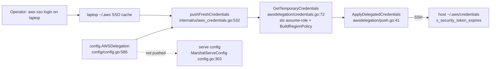
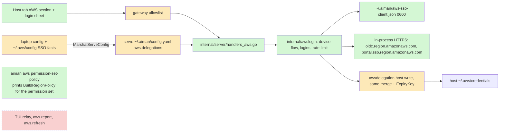
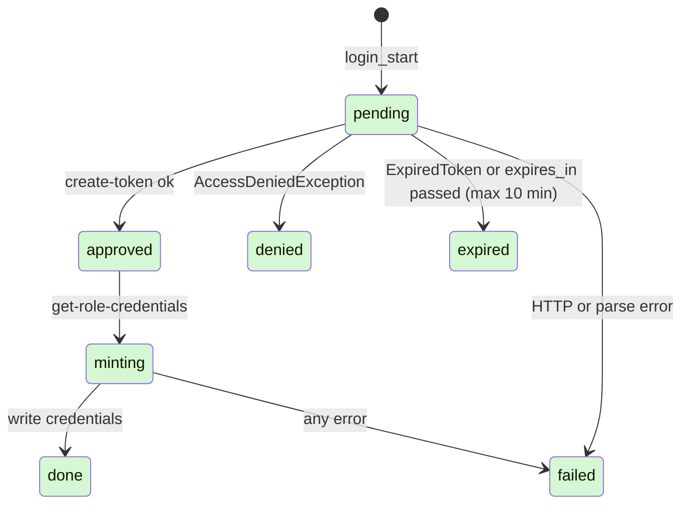
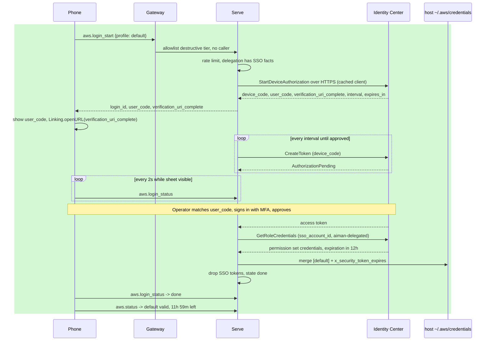

# phone-aws-login: Sign in to AWS from the phone

**Revision:** 4 · **Size:** project · **Status:** approved by the operator on 2026-11-07 ("Drop the relay, approved, go ahead") (rev 2: dedicated permission set instead of role chaining, decided by the operator, who needs sessions of at least 8 hours; rev 3: consult objections triaged, see Decisions)
**Task:** none yet · **Spec:** replaces the refresh half of `docs/superpowers/specs/2026-11-04-phone-aws-credentials-design.md` (parked)

**Legend:** green = new, amber = changed, red dashed = removed. Every diagram uses these three classes:

```text
classDef new fill:#d4f7d4
classDef changed fill:#fde9b8
classDef removed stroke-dasharray:4,fill:#f9d0d0
```

In a sequence diagram, which has no classes, new steps sit in `rect rgb(212,247,212)` and changed steps in `rect rgb(253,233,184)`.

## The problem

Agents on a host use short-lived AWS tokens. Only the laptop can mint them, with its own `aws sso login`. When the tokens expire, the agent's AWS calls fail. The operator, away from the laptop with only the phone, can neither see that nor fix it.

The parked design relayed refresh through the TUI, which needs the laptop awake with a valid AWS login. The operator logs in through IAM Identity Center, which works in the phone's browser. So the host can run the login itself, with the operator approving in the browser.

## How it works today



- The delegation lives only in the laptop's config. `MarshalServeConfig` does not copy it, so serve knows nothing about AWS.
- With an SSO source profile the mint is SSO role credentials, then `sts assume-role` into the delegated role (default `TemporaryDelegatedRole`, `awsdelegation/arn.go:11`) with `BuildRegionPolicy(regions)` (`policy.go:161`) or the session policy.
- The write merges one section into the host's `~/.aws/credentials` (0600) with `x_security_token_expires` (`ExpiryKey`, `expiry.go:15`).
- The phone has no AWS method. The allowlist (`internal/gateway/allowlist.go`) has read, write and destructive tiers. `isSessionCall` (`internal/server/peer.go:114`) refuses agents with `needs_operator`.

## Glossary

| Term | Meaning |
|---|---|
| IAM Identity Center | AWS's single sign-on service. The operator's portal login, with MFA, lives there. |
| Device authorization | An OAuth flow for a machine with no browser: it gets a code, a person approves the code in any browser, the machine polls for a token. |
| User code | The short code (like `ABCD-EFGH`) shown on both the phone and the approval page, so the operator can match them. |
| Client registration | The id and secret Identity Center issues to `aiman-serve` from `RegisterClient`. It identifies the app, not a person, and grants no AWS access. Valid 90 days. Registration is unauthenticated: any process can register its own client, so the file is a convenience, not a control. |
| SSO access token | `create-token`'s result after approval; fetches role credentials. In memory only. |
| Permission set | A role Identity Center creates in an account for a portal user, with its own policies and a session duration of 1 to 12 hours. |
| Delegated permission set | The permission set made for agents (`sso_role_name`, for example `aiman-delegated`). Its inline policy is the same region-locked policy the laptop generates today, and its session duration is 12 hours. |
| Delegated role | `TemporaryDelegatedRole`, the role the laptop assumes today. The phone path does not use it. |
| Role chaining | Assuming a role with another role's credentials. AWS caps it at 1 hour, which is why the phone path reads the permission set's credentials directly. |
| Delegation | One `AWSDelegation` entry: which host profile gets tokens, and how they are minted. |

## Proposed design

Serve runs the Identity Center device flow on the host, in process over HTTPS (the `sso-oidc` and `portal.sso` REST APIs; no `aws` CLI child). The phone starts it, shows the user code and opens the approval page. After approval serve reads the delegated permission set's credentials (12 hours, no role chaining) and writes them into the host's credentials file under the delegated profile name. The SSO tokens never touch disk.

The delegated permission set is set up once by the operator in Identity Center: name `aiman-delegated` (or any name put in `sso_role_name`), session duration `PT12H`, inline policy equal to the laptop's generated policy, assigned to the operator's user for the account. `aiman aws permission-set-policy [--regions us-east-2,...]` prints that policy JSON and the setup steps, so the two paths stay identical. A permission set's inline policy allows 32 KB, so the packed-policy trimming the generated session policy needs today does not apply there.

### Domain model

```mermaid
classDiagram
    classDef new fill:#d4f7d4
    classDef changed fill:#fde9b8
    classDef removed stroke-dasharray:4,fill:#f9d0d0
    class AWSDelegation {
      profile, account_id, role_name
      regions, session_policy, duration_seconds
      sso_start_url, sso_region
      sso_account_id, sso_role_name
    }
    class ServeAWSConfig {
      delegations []ServeAWSDelegation
    }
    class ClientRegistration {
      client_id, client_secret
      expires_at, region, start_url
    }
    class Login {
      id, profile, state, failure
      user_code, verification_uri_complete
      expires_at, interval
    }
    class ProfileStatus {
      profile, status, expires_at
      expiry_approx, sso_ready
    }
    class RefreshRequest
    class LaptopReport
    ServeAWSConfig --> AWSDelegation : copies non-secret fields
    Login --> AWSDelegation : mints for
    Login --> ClientRegistration : uses
    class AWSDelegation:::changed
    class ServeAWSConfig:::new
    class ClientRegistration:::new
    class Login:::new
    class ProfileStatus:::new
    class RefreshRequest:::removed
    class LaptopReport:::removed
```

`RefreshRequest` and `LaptopReport` were in the parked design and are dropped with it. `ProfileStatus` keeps the parked row table and adds `sso_ready`.

### Structure



**Config push.** `AWSDelegation` gains `sso_start_url`, `sso_region`, `sso_account_id` and `sso_role_name`. At push time the laptop fills an empty start URL, region or account id from its own `~/.aws/config` for the delegation's source profile, reading only those keys (both the `sso_session` form and the legacy inline form). `sso_role_name` is never inferred: it names the delegated permission set, not the operator's own portal role, and defaults to `aiman-delegated`. Explicit config wins. `ServeConfig` gains `aws.delegations` for that host: profile, account id, role name, regions, session policy, duration and the four SSO facts. None is a secret.

**RPCs.**

| Method | Params | Result |
|---|---|---|
| `aws.status` | `{check?}` | `{"type":"aws_status","profiles":[ProfileStatus]}` |
| `aws.login_start` | `{profile}` | `{"type":"aws_login","login":{login_id, profile, user_code, verification_uri_complete, expires_in, state}}` |
| `aws.login_status` | `{login_id}` | `{"type":"aws_login","login":{login_id, profile, state, failure, expires_at}}` |

`aws.status` uses the parked row table unchanged, with the delegated list now read from serve's config. Values never leave `ReadHostCredentialProfiles`, and the planted-secret test from the parked design stays. `check: true` keeps the parked `get-caller-identity` guard. `sso_ready` is false when a delegation lacks SSO facts, so the phone can explain before a tap.

`aws.login_start` refusals: `invalid_params` (profile not delegated), `aws_no_sso` (delegation has no SSO facts), `aws_rate_limited`, `needs_operator`. A start for a profile that already has a pending login returns that login and does not count against the limit. `login_id` is 128 random bits, and `aws.login_status` never returns the user code or the approval URL, so a session caller watching logins learns only states.

**Who may call what.**

| Method | Gateway tier | Session caller |
|---|---|---|
| `aws.status` | read | allowed |
| `aws.login_status` | read | allowed |
| `aws.login_start` | destructive (`allow_destructive`) | refused, `needs_operator` |

`aws.login_start` is destructive because it starts a new identity grant: the phone opens the approval page in Safari, which usually already holds the portal session, so approval is often one tap with no MFA replay. A lost unlocked phone without `allow_destructive` can therefore not mint a host session. (Rev 3, consult objection 1.)

**Limits.** At most 3 pending logins per serve, and 6 starts per 10 minutes. Finished logins stay in memory 10 minutes, then `login_status` is `not_found`. Logins are not persisted: a serve restart ends them, and the operator starts again.

**Client registration.** Serve calls `RegisterClient` with client name `aiman-serve`, type `public`, no scopes. It stores the result at `~/.aiman/aws-sso-client.json` (0600, atomic write) keyed by start URL and region, and registers again when it is within a day of expiry or Identity Center answers `InvalidClientException`. Registration is unauthenticated, so the file saves a round trip and is not a security control.

**Secrets never enter a child process.** Serve talks to `oidc.<sso_region>.amazonaws.com` (`RegisterClient`, `StartDeviceAuthorization`, `CreateToken`) and `portal.sso.<sso_region>.amazonaws.com` (`GetRoleCredentials`, bearer token header) with Go's `net/http` and a 30s timeout per call. The client secret, device code, access token and role credentials exist only in serve's memory until the write, never in argv, a child's environment, CLI history or a log. Errors are codes; response bodies are parsed for an error code and discarded. The engine's test plants recognisable fake secrets in a fake Identity Center and asserts they appear in no error string, log line or RPC result. The host `aws` CLI is used only by `aws.status {check:true}` (`get-caller-identity`, no secret in argv), as in the parked design.

**Write.** `GetRoleCredentials` returns the permission set's credentials with their expiry (12 hours with the recommended session duration; whatever the permission set says otherwise). Serve merges the section with the existing `MergeCredentialsIntoConfig` and `FormatCredentialsSection`, so `x_security_token_expires` is recorded exactly as today. It writes locally (temp file, 0600, rename) under `~/.aiman/aws-credentials.lock`. It never runs `EnsureRole` or `assume-role`: no IAM change and no chaining from the phone. `duration_seconds` does not apply to this path; the permission set's session duration decides.

### Behaviour



Serve polls `CreateToken` at the `interval` Identity Center returns, adds 5 seconds on `SlowDownException`, and stops at `expires_in` or 10 minutes, whichever is first. `failure` on `failed` is one of `sso_role_denied`, `write_failed`, `other`. On `done` or any end state serve drops the access token and any refresh token from memory.

## A scenario, end to end

The `default` profile on host `dev1` expired. The delegation has `regions: [us-east-2]`, `sso_role_name: aiman-delegated`, and the start URL, region and account id pushed from the laptop. The operator created the `aiman-delegated` permission set once, from the JSON `aiman aws permission-set-policy` printed.



The Host tab shows `default · expired · Sign in`. The sheet shows `ABCD-EFGH` with "Approve only this code" and opens Safari. Back in the app, the phone reads `done`, refetches `aws.status`, and shows the expiry from the file, never from the login result; the sheet's `done` copy carries no duration.

**Phone browser choice: `Linking.openURL`.** Full Safari shares the portal session, passwords and passkeys. No redirect back is needed, and serve polls on its own, so leaving the app costs nothing; the sheet resumes polling in the foreground. `WebBrowser.openAuthSessionAsync` expects a callback this flow never sends, adds a "wants to use amazonaws.com" prompt, and must be closed with Cancel. `openBrowserAsync` (`services/browser.ts`) does not share Safari's cookies.

**Phone copy per state.**

| `state` / `failure` | Copy |
|---|---|
| `pending` | Approve code ABCD-EFGH in the browser, and no other code. Expires in 9:12. |
| `approved`, `minting` | Approved. Getting credentials… |
| `done` | Signed in. (The row below shows the time left, from the file.) |
| `denied` | The sign-in was declined in the browser. |
| `expired` | The code expired before approval. Try again. |
| `sso_role_denied` | Identity Center has no `aiman-delegated` permission set for you in this account; create or assign it (aiman aws permission-set-policy on the laptop prints the steps). |
| `write_failed` | Got credentials but could not write them on the host. |
| `aws_no_sso` | This profile has no Identity Center settings; set them in aiman on the laptop. |
| `aws_rate_limited` | Too many sign-ins; try again in a few minutes. |
| `other` | Sign-in failed; see the serve log on the host. |

**Security, plainly.**

- Afterwards the host holds a temporary profile with the same region-locked policy the laptop pushes, for the permission set's session duration (12 hours recommended, the laptop's default lifetime today). The role ARN is the permission set's (`AWSReservedSSO_aiman-delegated_…`), not `TemporaryDelegatedRole`; anything that names the old ARN in a resource or trust policy needs the new one added.
- An agent cannot call `aws.login_start` the ordinary way, and cannot approve: approval happens in the operator's browser.
- **Accepted residual risk: out-of-band device flows.** `RegisterClient` needs no credential, so any process on the host (every agent, finding S1) can run its own device authorization outside serve, its rate limits and `needs_operator`, and show the operator a code in a pane, a to-do or a notification. If the operator approves it, that process gets `GetRoleCredentials` for any permission set the operator's user holds, including an administrator one, for its full session duration, with no region lock. This risk exists today too, since the device flow is a public AWS feature, but this feature trains the operator to approve codes. Mitigations: the sheet says to approve only the code it shows, and the Identity Center approval page names the client and the code; and the operator should sign in to aiman with a dedicated Identity Center user that holds only the `aiman-delegated` permission set, so an approved stray code yields nothing wider than the delegated profile. (Rev 3, consult objection 2.)
- Serve's own flow adds a binding the operator can check: the client name on the approval page is `aiman-serve` and the code matches the sheet.

## Alternatives considered

- **Device flow on the phone.** The phone would hold the access token and role credentials, and then have to ship credentials to the host. That breaks the anti-goal that credential material never crosses toward or from the phone.
- **Laptop relay (the parked design).** Needs the laptop awake, aiman open and a live laptop SSO session; it adds presence, claims and deadlines. Kept only as a historical note; see open question 3.
- **PKCE authorization-code flow.** Identity Center accepts only loopback redirect URIs for public clients. The browser runs on the phone and the listener would run on the host, so the redirect cannot land.
- **Long-lived keys on the host.** An agent on the host could read them. This is an anti-goal.

## Open questions

**1. Resolved (rev 2): a dedicated permission set.** The operator needs sessions of at least 8 hours, and role chaining caps at 1 hour. The phone path reads the `aiman-delegated` permission set's credentials directly, 12-hour session duration, inline policy from `aiman aws permission-set-policy`. Follow-up, not in this design: the laptop's own push could use the same permission set and stop chaining too.

**2. Resolved (rev 3): `aws.login_start` needs `allow_destructive`.** The consult showed that the browser approval is often a single tap on an already signed-in Safari session, so it is not an MFA gate. Only phones paired with `allow_destructive` can start a sign-in; the operator's phone needs that flag (phase 1 piece P4 moves typing and create behind the same flag, so it will have it).

**3. Resolved: the laptop relay is dropped.** One mechanism; a profile without Identity Center settings shows `aws_no_sso` on the phone and is refreshed from the laptop as today. Operator: "Drop the relay, approved, go ahead" (2026-11-07).

## Decisions

| Objection | Severity | Triage | Reason |
|---|---|---|---|
| Laptop relay needs the laptop awake | high | accept | Serve runs the device flow on the host. |
| Secrets in argv are visible in `ps` | high | accept | Pass through stdin JSON and child env. |
| Device code in logs enables phishing | medium | accept | Never logged; failures are codes. |
| Registration file on the host is a credential | low | reject | It grants no AWS access; approval still needs the operator. |
| Refresh token on disk | medium | accept | No scopes requested; any token stays in memory and is dropped. |
| Laptop and serve writing the same file at once | low | accept | A known limit, stated here: serve takes a local lock, the laptop push does not; a lost section is fixed by the next write. (Consult objection 8.) |
| 1-hour cap from chaining | medium | accept | Operator needs at least 8 hours: a dedicated permission set, read directly, no chaining (rev 2). |
| Permission set ARN differs from `TemporaryDelegatedRole` | low | accept | Named in the security notes; the policy is identical. |
| Consult 1: `aws.login_start` in the write tier lets any paired phone start an identity grant, and shared Safari means no MFA replay | high | accept | Destructive tier; open question 2 resolved. |
| Consult 2: any same-uid process can run its own device flow and trick the operator into approving it; the registration file is not a control | high | accept | Stated as an accepted residual risk with the sheet copy and a dedicated Identity Center user as mitigations. |
| Consult 3: phone mint duration silently diverged from the laptop's chained `assume-role` | high | accept | Rev 2 removed chaining from the phone path; the laptop keeps its own path for now, with unifying it on the permission set as a follow-up. |
| Consult 4: secrets reach the `aws` CLI child's environment, history and `CombinedOutput` errors | medium | accept | In-process HTTPS for the OIDC and portal calls; no child; planted-secret test covers errors, logs and results. |
| Consult 5: a guessable `login_id` lets an agent time an out-of-band flow against a real approval | medium | accept | 128 random bits; status returns no code or URL. |
| Consult 6: P3 and P4 shared a group with an unsettled contract; P2 too large; P3 a new contract at worker tier; P6's acceptance test too broad | medium | accept | Breakdown re-tiered below. |
| Consult 7: `done` copy stated a duration the login result cannot know | low | accept | Duration comes only from the status row. |

## Breakdown

| Piece | Owns files | Parallel group | Depends on | Complexity | Tier | Acceptance tests |
|---|---|---|---|---|---|---|
| P0 Permission set helper | `cmd/aiman/aws_cmd.go` (`aiman aws permission-set-policy`), `internal/infra/awsdelegation/permissionset.go` (+ tests), README section | A | none | S | worker | `go test ./internal/infra/awsdelegation/ -run TestPermissionSetPolicy` |
| P1 Config push of SSO facts | `internal/infra/config/config.go`, `internal/infra/awsdelegation/sso_profile.go` (+ tests) | A | none | S | worker | `go test ./internal/infra/config/ -run TestMarshalServeConfigAWS` and `go test ./internal/infra/awsdelegation/ -run TestReadSSOProfile` |
| P2a Host credentials file: `ReadHostCredentialProfiles`, locked 0600 merge write | `internal/infra/awsdelegation/hostcreds.go` (+ tests) | A | none | S | worker | `go test ./internal/infra/awsdelegation/ -run 'TestReadHostCredentialProfiles|TestWriteHostCredentials|TestHostCredsNoSecretLeak'` |
| P2b Contract: `aws.*` in `api/openapi.yaml`, error codes in `protocol.go`, allowlist entries and `TestDeviceMayCall` rows, dispatch stubs returning `unavailable` | `api/openapi.yaml`, `internal/server/protocol.go`, `internal/server/server.go` (dispatch cases only), `internal/gateway/allowlist.go` + test | A | none | M | smart | `go test ./internal/server/ -run TestOpenAPI ./internal/gateway/ -run TestDeviceMayCall` |
| P3 Device flow engine: registration cache, device flow over HTTPS, login states, limits, fake Identity Center | `internal/awslogin/` | B | P1, P2a | L | smart | `go test ./internal/awslogin/... -run 'TestLogin|TestNoSecretLeak|TestRateLimit'` |
| P4 Serve handlers: `aws.status`, `aws.login_start`, `aws.login_status`, `needs_operator` | `internal/server/handlers_aws.go` (+ tests) | C | P2b, P3 | M | worker | `go test ./internal/server/ -run 'TestAWSStatus|TestAWSLogin'` |
| P5 Phone data layer | aiman-phone `api/openapi.yaml` (copied from P2b), `api/types.generated.ts`, `services/api.ts`, `mocks/server.ts`, `lib/awsLogin.ts`, `hooks/useAwsStatus.ts`, `hooks/useAwsLogin.ts` | B | P2b | M | worker | `npm run openapi:generate && npm test -- awsLogin` |
| P6 Phone UI | aiman-phone `components/AwsSection.tsx`, `components/AwsLoginSheet.tsx`, `app/(tabs)/host.tsx` | C | P5 | M | worker | `npm run check` and `npm test -- AwsSection` |
| P7 Docs and eval | `AGENTS.md`, `README.md`, `evals/aws_login/` | D | P4 | S | worker | `go test ./evals/... -run TestEvalAWSLogin` |

Group A runs first (four small pieces with disjoint files; P2b settles the contract before any phone code). Group B needs A. Group C needs B. P7 last.

`aws.login_start` goes through `callServerOnce` (`services/transport.ts:45`); both polls use `useVisibleForPolling`.

## What you should be able to explain after reading

1. Why serve, not the phone or laptop, runs the device flow, and what crosses to the phone (codes, states, names, times; never credentials).
2. The chain from browser approval to the credentials file: `create-token`, `get-role-credentials` for the `aiman-delegated` permission set, merge with `x_security_token_expires`.
3. Why the phone path uses a permission set with the laptop's policy inline instead of assuming `TemporaryDelegatedRole`: role chaining caps at 1 hour, and the operator needs at least 8.
4. What stops an agent, and what does not: `needs_operator` and `allow_destructive` stop the ordinary call; nothing stops a same-uid process from running its own device flow, so the operator approves only the code on the sheet and signs in with a user that holds only `aiman-delegated`.
5. Which secrets exist, where each lives and for how long: the registration file on disk (not a credential), the device code and SSO tokens in serve's memory for minutes and never in a child process, the role tokens in `~/.aws/credentials` for the permission set's session.
