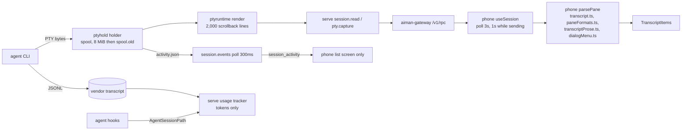
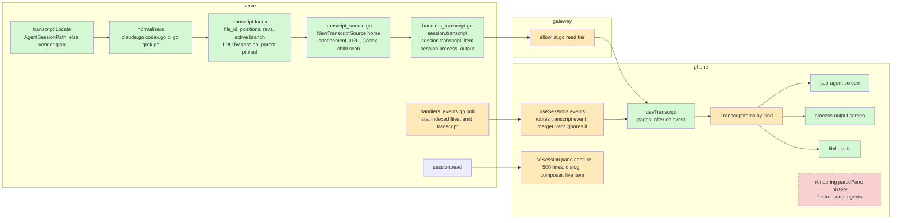
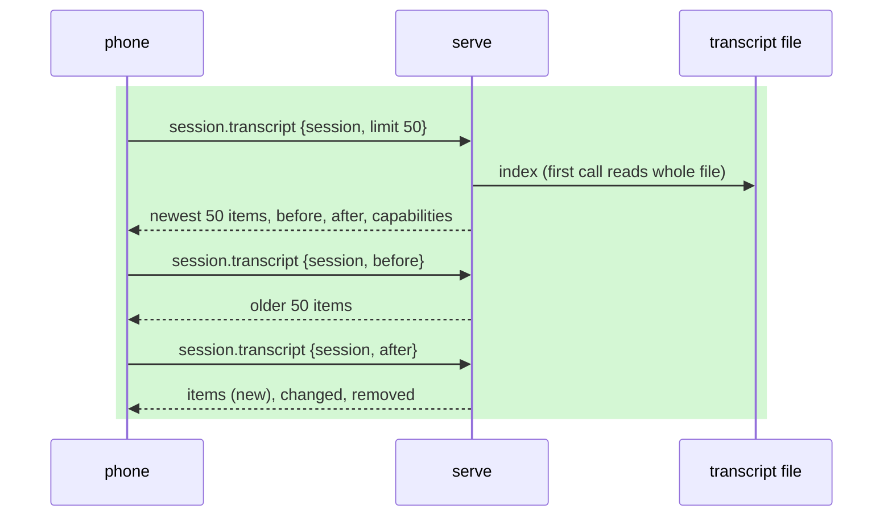
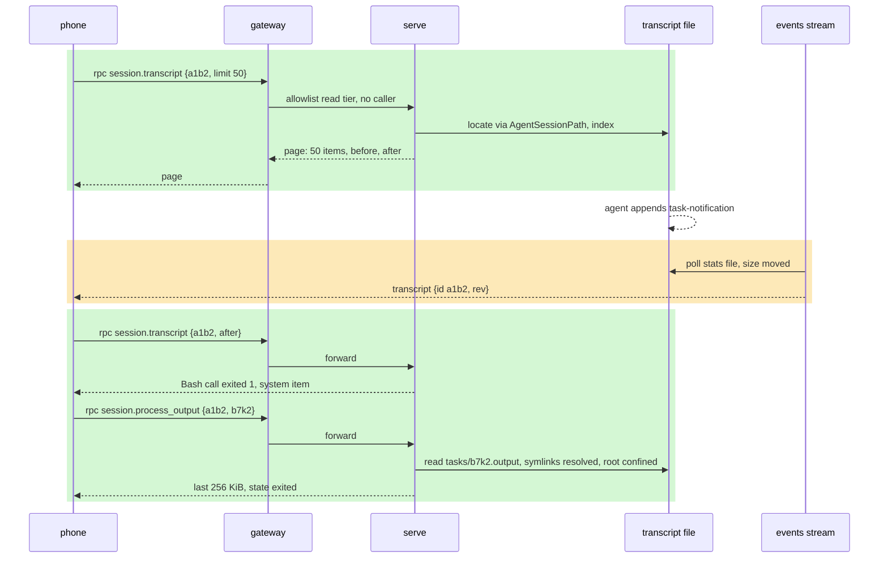

# phone-transcript: The phone reads the agent's own transcript

**Revision:** 8, as built · **Size:** project · **Status:** approved by the operator on 2026-11-07 ("Approved, go ahead"); rev 8 adds the phone as built (aiman-phone #8, #9, #10); rev 7 records the design as built through P5 (PRs #96, #97, #98, #99, #101) and lists what differs under "Deviations from the approved design" (no behaviour the operator approved changes); rev 6 records the as-built reader contract from P1 to P3 and the reviews of #96 and #98 (no behaviour the operator approved changes); rev 5 triages consult fc680ee4 (3 high, 5 medium, 2 low, all accepted); two consult rounds complete (b29eae39, fc680ee4); open questions resolved with their defaults (operator: "go with the defaults", 2026-11-07); awaiting operator approval
**Task:** architecture review finding E4 (`docs/reviews/2026-11-07-architecture-review.md`) · **Spec:** `docs/specs/phone-transcript.md` (this page)

**Legend:** green = new, amber = changed, red dashed = removed. Every diagram uses these three classes:

```text
classDef new fill:#d4f7d4
classDef changed fill:#fde9b8
classDef removed stroke-dasharray:4,fill:#f9d0d0
```

In a sequence diagram, which has no classes, wrap new steps in `rect rgb(212,247,212)` and changed steps in `rect rgb(253,233,184)`.

## The problem

The phone shows a session by reading its terminal screen. It asks for the last 500 lines every 3 seconds and runs about 2,200 lines of regex over them to rebuild the conversation. That has four costs the operator feels:

1. **Short history.** The phone sees at most 500 lines. Serve keeps 2,000 lines of rendered scrollback. Anything older is gone, even though the agent's transcript file still holds it.
2. **Thin tool calls.** A tool call is whatever the agent drew on screen: a header and a few clipped lines. The full input, the full result and the duration are not there.
3. **No sub-agents or background shells.** Claude, Codex and Grok run sub-agents and background commands. The screen shows a one-line status at best. The phone cannot open one or read its output.
4. **Dead links.** URLs, file paths and `owner/repo#n` refs are plain text.

Every agent UI change also breaks the regex silently. The agents that must be correct are Claude Code, Grok, Codex and Pi.

## How it works today



Files:

- Spool and rotation: `internal/ptyhold/spool.go:22`, limit `internal/ptyhold/contract.go:45` (`SpoolMaxBytes = 8 << 20`).
- Rendered scrollback cap: `internal/ptyruntime/render.go:51` (`maxScrollbackLines = 2000`).
- `session.read`: `internal/server/handlers_session.go:558`. `pty.capture`: `internal/server/handlers_pty.go:281`. Both return a screen, never structure.
- Transcript discovery for usage: `internal/usage/tracker.go:117` (`KindForPath`: Claude, Codex, Pi; Grok is `KindUnknown`), `internal/usage/tracker.go:374` (`sessionPaths`), `internal/usage/tracker.go:405` (Claude `subagents/*.jsonl`).
- Hook path extraction: `internal/agenthook/payload.go:25` (`transcript_path`, `session_path`, …).
- Event hub: `internal/server/events.go:29` (64-event buffer, drops when full). Stream poll: `internal/server/handlers_events.go:20` (300 ms) and `:165` (`session_activity`).
- Device tiers: `internal/gateway/allowlist.go:8`. `pty.capture` and `session.read` are read tier.
- Session scope after PR #86: `internal/server/peer.go:249` (`refuseOutOfScope`). It guards writes only. `pty.capture` and `session.read` are not scoped.
- Phone: `hooks/useSession.ts:11` (3 s poll, 500 lines), `lib/transcript.ts:694` (`parsePane`), `app/[id].tsx:88`, `hooks/useSessions.ts:56` (events socket, list only), `services/transport.ts` (`callServer`, `callServerOnce`), `mocks/server.ts` (`missingMethods` fakes an old serve).

### What the vendor files hold (structure only)

| Agent | File | Lines | Tool calls | Sub-agents | Background processes |
|---|---|---|---|---|---|
| Claude Code | `~/.claude/projects/<cwd slug>/<session>.jsonl` | Many `type` values: `user`, `assistant`, `system`, plus `last-prompt`, `mode`, `attachment`, `api-request`, `api-request-blob`, `queue-operation`, `pr-link`, `bridge-session` and more, which are skipped. Header lines are `last-prompt` (`{leafUuid, sessionId, type}`) or `ai-title`; neither has a `uuid`. `uuid`/`parentUuid` form a tree. `isMeta` marks injected text. `isSidechain` is false on parent files. | `message.content[]` blocks `tool_use {id, name, input}` and, in a later `user` line, `tool_result {tool_use_id, content, is_error}`. The same line carries `toolUseResult`, mostly `stdout`, `stderr`, `outputFile`; `backgroundTaskId` (rare next to `stdout`), `interrupted`, `durationSeconds` and `persistedOutputPath` (under `<session>/tool-results/`) are rare. | Sidechains live only under `<session>/subagents/agent-<agentId>.jsonl` (lines carry `isSidechain: true`, `agentId`) plus `agent-<agentId>.meta.json` `{agentType, description, toolUseId, finished, spawnDepth}`; a nested sub-agent's meta also carries `parentAgentId`. The parent's `Agent` result carries `toolUseResult.agentId`, `status: async_launched`, `outputFile`. | Bash with `run_in_background` returns `toolUseResult.backgroundTaskId`. Output is `/tmp/claude-<uid>/<cwd slug>/<session>/tasks/<id>.output`; for background agents that file is a symlink into `subagents/`. Completion arrives as a `user` line with `origin.kind: task-notification`. |
| Codex | `~/.codex/sessions/YYYY/MM/DD/rollout-<ts>-<thread id>.jsonl` | `{timestamp, ordinal, type, payload}`; `ordinal` is the position. `type` is `session_meta`, `turn_context`, `response_item`, `event_msg`, `compacted`, … | `response_item` `custom_tool_call` (dominant) or `function_call` with `call_id`, then `*_output` with the same `call_id`. `event_msg item_completed` carries typed items: `CommandExecution {command[], exit_code, duration, process_id, aggregated_output, status}`, `FileChange`, `McpToolCall`, `AgentMessage`, `ContextCompaction`. | Each child is its own rollout whose head has `session_meta.payload.parent_thread_id` plus `source.subagent`. The parent file does not point at it. `agents_states` is often absent; a child ends with `task_complete` or a final `AgentMessage` in its own rollout. `CollabAgentToolCall` appears as an `item` type, rarely. | `CommandExecution.process_id` with output inline in the item. No separate output file. |
| Pi | `~/.pi/agent/sessions/--<cwd>--/<ts>_<id>.jsonl` | `type` `session`, `message`, `model_change`, `thinking_level_change`. `id`/`parentId` form a tree (Pi branches). | `message.content[]` `toolCall {id, name, arguments}`; a `role: toolResult` message with `toolCallId`, `isError`, `durationMs`, `details.fullOutputPath` when truncated. | None. | None. |
| Grok | `~/.grok/sessions/<url-escaped cwd>/<session>/updates.jsonl` (serve already stores this as `AgentSessionPath`) | ACP notifications `{method, params: {sessionId, update, _meta: {agentTimestampMs, eventId, promptId}}}`. `method` is `session/update` or `_x.ai/session/update`; both are accepted. `update.sessionUpdate` is `user_message_chunk`, `agent_message_chunk`, `agent_thought_chunk`, `tool_call`, `tool_call_update`, `turn_completed`, `hook_execution`, `plan`, `auto_compact_*`, `memory_dream_*`, `current_mode_update`, `compaction_checkpoint`, … (`session_recap` not seen). Unknown values are skipped. | `tool_call {toolCallId, title, kind, rawInput, status}` then `tool_call_update {status, content[] (text or diff), rawOutput, locations}`. Per-command logs in `<session>/terminal/call-<id>-<n>.log`. | `subagent_spawned {subagent_id, child_session_id, description, subagent_type, model}` and `subagent_finished {status, duration_ms, turns, tool_calls}`. The child is a sibling session folder with its own `updates.jsonl`. `<session>/subagents/<id>/meta.json` holds the summary. About a third have no `<child_session_id>/updates.jsonl`; that child becomes a meta-only `subagent` item, never an error. | `task_backgrounded {task_id, command, cwd, output_file, tool_call_id}`, `background_tasks {tasks[] {kind, status}}`, `task_completed {task_snapshot}`. |

Grok's hook payload carries `sessionId` and `cwd` but no path. The path is found from those two. `chat_history.jsonl` beside it has whole messages but no timestamps, so `updates.jsonl` is the source.

## Glossary

| Term | Meaning |
|---|---|
| Transcript | The vendor's own JSONL log of a conversation. Serve reads it; the agent writes it. |
| Item | One normalised entry on the phone: a user turn, an assistant message, a tool call, a sub-agent, a process, a system note or a pane block. |
| Normaliser | Per-vendor code that turns transcript lines into items. |
| Cursor | Opaque string encoding `{file_id, kind: offset \| ordinal, position}`. `before` pages back; `after` fetches what is new, changed or removed. |
| File id | The vendor file's fingerprint: its first complete line with a `uuid`, hashed, scanning past Claude's `last-prompt` header lines. |
| Position | A byte offset just past a complete line (`kind: offset`; Claude, Pi, Grok), or Codex's `ordinal` (`kind: ordinal`). The two never compare. |
| Rev | The position of the last line that changed an item. A tool call's rev moves when its result lands. |
| Live item | One ephemeral item built from the pane while a turn is open, for agents whose transcript is written per turn. It is keyed to the `after` cursor in force when it appears. |
| Sub-agent | A child conversation the agent started inside its own process (Claude `Agent`, Codex `spawn_agent`, Grok `spawn_subagent`). Not an aiman child session. |
| Process | A background shell command the agent started and keeps running. |
| Capabilities | What one agent's transcript can show: tool results, sub-agents, processes, and whether scrollback comes from the transcript or the pane. |
| Pane item | Today's screen text, sent as one item when an agent has no transcript. |
| Active branch | For tree-shaped transcripts (Claude, Pi), the chain of entries from the newest leaf back to the root. Rewound branches are skipped. |

## Proposed design

Serve reads the transcript and pages it out as typed items. The phone renders items by kind. The pane stays for three things a transcript does not have: the open dialog, the composer and one ephemeral `live` item for the turn in progress.

### Domain model

```mermaid
classDiagram
    classDef new fill:#d4f7d4
    classDef changed fill:#fde9b8
    classDef removed stroke-dasharray:4,fill:#f9d0d0

    class Page {
        type = "transcript"
        session
        subagent
        source : transcript | pane
        capabilities
        items[]
        changed[]
        removed[]
        before : cursor or null
        after : cursor
        reset : bool
    }
    class Item {
        id
        kind : user | assistant | thinking | tool_call | subagent | process | system | pane | live
        at
        rev
        text
        truncated : bool
    }
    class ToolCall {
        tool_id
        name
        summary
        input
        result
        status : running | ok | error | denied
        duration_ms
        subagent_id
        process_id
    }
    class Subagent {
        id
        name
        description
        state : running | done | failed | unknown
        item_count
        started_at
        ended_at
    }
    class Process {
        id
        command
        state : running | exited | unknown
        exit_code
        output : file | inline
    }
    class Capabilities {
        agent
        scrollback : transcript | pane
        tool_results : bool
        thinking : full | summary | none
        subagents : bool
        processes : file | inline | none
    }
    class Session {
        AgentSessionPath
        AgentSessionID
        AgentName
    }
    Page "1" --> "*" Item
    Page --> Capabilities
    Item --> ToolCall
    Item --> Subagent
    Item --> Process
    Session ..> Page : located from
    class Page:::new
    class Item:::new
    class ToolCall:::new
    class Subagent:::new
    class Process:::new
    class Capabilities:::new
```

Per agent capabilities:

| Agent | scrollback | tool_results | thinking | subagents | processes |
|---|---|---|---|---|---|
| Claude Code | transcript | yes | full (`thinking` blocks; a redacted block shows as "thinking (hidden)") | yes | file |
| Codex | transcript | yes | summary (`reasoning` summaries; encrypted content skipped) | yes | inline |
| Grok | transcript | yes | full (`agent_thought_chunk`, joined) | yes | file |
| Pi | transcript | yes | full (`thinking` blocks when the model emits them) | no | none |
| Any other, or no file found | pane | no | none | no | none |

### Structure



New package `internal/transcript`:

- `item.go`: `Item`, `ToolCall`, `Subagent`, `Process`, `Capabilities`, `Page`. This page fixes them; they are the shared contract.
- `normaliser.go` (as built): `type Normaliser interface { Kind() string; Capabilities() Capabilities; PositionKind() string; Feed(pos int64, line []byte) []Delta; Flush() []Delta; Reset() }`. The position is a plain `int64` whose meaning the declared kind fixes (`PositionOrdinal` for Codex, read from the line's `ordinal`; `PositionOffset` for the others, the byte offset just past the line). `Flush` returns deltas held back for an open group (Grok chunks) after a read; `Reset` drops state before a whole reread. A `Delta` adds an item, updates one by id (a result, a status, an end time) or removes an id from the active branch.
- Normaliser files (as built): `claude.go`, `claude_line.go`, `claude_tools.go`, `claude_tree.go`, `claude_notify.go`; `codex.go`, `codex_child.go` (`CodexChildHead`), `codex_summary.go`; `pi.go`; `grok.go`, `grok_line.go`, `grok_tools.go`, `grok_tasks.go`. Shared: `index.go`, `index_state.go`, `lines.go` (a copy of the unexported `usage.readLines`), `page.go`, `truncate.go`, `redact.go`.
- `index.go`: reads a file once and keeps per item its first position, rev and text capped at 64 KiB. It reuses `readLines` (`internal/usage/lines.go:13`), which never consumes a trailing partial line, and `resumeOffset` (`internal/usage/tracker.go:476`), which forces a full reread on a shrink or a fingerprint change. That misses a rewrite that keeps the head, so the index also keeps the byte length and a checksum of the record at its last indexed offset. On each read it rechecks that record; a mismatch means the file was rewritten, and the index rereads it whole. The file id comes from `ClaudeFingerprint` (`internal/usage/claude.go:77`), which already scans past lines with no `uuid`.
- LRU: keyed by session, holding the parent and its sub-agent files together. A session is pinned while a `session.transcript` call for it arrived within the last 2 minutes. Eviction drops the index; the next call rereads the file from the start (about 3 s for the largest file seen on this host, measured by P2). Cursors stay valid because they carry the file id and a position. A rewrite that kept the head and the length while no index was live is detected only when a cursor position lies past the end (as built, rev 6). Sizes seen on this host: a 40 MB Claude parent with 12k+ lines, and Grok trees with tens of thousands of `tool_call_update` lines.
- `locate.go`: `AgentSessionPath` when set, else the vendor rule. `Locate` does not confine an explicit path; the hook that reports `AgentSessionPath` runs inside the agent, so the serve source (P5) resolves it with `EvalSymlinks` and accepts it only inside one of `SessionDirs()`, refusing anything else with `ErrNoTranscript` (pane fallback). `Locate` refuses an agent other than the four even with a path, and `agent` must be the base command (`agent.BaseOf`); the Codex child scan is cached per session. Vendor rule: Claude `~/.claude/projects/<slug>/<id>.jsonl`, Codex `~/.codex/sessions/*/*/*/rollout-*-<id>.jsonl`, Pi `~/.pi/agent/sessions/--<cwd>--/*_<id>.jsonl`, Grok `~/.grok/sessions/<url-escaped cwd>/<id>/updates.jsonl`. `usage.KindForPath` gains `KindGrok` here, not in usage. Codex children are not named by the parent file: the locator scans `rollout-*.jsonl` heads for `session_meta.payload.parent_thread_id` equal to the parent's thread id and caches the result per parent.
- `subagent.go` and `process.go` (as built, not in `internal/transcript`): serve's source maps a sub-agent id to its file and a process id to the output path the transcript itself named. It is `server.NewTranscriptSource(home)` in `internal/server/transcript_source.go`, wired in `cmd/aiman/serve.go`; the Codex child scan is `internal/server/transcript_codex_children.go`. A normaliser that names output files answers `ProcessPath(id)` by `Process.ID`.

### Behaviour



Rules:

1. **Paging.** Items are newest-last. `limit` defaults to 50, max 200. `before` returns the page above that cursor; `before: null` in the reply means the top. `after` returns three lists. `items[]` holds new items, whose first position is past the cursor; the phone appends them. `changed[]` holds items whose rev is past the cursor but whose first position is at or before it; the phone replaces one by `id` if it is loaded and ignores it otherwise, so a result for a call above the loaded window never lands at the bottom. `removed[]` holds the ids that left the active branch; the phone deletes them. A trailing partial line is never a record; it is read once its newline lands.
2. **Reset.** `after` returns the newest page with `reset: true` when the cursor's `file_id` differs from the file's (restart into a new conversation, agent switch), when the file shrank, or when the record at the last indexed offset no longer matches its stored length and checksum (a rewrite that kept the first line). `before` answers the same way. A rewind of the file's first prompt is not a reset: the normaliser reports it as ordinary `removed[]` ids (as built, rev 6). Serve rereads the file whole before replying. The phone drops its cache on `reset`.
3. **Pairing calls with results.** A tool call starts `running`. Its result line updates it in place. Claude: `tool_use.id` to `tool_result.tool_use_id`. Codex: `call_id`, with `CommandExecution` adding exit code and duration. Pi: `toolCallId`. Grok: `toolCallId` across `tool_call` and `tool_call_update`.
4. **Chunks.** Grok streams text as chunks, and tool updates interleave with them. The normaliser joins `agent_message_chunk` lines into one assistant item, and `agent_thought_chunk` lines into one `thinking` item, keyed by `promptId` (or the group's first `eventId`), never by consecutive line type. The item id is that key, so it is stable across appends.
5. **Trees.** Claude and Pi follow the active branch. A rewind (a new `parentUuid` or `parentId` leaf) lists the ids that left the branch in `removed[]`. Claude `isMeta` lines and Pi `system` prompts are skipped.
6. **System items.** Claude `compact_boundary` and `isCompactSummary`, Codex `compacted` and `ContextCompaction`, Claude task notifications, Grok `hook_execution` failures. Successful hook runs are dropped.
7. **Thinking.** A `thinking` item per reasoning block, in order with the assistant text it precedes. Claude: `thinking` content blocks (text when present; a signature-only or redacted block becomes a `thinking` item with `text: ""` and `hidden: true`). Codex: `reasoning` items' `summary` text; encrypted content is skipped, and on this host's current Codex builds every summary is empty, so Codex yields no `thinking` items in practice and the phone promises none. Grok: `agent_thought_chunk` lines joined by rule 4. Pi: `thinking` content blocks. The phone shows thinking dim and collapsed to its first line, expandable, and a live `thinking` item at the end of the transcript is how the operator sees the agent think while it works. `Capabilities.thinking` says `full`, `summary` or `none`.
8. **Sizes.** `text`, `input` and `result` are cut at 64 KiB each with `truncated: true`. `session.transcript_item {session, id, subagent?}` returns one item with a 1 MiB cap per field. A reply never exceeds 2 MiB; serve shortens the page and keeps `before` honest.
9. **Sub-agents.** `session.transcript {session, subagent: id}` pages inside the child file with the same rules. Claude: `subagents/agent-<id>.jsonl`. Codex: the child rollout the locator found by `parent_thread_id`. Grok: the sibling session folder named by `child_session_id`, or a meta-only item when that file is missing. State comes from Claude `meta.json finished`, Grok `subagent_finished`, and Codex `agents_states`; when that is absent, from the child's own rollout (`task_complete` or a final `AgentMessage` means done).
10. **Processes.** `session.process_output {session, id, since?}` returns `{data, offset, size, state, exit_code, truncated}`, at most 256 KiB from `since` or the tail. The client never sends a path, but the agent writes the one the transcript names, so it is untrusted. Serve resolves it with `filepath.EvalSymlinks`, then `filepath.Rel` against the located session's own directory, never a vendor tree root: `~/.claude/projects/<slug>/<session>/`, `/tmp/claude-<uid>/<slug>/<session>/` or `~/.grok/sessions/<cwd>/<id>/`. This follows `readConfined` (`internal/server/handlers_design.go:138`). Anything else, and any symlink resolving outside that directory, is refused. A named file that does not exist yet (`EvalSymlinks` fails, as at `handlers_design.go:143`) is checked by its parent directory and answers `{data: "", state: running}`. Codex has no output file: the reply is `aggregated_output` read from the source line, under the `transcript_item` 1 MiB cap, never the index's 64 KiB copy. `TestProcessOutput` covers `~/.grok/auth.json` (refused), a symlink out (refused), another project's jsonl (refused), a not-yet-created output (empty, running), and a Claude task output symlinked into `subagents/` (served).
11. **Fallback and live turn.** No transcript found, or an agent with no normaliser: one `pane` item holding today's capture, `source: pane`, `capabilities.scrollback: pane`, rendered by today's parser. For transcript agents the screen renders transcript items plus three things from the pane: the dialog, the composer and one ephemeral `live` item. Claude and Codex write a turn only when it completes, so without the live item the operator would see a spinner and old bubbles. The live item is keyed to the `after` cursor in force when it appears, never to vendor `at`, which is the turn's start. It is dropped when an assistant, thinking or tool_call item arrives with rev past that cursor, or when the session state is not `working` (a running tool_call keeps the live item only while the state is `working`, so a stale running call after a crash never pins it; ruling at P7 review, rev 6). The drop is sticky: the cleared pane block does not come back as a live item until the pane's trailing block changes. `parsePane` prose and tool blocks are never rendered beside transcript items. Grok streams chunks, so its live item is the transcript's open chunk group, not the pane.
12. **Event.** The stream poll stats the indexed files (parent, known sub-agent files, running process outputs) of each pinned session, else, as the fallback, of every session with an `AgentSessionPath`. When size or mtime moves it sends `transcript {id, subagent?, rev}`, debounced to once a second per session and file. Size and mtime are part of the event identity, so a same-size rewrite still fires. The poll records an event as seen only after encoding it; `collectSessionEvents` today records first (`internal/server/handlers_events.go:183`, encode at `:135`). It goes through the stream poll, not the 64-slot hub, so a slow phone misses nothing it cannot recover: the next `after` call catches up.
13. **Scope.** Both RPCs call `refuseOutOfScope`, so a session reads only its own tree. Operator and device calls pass. This is stricter than `pty.capture`, which is not scoped.
14. **Interaction.** Sub-agents and background shells take no input of their own. None of the four vendors exposes a way to type into one from outside. The only interaction is prompting the parent session, which the phone already does with `session.prompt`. The phone says this on the sub-agent and process screens.

Reader contract (as built by P1 to P3, rev 6; P5, P7 and P8 depend on it):

- An `after` reply cut by the limit or the byte cap stops short of the file's end. There is no "more" flag: call `after` again with the reply's cursor until a reply is empty.
- Apply `removed[]` before `items[]`: an id that left the branch and came back is in both.
- A `before` page's `after` cursor is the file's end. The phone keeps its own `after` cursor and never stores that one, or it misses the items in between.
- `Refresh` on a deleted file fails with `fs.ErrNotExist` and keeps the items already read; serve answers the pane fallback.
- `file_id` moves once early in a Claude session whose first lines have no `uuid`, giving one harmless reset.
- The index stamps each item's `rev` with the position it applied the delta at; an `Add` for a live id is an update that keeps its first position; an `Add` for a removed id is a new item at the current position (Pi forks back onto an abandoned branch do this).
- Processes are looked up by `Process.ID`, never `Item.ID`: Codex standalone process items keep the event's id as `Item.ID`, and a `process_id` can repeat within one file. A Codex call's `rev` moves to its output's ordinal, so the `CommandExecution` line that holds `aggregated_output` is found by `Process.ID` on the standalone item, not by the call's `rev`.
- Claude `Subagent.ItemCount` is always 0 from the normaliser; the source fills it from the child file. Claude `ProcessOutput` also answers for a background agent's id (`tasks/<id>.output`); the path stays untrusted. A notification for a task the transcript never started records nothing.
- A Claude `compact_boundary` is linked to no parent, so a rewind across a compaction removes nothing.
- Codex rollouts older than about 2026-09-28 have no `ordinal` and no `item_completed` events: they list no user turns. Current rollouts carry both.
- A Codex call that gets neither output nor `turn_aborted` (an agent crash) stays `running` and pins the live item; the phone clears the live item when the session state is not `working` (rule 11).

Phone:

- `useTranscript(serverId, id, subagent?)` is an infinite query. Pull down loads `before`. A `transcript` event for the open session (or its open sub-agent), an events reconnect, or the screen coming to the foreground calls `after`. A 30 s poll is the last resort. `mergeEvent` in `hooks/useSessions.ts` ignores `type: transcript`. An `unknown method session.transcript` error flips the screen to the pane path for that server.
- `useSession` keeps today's 500-line capture for transcript agents and runs the existing parser on it. It renders from it only the dialog menu (`menuFromSession`), the composer and, while the session state is `working` or the last transcript item is a running tool call, the trailing assistant block as a single `live` item at the bottom. The live item records the `after` cursor in force when it appears and follows rule 11 to clear. Tests cover a turn-complete Claude fixture plus a pane tail: one live item, then one assistant item, never both.
- On `after`, `items[]` append and `changed[]` replace by id only when loaded. Tests cover an off-screen tool completion.
- Items by kind: user and assistant as today's bubbles; `thinking` dim, collapsed to one line, expandable; `tool_call` collapsed to name, summary, status and duration, expanding to input and result, with "load full" when truncated; `subagent` row opening `app/session/[id]/subagent/[sid].tsx`; `process` row opening `app/session/[id]/process/[pid].tsx`, which tails `session.process_output` every 2 s while running.
- Links: `lib/links.ts` finds URLs, `owner/repo#n` (to `https://github.com/owner/repo/issues/n`, which GitHub redirects for a PR) and absolute or worktree-relative file paths. URLs and refs open with `Linking.openURL`. File paths copy on tap in v1 (see open questions). `parseInline` in `lib/transcriptProse.ts` gains a `link` span.

Exposure: a transcript holds whatever the agent printed, secrets included. That is the same exposure as `pty.capture` and `session.read` today, with more history. Device tokens already reach those; no new tier is needed. `session.transcript_item` is the large-read path and is subject to the same device token as `session.read`. The blast radius of a device token is now the whole transcript, not 500 pane lines.

## A scenario, end to end

The operator opens a Claude session on the phone. The agent is running a background `go test ./...` and one sub-agent.

1. The phone calls `session.transcript {session: "a1b2", limit: 50}` through `/v1/rpc`.
2. The gateway checks the device token against `deviceReadMethods` and forwards it with no caller.
3. Serve finds row `a1b2`, `AgentName: claude`, `AgentSessionPath: ~/.claude/projects/-home-code-repos-x/9f….jsonl`. The index has no entry, so it reads the file once, follows the active branch and builds 1,340 items.
4. Serve returns the newest 50. Among them: a `tool_call` `Bash` with `process_id: b7k2`, state `running`; a `tool_call` `Agent` with `subagent_id: a3f0`; a `subagent` item `a3f0` "audit config loader", state `running`, 41 items.
5. Ten seconds later the test run writes its result. Claude appends a `user` line with `origin.kind: task-notification`. The stream poll sees the file grow and sends `transcript {id: "a1b2", rev: 9123456}`.
6. The phone calls `session.transcript {session: "a1b2", after}`. Serve returns the `Bash` call in `changed[]` (state `exited`, exit code 1) and a new `system` item in `items[]`.
7. The operator taps the process row. The phone calls `session.process_output {session: "a1b2", id: "b7k2"}`. Serve looks up `b7k2` in the index, gets `/tmp/claude-1004/-home-code-repos-x/9f…/tasks/b7k2.output`, resolves it under `/tmp/claude-1004/` and returns the last 256 KiB.
8. The operator taps the sub-agent row. The phone calls `session.transcript {session: "a1b2", subagent: "a3f0"}`. Serve reads `9f…/subagents/agent-a3f0.jsonl`.
9. The operator pulls down on the main screen. The phone calls `before` and gets items 1,241 to 1,290, which the screen never showed.



## Alternatives considered

- **Keep the regex and raise the line count.** Cheap, but tool input, results, sub-agents and processes are never on screen. It fixes one of four asks.
- **Serve the raw spool.** The spool holds 8 MiB plus one rotated segment of escape codes. Replaying it gives more history, still without structure, and cutting it mid-sequence corrupts the replay (`handlers_pty.go:291`).
- **Ship raw vendor JSONL to the phone and parse there.** Moves four fragile parsers into TypeScript, sends megabytes over the tailnet and needs a phone release for every vendor change. Serve already parses these files for usage.
- **Push items over the event stream.** The hub drops at 64 buffered events. A transcript event that says "fetch" is safe to lose; one that carries the content is not.
- **Send input to a background shell or sub-agent.** No vendor offers it. Typing into the parent's PTY reaches the composer, not the child. Faking it would mean `pty.input` into the agent with crafted text, which is destructive tier and unreliable. Left out.
- **One generic normaliser driven by config.** The four formats differ in shape (trees, chunks, separate files per child). A config language would be a fifth parser to maintain.

## Open questions

**Q1 (resolved: parse `updates.jsonl`). Does Grok parse `updates.jsonl` or fall back to the pane?**
It decides whether Grok gets tool details, sub-agents and processes in v1.
- Parse `updates.jsonl` (recommended). Full features. Costs one more normaliser, and ACP chunk joining. The format is versioned by Grok, not by a public spec, so it may move.
- Pane fallback. No serve work for Grok. Grok stays on the regex with today's limits.

The consult confirmed this: 611 real `updates.jsonl` files on this host, ACP shaped.

**Q2 (resolved: keep the 500-line capture; render only dialog, composer and one live item). Does the phone drop the pane regex for transcript agents entirely?**
It decides how much of the 2,200 lines can be deleted.
- Keep the 500-line capture and the existing parser, but render only the dialog menu, the composer and one ephemeral `live` item (recommended, see rule 11). The history regex is not rendered for transcript agents; it is not removed. Costs one parse per poll, as today.
- Drop all pane reading. Simplest screen. Loses dialog chips and the composer suggestion, because no transcript records an open permission dialog.
- Keep everything as a fallback. No deletion; two renderers to maintain.

**Q3 (resolved: `transcript` event). Event or polling for new items?**
It decides latency and battery use on the detail screen.
- New `transcript` event from the stream poll (recommended). About one second latency, no idle traffic. Costs a stat per running session every 300 ms on serve and a new event type in the spec.
- Reuse `session_activity`. No serve change. Fires on every spinner frame, so the phone must debounce, and a sub-agent writing its file without moving the pane is missed.
- Poll `after` every 3 s. No event work. Same traffic as today.

The consult confirmed the event, given that rule 12 stats sub-agent and process files.

**Q4 (resolved: scoped). Should session callers be scoped to their own tree?**
It decides whether a session can read a sibling's full history.
- Scope with `refuseOutOfScope` (recommended). A coordinator still reads its children. Costs a sibling consult reading a peer's transcript, which nothing does today.
- Leave unscoped, like `pty.capture`. Consistent with today. Gives any session the full history, and any secret in it, of every other session.

**Q5 (resolved: copy in v1; URLs and refs open in the default browser; an in-app viewer is a follow-up). What does tapping a file path do?**
It decides whether a new file-read RPC is in scope.
- Copy the path (recommended for v1). No serve work.
- Open a GitHub blob link at the session branch. No serve work. Wrong for unpushed changes.
- Open an in-app viewer through a new `session.file {session, path}` built on `readConfined`. Most useful. Costs a new read RPC confined to the worktree, its spec, its allowlist entry and a viewer screen.

## Decisions

| Objection | Severity | Triage | Reason |
|---|---|---|---|
| Brief: scope "the way `pty.capture` is scoped after PR #86". `pty.capture` is not scoped; #86 guards writes only. | medium | accept | Proposed scoping as Q4 with a recommendation instead of copying an unscoped read. |
| Brief: one `before` cursor. Tool results land after the call, so new pages alone miss updates. | high | accept | Added `after` with per-item rev and replace-by-id. |
| Brief: process output from a file for every agent. Codex has no output file. | medium | accept | `processes: inline` for Codex; `process_output` answers from the item. |
| Brief: pane capture as the fallback only. Dialogs and the composer exist only on the pane. | high | accept | The pane tail stays for dialog, composer and live status (Q2). |
| Brief: Grok may have no readable transcript. | low | accept | It has `updates.jsonl`; serve already stores it as `AgentSessionPath`. Q1 still asks. |
| Thinking blocks in v1. | low | accept | Operator: "it's important" (2026-11-07). A `thinking` item kind; Codex gives summaries only. |
| Consult b29eae39: byte cursors and add-only `after` mis-page on shrink, rewrite, partial line, rewind and file switch. | high | accept | Glossary, Behaviour rules 1, 2, 5 and `index.go`: cursor `{file_id, position}`, reuse `readLines` and `resumeOffset`, `removed[]` and `reset`, four new P1 tests. |
| Consult: process output prefix check passes `~/.grok/auth.json` and symlinks out. | high | accept | Behaviour rule 10: `EvalSymlinks` then `filepath.Rel` against three exact roots, `~/.grok/sessions/` only, named `TestProcessOutput` cases. |
| Consult: Claude and Codex transcripts are turn-complete; a 40-line tail with no history leaves the live turn blank or duplicated. | high | accept | Behaviour rule 11, Phone and Q2: 500-line capture kept, renders only dialog, composer and one `live` item; `parsePane` history never rendered. |
| Consult: the event stats one file, so sub-agent and process screens never refresh; `mergeEvent` misreads it. | medium | accept | Behaviour rule 12 and Phone: stat indexed files, `transcript {id, subagent?, rev}`, refetch on reconnect and foreground, `mergeEvent` ignores it. |
| Consult: an LRU of 16 files evicts a 40 MB parent and rereads it from empty. | medium | accept | Structure `index.go`: LRU by session, parent pinned, 64 KiB text cap, rebuild from file id and positions. |
| Consult: Grok chunks joined by consecutive type split replies, since tool updates interleave. | medium | accept | Behaviour rule 4: join message and thought chunks by `promptId` or first `eventId`; thinking stays (operator, rev 2). |
| Consult: P5 and P7 share `api/openapi.yaml` in one group; P3, P4, P8 under-tiered; P1 tests thin. | medium | accept | Breakdown: P7 after P5 in group D, P8 in E, P3, P4, P8 `smart`, P1 regex extended, P5 owns the spec. |
| Consult: vendor table differs from files on this host. | medium | accept | How it works today, vendor table: Claude types and headers, Codex `ordinal` and children, Grok methods, updates and missing child files. |
| Consult: `session.transcript_item` widens what a device token reads. | low | accept | Proposed design, Exposure: large-read path subject to the same device token as `session.read`; blast radius is the whole transcript. |
| Consult: close Q1 as parse and keep Q3 as an event. | low | accept | Open questions Q1 and Q3: already resolved; noted that the consult confirmed both. |
| Consult fc680ee4: `after` mixes new and changed items; an unknown id is unspecified, so an off-screen tool result lands at the bottom. | high | accept | Domain model `Page`, Behaviour rule 1, Phone, scenario step 6, Breakdown P1/P7: `items[]` new (append), `changed[]` (replace if loaded, else ignore), off-screen completion tests. |
| Consult: the live item clears on vendor `at`, which is the turn start, so it never clears; pane tool blocks duplicate rows. | high | accept | Glossary, Behaviour rule 11, Phone: keyed to the `after` cursor at appearance; dropped on a newer assistant, thinking or tool_call item, or when not `working` with no running call; `parsePane` prose and tool blocks never rendered; P7/P8 tests. |
| Consult: `resumeOffset` resets only on shrink or fingerprint change; a rewrite keeping the head reads new bytes at old offsets. | high | accept | Structure `index.go`, Behaviour rule 2, Breakdown P1: length and checksum of the last indexed record, `reset: true` after a full reread, `TestRewriteKeepsHead`. |
| Consult: process output confined to whole vendor trees; a not-yet-created output errors. | medium | accept | Behaviour rule 10: confined to the located session directory; missing file answers `{data: "", state: running}`; both in `TestProcessOutput`. |
| Consult: the poll records seen before encoding, same-size rewrites are deduped, and the pin is undefined. | medium | accept | Behaviour rule 12 and Structure LRU: encode then record, size and mtime in the identity, pin is a `session.transcript` call within 2 minutes, fallback stats every session with an `AgentSessionPath`. |
| Consult: one untyped `int64` position compares bytes to Codex ordinals. | medium | accept | Glossary, Structure `normaliser.go`: cursor `{file_id, kind, position}`, `Feed` gets its declared kind, `TestCursor` round-trips Codex. |
| Consult: the Codex parent does not point at children and `agents_states` is often absent. | medium | accept | Vendor table, Structure `locate.go`, Behaviour rule 9: scan rollout heads for `parent_thread_id` (cached), child state from its own rollout. |
| Consult: P4 under-rated; P1 regex misses rewrite and off-screen `after`; P7 tier depends on its tests. | medium | accept | Breakdown: P4 `high`, P1 adds `TestRewriteKeepsHead` and `TestAfterOffscreenChange`, P7 stays `worker` with tests committed first. |
| Consult: vendor table drifts from this host's files. | low | accept | How it works today, vendor table: Codex `CollabAgentToolCall`, Claude `last-prompt`/`ai-title` headers, rare `backgroundTaskId`, `parentAgentId`, Grok `current_mode_update`/`compaction_checkpoint`, unknown values skipped. |
| Consult: inline Codex output comes from the index's 64 KiB field. | low | accept | Behaviour rule 10: read from the source line under the `transcript_item` 1 MiB cap. |
| P1 consult d9220f64: `TestRedact` counted 6 keys where the fixture has 7. | high | accept | Test fixed on the branch (`551be48`); `Redact` keeps every key. |
| P3 consult c5532e7c: a later failed `CommandExecution` on a call with a process leaves the call `ok`; processes keyed by `Process.ID`; a command with no open call must not attach to a closed one. | medium | accept | Codex normaliser marks the call `error`; Reader contract names `Process.ID` and standalone items. |
| Review of #96: an explicit `AgentSessionPath` is indexed unconfined, so a hook-reported `~/.grok/auth.json` could be served. | high | accept | Structure `locate.go`: the P5 source confines it to `SessionDirs()` with `EvalSymlinks`; `Locate` and `TestLocate` unchanged. |
| Review of #96: a failed `Refresh` reads state outside the lock; the page budget skips `removed[]` and the envelope. | medium | accept | Fixed on the branch before merge. |
| Review of #96: rule 2's "root changed" reset has no normaliser signal; the LRU's "rebuild from positions" has no seed API. | medium | accept | Rule 2 clause dropped (a first-prompt rewind is `removed[]`); LRU paragraph: eviction rereads from the start. |
| Review of #98: the Codex `seen` map grows with every item; Codex reasoning summaries are empty on current builds. | low | accept | `seen` bounded to the current turn on the branch; rule 7 says Codex yields no thinking in practice. |

## Deviations from the approved design

What the built code (PRs #96, #97, #98, #99, #101) does differently from rev 5 as approved. None changes behaviour the operator approved; each narrows or pins down a rule.

- **`AgentSessionPath` confinement and the session-match rule.** Rev 6 confined a stored path to `SessionDirs()`. As built, `explicitPath` resolves it with `EvalSymlinks` and accepts it only inside that agent's vendor root under home (`~/.claude/projects`, `~/.codex/sessions`, `~/.pi/agent/sessions`, `~/.grok/sessions`), and only when it names this session: Claude's parent directory is the slug of `WorkingDirectory` and the file is `<AgentSessionID>.jsonl` (each checked when set, at least one required); Codex and Pi file names contain `AgentSessionID`; Grok's folder is `AgentSessionID`. Anything else is `ErrNoTranscript` and the pane. The event poll stats an unpinned session's path only when it passes the same checks (`WatchPath`).
- **Process output roots.** Rule 10 named three roots. As built, a Claude session's directories are `<session>/` beside the jsonl and `claude-<uid>/<slug>/<session>/` under both `/tmp` and `os.TempDir()`; Grok's is the session folder; Codex and Pi have none. A missing output file keeps the item's process state, `running` only when it has none.
- **Codex child listing.** Rule 9 put the `parent_thread_id` scan in the locator. As built, serve's source scans rollout heads (`transcript_codex_children.go`), caches the scan per session for 30 seconds, and lists each child on the parent page as a `subagent` item built by `transcript.CodexChildHead`, which reads the first line plus the last 256 KiB because `task_complete` sits at the end. The Codex normaliser emits no sub-agent items of its own.
- **Sub-agent lookups.** An unknown sub-agent id is `not_found`, never the parent's pane, and a failed lookup is remembered for 30 seconds.
- **Eviction reread.** The LRU holds 8 sessions beyond the pinned ones (read in the last 2 minutes). Eviction drops the index; the next call rereads the file from the start. There is no seed API to rebuild from positions (rev 6). The full-size index `session.transcript_item` rereads for a truncated field is dropped after 2 idle minutes.
- **Located path cache.** The located path is reused while the session's agent, `AgentSessionID`, `AgentSessionPath` and `WorkingDirectory` are unchanged, and located again only once the file is gone.
- **Grok chunk Flush rule.** Rule 4 joins chunks by `promptId`. As built, the key falls back to the open group, then the first `eventId`; item ids are `assistant:<key>` and `thinking:<key>`; `turn_completed` closes the open group. The first chunk is an `Add`, and later chunks produce one `Update` per `Flush`, which the index calls after each read that consumed a line, so a long streamed reply costs one copy per read. `Flush` and `Reset` joined the `Normaliser` interface for this.
- **Positions.** The approved `Position {kind, value}` is a plain `int64` whose meaning the normaliser's declared `PositionKind` fixes. The cursor carries an unexported sub-position, so a page can end among several items from one line.
- **Processes keyed by `Process.ID`.** Process lookups use `Process.ID`, never `Item.ID`. Codex `CommandExecution` events with no open call become standalone `process` items; the first command on an open call attaches to it, and a later failed one marks that call `error`. `turn_aborted` ends open calls.
- **Codex thinking in practice.** `Capabilities.thinking` is `summary` for Codex, but current builds write empty reasoning summaries, so Codex yields no `thinking` items and the phone promises none.
- **Codex compaction.** One `system` item per compaction, not one per `compacted` and `ContextCompaction` line.
- **Claude rewinds.** A fork is a rewind only when a new prompt abandons a branch holding a prompt or notification; parallel tool results and attachments remove nothing. A `compact_boundary` links to no parent. Notification system items are built from structured fields only.
- **Reset on a first-prompt rewind.** Rule 2's "root changed" reset was dropped: the normaliser reports it as `removed[]` ids (rev 6).
- **Fallback for a stub or unknown agent.** An agent with no normaliser, a deleted file and `ErrNoTranscript` all answer one `pane` item with `source: pane`.

Phone (PRs aiman-phone #8, #9, #10), as built:

- **Pending prompts after the live item.** A prompt sent from the app renders below the live item until its `user` item arrives, and settles only against user items from the first page's oldest item to the newest end, never against a page `loadOlder` prepends.
- **Process output gaps.** The process screen polls with `since` set to the last reply's `size`; a reply that does not cover the whole range shows a `[… N bytes of output skipped …]` marker where the gap is.
- **Path taps copy with a toast.** Tapping a path copies it and shows "Copied" (`components/Toast.tsx`, new); `http(s)` links open in the browser and `javascript:` or `file:` hrefs never open.
- **Wire types from the spec.** `services/api.ts` aliases the generated `api/types.generated.ts` schemas (`api/openapi.yaml` copied from v0.33.0); `changed` and `removed` are kept required on the client because `sessionTranscript` fills them.

## Breakdown

| Piece | Owns files | Parallel group | Depends on | Complexity | Tier | Acceptance tests |
|---|---|---|---|---|---|---|
| P1 transcript core | `internal/transcript/{item,normaliser,index,locate,page,truncate}.go` and tests, `internal/transcript/testdata/redact/` | A | none | medium | smart | `go test ./internal/transcript -run 'TestIndex|TestPage|TestCursor|TestLocate|TestTruncate|TestPartialLine|TestRewind|TestFileSwitch|TestRewriteKeepsHead|TestAfterOffscreenChange'` (`TestCursor` round-trips a Codex `ordinal` cursor; `TestPage` covers an off-screen tool completion) |
| P2 Claude normaliser | `internal/transcript/claude*.go`, `internal/transcript/testdata/claude/` | B | P1 | high | smart | `go test ./internal/transcript -run TestClaude` |
| P3 Codex and Pi normalisers | `internal/transcript/{codex,pi}*.go`, `internal/transcript/testdata/{codex,pi}/` | B | P1 | medium | smart | `go test ./internal/transcript -run 'TestCodex|TestPi'` |
| P4 Grok normaliser | `internal/transcript/grok*.go`, `internal/transcript/testdata/grok/` | B | P1 | high | smart | `go test ./internal/transcript -run TestGrok` |
| P5 serve RPCs, event, spec, gateway | `internal/server/handlers_transcript.go` and test, `internal/server/handlers_events.go`, `internal/server/server.go` (dispatch lines), `api/openapi.yaml` (owner), `internal/gateway/allowlist.go` | C | P1 | medium | smart | `go test ./internal/server -run 'TestSessionTranscript|TestProcessOutput|TestTranscriptEvent|TestOpenAPI' && go test ./internal/gateway -run TestAllowlist` |
| P6 docs and eval | `AGENTS.md`, `docs/specs/phone-transcript.md`, `evals/cases/transcript*`, `evals/fakeagent/` transcript writer | D | P2, P3, P4, P5 | small | worker | `make eval && make ci` |
| P7 phone data layer | `api/openapi.yaml` (copy, only after P5 lands), `api/types.generated.ts`, `services/api.ts`, `hooks/useTranscript.ts`, `hooks/useSessions.ts`, `hooks/useSession.ts`, `mocks/server.ts`, `tests/unit/useTranscript.test.ts`, `tests/unit/mockServer.test.ts` | D | P5 | medium | worker (its acceptance tests, including the live-item and off-screen `after` cases, are committed before it starts) | `npx jest tests/unit/useTranscript.test.ts tests/unit/mockServer.test.ts && npm run typecheck` |
| P8 phone UI per kind and links | `components/TranscriptItems.tsx`, `components/ToolCallItem.tsx`, `app/[id].tsx`, `app/session/[id]/subagent/[sid].tsx`, `app/session/[id]/process/[pid].tsx`, `lib/links.ts`, `lib/transcriptProse.ts`, `tests/unit/links.test.ts`, `tests/unit/transcriptProse.test.ts`, `tests/unit/transcriptScreen.test.ts` | E | P7 | medium | smart | `npx jest tests/unit/links.test.ts tests/unit/transcriptProse.test.ts tests/unit/transcriptScreen.test.ts && npm run check` (`transcriptScreen`: turn-complete Claude fixture plus pane tail renders one live item, then one assistant item, never both) |

Fixtures come from real files on the host, passed through the P1 redactor: every string value is replaced except enum-like keys (`type`, `role`, `name`, `status`, `subtype`, `sessionUpdate`), and ids are rehashed so pairs still match. No prompt or output text is committed.

## What you should be able to explain after reading

1. Why a transcript gives more history than the pane: the vendor file keeps every turn, including those before a compaction, while the pane keeps 2,000 rendered lines and the phone asks for 500.
2. Why the API has both `before` and `after`, and why a tool call's rev moves when its result lands.
3. Where each agent keeps sub-agents and background output, and why Codex process output is inline while Claude and Grok have files.
4. Why the pane does not go away: open dialogs, the composer and the live turn of a Claude or Codex session are on screen only.
5. Why sub-agents and background shells cannot take input, and what the operator does instead.
