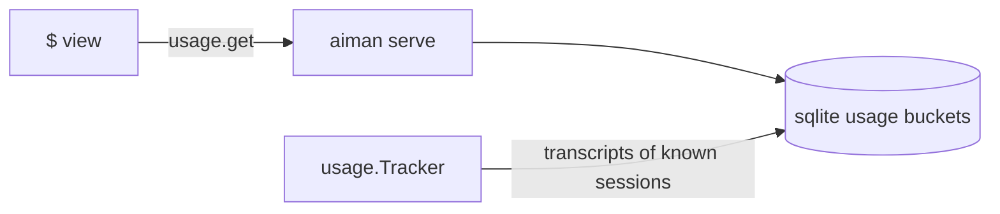
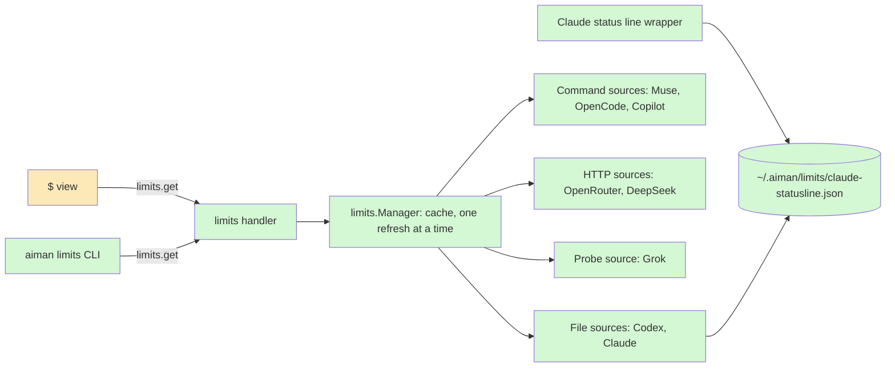
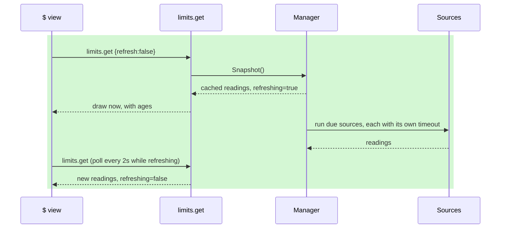

# provider-limits: See how much of each provider's allowance is left

**Revision:** 2 · **Size:** project · **Status:** approved
**Task:** operator request, 2026-11-05: "yes build all that are possible" · **Spec:** this page

**Legend:** green = new, amber = changed, red dashed = removed. Every diagram uses these three classes:

```text
classDef new fill:#d4f7d4
classDef changed fill:#fde9b8
classDef removed stroke-dasharray:4,fill:#f9d0d0
```

## The problem

Aiman's `$` view says what sessions have cost. It does not say how close you are to being cut off. To learn that today you open each agent and look: `/usage` in Grok, `/status` in Codex, `/usage` in Claude Code, a web console for OpenCode. You find out you have run out when a session stops working.

Providers expose this in very different ways, some documented, some only on a screen inside a running agent. This page puts them in one place, per host, and is honest about how old and how trustworthy each number is.

## How it works today

`$` calls `usage.get` once per host and renders cost rows plus one dim line under the host name.



- Fetch and render: `internal/ui/usage_view.go:103`, `:194`, `:469`. A rollup error shows as text; RTK failing shows nothing.
- Handler: `internal/server/handlers_usage.go:80`. It reads only the database.
- Tracker: `internal/usage/tracker.go:224`. It scans only session-known transcripts. The Codex parser at `internal/usage/codex.go:141` keeps only `turn_context` and `token_count` totals. Its structs have no `rate_limits` field and it skips lines with `info: null`, which can still carry limits, so limits need their own reader.
- Registering an RPC: `internal/server/server.go:336`, `api/openapi.yaml`, `cmd/aiman/rpc_cmd.go:15`. Devices are deny by default at `internal/gateway/allowlist.go`.
- Terminal holders are visible everywhere: `session.list`, `pty.list`, the notification sweep and the event streams all see any holder under `~/.aiman/pty/`, whatever its role (`internal/server/handlers_session.go:305`, `handlers_pty.go:67`, `handlers_notify.go:24`, `handlers_events.go:158`).

No code reads a remaining limit today, and serve holds no provider API keys.

## Glossary

| Term | Meaning |
|---|---|
| Allowance | What a subscription lets you use in a window, usually shown as percent used plus a reset time. |
| Window | A limit period: 5 hours, a week, a month. |
| Balance | Prepaid money or credits left on an API account. |
| Reading | One provider's numbers at one moment, with where they came from and when. |
| Source | The code that produces a reading for one provider. |
| Status line | The line Claude Code draws under its composer. It runs a command you configure and passes it JSON on stdin. |
| Probe | Starting an agent CLI under a short-lived terminal private to serve, typing one command, reading the screen and killing it. It is not a session. |
| Holder | `aiman pty hold`, the durable process that owns a session's terminal. A probe does not use one. |

## Proposed design

### What each provider gets

Every figure was checked on this host unless marked.

| Provider | Source | Gives | Needs | Trust |
|---|---|---|---|---|
| Muse | `muse usage --json` | Allowance | Nothing new | Documented command. **Only a null allowance seen so far** (`server_sent_no_usage`); see open question 2. |
| Codex | Tail of the newest `~/.codex/sessions/**/*.jsonl` | 5-hour and weekly percent, reset times, plan | Nothing new | Seen here. Only as fresh as the last Codex turn on this host. |
| Claude Code | Status line wrapper, **off until you turn it on** | 5-hour and weekly percent, reset times | One edit to `~/.claude/settings.json` | Documented. Only for subscribers, after the first response, only as fresh as the last Claude turn. A project-level `statusLine` overrides it. |
| Grok | Probe of `/usage` | Weekly percent, plan, reset text | Nothing new | Read off a screen. Tried once by hand here. |
| OpenRouter | `GET /api/v1/key` | Credits left, daily and weekly use | `.openrouter.key` in `~/.pi/agent/auth.json` when `.openrouter.type` is `api_key`, else `OPENROUTER_API_KEY` | Documented. |
| DeepSeek | `GET /user/balance` | Balance per currency | `.env.API_KEY` in `~/.deepcode/settings.json` when `.env.BASE_URL` has the exact host `api.deepseek.com`, else `DEEPSEEK_API_KEY` | Documented by the provider; checked only through mirrors. |
| Copilot | `gh api /users/<login>/settings/billing/premium_request/usage` | Premium requests this month | Existing `gh` login | Returned an empty list here, so the populated shape is from docs only. |
| OpenCode | `opencode stats --days 7` | Spend, 7 days, **not** a limit | Nothing new | Text screen; prints `$0.00` here. Go limits exist only in OpenCode's web console. |

**Not possible today:** Gemini and Antigravity (no quota command found; `agy --help` has none), Cursor (not installed, and its API needs an admin key), Pi on its own (it reports through the provider it uses), billing APIs needing admin keys.

### Domain model

```mermaid
classDiagram
    classDef new fill:#d4f7d4
    classDef changed fill:#fde9b8
    classDef removed stroke-dasharray:4,fill:#f9d0d0
    class Reading:::new {
      Provider string
      Plan string
      Windows []Window
      Balances []Balance
      Spend string
      State ok|unknown|unavailable
      Reason string
      ObservedAt time
      Source string
    }
    class Window:::new {
      Label string
      UsedPercent float
      ResetsAt time
      ResetsText string
    }
    class Balance:::new {
      Amount string
      Currency string
    }
    Reading "1" --> "*" Window
    Reading "1" --> "*" Balance
```

Rules that keep the numbers honest:

- **`ObservedAt` is when the provider said it**, not when serve asked. For Codex that is the transcript line's timestamp; for Claude the file's write time.
- **A window whose `ResetsAt` has passed is reported as reset**, with the old percent dropped. A stale 90% from before a reset must not be shown as current.
- **`ResetsText` holds a reset the screen gives without a year or zone** (Grok: `November 11, 13:44`). It is shown as printed, never parsed into a guessed time.
- **`unknown` means the source ran and could not read the answer**, such as a changed screen. `unavailable` means it does not apply here, such as an agent not installed. Neither is ever filled from a default or an old value without showing the old value's age.

### Structure



All of it lives in a new package, `internal/limits`, with the RPC at `internal/server/handlers_limits.go`. It touches nothing on the usage tracker's path. `limits.get` is a separate RPC so an older serve answers `unknown method` and the view just omits the section. It stays off the device allowlist until the phone wants it.

### Behaviour

`limits.get {refresh}` never blocks on a provider. It returns what is cached and starts a refresh of whatever is due, and the view polls while `refreshing` is true.



Refresh rules:

- Nothing runs on a timer. Only opening `$`, or pressing `l` there to force it, asks. This follows `hoststats` and `repoCache`.
- Minimum age before a source re-runs: 60 seconds for file and HTTP sources, 10 minutes for the Grok probe.
- **At most one run per source at a time.** Sources run concurrently with each other. A forced refresh skips the age check, and joins a run already in flight instead of starting a second one.
- A failed source keeps its previous reading, marked with the failure and its real age.
- Time limits: HTTP 10s, `muse` 15s, `gh` and `opencode` 20s, Grok probe 30s. File sources read a bounded tail (256 KiB).

P1 publishes the contract the other pieces build on:

```go
type Source interface {
    Name() string
    MinAge() time.Duration
    Timeout() time.Duration
    Read(ctx context.Context) Reading
}
```

### Codex

A dedicated reader, not the usage parser. It finds the newest transcript under `~/.codex/sessions/` by walking the newest date folders, reads a bounded tail, and takes the last `token_count` line that has `payload.rate_limits`, including lines with `info: null`. `ObservedAt` is that line's timestamp. It never logs the line.

### The Grok probe, which is the hidden session

You asked for something that does not show up as an aiman session. A new hidden role would leak: the holder is seen by `session.list`, `pty.list`, the 2-second notification sweep and the event streams, so it needs guards in about six places.

The probe avoids all of them by **not using a holder**. Serve starts `grok` directly with `creack/pty` (already a dependency, `internal/ptyhold/holder.go:80`) and renders its output with the existing `ptyruntime.RenderScreen`. To the rest of aiman it is no different from `gh`. It is Unix-only.

**Every keystroke is gated on a classified screen.** This is what makes it safe, since `/usage` typed at the wrong moment is a user message that spends a model call, and Enter on an update dialog would confirm the update.

| Screen | Action |
|---|---|
| Grok's trust prompt, exact text | Enter, once |
| Composer visible and empty, no dialog text anywhere | `/usage` then Enter, once |
| The usage panel | Read it, then kill |
| Anything else, including an update dialog | No keys. Poll until the limit, then `unknown`, then kill |

**Nothing survives it.**
- Linux sets `Pdeathsig: SIGKILL`. Go ties that signal to the creating OS thread, so the probe starts from a goroutine locked to its thread.
- The probe's process group is killed with `Kill(-pid)` and waited for on timeout, success, error and serve shutdown. `holder.terminate` only signals one process, so this is new code.
- Serve's unit is `KillMode=process`, so a stopped serve does not take the probe with it. As a backstop, the probe records its PID in `~/.aiman/limits/grok-probe.pid`, and the next run kills that PID only if `/proc/<pid>/cwd` is still the probe folder. This covers macOS, which has no `Pdeathsig`.

**It gets a minimal environment.** Not a copy of serve's: serve's environment may hold API keys and tokens, and Grok plugins could read them. It gets only `HOME`, `USER`, `LOGNAME`, `PATH`, `LANG`, `TERM=xterm-256color`, `COLORTERM`, plus anything the real-CLI check shows Grok needs. No `AIMAN_*`, so aiman's own Grok hooks are no-ops (`cmd/aiman/session_cmd.go:369`).

**Reading the screen.**
- It opens at 120x40 with the same resize nudge the holder uses (`holder.go:24`), because Grok can skip a full layout without one.
- It parses the ANSI-stripped screen. It needs all three of the `Weekly limit (<plan>)` label, `NN%` on the bar row and a `Resets:` line, or the reading is `unknown` with a sanitised reason. It never returns a partial figure.

**Cleaning up.** It runs in the fixed folder `~/.aiman/limits/grok-probe/`, so the trust prompt comes at most once. Afterwards it lists `~/.grok/sessions/`, URL-decodes each name, and removes only the folder whose decoded name is exactly the probe folder.

### The Claude status line wrapper

The status line's stdin is the only documented source (`https://code.claude.com/docs/en/statusline.md`). Claude Code takes one `statusLine` object, and reacts to a change immediately by cancelling the running command. So this is **off by default** and you turn it on with `limits.claude_statusline: true`. Until then Claude shows `off: set limits.claude_statusline`.

Your settings today are `{"type":"command","command":"bash ~/.claude/statusline-command.sh"}`, and that script is already heavy: it reads the full transcript with `jq`.

- **Only `.command` changes.** Every other key (`padding`, `refreshInterval`, and so on) stays. The whole original object is saved to `~/.aiman/limits/claude-statusline.original.json`, so restoring is exact.
- **What the wrapper does.** `~/.aiman/hooks/claude-statusline.sh` reads stdin, hands a copy to `aiman limits record-claude` in the background, then always runs your original command with the original bytes and exits with its status. Your status line neither waits for the recording nor depends on it.
- **What gets stored.** `record-claude` parses the JSON and atomically writes only `{rate_limits, observed_at}` at 0600. The working directory, transcript path, session id and cost never reach disk. A cancelled write leaves the previous file intact.
- **Detecting itself.** The wrapper is recognised by a marker in the command, not by its path. Already wrapped means no write at all, so a serve restart cannot make your status line flicker. A different command means you changed it, which becomes the new original.
- **One write.** The edit folds into the existing `ensureClaude` settings update (`internal/agenthook/install.go:76`), so serve rewrites settings once.
- **Turning it off** restores the saved object. Only user settings are touched; a project-level `statusLine` wins and Claude then shows no reading.

### API keys

Keys stay where the agents already keep them. Serve reads them at refresh time, holds them for that call only, and never stores or logs them.

- **One exact JSON path per file**, listed in the provider table, so another vendor's key in the same file can never be picked. Environment variables are a fallback only when that path is missing.
- **One hard-coded HTTPS host per provider.** The client refuses redirects, ignores proxy settings (`Proxy: nil`, since Go's default would send the header through `HTTP_PROXY`), and sends the key only in the header, never a query string.
- A DeepSeek key from Deep Code's settings is used only when `BASE_URL`'s host is exactly `api.deepseek.com`, because that key may belong to some other provider.
- Errors carry the status code only. The URL, headers and body are never logged or returned.

## A scenario, end to end

You press `$` on host `regent0` at 21:00. The view draws cost as today and calls `limits.get`. Serve has nothing cached, so it answers immediately with `refreshing:true`, and the view shows `limits: checking…`.

Serve reads the tail of the newest Codex transcript: `used_percent` 30 on the 10080-minute window, line time 18:51. It reads `claude-statusline.json`, written by your last Claude turn. It runs `muse usage --json`, which returns a null allowance, so Muse is `unknown: no usage yet in this window`. It calls OpenRouter with the key from Pi's `auth.json`, and DeepSeek with Deep Code's after checking the host. It starts the Grok probe, waits for the composer, sends `/usage`, reads `19%` and `November 11, 13:44`, kills Grok and removes its session folder.

Two seconds later the view polls and draws:

```text
regent0
  Codex (plus)      5h 2%   week 30%, resets Nov 8 14:21     2h ago
  Claude (max)      5h 41%  week 12%, resets Nov 9 06:00     4m ago
  Grok (Plus)               week 19%, resets November 11, 13:44   now
  OpenRouter        $74.50 left, $1.20 today                  now
  DeepSeek          $12.10                                    now
  Muse              no usage yet in this window               now
```

Copilot and OpenCode follow when they have something to report. Pressing `l` forces a refresh. Reopening `$` within 10 minutes reuses the Grok figure and shows its age. (The Claude and money figures above are illustrative.)

## Alternatives considered

- **Hidden session role.** What was first proposed. Lost: it leaks through six consumers, stays subject to holder lifetime, and needs guards that every future consumer must remember.
- **Private web endpoints** (`grok.com/.../GetGrokCreditsConfig`, `api.anthropic.com/api/oauth/usage`, Codex's `/api/codex/usage`). Lost: they need browser cookies or login tokens stored or reused on hosts, and can change without notice.
- **Codex `account/rateLimits/read` through `codex app-server`.** Would give a live figure with no Codex turn. Deferred: not prominently documented, and the transcript is verified here. It is the first thing to add if the age proves a nuisance.
- **Probing Claude's `/usage` instead of wrapping the status line.** No settings edit and it works with no session running, but it starts a screen scrape where a documented source exists.
- **Extending `usage.get`.** Lost: it reads only sqlite today and is called with a 30-second timeout, and the phone relies on it. Slow providers must not sit on that path.
- **A background timer.** Lost: it starts Grok and calls providers while nobody is looking.
- **Asking you to paste API keys into aiman's config.** Lost: the agents already hold them, and copies of keys are how keys leak.

## Open questions

1. **Should the Claude wrapper start on?** It is the only documented route to Claude's figures, and it changes which command your status line runs, though not what it shows. It is off by default on every host. Saying yes means I set `limits.claude_statusline: true` for your remotes as part of this work, so Claude appears straight away. Saying no leaves your settings untouched and shows Claude as off until you set it. I recommend yes: your status line keeps working even if recording fails, and turning it off restores your settings exactly.
2. **May I spend one Muse turn on a trivial prompt to see a populated `muse usage --json`?** We have only seen a null allowance, so the parser would be written blind. One short turn costs very little and lets me test against the real shape. Without it, Muse ships reporting `unknown` for anything it cannot parse, and the shape gets confirmed on first real use. I recommend yes.

## Decisions

Consult 7a1a16db, verdict `revise`, 7 high, 4 medium, 2 low. No second consult: every high is accepted and its change is written into this revision.

| Objection | Severity | Triage | Reason |
|---|---|---|---|
| Grok probe can type into the wrong screen | high | accept | Keystroke table added; other screens get no keys. |
| Probe survives serve death | high | accept | `Pdeathsig` on a locked thread, group kill, plus a PID backstop the consult did not ask for, because `Pdeathsig` depends on the thread and macOS lacks it. |
| Two concurrent probes are possible | high | accept | One run per source; force joins it. |
| `statusLine` is an object, not a string | high | accept | Wrap `.command`, save the whole object, detect by marker, one write in `ensureClaude`. |
| Wrapper stores all of stdin and delays a heavy original | high | accept | Store only `rate_limits`, record in the background, always run the original. |
| Wrong key could reach OpenRouter or DeepSeek | high | accept | Exact JSON paths, no proxy, no redirects, no logging. P2 raised to M and smart. |
| Grok inherits serve's environment | high | accept | Minimal environment list. |
| Screen parse needs size and ANSI handling | medium | accept | 120x40, nudge, strip ANSI, coloured fixture. |
| Codex cannot reuse `applyCodexLine` | medium | accept | Own tail reader. My earlier text on this was wrong and is corrected. |
| Breakdown gaps | medium | accept | Mount points, config files, `Source` interface and timeouts added. |
| Status line edit applies live | medium | accept | Default off, and no write when already wrapped. |
| Session cleanup encoding unspecified | low | accept, changed | Decode names and match exactly. Rejected "watch the tree": another Grok session starting at the same moment would be deleted. |
| Stay off the allowlist and off `rpc_cmd.go` | low | accept in part | Stays off the device allowlist. Rejected for `rpcMethods`: the TUI calls through `ServeRPC`, which requires it. |

## Breakdown

The contract (`internal/limits/reading.go`, the `Source` interface, stubs in each owned file and `LimitsConfig` in config) and every acceptance test are committed before any child starts. An `unavailable` reading for a tool that is simply not installed has an empty `Reason`, and the view drops it.

Acceptance tests are written and committed on this branch before the first child starts.

| Piece | Owns files | Parallel group | Depends on | Complexity | Tier | Acceptance tests |
|---|---|---|---|---|---|---|
| P1 Core and file sources: `Reading`, `Manager`, RPC, CLI, Codex, Muse, API contract | `internal/limits/{reading,manager,codex,muse}.go`, `internal/server/handlers_limits.go`, `cmd/aiman/limits_cmd.go`, `cmd/aiman/rpc_cmd.go`, `cmd/aiman/serve.go`, `internal/server/server.go`, `internal/gateway/allowlist_test.go`, `api/openapi.yaml` | A | none | M | smart | `go test ./internal/limits/ -run 'TestManager\|TestCodex\|TestMuse'`, `go test ./internal/server/ -run TestLimitsGet` covering one run per source, force joining, and `limits.get` absent from the allowlist |
| P2 Keys and HTTP and command sources: OpenRouter, DeepSeek, Copilot, OpenCode | `internal/limits/{openrouter,deepseek,copilot,opencode,keys}.go` | B | P1 | M | smart | `go test ./internal/limits/ -run 'TestOpenRouter\|TestDeepSeek\|TestCopilot\|TestOpenCode\|TestKeys'` covering wrong key not sent, 301 to another host refused, proxy ignored, and a log capture that stays free of the key |
| P3 Grok probe | `internal/limits/{probe,grok}.go` | B | P1 | L | smart | `go test ./internal/limits/ -run 'TestProbe\|TestGrok'` with a fake CLI that draws the recorded coloured screen, an update dialog (no keys sent), a late composer, and a hang. It fails if a grandchild is alive after the kill or after the master closes |
| P4 Claude status line wrapper | `internal/limits/claude.go`, `internal/agenthook/statusline.go`, `internal/agenthook/install.go`, `internal/infra/config/config.go` (`Config` and `ServeConfig`) | B | P1 | M | smart | `go test ./internal/limits/ -run TestClaude`, `go test ./internal/agenthook/ -run TestStatusLine` covering object wrap and exact restore, no write when already wrapped, original output byte for byte, a failed record still painting, a cancelled write keeping the old file, and only `rate_limits` on disk |
| P5 `$` view and docs | `internal/ui/usage_view.go`, `internal/ui/usage_limits.go`, `AGENTS.md`, `README.md` | C | P2, P3, P4 | S | worker | `go test ./internal/ui/ -run TestUsageLimits` covering old serve, ages and poll stop |

After merge I run `aiman limits` on this host for real, and the Grok probe against the real CLI, before releasing.

## What you should be able to explain after reading

1. Why the Grok probe is not a session at all, and what would have had to change if it were.
2. Why a Codex or Claude figure can be hours old and still be shown, and what stops a figure from before a reset being shown as current.
3. Why `limits.get` is its own RPC that returns immediately, not part of `usage.get`.
4. Where each API key comes from, and the one rule that stops a key reaching the wrong host.
5. Exactly what the status line wrapper changes in your Claude settings, what it stores, and how to undo it.
