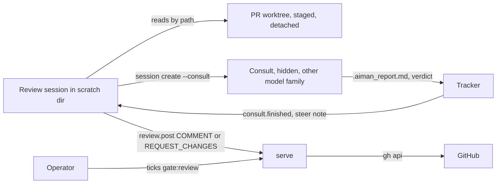
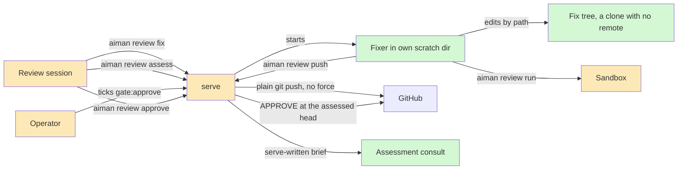
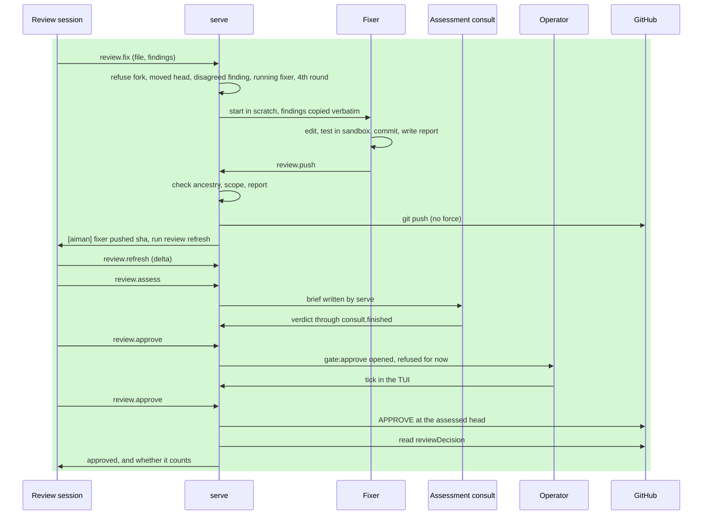

# review-fix-approve: review agents that get findings fixed and PRs approved

**Revision:** 4 · **Size:** project · **Status:** as built, v0.27.0
**Task:** operator request, 2026-11-05 · **Reverses:** two non-goals of `docs/superpowers/specs/2026-10-30-review-mode-design.md` ("never pushes to the PR branch", "the agent never approves a PR")

**Legend:** green = new, amber = changed, red dashed = removed. Every diagram uses these three classes:

```text
classDef new fill:#d4f7d4
classDef changed fill:#fde9b8
classDef removed stroke-dasharray:4,fill:#f9d0d0
```

In a sequence diagram, new steps are wrapped in `rect rgb(212,247,212)` and changed steps in `rect rgb(253,233,184)`.

## The problem

A review session can find problems and post comments, and then it stops. Someone else has to fix the findings, and a person has to approve the PR on GitHub.

The operator wants two more abilities:

1. A review agent can tell another agent to fix findings and push the fixes to the PR.
2. A review agent can tell another agent to assess whether the PR is approvable, and have it approved on that assessment.

The operator's decisions, in their words: "approval needs my sign off; any findings; no separate gh account".

## How it works today

A review session (`session.create {review}`, `internal/server/review.go:144`) runs its agent in a scratch directory, `~/.aiman/pr-reviews/<id>/work`. It reads a detached, staged PR worktree, `<repo>@pr-<n>`, by path. That separation is deliberate: the agent never starts inside PR content, so it never loads the PR's agent config or hooks. PR code runs only in the Docker sandbox (`aiman review run`, `internal/server/review_run.go`).



- `review.post` (`internal/server/review_post.go:72`) refuses while `gate:review` is open, and `File.Post` refuses `APPROVE` (`internal/review/file.go:196`).
- `review.refresh` (`internal/server/review_reveal.go:198`) restages at a new head, withdraws the description and restarts from the blind pass.
- A consult's verdict is already recorded on the parent's ledger as `consult.finished` with severity counts.
- `aiman todo approve-review --quote` closes `gate:review`, but serve only checks that the owner sent a non-empty quote. The quote is the agent's claim about what the operator said.
- Every agent on a host shares one `gh` login and one set of git credentials.

## Glossary

| Term | Meaning |
|---|---|
| Finding | An entry `### F1 blocking path:line` in the review file, `.aiman_review.md` |
| Fixer | New: a child session of a review that fixes named findings and pushes them to the PR |
| Assessment | New: a consult with a brief written by serve, whose verdict decides whether the PR may be approved |
| Sign-off | New: the operator closing `gate:approve`. Serve refuses a session's attempt, with or without a quote. It is a process control, not a security boundary: see Approving |
| Fix tree | New: a standalone local clone with no remote that the fixer edits. It is not a git worktree of the main clone |
| Round | One fixer run. A review may run 3 |
| Delta refresh | New: a refresh onto a head aiman's own fixer pushed. The review checks the fix and does not restart blind |

## Proposed design

Two new verbs, each with one guard rail that serve enforces rather than asks the agent to honour.

### Domain model

```mermaid
classDiagram
    classDef new fill:#d4f7d4
    classDef changed fill:#fde9b8
    classDef removed stroke-dasharray:4,fill:#f9d0d0
    class State {
      Ref
      HeadSHA
      Revealed
      Single
      Fixes: list of FixRound
      Assessment
      ApprovedHead
    }
    class FixRound {
      Fixer
      Findings
      StartSHA
      PushedSHA
    }
    class Assessment {
      Consult
      HeadSHA
    }
    class Finding {
      Label
      Verified
      Call
      Fixed: pushed sha
    }
    class SessionRole {
      fixer
    }
    class Gates {
      gate:review
      gate:approve
    }
    State --> FixRound
    State --> Assessment
    class State:::changed
    class FixRound:::new
    class Assessment:::new
    class Finding:::changed
    class SessionRole:::changed
    class Gates:::changed
```

### Structure



| Change | Where | Notes |
|---|---|---|
| New | `internal/server/review_fix.go` | `review.fix`, `review.push`, fixer tracking |
| New | `internal/server/review_approve.go` | `review.assess`, `review.approve` |
| Changed | `internal/review/file.go` | `Fixed:` line; `File.Approval`; `Post` and `Missing` skip fixed findings |
| Changed | `internal/review/github.go` | `PR.Fork` (`isCrossRepository`), `Viewer`, `ReviewDecision` |
| Changed | `internal/review/state.go` | fields above |
| Changed | `internal/todo/gate.go` | `gate:approve`, which has no `--quote` route |
| Changed | `internal/domain/session.go` | `SessionRoleFixer`, visible, not hidden; `FixPR` field. A fixer has no `ReviewPR`, so the 55 existing `ReviewPR` references keep meaning "this is the review session" |
| Changed | `internal/infra/git/pr_worktree.go` | `SetupFixTree`: `git clone --no-checkout` from the main clone, `git remote remove origin`, detached checkout at the staged SHA; `PushFixTree` fetches from it into the main clone and pushes from there |
| Changed | `internal/server/review_reveal.go`, `review_run.go`, `review_post.go`, `handlers_todo.go` | Refresh gains the delta path and carries `Fixes`; `review.run` accepts a fixer by `FixPR`; `review.post` needs a finished consult after a delta; `todo.gate` refuses `gate:approve` |
| Changed | `internal/coordinator/track.go` | A `fixer:<id>` ref settles on push and fails on a dead or timed-out fixer. It never waits for a PR |
| Changed | `internal/ui/a1_detail.go` | The meta line shows `fix #n` for a fixer |
| Changed | `cmd/aiman`, `api/openapi.yaml`, `internal/gateway/allowlist.go` | CLI, contract; `review.approve`, `review.fix` and `review.push` stay off the device allowlist |
| Changed | `internal/aimanskill/SKILL.md`, `AGENTS.md`, `internal/review/prompt.go` | Review mode rules |

### Behaviour



### Fixing: rules

`aiman review fix <file> [--findings F1,F3]` runs from the review session or the operator. No `--findings` means every finding that is not `Call: disagree`.

- **Any finding, no call needed.** Any label, verified or not, is allowed. The only exclusion is a finding the operator explicitly disagreed with.
- **Runs after reveal**, so the blind passes are complete first (`review_not_ready`).
- **Refusals:** a fork (`review_fix_fork`), a moved head (`review_head_moved`), a fixer already running (`review_fix_running`), a fourth round (`review_fix_limit`, which then needs the operator).
- **Someone else's PR:** allowed without asking. Operator: "they should be able to push".
- **Isolation:** the fixer runs in its own scratch directory like the review session, and edits its fix tree by path. The fix tree is a clone with `origin` removed, so a plain `git push` from it has nowhere to go, its config is its own, and it cannot clash with a branch checked out elsewhere on this host. The fixer uses the review session's agent and model. It runs PR code only through `aiman review run`, which gets a sandbox for its tree.
- **Fixer's report:** `.aiman_report.md` has `## Findings` with one line per finding (`F1 fixed <evidence>` or `F3 not fixed <reason>`) and `## Surprises`.

`aiman review push`, from the fixer only, is where serve checks the work:

- Commits exist, the worktree is clean, and the round's `StartSHA` is an ancestor of `HEAD`.
- The report parses and covers every assigned finding.
- Every changed path is an assigned finding's file or in that file's directory (`review_fix_scope`). That leaves room for a helper or a test beside the fix, and refuses a change anywhere else. A finding with no path grants no scope.
- Nothing under `.github/` changes unless an assigned finding's file is there. A same-repo push to `.github/workflows` runs on GitHub with the repo's secrets, and the fixer has read untrusted text.
- Serve then fetches the commits into the main clone and runs `git -c core.hooksPath=/dev/null push origin <sha>:refs/heads/<headRef>`, never with force, so a moved branch is rejected.
- It records `review.fix_pushed`, steers the review session, stops the fixer and removes the fix tree.

A fixer that ends, dies or runs past `review.fix_timeout` (default 60m) without pushing is retired with `review.fix_failed`, and the review session gets a note. Its fix tree is kept, because it may hold useful work, until the next round or the review's termination.

### Re-review after a fix

The next `aiman review refresh` compares the PR head with the last round's `PushedSHA`.

- **Equal, and the fix is 400 changed lines or fewer:** a delta refresh. The description stays revealed, `.aiman_review/fix.patch` holds `StartSHA..PushedSHA`, the informed and post to-dos and all gates reopen, consults and any assessment are dropped, and `Fixes` is kept. The blind to-do stays done. A second agent must still look: `review.post` refuses until a consult has finished since this refresh (`review_not_ready`), unless the review runs `Single`, and `review.approve` needs the assessment, which reads the whole diff.
- **Different** (someone else pushed), **or a larger fix:** today's full refresh back to the blind pass. `Fixes` is kept, so the round limit holds.

The review file gains `Fixed: <sha>` on a finding. Serve accepts it only for a finding that `Fixes` records as fixed at that sha; anything else counts as an ordinary finding that still needs its call, so `Missing` takes the recorded fixes as an input. A fixed finding needs no `Call:`, posts no inline comment, and is listed in the review body as "Fixed in <sha>".

### Approving: rules

`aiman review assess` starts a consult using the existing consult machinery, so it gets the other-family pick, the tracker, the timeout and the kept report. The difference is that serve writes the brief, so the review agent cannot steer it:

- Review the diff first, without the PR description and without the findings.
- Then read `findings.md`, a copy serve places in the consult's directory, and check each one is resolved.
- `## Objections` and `## Verdict` as usual.

`aiman review approve <file>`, from the review session or the operator, checks in this order:

| Check | Refusal |
|---|---|
| The `gh` viewer is not the PR author | `review_own_pr` |
| Revealed, and the head equals the staged head | `review_not_ready`, `review_head_moved` |
| No `blocking` finding open (not `Fixed:` and not `Call: disagree`), and the file is otherwise complete | `review_blocking_open`, `review_incomplete` |
| An assessment exists for this head, with verdict `approve` and 0 high objections | `review_not_assessed`, `review_assessment_rejected` |
| Not already approved at this head | `review_already_approved` |
| `gate:approve` exists and is closed. If it does not exist yet, serve opens it and refuses | `gate_needs_operator` |

Opening the gate only after an approve verdict means the operator is always signing off on a known verdict and head. `todo.gate` refuses `gate:approve`, so only serve opens it. State records the head and consult the gate was opened for; if they no longer match, serve reopens the gate and refuses. Any head change or refresh also reopens it. Only the consult that `review.assess` started counts, not one the review agent started itself.

Serve then submits `APPROVE` at the assessed head through `File.Approval`. The body states that an agent assessed the PR and names that agent's family, says whether it differed from the reviewer's, and says the operator signed off. It carries the summary, plus the agreed unfixed inline comments if no earlier post sent them. `File.Post` still refuses `APPROVE`.

**The sign-off cannot be typed through a session.** `gate:approve` has no `approve-*` command. It closes only through an operator `todo.update`: the TUI tick (`ctrl+t`), a shell on the host outside any session, or a paired phone, which the gateway treats as the operator (the app has no button for it yet). Typing "approved" into the review session's terminal will not close it. This is stricter than `gate:review`, because a PR's text can instruct the agent reading it, and that agent could otherwise run `--quote "approved"` itself.

**What the sign-off does not do.** It stops an agent going through aiman's approval path without you. It is not a security boundary against a hostile agent: every agent runs as the same Unix user with the same `gh` login, so one could detach from its holder tree to look like the operator (`internal/server/peer.go:114`), or skip aiman and run `gh pr review --approve` directly. No check inside serve can stop that. Only separate credentials or a separate Unix user would.

**One login.** Afterwards serve reads `reviewDecision` and reports whether the approval counts.

- PRs opened under the host's own `gh` login cannot be approved, so `review_own_pr` is refused before an assessment is spent. GitHub's own "Can not approve your own pull request" answer maps to the same code, which also covers cases the author check misses, such as a Copilot PR you assigned. **Agents on this host open PRs under that login, so those PRs can only ever get comments.**
- If a repo requires approval of the most recent push by someone else, an approval after our fixer pushed may be posted but not count. The result says `counts: false`, and the operator is told. It is not reported as success.

## A scenario, end to end

Review `acme/api#88`, by a colleague, same repo. The reviewer and its consults produce F1 `blocking` at `pay/charge.go:42` and F2 `nit`.

1. The review session runs `aiman review fix .aiman_review.md`, which starts fixer `pr-88-fix` at head `abc`. The PR is a colleague's, and no tick is needed.
2. The fixer edits its fix tree by path, runs `aiman review run -- go test ./pay/...`, commits `def`, writes its report and runs `aiman review push`. Every changed file is in `pay/`, so serve's checks pass and it pushes to `feature/charge`. The fixer is stopped and the review session gets `[aiman] fixer pushed def for F1, F2. Run aiman review refresh.`
3. `aiman review refresh` sees head `def` equal to `PushedSHA`, and a small fix, so it is a delta refresh. The agent reads `fix.patch`, rechecks F1, and adds `Fixed: def` to F1 and F2.
4. `aiman review assess` starts a consult on another model family. It finishes with `approve`, 0 high, 1 low.
5. `aiman review approve .aiman_review.md` opens `gate:approve` and is refused. The agent tells the operator the verdict and links the brief.
6. The operator reads the brief and ticks `Approval signed off` in the TUI.
7. `aiman review approve` runs again. Serve confirms head `def` is unchanged, submits `APPROVE` at `def`, and reads `reviewDecision`: `counts: true`.

## Alternatives considered

- **The fixer pushes with `git push` itself.** Lost: no head check, scope check or ledger. It remains physically possible, see the residual risk under Decisions.
- **The fixer works in the PR worktree or a normal `CreateSession` worktree.** Lost: its working directory would hold PR-controlled agent config and hooks, in a prompt-free session. That undoes the review's isolation.
- **A detached git worktree for the fixer (revision 1).** Lost: a worktree shares the main clone's config, so it keeps `origin` and the fixer can push around serve's checks. Removing the remote per worktree would mean a repo-wide config change.
- **Mark the fixer with `ReviewPR` and a role (revision 1).** Lost: `ReviewPR` means "this is the review session" across 55 references, including reveal, post, cleanup and the duplicate-review check.
- **Check out the PR's branch for the fixer.** Lost: git refuses when that branch is checked out elsewhere, which is common here because aiman sessions author PRs on this host.
- **A one-time tick code to make the sign-off unforgeable.** Lost: anything serve stores, a same-user agent can read, and the agent can bypass the gate with `gh` anyway. It would look like protection without being it.
- **A distinct approver agent that holds the APPROVE call.** Lost: same `gh` login, so it adds nothing beyond the assessment. The independent judgement is in the verdict, and serve does the submit.
- **Reuse `gate:review` and `--quote` for sign-off.** Lost: the quote is agent-asserted, so a PR's text could forge the sign-off.
- **Always restart blind after a fix.** Lost: every round repeats the full review for a small known change. A foreign commit still forces it.

## Open questions

None.

## Decisions

| Objection | Severity | Triage | Reason |
|---|---|---|---|
| Operator: "approval needs my sign off" | n/a | accept | `gate:approve`, no agent-assertable route |
| Operator: "any findings" | n/a | accept | No label, verification or call filter. My call: a finding with `Call: disagree` is still excluded, because the operator rejected it |
| Operator: "they should be able to push" | n/a | accept | `gate:push` removed: agents push to any same-repo PR without asking. Forks stay refused, because the host's credentials generally cannot push to them |
| Operator: "no separate gh account" | n/a | accept | One login. Own PRs refused up front; `counts: false` reported honestly |
| The fixer holding `ReviewPR` makes it a second review session across about 15 behaviours | high | accept | Confirmed in code. New `FixPR` field; `ReviewPR` stays on the review session only |
| `gate:approve` is not TUI-only: the gateway calls as the operator and `todo.update` is on the device list | high | accept in part | Claim corrected on this page, and the ref joins `gateTexts`. Rejected the device block: a paired phone is the operator, and its token is the one credential not stored on the host |
| The fixer's worktree keeps `origin`, so it can push around serve | high | accept | Fix tree is a clone with no remote; serve pushes from the main clone. Credentials can still reach GitHub by URL, see residual risk |
| A delta refresh plus `.github/`-only scope lets extra commits skip the second reviewer | high | accept | Path scope limited to the finding's file and directory; a consult must finish before posting after a delta; over 400 changed lines is a full refresh. Changed from "one serve-written consult" to the existing consult rule, because the assessment already gives the approval path a serve-written one |
| A session can open `gate:approve` before a verdict through `todo.gate` | medium | accept | `todo.gate` refuses the ref, and the gate is bound to head and consult |
| `isSessionCall` can be escaped, so "cannot be forged" is too strong | medium | accept in part | Claim dropped and the limit documented. Rejected the nonce: same-user agents can read what serve stores, and can use `gh` directly |
| A fixer linked as `child:` waits forever for a PR | medium | accept | `fixer:<id>` ref with its own tracker path |
| `Fixed:` could take an unfixed finding off the blocking list | medium | accept | Already intended; `Missing` now takes the recorded fixes as input, so it is enforced |
| Copilot PRs also refuse approval from the assigner | low | accept | GitHub's refusal maps to `review_own_pr` |
| A visible fixer looks like a duplicate review in the TUI | low | accept | Meta line shows `fix #n` |
| Residual risk: an agent with host credentials can still run `git push <url>` or `gh pr review --approve` itself | medium | defer | Serve cannot stop a process on the same account. Skill rules forbid it, as they already do. `agenthook.GuardsPRCreate` shows a hook route for some agents; separate piece of work |
| P3 consult: lock dropped gates in `GuardGate`, leave `ClampGate` alone | medium | accept | Applies to every gate; see Deviations |
| P3 report: the assessor reads a file the review agent can write | high | accept | Serve generates the diff from the head SHA; see Deviations |
| P2 consult: `skillRoots`, `restartRoot` and the restart trust block must skip a fixer | high | accept | Done in P2 |
| P2 consult: change-directory, TUI overlays and verify-before-PR must know about a fixer | high | accept | Done in P4 |
| P2 consult: `restartKit` matches checklists against the fix tree | low | defer | A read-only glob |

## Breakdown

Acceptance tests are committed on this branch before the first child starts.

| Piece | Owns files | Parallel group | Depends on | Complexity | Tier | Acceptance tests |
|---|---|---|---|---|---|---|
| P1 Foundations: `Fixed:`, `File.Approval`, `PR.Fork`, `Viewer`, `ReviewDecision`, state fields, new gates, fixer role | `internal/review/{file,github,state}.go`, `internal/todo/gate.go`, `internal/domain/session.go`, `internal/server/handlers_todo.go` | A | none | M | worker | `go test ./internal/review ./internal/todo ./internal/domain` |
| P2 Fixing: fix tree, `review.fix`, `review.push`, fixer tracking, sandbox for the fixer, delta refresh | `internal/server/review_fix.go`, `review_reveal.go`, `review_run.go`, `review_post.go`, `internal/infra/git/pr_worktree.go`, `internal/coordinator`, `internal/ui/a1_detail.go` | B | P1 | L | smart | `go test ./internal/server -run 'TestReviewFix\|TestReviewPush\|TestReviewRefreshDelta'` |
| P3 Approving: `review.assess`, `review.approve` | `internal/server/review_approve.go` | B | P1 | L | smart | `go test ./internal/server -run 'TestReviewAssess\|TestReviewApprove'` |
| P4 Surface: CLI, openapi, allowlist, skill, AGENTS.md, prompt, evals | `cmd/aiman`, `api/openapi.yaml`, `internal/gateway/allowlist.go`, `internal/aimanskill/SKILL.md`, `AGENTS.md`, `internal/review/prompt.go`, `evals/` | C | P2, P3 | M | worker | `make ci`, `make eval` |

No phone work: the app has no gate button yet, and `review.fix`, `review.push`, `review.assess` and `review.approve` stay off the device allowlist. Release as v0.27.0, serve only.

## As built

Released as v0.27.0. PRs #70 (P1), #71 (P2), #72 (P3), #73 (P4).

### Deviations from the approved design

- **The assessor's diff comes from the head commit.** The design had the assessment read the review's own `.aiman_review/diff.patch`. The review agent can write to that directory, so serve now generates `diff.patch` into the consult's directory from the staged head SHA against its merge base with the PR's base branch, ignoring replace refs, external diff drivers and textconv.
- **A dropped gate is locked for sessions.** `todo.GuardGate` protected only an open gate, so after the operator dropped `gate:approve` a session could mark it done and `review.approve` would post. It now also refuses a session's change to a dropped gate. This applies to `gate:design` and `gate:review` too: the operator reopens a dropped gate.
- **An approval that carried the inline comments ticks `review:post`,** so a later `review.post` cannot send them twice.
- **A new ledger kind, `review.assess_started`,** names the assessing agent after its consult's row is forgotten.
- **`skillRoots`, `restartRoot` and the restart trust block skip a fixer.** Otherwise a serve restart writes the skill into the fix tree, which makes `review.push` refuse it.
- **A fix containing a binary file refreshes in full,** because its size cannot be judged.

### Known limits

- Not run against real Docker, a real SSH host or a real GitHub push. The tests use real git against a local upstream with fake GitHub and Docker.
- `origin/<base>` is a ref an agent can move. Moved to the head, it gives the assessor an empty diff, which is not refused.
- If saving state fails after GitHub accepts an approval, a retry posts a second APPROVE. The call says the PR is approved on GitHub.
- A fixer the tracker retires logs `session.ended` with reason `consult_finished`, because it reuses `RetireConsult`.
- If someone drops a fixer's to-do, nothing times that fixer out, and it holds `review_fix_running` until its agent ends.
- The tracker reads sessions once and each to-do list later, so a consult linked in between can be unlinked and later swept without a `consult.abandoned` row. `review.approve` then says `review_not_assessed` without saying why. It can block an approval, not allow a wrong one. Traced in code, not reproduced.
- `counts: false` reaches the operator only through the agent, as the skill instructs. Serve sends no notification.

## What you should be able to explain after reading

1. Why the fixer edits a remote-less clone by path from a scratch directory, and what would go wrong if it ran inside the PR's worktree.
2. Why typing "approved" in the review session does not close `gate:approve` when it does close `gate:review`, and why that is still not protection against a hostile agent.
3. Which three things must line up before `APPROVE` goes out: the head, the verdict and your tick.
4. Why PRs opened under this host's own `gh` login can never be approved by this feature, and what `counts: false` means.
5. When a refresh after a fix is a delta, and when it goes back to the blind pass.

## Contract for piece P1

Later pieces build on exactly these names.

`internal/review`:

- `PR.Fork bool`, read from `isCrossRepository`, which joins the `gh pr view --json` field list.
- `GitHub` gains `Viewer(ctx) (string, error)` (`gh api user -q .login`) and `ReviewDecision(ctx, ref Ref) (string, error)` (`gh pr view <n> --repo <slug> --json reviewDecision`).
- `ErrOwnPR`: `PostReview` wraps it when GitHub answers "Can not approve your own pull request".
- `Finding.Fixed string`, parsed from a `Fixed: <sha>` line before the body.
- `File.MissingWith(fixed map[string]string) []string`: `fixed` maps a finding id to the sha `State.Fixes` records. A finding whose `Fixed` equals its entry needs no call or verification. Any other `Fixed:` value is an ordinary finding. `File.Missing()` is `MissingWith(nil)`.
- `File.OpenBlocking(fixed map[string]string) []string`: ids of `blocking` findings neither recorded as fixed nor `Call: disagree`.
- `File.PostFixed(event, commit string, single bool, fixed map[string]string) (Post, error)`: as `Post`, which becomes `PostFixed` with nil. Recorded fixed findings produce no inline comment, and the body gains one `Fixed in <sha>: <id> <path>` line each. `APPROVE` is still refused.
- `File.Approval(commit string, single bool, fixed map[string]string, posted bool, note string) (Post, error)`: event `APPROVE`, incomplete files and open blocking findings refused. The body is the summary, the single-reviewer note, the fixed lines and `note`. With `posted` true it has no inline comments.
- `FixRound{Fixer string, Findings []string, Fixed []string, StartSHA, PushedSHA string}` and `AssessmentState{Consult, HeadSHA string}`.
- `State` gains `Fixes []FixRound`, `Assessment *AssessmentState`, `ApproveGate *AssessmentState` (what `gate:approve` was opened for) and `ApprovedHead string`, all `omitempty`.
- `State.FixedMap() map[string]string`: finding id to `PushedSHA`, for ids in a round's `Fixed`; a later round wins.
- `ParseFixReport(md string) (FixReport, error)`: `FixReport{Fixed, NotFixed map[string]string, Surprises string}`. `## Findings` has lines `F1 fixed <evidence>` or `F3 not fixed <reason>`, and `## Surprises` is required. An empty reason or evidence is an error.

`internal/todo`: `ApproveGateRef = "gate:approve"`, `ApproveGateText = "Approval signed off"`, both in `gateTexts`. `ServeOnlyGate(ref string) bool` is true only for `gate:approve`.

`internal/server`: `handleTodoGate` refuses a serve-only ref with `invalid_params`.

`internal/domain`: `SessionRoleFixer SessionRole = "fixer"`, not `Hidden()`. `Session.FixPR string`, stored in a new COALESCE-protected `fix_pr` column, and carried on `SessionConfig.FixPR` and `SessionInfo` as `fix_pr`.

## Contract for pieces P2 and P3

Routes and empty handlers are already on this branch (`review_fix.go`, `review_approve.go`), so P2 and P3 share no file. The acceptance tests drive everything through RPC and use these literals.

### P2: fixing

`review.fix {session, file, findings?}`, from the review session or the operator; another session gets `gate_needs_operator`. `findings` omitted means every finding not `Call: disagree`. Naming a disagreed or unknown finding is `invalid_params`.

Result: `{"type":"review_fix","session":<review id>,"fixer":<SessionInfo>,"findings":[...],"start_sha":<staged head>,"round":<n>}`.

The fixer's row has `Role` `fixer`, `FixPR` the ref, no `ReviewPR`, `ParentID` the review, and the review's `AgentName`, model and effort. Everything it owns lives under `<review base>/<fixer id>/`, laid out like a review: `work` (`WorkingDirectory`, a fresh repository, the agent's cwd), `tree` (`WorktreePath`, the fix tree), and `sandbox`, `src`, `out` (`reviewSandbox(fixer id)`). `work/findings.md` holds the assigned findings verbatim. The initial prompt names the tree path.

A round is appended to `State.Fixes` at start. A pending to-do with `Ref` `fixer:<id>` goes on the review's list. Ledger on the review: `review.fix_started`.

A round without a `PushedSHA` still counts toward the limit of 3, so a fixer that keeps dying cannot run for ever.

`review.push {}`, from a fixer only, reads its own row. Any other caller gets an error and nothing is pushed.

Result: `{"type":"review_push","sha":<pushed sha>}`.

| Refusal | When |
|---|---|
| `review_fix_incomplete` | No commits, a dirty tree, `StartSHA` not an ancestor, a report that does not parse, or one that misses an assigned finding |
| `review_fix_scope` | A changed path, either side of a rename, is outside the assigned findings' files and their exact directories (not subdirectories), or under `.github/` without a finding's file there |
| `review_head_moved` | GitHub's head differs from `StartSHA`, or the plain push is rejected as non-fast-forward |

A refusal leaves the fixer and tree alone. On success: `Fixes[n].PushedSHA` and `Fixed` are set from the report, ledger `review.fix_pushed {fixer, sha, findings, fixed}`, the `fixer:<id>` to-do is done, a steer note containing the sha and `aiman review refresh` goes to the review, and the fixer's row and tree go. The main clone's hooks do not run on the push.

`review.refresh` result gains `"delta": bool`. A delta writes `.aiman_review/fix.patch` (`StartSHA..PushedSHA` of the newest round) and rewrites the other review files. Both paths set `Assessment`, `ApproveGate` and `ApprovedHead` empty, keep `Fixes`, and reopen `gate:approve` when present. The delta `review.refreshed` row has `delta: true`.

`review.run` accepts a fixer: `session` defaults to the caller, the source is exported from the fix tree's working files at each run, including uncommitted edits, and the log is `<fixer work>/.aiman_review/runs/<n>.log`.

`Tracker.FixTimeout time.Duration` (`review.fix_timeout`, default 60m, wired in `cmd/aiman/serve.go`). A `fixer:<id>` item is never probed for a PR. With the agent ended, the terminal gone (`Alive`) or the timeout passed, the tracker clears the item's `Ref`, leaves it pending, appends `review.fix_failed {fixer, todo}` on the parent, steers a note naming the fixer, and calls `Retire`, which must not delete the tree. A row that is gone unlinks the item the same way, without `Retire`.

The next `review.fix` removes the directories of earlier fixers that are no longer running. `dropSession` of a review removes every directory `State.Fixes` names. A review that is dropped stops its running fixer.

`internal/ui/a1_detail.go`: `renderMetaLine` shows `fix #n` for a session with `FixPR`.

### P3: approving

`review.assess {session, file}` and `review.approve {session, file}`, from the review session or the operator; another session, a fixer included, gets `gate_needs_operator`.

`review.assess` result: `{"type":"review_assess","session":<review id>,"consult":<SessionInfo>,"head_sha":<head>}`. It accepts no brief: a `brief` param is ignored. It refuses `review_own_pr`, then `review_not_ready`, `review_head_moved`. The brief is written by serve into the consult's `.aiman_task.md` through the usual consult path, and names `diff.patch` and `findings.md`, both in the consult's directory. `findings.md` is a copy of the review file's `## Findings` section. `diff.patch` is generated by serve from the staged head SHA against its merge base with the PR's base branch, because the review agent can write to its own scratch directory and worktree but cannot change a commit. The consult is linked from a new pending to-do with `Ref` `child:<id>`, so the tracker settles it. `State.Assessment` is set, replacing any earlier one, and the earlier consult's verdict stops counting.

`review.approve` runs the checks in the table under Approving, in that order. A verdict is read from the `consult.finished` ledger row whose `child` is `State.Assessment.Consult`; no row is `review_not_assessed`, and `high > 0` or a verdict other than `approve` is `review_assessment_rejected`. `gate:approve` is added by serve with `todo.AddGate` as `domain.AuthorAiman`, recording `State.ApproveGate`. When a closed gate's binding differs from the current assessment, serve sets the item pending, rebinds and refuses.

`posted` for `File.Approval` is true when `review:post` is done. The note names the assessing agent's model family (`agent.Family`), says whether it differs from the review's, and contains the words `signed off`.

Result: `{"type":"review_approved","session":<id>,"head_sha":<head>,"decision":<reviewDecision>,"counts":<bool>}`. An approval that carried the inline comments ticks `review:post`, so a later `review.post` cannot send them twice. `counts` is true only for `APPROVED`. `counts: false` is not an error. Ledger: `review.pr_approved {head, consult, decision, counts}`. `State.ApprovedHead` is set after GitHub accepts. `ErrOwnPR` from `PostReview` is `review_own_pr`; any other post failure is `create_failed`. In both cases `ApprovedHead` stays empty.
