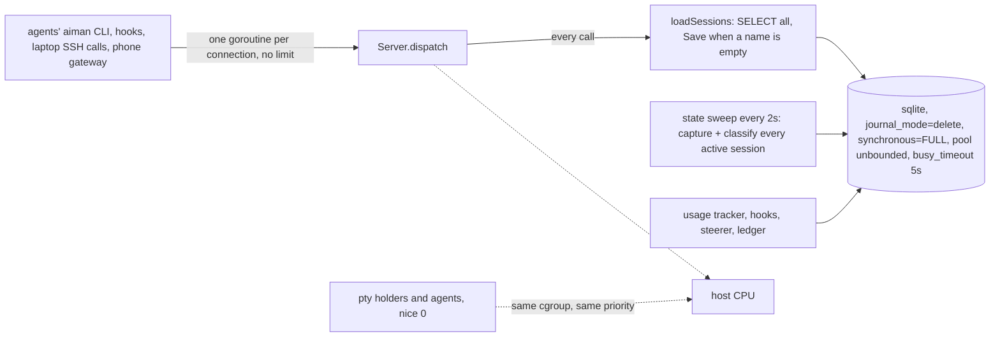
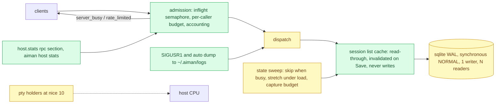

# Serve load guard: stay answerable when the host is swamped

**Revision:** 1 · **Size:** project · **Status:** proposed
**Task:** operator report on 2026-11-09: "The serve got inundated with rpc requests and completely failed now - we need to guard against that"; "The rpc flood was on the host, and it seemed to lock up the db".

## Problem

Between about 16:40 and 17:14 on 2026-11-09 `aiman serve` on `regent0` stopped answering. The operator saw a pile of `aiman` client processes on the host and the database locked, and restarted the service at 17:14. What the host recorded:

- The 15-minute load average reached 120 on 32 cores. Three Go CI runs (lint and race tests on every core) were running at once inside sessions, beside 25 running agents and the macOS VM.
- Serve's own 10-second GitHub lookups timed out at 16:48 and 17:08. When it received SIGQUIT at 17:13 it needed 50 seconds to print six lines of its goroutine dump, and the journal dropped the rest.
- The ledger shows no burst: 10 to 30 events per ten minutes all afternoon. Serve does not log requests, so the read calls that piled up (pane captures, lists, waits) are invisible after the fact.
- The database runs in `journal_mode=delete` with `synchronous=FULL`: every write takes the whole file, every reader waits for it, and each commit fsyncs. The connection pool is unbounded, and every one of its connections waits up to 5 seconds (`busy_timeout`) before giving up.
- Every RPC calls `loadSessions`, which reads the whole `sessions` table and, when a row lacks a name or group, writes it back, inside the read path.

So a CPU-starved host turned slow writes into long locks, long locks into queued readers, queued readers into client processes that pile up on the host, and the pile into more load. Nothing in serve bounds any of it, and nothing records who was calling.

## How it works today



- `cmd/aiman/serve.go` opens one `sqlite.Repository` (`internal/infra/sqlite/repository.go`): `database/sql` pool with the default unlimited `MaxOpenConns`, `busy_timeout` 5s in the DSN, no `journal_mode` or `synchronous` pragma, so the file's defaults apply.
- `internal/server/server.go` accepts each Unix socket connection in its own goroutine and dispatches with no concurrency bound, no per-caller accounting and no request log. `callDeadline` bounds only the client side.
- `handlers_session.go` `loadSessions` is the read path of almost every handler, twice per call for session callers (`sessionScopeOf` and `resolveReq`), and can `Save` during a read.
- `handlers_notify.go` `runStateSweep` ticks every 2 seconds (`notifySweepEvery`) and `sweepStates` captures and classifies every non-hidden active session; nothing skips a tick when the previous sweep is still running or the host is loaded.
- `internal/ptyruntime` starts `aiman pty hold` processes at the caller's priority; their agents and everything the agents run (builds, tests, linters) compete with serve for CPU as equals.
- The only diagnostics are the journal and SIGQUIT, whose dump the journal rate limiter drops when it is long, which is exactly when it is needed.

## Glossary

- **Caller**: who a request is for accounting: the session id a session call carries or is bound to, else the connecting process's command name (`aiman`, `aiman-gateway`), else `operator`.
- **In flight**: requests dispatched and not yet answered.
- **WAL**: sqlite's write-ahead log mode, where readers never block a writer and a writer never blocks readers.
- **Sweep**: one pass of `sweepStates` over the active sessions.

## Proposed design

Legend: **new**, *changed*, ~~removed~~.

### Domain model

- **new** `server.RPCStats{WindowSeconds int; Total, Inflight, Rejected, Limited int; ByMethod, ByCaller []RPCCount}` with `RPCCount{Name string; Count int; AvgMS int}`: the last 60 seconds of requests, in `host.stats` under `rpc`.
- **new** error codes `server_busy` (the concurrency cap held the request past its wait) and `rate_limited` (one caller over its per-minute budget), both with `data: {retry_after_ms}`.
- **new** config `host.load` (`HostLoadConfig{MaxInflight int; PerCallerPerMinute int; AgentNice int}`), defaults 64, 300 and 10, pushed by `MarshalServeConfig`.
- *changed* `sqlite.Repository` opens the database in WAL mode with `synchronous=NORMAL`, one writer connection and a bounded reader pool.

### Structure



### Behaviour

1. **Database** (`internal/infra/sqlite/repository.go`, P1). `NewRepository` executes `PRAGMA journal_mode=WAL` once after opening (persistent in the file; a failure is an error, because a read-only or network filesystem that cannot do WAL must be seen, not worked around). The DSN carries `busy_timeout(5000)` as today plus `synchronous(NORMAL)`, the right level for WAL: a commit is durable against application crash and the fsync per commit is gone. `_txlock=immediate` so a write transaction takes the write lock at `BEGIN` and never deadlocks upgrading. Two pools: `SetMaxOpenConns(1)` on a writer `*sql.DB` used by every mutating method, and a reader `*sql.DB` with `SetMaxOpenConns(8)`, so readers are bounded and the writer never queues behind them; `database/sql` does the queueing in process instead of sqlite spinning on `busy_timeout`. A checkpoint `PRAGMA wal_checkpoint(TRUNCATE)` runs on the writer every 5 minutes when the WAL is over 16 MiB, so the file does not grow without bound. The laptop's TUI opens the same package against its own file and gets the same settings; both ends are the only writers of their files, so WAL changes nothing for them except speed.
2. **No writes on the read path** (`handlers_session.go`, P1). `loadSessions` only reads. The name and group backfill moves to one pass at serve start (`backfillNames`) and into the two write paths that can create a row without them (`session.register`, `handleReportAgentSession`). `loadSessions` serves from a **read-through cache** of the stored list, invalidated by every `repo.Save`, `Delete` and `ClearNativeAgentIdentity` through the repository (an `onChange` hook on `sqlite.Repository`), and by a 2-second TTL as a safety net; the live merge (`mergeLiveSessions`) still runs per call because the pty list is cheap and in memory. A session call that resolves scope and then the target reads the cache twice, not the table twice.
3. **Admission** (`internal/server/admission.go`, P2). Every request passes `admit(ctx, req)` before `dispatch`:
   - **Accounting**: a 60-second ring of per-method and per-caller counts and durations; `Inflight` is a counter. `host.stats` returns it under `rpc`; `aiman host stats` prints a `rpc` block (`total/min`, `inflight`, `rejected`, `limited`, top 10 methods, top 10 callers). Read-only, no persistence.
   - **Concurrency cap**: a semaphore of `host.load.max_inflight` (default 64). A request waits for a slot up to 2 seconds, then answers `server_busy` with `retry_after_ms: 1000`. `pty.attach` and `session.events` (long-lived streams) take a slot only while they are being set up, then release it: they are connections, not work.
   - **Per-caller budget**: a token bucket per caller, `host.load.per_caller_per_minute` (default 300, about 5 a second) with a burst of 60. Over budget is `rate_limited` with `retry_after_ms`. The operator (`caller` empty, process outside any holder) and `aiman-gateway` are not limited: the budget protects serve from a looping agent, not from the person. Session callers are limited by the session that owns the connecting process (the same binding peer notes uses), so `AIMAN_ID` games do not get a fresh bucket.
   - **Log**: one line per caller per minute when it is limited or rejected (`rpc: caller <id> limited: 300/min, method session.read`), and one line when `Inflight` first exceeds half the cap (`rpc: 33 in flight, host load 87.2`). Never the request body.
   - The CLI client (`client.go`) retries `server_busy` and `rate_limited` once after `retry_after_ms`, then returns the error with its message, so an agent sees `rate limited: slow down` instead of a hang.
4. **Agents yield to serve** (`internal/ptyruntime`, `internal/ptyhold`, P3). `aiman pty hold` lowers its own priority to `host.load.agent_nice` (default 10) at start with `syscall.Setpriority(PRIO_PROCESS, 0, n)`, before it starts the agent, so the agent and everything it spawns inherit it. A value of 0 disables it. Serve stays at 0, so under contention the scheduler gives serve, the SSH daemon and the laptop's calls the CPU first. Existing holders keep their priority until they restart; the design does not renice running agents.
5. **Load-aware sweep** (`handlers_notify.go`, P4). `sweepStates` takes a `TryLock`; when the previous sweep is still running the tick is skipped and counted (`sweep_skipped` in `host.stats`). The ticker period is 2 seconds while the 1-minute load average is below `runtime.NumCPU()`, 5 seconds up to twice that, and 10 seconds beyond, read from `/proc/loadavg` each tick (elsewhere than Linux: always 2 seconds). Each sweep captures at most 16 sessions, round robin from where the last one stopped, so a host with 40 sessions is covered in three sweeps rather than one 40-capture burst; a hook-reported state still wins and needs no capture.
6. **Diagnostics** (`cmd/aiman/serve.go`, `internal/server/dump.go`, P5). SIGUSR1 writes `~/.aiman/logs/serve-dump-<unix>.txt`: the `RPCStats`, the load average, the inflight request list (method, caller, age) and the full goroutine dump (`runtime.Stack(buf, true)`), then continues running. The same file is written automatically, at most once per 10 minutes, when `Inflight` has been at the cap for 30 seconds. The journal never sees the dump. `aiman host dump` sends the signal to the service's main PID (from `systemctl --user show -p MainPID`).

### CLI

- `aiman host stats` gains the `rpc` block (and `--json` the `rpc` object).
- `aiman host dump` writes the dump file and prints its path.
- Config: `host.load.max_inflight`, `host.load.per_caller_per_minute`, `host.load.agent_nice`.

## Scenario

Three children run `make ci` at once; load climbs past 100. The holders run at nice 10, so serve, sshd and the laptop's `aiman pty capture` calls keep getting CPU. The sweep sees load above twice the core count and drops to every 10 seconds, 16 captures per pass. A reviewer child polls `aiman session read` in a tight loop: after 300 calls in a minute it gets `rate_limited`, the CLI retries once after a second, then prints the error; serve logs the caller once. The TUI's captures take 300 ms instead of 5 seconds because the database no longer blocks readers while hook reports commit. The operator runs `aiman host stats` and sees `inflight 9`, `limited 1 (sess-c, session.read)`, and the load. Nothing piles up and nothing locks.

## Alternatives

- **Move off sqlite**: lost; the contention is the journal mode and the unbounded pool, both fixable in place, and every client of the package stays unchanged.
- **Shed load by refusing all session callers when busy**: lost; a budget per caller punishes the one looping agent, not every agent.
- **Renice serve upward** instead of agents downward: lost; a negative nice needs root or `CAP_SYS_NICE`, and the unit runs as the user.
- **cgroup CPU weights** (`systemd-run --scope` per holder with `CPUWeight`): better isolation than nice, lost for the first cut because holders are started by serve, not systemd, and `KillMode=process` already keeps them in serve's cgroup; nice gets most of the benefit with one syscall. Noted as a follow-up if nice proves too weak.
- **Request log to disk**: lost; the 60-second window answers "who is hammering now" and the dump answers "what is stuck", without a log that grows.

## Open questions

1. Should `rate_limited` also apply to the operator's own processes (the laptop TUI's SSH calls)? Default: no; the TUI already serialises its captures (`previewBusy`).
2. Default `agent_nice` 10 or 5? Default: 10; agents are interactive but their builds are not, and the TUI's responsiveness is what the operator feels.

## Decisions

Pending the consult.

## Breakdown

| Piece | Owns files | Parallel group | Depends on | Complexity | Tier | Acceptance tests |
|---|---|---|---|---|---|---|
| P1 database and read path | `internal/infra/sqlite/repository.go` (WAL, pools, checkpoint, `onChange`), `internal/server/handlers_session.go` (`loadSessions` cache, `backfillNames`), `cmd/aiman/serve.go` (startup backfill) | 1 | none | M | smart | `internal/infra/sqlite/wal_acceptance_test.go`, `internal/server/session_cache_acceptance_test.go`; `go test ./internal/infra/sqlite/ ./internal/server/` |
| P2 admission and stats | `internal/server/admission.go` (new), `server.go` (accept path), `protocol.go` (codes), `handlers_host.go` (`host.stats` rpc), `client.go` (retry), `cmd/aiman/host_cmd.go` (print), `internal/infra/config/config.go` (`HostLoadConfig`), `api/openapi.yaml`, `AGENTS.md` | 1 | none | M | smart | `internal/server/admission_acceptance_test.go`, `cmd/aiman/host_stats_rpc_acceptance_test.go`; `go test ./internal/server/ ./cmd/aiman/` |
| P3 holder priority | `internal/ptyhold/hold.go` (setpriority), `internal/ptyruntime` (pass the nice), `cmd/aiman/pty_cmd.go` (flag), config push | 1 | none | S | worker | `internal/ptyhold/nice_acceptance_test.go`; `go test ./internal/ptyhold/ ./internal/ptyruntime/` |
| P4 load-aware sweep | `internal/server/handlers_notify.go`, `internal/server/loadavg.go` (new) | 2 | P1 (cache) | S | worker | `internal/server/sweep_load_acceptance_test.go`; `go test ./internal/server/` |
| P5 diagnostics | `internal/server/dump.go` (new), `cmd/aiman/serve.go` (SIGUSR1), `cmd/aiman/host_cmd.go` (`host dump`) | 2 | P2 (stats) | S | worker | `internal/server/dump_acceptance_test.go`; `go test ./internal/server/ ./cmd/aiman/` |

## Contracts

```go
// internal/server
type RPCCount struct { Name string `json:"name"`; Count int `json:"count"`; AvgMS int `json:"avg_ms"` }
type RPCStats struct {
    WindowSeconds int        `json:"window_seconds"` // 60
    Total, Inflight, Rejected, Limited int `json:"total","inflight","rejected","limited"`
    SweepSkipped int         `json:"sweep_skipped"`
    ByMethod, ByCaller []RPCCount `json:"by_method","by_caller"`
}
const (
    CodeServerBusy  = "server_busy"
    CodeRateLimited = "rate_limited"
)
func (s *Server) RPCStats() RPCStats

// internal/infra/config
type HostLoadConfig struct {
    MaxInflight        int `yaml:"max_inflight,omitempty"`          // 0: 64
    PerCallerPerMinute int `yaml:"per_caller_per_minute,omitempty"` // 0: 300
    AgentNice          *int `yaml:"agent_nice,omitempty"`           // nil: 10
}
// HostConfig gains Load HostLoadConfig `yaml:"load,omitempty"`.

// internal/infra/sqlite
func NewRepository(dbPath string) (*Repository, error) // WAL, synchronous NORMAL, 1 writer, 8 readers
func (r *Repository) OnChange(fn func())                // called after every mutating method commits
```

## What the reader should be able to explain

1. Why a loaded host turned into a locked database, and which two settings (journal mode, unbounded pool) made it so.
2. What the admission layer refuses, to whom, and why the operator's own calls are exempt.
3. Why agents run at nice 10 and serve does not.
4. How to read `aiman host stats` and where the dump lands next time.
