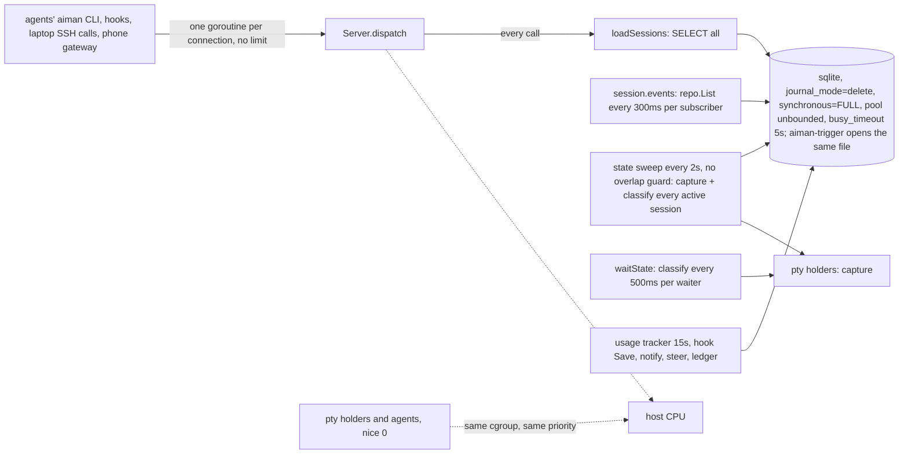
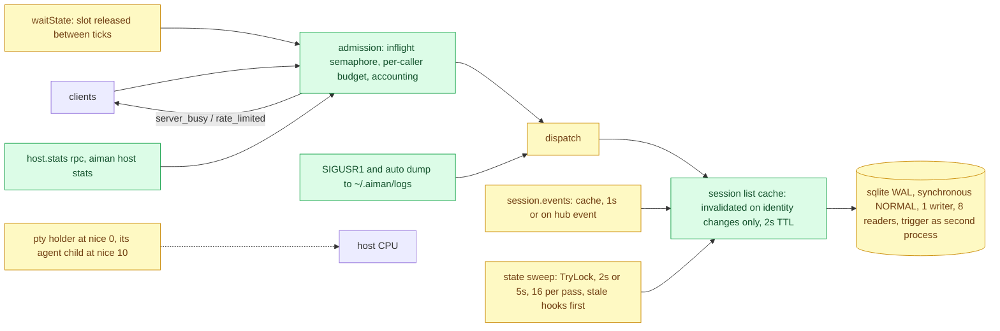

# Serve load guard: stay answerable when the host is swamped

**Revision:** 2 (after consult round 1) · **Size:** project · **Status:** proposed
**Task:** operator report on 2026-11-09: "The serve got inundated with rpc requests and completely failed now - we need to guard against that"; "The rpc flood was on the host, and it seemed to lock up the db".

## Problem

Between about 16:40 and 17:14 on 2026-11-09 `aiman serve` on `regent0` stopped answering. The operator saw a pile of `aiman` client processes on the host and the database locked, and restarted the service at 17:14. What the host recorded, and what the code says, ranked by weight:

1. **Serve did not get CPU.** The 15-minute load average reached 120 on 32 cores: three Go CI runs (lint and race tests on every core) inside sessions, 25 agents and the macOS VM, all at the same priority as serve. Serve's 10-second GitHub lookups timed out at 16:48 and 17:08, and when it received SIGQUIT at 17:13 it needed 50 seconds to print six lines of its goroutine dump, which the journal then dropped. Everything below made a starved process do more work than it had to.
2. **Captures stacked.** `runStateSweep` ticks every 2 seconds with no overlap guard, and each `sweepStates` captures and classifies every active session; under load the sweeps pile up. `waitState` (`session.wait`, `session.prompt --wait`) classifies every 500 ms per waiting caller, and `applyMenuOverride` captures on working hooks. With 25 agents, several children waiting and a slow host, serve was capturing dozens of panes a second.
3. **The event stream read the table every 300 ms.** Each `session.events` subscriber (the laptop TUI, the phone) calls `repo.List` every 300 ms, and `loadSessions` runs once or twice per RPC on top.
4. **Writers under the worst journal mode.** The file runs in `journal_mode=delete` with `synchronous=FULL`: a write locks the whole file against readers and fsyncs per commit. The steady writers are the usage tracker every 15 s (a transaction), a `Save` on every hook report, notification `AppendIfDue` transactions, steer notes and the ledger. The pool is unbounded and every connection waits `busy_timeout` (5 s) on contention, so stalls turned into five-second holds in every goroutine. The name backfill inside `loadSessions` is a one-shot and not a load-path writer once rows have names.
5. **Nothing bounds or records requests.** Each connection gets a goroutine and is dispatched at once; there is no concurrency cap, no per-caller budget and no request accounting, so a looping caller is invisible and a pile-up has no ceiling. After the fact, the only diagnostics were the journal and the dropped SIGQUIT dump.

Together: a swamped host turned slow captures and slow writes into long locks, long locks into queued readers, queued readers into client processes piling up on the host, and the pile into more load. The guard has to cut every link, in that order.

## How it works today



- `cmd/aiman/serve.go` opens one `sqlite.Repository` (`internal/infra/sqlite/repository.go`): `database/sql` with unlimited `MaxOpenConns`, `busy_timeout` in the DSN, no `journal_mode` or `synchronous` pragma. `Repository.DB()` is handed to `contextstore.OpenIndex` and `memoryjob.Open`, which write through it. `cmd/aiman-trigger` opens the same file with `NewRepository`: the host file has two writer processes. The laptop's TUI uses the package on its own file.
- `internal/server/server.go` accepts each Unix socket connection in its own goroutine and dispatches with no bound, no accounting and no request log. `callDeadline` bounds only the client side.
- `handlers_session.go` `loadSessions` reads the table on almost every handler, twice for session callers (`sessionScopeOf`, `resolveReq`); `handlers_events.go` reads it every 300 ms per stream.
- `handlers_notify.go` `runStateSweep` ticks every 2 s (`notifySweepEvery`); `sweepStates` has no overlap guard and no capture budget.
- `internal/ptyruntime` starts `aiman pty hold` at the caller's priority; the holder is also the capture and attach path, and its agent and everything the agent runs inherit the priority.
- Diagnostics: the journal, and SIGQUIT, whose dump the journal rate limiter drops when it is long.

## Glossary

- **Caller**: who a request is for accounting: the session bound to the connecting process (`sessionScopeOf`, the holder tree walk), else `operator` for a process outside any holder with no `caller`, else the named caller when it exists. `aiman-gateway` and `aiman-trigger` run outside holders and count as the operator.
- **In flight**: requests dispatched and not yet answered, minus idle waits (see Behaviour 3).
- **WAL**: sqlite's write-ahead log, where readers never block the writer and the writer never blocks readers.
- **Sweep**: one pass of `sweepStates`.

## Proposed design

Legend: **new**, *changed*, ~~removed~~.

### Domain model

- **new** `server.RPCStats{WindowSeconds int; Total, Inflight, Waiting, Rejected, Limited, SweepSkipped int; ByMethod, ByCaller []RPCCount}` with `RPCCount{Name string; Count int; AvgUS int64}`: the last 60 seconds, in `host.stats` under `rpc`.
- **new** error codes `server_busy` and `rate_limited`, both with `data: {retry_after_ms}`.
- **new** config `host.load` (`HostLoadConfig{MaxInflight int; PerCallerPerMinute int; AgentNice *int}`), defaults 64, 300 and 10, pushed by `MarshalServeConfig`.
- *changed* `sqlite.Repository`: WAL, `synchronous=NORMAL`, one writer pool and one bounded reader pool, `OnChange` hook.

### Structure



### Behaviour

0. **Stop the stacking first** (P0, smallest change, ships alone if needed). `sweepStates` takes a `TryLock`; while the previous sweep runs the tick is skipped and `SweepSkipped` counts it. `session.events` reads the session list from the cache in Behaviour 2 (until that lands, no more often than once a second) and otherwise only when a hub event arrived since the last read.
1. **Database** (`internal/infra/sqlite/repository.go`, P1). `NewRepository` opens two `*sql.DB` on the same file. Both DSNs carry `_pragma=busy_timeout(5000)`, `_pragma=journal_mode(WAL)` (the mode persists in the file; saying it on every connection costs nothing and covers a file created by an older binary) and `_pragma=synchronous(NORMAL)` (per connection, so it has to be in the DSN, as the `busy_timeout` comment already explains). The writer DSN adds `_txlock=immediate` (valid for `modernc.org/sqlite`; it applies to `Begin`/`BeginTx`, which `ApplyUsage` and `AppendIfDue` use; autocommit `Save` is unaffected) and `SetMaxOpenConns(1)`. The reader has `SetMaxOpenConns(8)` and `SetConnMaxIdleTime(1m)`, so idle readers do not pin the WAL for ever. Every read-only method (`List`, `Get`, the `ListUndelivered*`, the usage and notify reads) queries the reader; every mutating method uses the writer; `DB()` returns the writer, so `contextstore` and `memoryjob` keep writing through one connection. `aiman-trigger` is a second process on the same file; WAL makes its writes and serve's coexist without the five-second holds, and nothing in this design assumes a single process. A `PRAGMA wal_checkpoint(PASSIVE)` runs on the writer every 5 minutes, and `Close` runs `wal_checkpoint(TRUNCATE)` so a copy of `aiman.db` taken after a clean stop is consistent without its `-wal` and `-shm` sidecars (an rsync or backup while serve runs must take all three files; the README says so). `aiman downgrade` swaps the binary only and opens a WAL file fine. The laptop's own database gets the same settings on its own file.
2. **Session list cache** (`handlers_session.go`, P1). `loadSessions` reads the stored list from a cache keyed by nothing (one host, one table): a read-through copy with a 2-second TTL, invalidated through `Repository.OnChange` only when a write touches identity or lifecycle columns (`name`, `group_name`, `parent_id`, `role`, `status`, `backend`, `branch`, `working_directory`, a delete, `ClearNativeAgentIdentity`). A hook report's `Save` changes `hook_state`, `hook_state_at`, `agent_title`, `agent_ended`: those do not invalidate, because the handlers that need them (`steerReady`, `classify`, `applyAgentReport`) read the row by id through `repo.Get` or the in-memory `sessionStates`, not the list. The name and group backfill moves out of `loadSessions` into a startup pass and the two write paths that can create a nameless row (`session.register`, `handleReportAgentSession`). The live merge (`mergeLiveSessions`) stays per call; the pty list is in memory. `session.events` uses the same cache. Net effect: a hook storm costs one `Save` each and zero list reads.
3. **Admission** (`internal/server/admission.go`, P2). Every request passes `admit` before `dispatch`:
   - **Accounting**: a 60-second ring of per-method and per-caller counts and durations in microseconds; `Inflight` and `Waiting` counters. `host.stats` returns it under `rpc`; `aiman host stats` prints a `rpc` block (`total/min`, `inflight`, `waiting`, `rejected`, `limited`, `sweep_skipped`, top 10 methods, top 10 callers by count).
   - **Concurrency cap**: a semaphore of `host.load.max_inflight` (default 64). A request waits for a slot up to 2 seconds, then answers `server_busy` with `retry_after_ms: 1000`. Long-lived calls hold a slot only while they work, not while they wait: `pty.attach` and `session.events` release it after setup; `waitState` (`session.wait`, `session.prompt --wait`, the peer-note wait) releases the slot between classify ticks and takes it back for each classify, counted in `Waiting` meanwhile, so 25 waiting agents cost 25 slots for a few milliseconds a second, not continuously. `session.create`, `design.publish`, `review.run`, `review.coverage`, `session.restart` and `session.terminate` do real work for their whole duration and keep their slot.
   - **Per-caller budget**: a token bucket per caller, `host.load.per_caller_per_minute` (default 300) with a burst of 60; over budget is `rate_limited` with `retry_after_ms`. The caller is the session bound to the connecting process (`sessionScopeOf`), so `AIMAN_ID` games share the real session's bucket; a process outside any holder with no `caller` is the operator and is exempt, which covers the laptop TUI, `aiman-gateway` and `aiman-trigger`. `session.report_agent_session` is exempt from the bucket (still counted): hooks are how steering and notifications stay live, and a tool loop must not silence them. `todo.mirror` is exempt for the same reason. A `pty.wait-output` loop at one poll a second fits (60/min); a coordinator polling four children at once fits; a session calling `session.read` in a tight loop is the case this stops.
   - **Log**: one line per caller per minute when it is limited or rejected (`rpc: caller <id> limited: 300/min, method session.read`), and one line when `Inflight` first exceeds half the cap (`rpc: 33 in flight, host load 87.2`). Never the request body.
   - The CLI client (`client.go`) retries `server_busy` and `rate_limited` once after `retry_after_ms`, then returns the error with its message.
4. **Agents yield to serve** (`internal/ptyhold`, P3). The holder stays at nice 0: it is the capture and attach path the TUI and the phone depend on, so it must stay as responsive as serve. After `pty.StartWithSize` the holder calls `syscall.Setpriority(PRIO_PROCESS, cmd.Process.Pid, n)` on the agent's shell with `n` from `host.load.agent_nice` (default 10, 0 disables), so the agent and everything it spawns inherit it. Documented consequence: `git`, `ssh`, test binaries and anything else started inside a session run at nice 10 and can miss short timeouts under load; a user-level mutagen daemon runs outside sessions and is unaffected. Existing agents keep their priority until their session restarts; nothing renices running processes. The nice value reaches the holder through its request file (`ptyruntime` passes it from serve's config).
5. **Load-aware sweep** (`handlers_notify.go`, P4). On top of Behaviour 0: the ticker runs every 2 seconds while the 1-minute load average is below `runtime.NumCPU()` and every 5 seconds above it (never longer, so a hook-less `ended` or an open menu reaches the TUI and the notifier within about 10 seconds even on a 40-session host); the load average comes from `/proc/loadavg` each tick, and elsewhere than Linux the period stays 2 seconds. Each sweep captures at most 16 sessions, chosen in this order: sessions that just transitioned (a hook reported `ended` or `waiting_input` since the last sweep) always, then sessions whose hook report is stale or missing, then the rest round robin; a session with a fresh hook report needs no capture at all. `session.wait` and `steerReady` classify on their own and are not delayed by the sweep.
6. **Diagnostics** (`cmd/aiman/serve.go`, `internal/server/dump.go`, P5). SIGUSR1 writes `~/.aiman/logs/serve-dump-<unix>.txt` from a dedicated goroutine: `RPCStats`, the load average, the in-flight list (method, caller, age), then `runtime.Stack` into a buffer capped at 64 MiB (a truncated dump says so on its last line). One dump at a time; a signal during a dump is ignored. The same file is written automatically, at most once per 10 minutes, when `Inflight` has sat at the cap for 30 seconds. `aiman host dump` sends SIGUSR1 to `systemctl --user show -p MainPID --value aiman-serve`; when that is empty or 0 (serve not running as a user unit) it reads `~/.aiman/serve.pid`, and with neither it says so and exits 1.

### CLI

- `aiman host stats` gains the `rpc` block (and `--json` the `rpc` object).
- `aiman host dump` writes the dump file and prints its path.
- Config: `host.load.max_inflight`, `host.load.per_caller_per_minute`, `host.load.agent_nice`.

## Scenario

Three children run `make ci` at once; load climbs past 100. Their shells run at nice 10, so serve, the holders, sshd and the laptop's `aiman pty capture` calls keep getting CPU. The sweep skips the ticks it cannot keep up with, drops to every 5 seconds, and captures the 16 sessions whose hooks are stale, so the two Codex sessions without hooks still show their state within 10 seconds. Twenty agents sit in `session.wait`; they hold a slot only during each half-second classify, so `inflight` reads 6. A reviewer child polls `aiman session read` in a tight loop: after 300 calls in a minute it gets `rate_limited`, the CLI retries once after a second, then prints the error; serve logs the caller once. Hook reports from 25 agents commit in WAL without blocking the TUI's reads, and none of them invalidates the session list cache. The operator runs `aiman host stats` and sees `inflight 6`, `waiting 20`, `limited 1 (sess-c, session.read)`, `sweep_skipped 14`. Nothing piles up and nothing locks. Had it still locked up, `aiman host dump` would have written what serve was doing to a file the journal cannot drop.

## Alternatives

- **Move off sqlite**: lost; the contention is the journal mode, the unbounded pool and the read patterns, all fixable in place.
- **Shed load by refusing all session callers when busy**: lost; a budget per caller punishes the one looping agent, not every agent.
- **Renice serve upward**: lost; a negative nice needs root or `CAP_SYS_NICE`, and the unit runs as the user.
- **Nice the whole holder** (rev 1): lost in round 1; the holder is the capture and attach path, so a slow holder is exactly what the operator feels. The agent's shell child is the right process.
- **cgroup CPU weights per holder**: better isolation than nice; lost for the first cut because holders are started by serve, not systemd, and stay in serve's cgroup. A follow-up if nice proves too weak.
- **Invalidate the cache on every `Save`** (rev 1): lost in round 1; hook reports are the hottest write on a busy host and would make the cache miss constantly.
- **Request log to disk**: lost; the 60-second window answers "who is hammering now" and the dump answers "what is stuck".

## Open questions

1. Should `rate_limited` also apply to the operator's own processes (the laptop TUI's SSH calls)? Default: no; the TUI already serialises its captures (`previewBusy`).
2. Default `agent_nice` 10 or 5? Default: 10; agents are interactive but their builds are not, and the TUI's responsiveness is what the operator feels.

## Decisions

Consult round 1 (Grok, report `~/.aiman/consults/a67838f4-8fb1-40d1-a3af-fb90cce9f108.report.md`): verdict revise, 4 high, 2 medium, 2 low. All accepted in rev 2.

| Objection | Severity | Triage | Reason |
|---|---|---|---|
| The diagnosis named the journal mode as the outage; the continuous load was CPU starvation, stacked sweeps and wait/classify captures, `session.events` listing every 300 ms, and hook, usage and notify writers; the write-on-read is a one-shot | high | accept | Problem rewritten as a ranked list; Behaviour 0 ships the sweep guard and the event-stream read first |
| A cache invalidated on every `Save` misses on every hook report; `session.events` bypasses `loadSessions` | high | accept | Behaviour 2: invalidate on identity and lifecycle columns only, hook fields read by id; the event stream uses the cache |
| Nicing the holder slows the capture and attach path the operator needs | high | accept | Behaviour 4: holder stays at nice 0, the agent's shell child is reniced; inherited effects documented |
| Two pools underspecified: `synchronous` per connection, `DB()` handed to contextstore and memoryjob, `aiman-trigger` is a second writer process, `TRUNCATE` checkpoints never finish under idle readers, sidecar files on copy | high | accept | Behaviour 1: pragmas in both DSNs, `_txlock=immediate` on the writer only, `DB()` is the writer, reader idle time, `PASSIVE` on a timer and `TRUNCATE` on `Close`, trigger named, laptop claim removed |
| Waits hold a slot for minutes; 300/min breaks a coordinator's hooks in a tool loop; caller identity must follow the holder binding; trigger is exempt by the wording | medium | accept | Behaviour 3: waits release the slot between classify ticks (`Waiting`), hooks and `todo.mirror` exempt from the bucket, identity through `sessionScopeOf`, operator exemption spelled out |
| A 10-second sweep with 16 per pass delays TUI state and notifications by 20 to 30 seconds | medium | accept | Behaviour 5: 2 s or 5 s only, transitions first, stale hooks next, fresh hooks need no capture |
| The `RPCStats` struct tags do not compile; integer milliseconds hide cheap calls | low | accept | Contracts: one field per tag, `AvgUS` in microseconds |
| A full goroutine dump can be tens of MB and stall serve; `aiman host dump` needs a non-unit path | low | accept | Behaviour 6: dedicated goroutine, 64 MiB cap, one at a time, `serve.pid` fallback |

## Breakdown

| Piece | Owns files | Parallel group | Depends on | Complexity | Tier | Acceptance tests |
|---|---|---|---|---|---|---|
| P0 stop the stacking | `internal/server/handlers_notify.go` (`TryLock`, `SweepSkipped`), `internal/server/handlers_events.go` (1 s or on hub event) | 0 | none | S | worker | `internal/server/sweep_overlap_acceptance_test.go`; `go test ./internal/server/` |
| P1 database and cache | `internal/infra/sqlite/repository.go` (pools, pragmas, checkpoint, `OnChange`, read/write split), `internal/server/handlers_session.go` (`loadSessions` cache, backfill move), `handlers_events.go` (cache), `cmd/aiman/serve.go` (startup backfill), `README.md` (WAL sidecars) | 1 | P0 | M | smart | `internal/infra/sqlite/wal_acceptance_test.go`, `internal/server/session_cache_acceptance_test.go`; `go test ./internal/infra/sqlite/ ./internal/server/` |
| P2 admission and stats | `internal/server/admission.go` (new), `server.go`, `protocol.go`, `handlers_host.go`, `handlers_session.go` (`waitState` slot release), `client.go`, `cmd/aiman/host_cmd.go`, `internal/infra/config/config.go` (`HostLoadConfig`), `api/openapi.yaml`, `AGENTS.md` | 1 | none | M | smart | `internal/server/admission_acceptance_test.go`, `cmd/aiman/host_stats_rpc_acceptance_test.go`; `go test ./internal/server/ ./cmd/aiman/` |
| P3 agent priority | `internal/ptyhold/holder.go` (renice the child), `internal/ptyruntime` (pass the value), config push | 1 | none | S | worker | `internal/ptyhold/nice_acceptance_test.go`; `go test ./internal/ptyhold/ ./internal/ptyruntime/` |
| P4 load-aware sweep | `internal/server/handlers_notify.go`, `internal/server/loadavg.go` (new) | 2 | P0, P1 | S | worker | `internal/server/sweep_load_acceptance_test.go`; `go test ./internal/server/` |
| P5 diagnostics | `internal/server/dump.go` (new), `cmd/aiman/serve.go` (SIGUSR1), `cmd/aiman/host_cmd.go` (`host dump`) | 2 | P2 | S | worker | `internal/server/dump_acceptance_test.go`; `go test ./internal/server/ ./cmd/aiman/` |

## Contracts

```go
// internal/server
type RPCCount struct {
    Name  string `json:"name"`
    Count int    `json:"count"`
    AvgUS int64  `json:"avg_us"`
}
type RPCStats struct {
    WindowSeconds int        `json:"window_seconds"` // 60
    Total         int        `json:"total"`
    Inflight      int        `json:"inflight"`
    Waiting       int        `json:"waiting"`
    Rejected      int        `json:"rejected"`
    Limited       int        `json:"limited"`
    SweepSkipped  int        `json:"sweep_skipped"`
    ByMethod      []RPCCount `json:"by_method"`
    ByCaller      []RPCCount `json:"by_caller"`
}
const (
    CodeServerBusy  = "server_busy"
    CodeRateLimited = "rate_limited"
)
func (s *Server) RPCStats() RPCStats

// internal/infra/config
type HostLoadConfig struct {
    MaxInflight        int  `yaml:"max_inflight,omitempty"`          // 0: 64
    PerCallerPerMinute int  `yaml:"per_caller_per_minute,omitempty"` // 0: 300
    AgentNice          *int `yaml:"agent_nice,omitempty"`            // nil: 10
}
// HostConfig gains Load HostLoadConfig `yaml:"load,omitempty"`.

// internal/infra/sqlite
func NewRepository(dbPath string) (*Repository, error) // WAL, synchronous NORMAL, 1 writer (_txlock=immediate), 8 readers
func (r *Repository) OnChange(fn func(ChangeKind))     // Identity or Other, after every mutating method commits
func (r *Repository) DB() *sql.DB                      // the writer
func (r *Repository) Close() error                     // wal_checkpoint(TRUNCATE), then both pools
```

## What the reader should be able to explain

1. The five links of the failure chain, in order, and which piece cuts each.
2. Why hook reports must not invalidate the session list cache.
3. Why the agent's shell, and not its holder, runs at nice 10.
4. What the admission layer refuses, to whom, why waits and hooks are treated specially, and why the operator's own calls are exempt.
5. How to read `aiman host stats` and where the dump lands next time.
