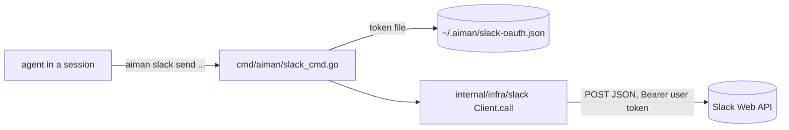
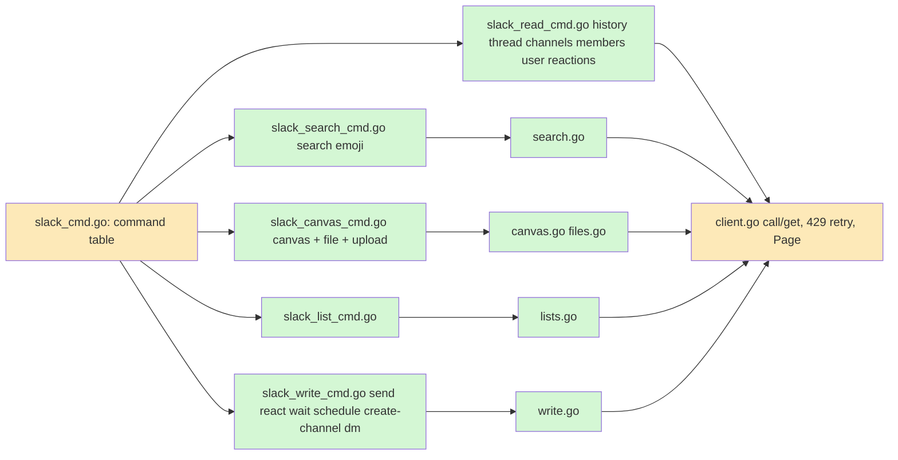
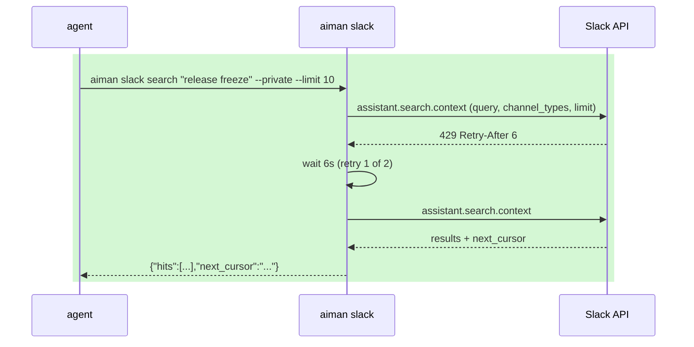

# slack-parity: aiman slack does what Claude's Slack tools do

**Revision:** 2 · **Size:** project · **Status:** in review
**Task:** operator request 2026-11-12, "it must basically be at least equivalent to Claude" · **Parity map:** the table under Proposed design

**Legend:** green = new, amber = changed, red dashed = removed. Every diagram uses these three classes:

```text
classDef new fill:#d4f7d4
classDef changed fill:#fde9b8
classDef removed stroke-dasharray:4,fill:#f9d0d0
```

## The problem

Agents in aiman sessions talk to Slack through `aiman slack`. It can post, read a channel or thread, react, look up one user, list channels and wait for a reply. Claude's own Slack connector can also search, read and write canvases, read and write Lists, upload and read files, schedule messages, create channels and DMs, list members, read reactions and page through long history. An agent working on a ticket that lives in a Slack thread, a canvas spec or a List of QA items cannot read or update it today. The operator wants an agent in aiman to be able to do at least what Claude can.

v0.44.0 already requests every scope this needs (32 user scopes), so the operator installs the app once. This design adds the commands.

## How it works today

`aiman slack <cmd>` is a plain CLI. It does not go through `aiman serve`. It loads the user token from `~/.aiman/slack-oauth.json` (or `AIMAN_SLACK_USER_TOKEN`), calls the Slack Web API as the member who approved the app, and prints JSON.



- Dispatcher: one `switch` in `cmd/aiman/slack_cmd.go:19` (`runSlack`).
- Client: `internal/infra/slack/client.go:96` (`call`): JSON POST, reads at most 1 MiB, maps `ok:false` to `apiFailure{Method, Code}`. No retry on HTTP 429, no pagination.
- Methods today: `AuthTest`, `Post`, `History`, `Replies`, `Channels`, `ResolveChannel`, `User`, `React`, `Wait` (`client.go:140-300`).
- Errors print `{"error":{"code","message"}}` with codes `slack_unconfigured`, `slack_params`, `slack_api`, `slack_timeout`.

## Glossary

| Term | Meaning |
|---|---|
| User token | An `xoxp-` token. Calls act as the member who approved the app; there is no bot user. |
| Real-time Search | `assistant.search.context`, Slack's search API with semantic ranking and message, file, channel and user results. Rate limited to about 10 calls a minute per user. |
| Canvas | A Slack document. Read as markdown with `canvases.getContent`, written with `canvases.create` and `canvases.edit`. Paid plans only. |
| List | A Slack List (table with typed columns). `slackLists.*` methods. Paid plans only. |
| Cursor | Slack's pagination token (`response_metadata.next_cursor`). |
| External upload | Slack's two-step upload: `files.getUploadURLExternal`, PUT the bytes, then `files.completeUploadExternal`. |

## Proposed design

### Parity map

| Claude tool | aiman command | Slack method(s) | Today |
|---|---|---|---|
| search_public, search_public_and_private | `aiman slack search <query> [--private] [--in C] [--from U] [--after YYYY-MM-DD] [--before YYYY-MM-DD] [--files] [--limit n] [--cursor c]` | `assistant.search.context`; `--in`/`--from` become `in:<#C>`/`from:<@U>` inside the query, dates become `after:`/`before:` query terms, `--files`/`--channels`/`--users` set `content_types`. Falls back to `search.messages` on `feature_not_enabled` or `assistant_search_context_disabled`, output says `"engine":"legacy"` | new |
| search_channels | `aiman slack search <q> --channels` | `assistant.search.context` content type channels | new |
| search_users | `aiman slack search <q> --users`; `aiman slack user --email e` | `assistant.search.context` users; `users.lookupByEmail` | new |
| search_emojis | `aiman slack emoji [query]` | `emoji.list`, filtered locally | new |
| read_channel | `aiman slack history --channel C\|U [--oldest] [--latest] [--limit] [--cursor]` | `conversations.history` (a user id opens the DM with `conversations.open`) | changed: paging, DMs |
| read_thread | `aiman slack thread ... [--cursor] [--limit]` | `conversations.replies` | changed: paging |
| read_canvas | `aiman slack canvas read <id> [--sections header,any_header] [--contains text]` | `canvases.getContent` (one markdown string) plus `canvases.sections.lookup` for section ids, filtered by type or text | new |
| create_canvas | `aiman slack canvas create --title T [--channel C] --text-file f.md` | `canvases.create` / `conversations.canvases.create` | new |
| update_canvas | `aiman slack canvas edit <id> --op append\|prepend\|after\|before\|replace\|delete\|rename [--section S] [--all] --text-file f.md` | `canvases.edit`, one change per call: append→`insert_at_end`, prepend→`insert_at_start`, after/before→`insert_after`/`insert_before`. `replace` and `delete` need `--section`; replacing the whole canvas needs `--all` | new |
| read_file | `aiman slack file read <id> [--out path]` | `files.info` + authenticated GET of `url_private` | new |
| get_file_upload_url + complete_file_upload | `aiman slack upload <path> --channel C [--thread ts] [--comment text] [--title t]` | `files.getUploadURLExternal` (form POST, `filename`, `length`), POST the bytes to `upload_url`, `files.completeUploadExternal` | new |
| read_user_profile | `aiman slack user [U]` (self when omitted) | `users.info` + `users.profile.get` (GET only) | changed: profile, email |
| list_user_channels | `aiman slack channels [--mine] [--types ...] [--prefix p] [--cursor]` | `users.conversations` / `conversations.list` | changed |
| list_channel_members | `aiman slack members --channel C [--cursor]` | `conversations.members` + `users.info` | new |
| send_message | `aiman slack send ... [--broadcast] [--no-unfurl]` | `chat.postMessage` with `markdown_text` alone (it conflicts with `text`); `reply_broadcast`; `unfurl_links`/`unfurl_media` false | changed |
| schedule_message | `aiman slack schedule --channel C --at <RFC3339\|+2h> [--thread ts] --text ...`; `schedule list`, `schedule cancel <id>` | `chat.scheduleMessage`, `chat.scheduledMessages.list`, `chat.deleteScheduledMessage` | new |
| send_message_draft | none | no public API | not possible |
| add_reaction / get_reactions | `react` / `reactions --channel C --ts T` | `reactions.add` / `reactions.get` | get is new |
| create_conversation | `aiman slack create-channel <name> [--private] [--invite U,...]`; `aiman slack dm U[,U...]` | `conversations.create` + `conversations.invite`; `conversations.open` | new |
| read_list | `aiman slack list read <id> [--format csv\|markdown\|json] [--schema] [--cursor]` | `slackLists.items.list` with `include_list=true` (the schema source), `slackLists.items.info` | new |
| create_list, update_list | `aiman slack list create --name N --columns-file cols.json`; `list update <id> [--name] [--description] [--todo on\|off]` | `slackLists.create` (columns are set only here); `slackLists.update` changes name, description and todo mode, never columns | new |
| add_list_record, update_list_record | `aiman slack list add <id> --set col=value ...`; `list set <id> <row> --set ...` | `slackLists.items.create` (`initial_fields`), `slackLists.items.update` (`cells[]` of `row_id` + `column_id`). A typed mapper turns a column name or key into its `Col…` id, a select label or value into the choice `value`, and text into a `rich_text` block | new |

Every command prints JSON, takes long text through `--text-file` or `--text -`, and never accepts the token in argv. Anything that pages returns `next_cursor`.

**Writes switch.** Every command that changes Slack (`send`, `react`, `schedule`, `upload`, `create-channel`, `dm`, `canvas create|edit`, `list create|update|add|set`) declares itself a write in the command table. When `slack.writes` is `off` in `~/.aiman/config.yaml`, `runSlack` refuses it with `slack_writes_off` before any API call. Unset is on. One check, in piece A.

**Search notes.** Real-time Search allows about 10 calls a minute per user and each page counts, so `search` returns one page and the caller follows `next_cursor`; it never loops. DM and group-DM results need each member's consent in the Slack client, so `--private` can omit them until then. Real-time Search works for internal apps such as Aiman's, so `feature_not_enabled` means the plan or workspace, not the token.

### Domain model

```mermaid
classDiagram
    classDef new fill:#d4f7d4
    classDef changed fill:#fde9b8
    classDef removed stroke-dasharray:4,fill:#f9d0d0
    class Client {
      call(method, json, out)
      callForm(method, form, out)
      get(method, query, out)
      retry on 429 Retry-After
    }
    class Page~T~ {
      Items []T
      NextCursor string
    }
    class SearchHit { kind message|file|channel|user; channel; ts; text; permalink }
    class Canvas { ID; Title; Markdown; Sections [] }
    class SlackList { ID; Name; Columns []; Items [] }
    class File { ID; Name; Mimetype; Size; URLPrivate }
    class Scheduled { ID; Channel; PostAt }
    Client ..> Page
    Client ..> SearchHit
    Client ..> Canvas
    Client ..> SlackList
    Client ..> File
    Client ..> Scheduled
    class Client:::changed
    class Page:::new
    class SearchHit:::new
    class Canvas:::new
    class SlackList:::new
    class File:::new
    class Scheduled:::new
```

### Structure



- The `switch` in `runSlack` becomes a table, `slackCommands map[string]slackHandler`. Each command file registers its own entries in an `init()`, so pieces never edit the same lines.
- `Client` keeps JSON `call` (history, replies and most writes take JSON) and gains `callForm` (POST form-encoded, for `files.getUploadURLExternal`), `get` (for `users.profile.get`), a 429 retry that honours `Retry-After` up to twice, a configurable response cap (default 8 MiB), and a generic `Page[T]` for cursor paging.
- New client files hold one area each: `search.go`, `canvas.go`, `files.go`, `lists.go`, `write.go`.
- The bundled skill's `## Slack` section and `README.md` list every command. I write those after the pieces land, so no piece owns them. `make ci` covers all of it with an `httptest` fake of the Slack API; no test calls Slack.

### Behaviour



## A scenario, end to end

A child session is told "the QA checklist is the List linked in #qa, mark items done as you fix them".

1. `aiman slack search "QA checklist" --files` finds the List and returns its id `F0LIST1`.
2. `aiman slack list read F0LIST1 --format json` prints columns (`Item`, `Status`, `Owner`) and rows with record ids.
3. The agent fixes item 3, then runs `aiman slack list set F0LIST1 Rec03 --set Status=Done`. `lists.go` reads the schema (`include_list=true`), maps `Status` to its `Col…` id and the label `Done` to the choice value `done`, then calls `slackLists.items.update` with one cell.
4. It posts a summary with `aiman slack send --channel qa --thread 1711.000100 --text-file summary.md`.
5. At each step the output is JSON; a failure prints `{"error":{"code":"slack_api","message":"slackLists.items.update: invalid_option_id"}}` and exits non-zero. With `slack.writes: off` step 3 prints `slack_writes_off` and calls nothing.

## Alternatives considered

- **Point agents at Claude's Slack MCP connector instead.** Lost: it exists only in Claude, needs each user's claude.ai login, and does not work for Codex, Pi or Grok sessions.
- **Run Slack calls through `aiman serve` (RPC).** Lost for now: it adds a protocol surface and phone allowlist work for no gain; the token is already per host. Can be added later if the phone needs Slack.
- **Use a Slack SDK (slack-go).** Lost: it lags on `assistant.search.context`, canvases and Lists, and the existing client is about 300 lines. We keep a thin client.
- **Draft messages as local files.** Lost: a draft that is not in Slack's Drafts is not what the operator asked for, and `send` already takes `--text-file`.

## Open questions

1. **Should write commands need a confirm step?** Writes post as you. Options: (a) no gate, as Claude's tools and `send` do today; (b) `slack.writes: off|on` in the host config, default on, so a host can make agents read-only; (c) require `--yes`. My call, and the consult's: (b). Waiting on the operator.
2. **Search fallback.** `assistant.search.context` may be unavailable on some plans. Falling back to `search.messages` keeps message search working but loses channels, users and semantic ranking. My call: fall back for messages only, and say `"engine":"legacy"` in the output.

## Decisions

| Objection | Severity | Triage | Reason |
|---|---|---|---|
| Lists cells need `column_id`, choice values and `rich_text`; `slackLists.update` cannot change columns | high | accept | Typed mapper in parity map and scenario; `list update` limited to name, description, todo mode |
| Writes switch must be settled and built once in A before C, D, E | high | accept | `slack.writes` check in `runSlack`, owned by A; `replace`/`delete` need `--section` or `--all` |
| B to E not disjoint (emoji twice, `send` in A's file, skill doc shared) | high | accept | A moves `send`/`react`/`wait` to `slack_write_cmd.go`; emoji only in B; skill and README written by the coordinator |
| Search has no `in`/`from` args; dates; content types; paging counts against the limit | medium | accept | Query mapping and one page per call documented |
| Canvas ids come from `sections.lookup`; real op names; one change per call | medium | accept | `canvas read` adds lookup; op mapping in parity map |
| `get` is the wrong primitive; upload is form POST with `length` | medium | accept | `callForm` and `get` both added; JSON `call` kept |
| `markdown_text` conflicts with `text` | medium | accept | Sent alone; flags wired to `reply_broadcast` and unfurl fields |
| DM search needs member consent | low | accept | Search notes |
| Real-time Search app class | low | accept | Search notes |

## Breakdown

Group 1 sets the shared shape; group 2 runs four children at once on disjoint files.

| Piece | Owns files | Parallel group | Depends on | Complexity | Tier | Acceptance tests |
|---|---|---|---|---|---|---|
| A. Core, reads, writes switch | `internal/infra/slack/client.go`, `internal/infra/slack/reads.go`, `cmd/aiman/slack_cmd.go`, `cmd/aiman/slack_read_cmd.go`, `cmd/aiman/slack_write_cmd.go` (moves `send`, `react`, `wait` there), `internal/infra/config` (`slack.writes`) | 1 | none | M | smart | `go test ./internal/infra/slack/ -run 'TestPage\|TestRetry\|TestCallForm\|TestReads'`, `go test ./cmd/aiman/ -run 'TestSlackRead\|TestSlackWritesOff'` |
| B. Search and emoji | `internal/infra/slack/search.go`, `cmd/aiman/slack_search_cmd.go` | 2 | A | M | smart | `go test ./internal/infra/slack/ -run TestSearch`, `go test ./cmd/aiman/ -run TestSlackSearch` |
| C. Canvases, files, upload | `internal/infra/slack/canvas.go`, `internal/infra/slack/files.go`, `cmd/aiman/slack_canvas_cmd.go` | 2 | A | L | smart | `go test ./internal/infra/slack/ -run 'TestCanvas\|TestFile\|TestUpload'`, `go test ./cmd/aiman/ -run TestSlackCanvas` |
| D. Lists | `internal/infra/slack/lists.go`, `cmd/aiman/slack_list_cmd.go` | 2 | A | L | smart | `go test ./internal/infra/slack/ -run TestList`, `go test ./cmd/aiman/ -run TestSlackList` |
| E. Writes | `internal/infra/slack/write.go`, `cmd/aiman/slack_write_cmd.go` (after A moved `send`, `react`, `wait` there) | 2 | A | M | smart | `go test ./internal/infra/slack/ -run 'TestSchedule\|TestCreateChannel\|TestDM\|TestSendOptions'`, `go test ./cmd/aiman/ -run TestSlackWrite` |

B to E never edit `client.go` or `slack_cmd.go`. Every piece also runs `make ci`. I write each piece's acceptance tests against the `httptest` fake and commit them on the base branch before its child starts.

## What you should be able to explain after reading

1. Why aiman calls Slack as the approving member (user token) rather than a bot, and where that token lives.
2. Which Slack method backs each Claude tool, and why drafts are the one gap.
3. How the command table lets four children add commands without touching the same lines.
4. What happens on a 429 and how paging is exposed (`--cursor`, `next_cursor`).
5. What a host can do to stop agents changing Slack (open question 1).
