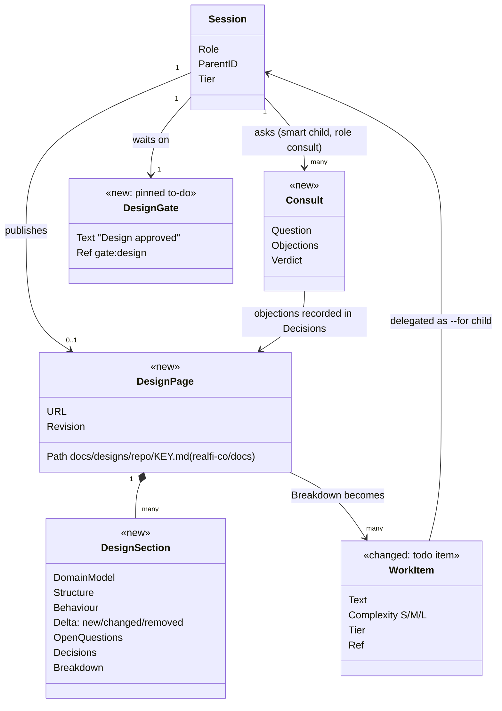
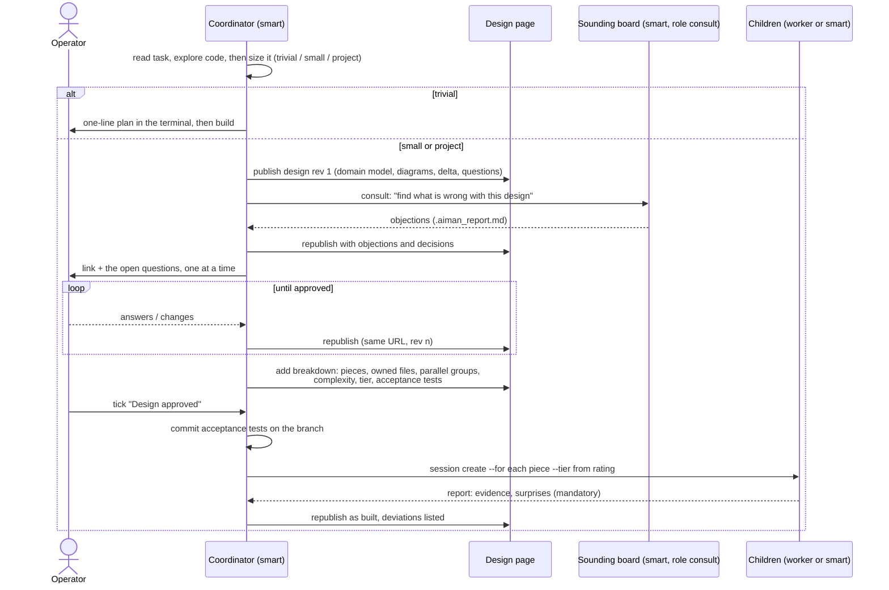

# Design-first coordinator sessions

**Date:** 2026-10-29
**Status:** Approved 2026-10-29

## Intent

A new aiman session should approach a problem like a lead engineer, not
like a typist. Today it reads the task, maybe outlines a plan in the
terminal, and starts editing. The operator's complaint, in their words: "it
did not consider the scope of work, and present and iterate a design".

The operator works visually. They want to see a design before any code:
the domain model first, then the structure and the behaviour, with what is
new, removed and changed marked plainly. The session asks the questions the
design raises, consults other smart models as sounding boards, and only
then scopes the work, splits it, rates each piece for complexity and hands
pieces to children on the right tier.

Above all, the engineer must come away understanding the problem, the
current system, the change and why it is shaped that way, well enough to
explain it, review its PRs and maintain it without the agent. A design the
engineer approved but cannot explain is a failure, however good the code.

Evidence for the choices below is in
`2026-10-29-agentic-workflows-research.md` (findings cited as R1.2 etc.).
No study shows diagram-first design improves agent code (R2.4); its value
is the engineer's understanding, which is the main goal here.

## Goals

1. **The engineer understands the work.** The page teaches before it
   asks: how the relevant part of the system works today, the terms it
   uses, what changes and why, the alternatives that were rejected and
   why, and one concrete scenario walked through end to end. Questions to
   the engineer explain enough context that answering them builds
   understanding rather than guessing. The as-built page and the PR
   descriptions explain what shipped in the same terms.
2. Every session the operator starts runs a design phase before it edits
   code, sized to the task (a one-line fix gets a one-line design).
3. The design is a page the operator looks at, not terminal scrollback.
   In reading order: the problem in plain words; how the system works
   today (current domain model and flow, with file links); a glossary of
   the terms the page uses; the proposed domain model, structure and
   behaviour diagrams with a delta legend (new / changed / removed); one
   scenario walked through end to end; alternatives considered and why
   they lost; open questions; decisions; the breakdown; and "What you
   should be able to explain after reading", three to five points.
4. Before asking the operator for approval, the coordinator has had the
   design reviewed by at least one other smart model, and the page shows
   each objection and what was decided about it.
5. The breakdown lists each piece with a complexity rating and a tier; the
   operator approves it together with the design.
6. Iteration republishes the same page, so the link stays stable.
7. Children, reviewers, handover helpers and autonomous runs get prompts
   that match how they actually run (no "wait for confirmation" text in a
   session nobody is watching).

## Non-goals

- A web UI inside aiman for designs. The page is published content.
- Changing how children are merged (child PRs into the parent branch stay
  as they are). Briefs, reports and verify change only as described below.
- Enforcing the design phase in serve. The phase is prompt and skill
  guidance plus one approval gate; a determined agent can still skip it.

## Anti-goals

- Ceremony on trivial work. A typo fix must not produce a three-diagram
  page and a consult round.
- Design pages that leak private code to the public internet.
- An engineer who approved a design they cannot explain. The page is
  written to be understood by someone who did not do the exploration,
  not to look complete.
- A sounding board that rubber-stamps: if the page shows no objections the
  consult was wasted.

## Current state

| Session kind | Initial prompt today | Planning step today |
|---|---|---|
| JIRA issue | `initialPrompt` (`internal/infra/skills/engine.go:162`): read `.aiman_task.md`, "present your implementation plan" | Working Guidelines step 3: present a plan, wait for confirmation unless trivial |
| Branch / repo, no issue | `quality.KitPrompt` (`internal/quality/kit.go:18`) or the operator's text | none |
| Ad-hoc / quick | operator's text only | none |
| Restart / agent switch | kit-only or handover pointer | none |
| Autonomous (GitHub issue) | `daemon.go:171-177`: implement, open a PR | none |
| `--for` child | brief (Question / Scope / Report); inherits the parent's task file, including "wait for confirmation" | contradictory: told to wait, nobody watches |
| Reviewer, handover | role-specific briefs | n/a |

The skill (`internal/aimanskill/SKILL.md`, Coordinator section) says
"assess the scope" and explains splitting and tiers, but has no design,
visual, consult or approval step, and no prompt tells the agent to read the
skill. Tier changes the model, never the prompt text.

## Domain model

New: `DesignPage`, `Consult` (a session role), `DesignGate`. Changed: to-do
items carry a complexity rating in their text. Removed: nothing; the old
"present a plan" guideline is replaced by the design phase.

## Behaviour

### Sizing (the coordinator's first call)

- **Trivial**: one file, no new concept, no behaviour change a reviewer
  would argue about. A one-paragraph plan in the terminal, no page, no
  consult, no gate.
- **Small**: one module, a contract stays the same. A page with the domain
  delta and one diagram; one consult; the gate.
- **Project**: new concepts, more than one module, or a changed contract.
  The full page; one consult covering the design and the breakdown,
  at most two rounds (R4.1: more debate rounds do not help); the gate.

The coordinator sizes after a bounded exploration of the code, not from
the task text alone (R3.1), and states its size call so the operator can
overrule it.

### Breakdown, complexity and tier

Each breakdown row: piece, owns files, parallel group, depends-on,
complexity, tier, acceptance tests (exact command).

| Complexity | Meaning | Tier |
|---|---|---|
| S | Well specified, mechanical, small diff, existing tests show the pattern | worker |
| M | Clear contract, some judgement inside one module | worker only when the brief has acceptance tests (R5.1); otherwise smart |
| L | Ambiguous, cross-cutting, new contract, or design inside the piece | smart |

Rules:

- **Parallel only when disjoint.** Pieces share a parallel group only when
  they own disjoint files and share no unsettled contract; otherwise they
  run in sequence or merge into one piece (R1.2, R1.4-1.6). At most 4
  children run at once. (My call within the research's 3-5.)
- **Acceptance tests first, and protected.** The coordinator writes each
  piece's acceptance tests and commits them on its branch before the first
  child starts; the operator sees them with the design (R5.1). A child may
  not edit them: the reviewer denies a diff that touches a file listed
  under the brief's acceptance tests, and verify runs those exact commands
  (R5.3). Children are not told to "write more tests" (R5.2).
- **Escalation.** A worker's brief lists escalation triggers (the contract
  does not match the code; a second test failure with the same cause; a
  decision the design does not cover). On a trigger, or when the child
  reports "harder than rated" after exploring, it asks a smart-tier
  advisor through a short consult instead of guessing (R3.3, R3.4). Moving
  the piece to the smart tier after a failed attempt stays the fallback.
- **The coordinator coordinates.** It does not implement pieces while
  children run, and it does not call the work done until every piece's
  report and review are in (R1.6, R2.5).

The shared contract for a project goes in `docs/specs/<ISSUE>.md` as today;
the design page links to it.

### Child brief and report

The brief becomes structured (R1.3, R1.4, R6.5). `coordinator.ParseBrief`
requires `## Objective`, `## Contract`, `## Owns`, `## Out of scope`,
`## Acceptance tests`, `## Report must contain` and `## Escalate when`,
and refuses the old three-heading brief with a message naming the new
headings. (My call: no compatibility window; only coordinators write
briefs, and the skill ships with the change.) The design page and spec
are passed by path, never pasted.

`.aiman_report.md` gains two required sections: `## Evidence` (each
command run with its exit code, plus an end-to-end check where one exists)
and `## Surprises` (contract changes or discoveries that affect other
pieces; "none" is allowed but the heading is required). The tracker treats
a report without both as no evidence. When Surprises is not "none", the
tracker steers the coordinator to re-read the design before starting
dependent pieces (R1.4).

### Sounding board

A consult is a child session with the new role `consult`: smart tier,
hidden from the session list like reviewer and handover, started with a
brief whose Question is the design question and whose Report must contain
"objections, each with severity and a suggested change, and a verdict".
It is given the task, the design page and read access to the code, never
the coordinator's transcript (R4.3). It reads them read-only, writes
`.aiman_report.md` in its own scratch directory, and ends. No branch, no
PR. Serve closes the consult's to-do when the report exists (the PR
requirement does not apply to consults). The coordinator copies objections
into the page's Decisions section with what it decided and why.

A consult runs only on the smart tier; when the tier pick falls back to
worker, create fails with `consult_needs_smart` (R4.3: lightweight
reviewers add nothing). It uses a different agent or model than the
coordinator when the smart tier has more than one entry, preferring a
different model family (`verify.PickReviewer`'s independence rule,
extended; R4.2). The coordinator triages each objection as accept, reject
with a reason, or defer, and the page shows all three (R4.4, R4.5).

### Approval gate

When a session publishes a design, it adds the pinned to-do
`Design approved` with `Ref` `gate:design`. Two ways close it, and the
operator decided both count:

- The operator ticks it in the TUI (`ctrl+t`), or with a laptop CLI call
  that carries no session id.
- The operator types approval in the session ("approved", "go ahead").
  The coordinator then runs `aiman todo approve-design --quote "<the
  operator's words>"`. Serve accepts this only from the list's owner
  session, requires a non-empty quote, and records `design.approved` in
  the ledger with the actor and the quote, so the approval is auditable.
  The skill tells the agent that only the operator's own message counts,
  never a consult verdict, a child report or a steering note.

Every other path is refused with `gate_needs_operator`: a plain
`todo done` on the item from any session, and any call from another
session (a child, a consult, a sibling), which `deriveAuthor` would
otherwise count as `user`. (My call.) `session create --for` from a
session whose gate is open is refused with `design_not_approved`.

The gate blocks only `session create --for`. Consults and plain creates
stay allowed before approval, because consults are part of reaching it.
(My call.)

Autonomous sessions have no operator: the gate is not added; a passing
consult verdict stands in for approval, and the design link goes into the
issue comment. The consult must be cross-family when another family is
installed, and its verdict is recorded in the ledger. Any unresolved
high-severity objection stops the run with a needs-you notification and
the design link (R4.2, R4.3). Otherwise a rejecting verdict gets one
revision and one more consult; a second rejection also stops the run.

## Publishing the page

The operator's decision: design pages live in the `realfi-co/docs`
repository. Its GitHub Pages site serves `/docs` on `main`, is private
(Enterprise Cloud, `public: false`, `https://super-bassoon-qwp2qee.pages.github.io/`),
and already runs Mermaid in the browser (`docs/_includes/head-custom.html`,
mermaid 11.12.2, `securityLevel: "strict"`). Its README forbids a public
site or gist for that content, which matches the anti-goal.

- **Path**: `docs/designs/<repo>/<KEY>.md` (repo is the session's repo
  name, KEY the issue key, else the branch with `/` replaced by `-`). Pages
  serves it at `<site>/designs/<repo>/<KEY>.html`. No Confluence workflow
  covers `docs/designs/`, so nothing syncs it to Confluence.
- **Commits**: straight to `main`, because Pages builds only `main` and the
  link must show the new revision. `main` has no branch protection. Each
  revision is one commit `design(<repo>): <KEY> rev <n>`. (My call.)
- **Lifetime**: the page stays after the work merges; it is the design
  record. Nothing design-related is committed to the code repository, so
  the merge-or-remove question does not arise.
- **Mechanism**: serve keeps one checkout of the docs repository at
  `~/.aiman/design-repo/` on the host, and a new CLI `aiman design publish
  <file> [--key KEY]` copies the file to its path, commits, pulls with
  rebase, pushes, and prints the page URL plus the Pages build state
  (`gh api repos/<repo>/pages/builds/latest`). Agents never clone or push
  the docs repository themselves. One publish at a time per host (a file
  lock), so concurrent sessions do not race on `main`.
- **Config**: `design.repo` (`realfi-co/docs`), `design.dir`
  (`docs/designs`), `design.site` (optional; read from the Pages API when
  unset). `MarshalServeConfig` pushes it to serve. With `design.repo`
  unset, `aiman design publish` writes the file under the worktree's git
  dir and prints its path, and the skill tells the agent to show the
  operator that path instead of a link.
- **As built**: when the work merges, the coordinator republishes the
  page with what shipped and a "Deviations from the approved design" list
  (R2.3).
- **Delta styling**: a legend at the top and Mermaid `classDef` styles:
  green new, amber changed, red dashed removed. Each diagram uses the same
  three classes.

## Prompt and skill changes

1. **SKILL.md**: a new section `## Design first` ahead of `## Coordinator`
   with the sizing rules, the page template, the consult command, the
   gate, and the breakdown table. The Coordinator section's "assess the
   scope" points at it.
2. **Initial prompts** (`engine.go` `initialPrompt`, `buildSessionPrompt`,
   `quality.KitPrompt`, ad-hoc and quick with operator text): one shared
   suffix, "Use the aiman skill's Design first section: size the task and
   say your call before editing." Quick sessions with no text get nothing.
3. **`.aiman_task.md` Working Guidelines**: step 3 "Present a plan … wait
   for confirmation" becomes "Design first (see the aiman skill): size,
   design page, consult, gate". Children get a different block: "You are a
   child. Your brief is your design; do not wait for confirmation. Raise a
   blocking question with your parent via the report."
4. **Restart / agent switch**: the prompt keeps the handover pointer; if
   the gate is still open the handover's Next Steps already says so (no
   new text).
5. **Autonomous** (`daemon.go`): add "Size the task; for small or larger
   work write the design file and run one consult before implementing;
   link the design in your issue comment."
6. **Template**: `internal/aimanskill/design-template.md`, installed beside
   SKILL.md, the page skeleton with the sections of goal 3 in that order
   and the legend. The skill tells the coordinator to write for an
   engineer who has not read the code, to explain each question's context
   when asking it, to answer "explain X" requests at any point by updating
   the page rather than only replying in the terminal, and to write child
   PR and final PR descriptions in the page's terms with a link to it.

## Evals

Deterministic harness cases (`evals/harness`):

- `design-gate`: a plain `done` on `gate:design` from the owner is
  refused, as is any call from another session; `approve-design` from the
  owner with a quote succeeds and writes the ledger row; a `done` with no
  session id succeeds; `session create --for` is refused while open and
  allowed after.
- `consult-closes-on-report`: a consult child's to-do closes when its
  report exists, with no PR.
- `brief-structure`: a brief missing `## Acceptance tests` is refused; a
  report missing `## Surprises` leaves the item open; a non-"none"
  Surprises steers the coordinator.
- `protected-acceptance-tests`: a child diff touching a listed
  acceptance-test file is denied by the reviewer.
- `child-prompt-no-wait`: a `--for` child's task file contains no "wait
  for confirmation" text.

Prompt text tests in `internal/infra/skills` and `internal/quality` pin the
suffix per session kind.

## Left to the builder

- Exact wording of SKILL.md and the prompt suffix, within the rules above.
- Where the consult's scratch directory lives (follow
  `~/.aiman/handovers/<run-id>/` as the pattern).
- How the TUI marks the gate item (it is a to-do; a distinct glyph is
  optional).

## Measuring the design phase

Multi-agent work costs about 15x chat tokens and spec-first work 2-3x
(R1.1, R2.3), so the phase must earn its cost. The ledger records
`design.published` (revision), `consult.finished` (objection counts by
severity, accepted, rejected, deferred) and `design.approved`. The usage
rollup gains `by: role`, so design, consult, child and review cost show
separately; consults and children are their own sessions, so no per-phase
token tagging is needed. A long run of consults with zero accepted
objections is the rubber-stamp signal.

## Implementation plan

Order matters only where noted; tasks 1-6 are independent.

1. **Gate in serve** (Go, M): `todo.DesignGateRef = "gate:design"`;
   `MutateTodos` closes it only from a caller with no session id or via
   `todo.approve_design` (owner session, non-empty quote, ledger row
   `design.approved`), else `gate_needs_operator`; `handleSessionCreate`
   refuses `--for` while the parent has an open gate
   (`design_not_approved`). CLI: `aiman todo gate`, `aiman todo
   approve-design --quote`. Tests in `internal/server`, eval `design-gate`.
2. **Consult role** (Go, M): `domain.SessionRoleConsult`, `Hidden()` true;
   `session create --consult --brief-file` creates it in a scratch dir;
   smart tier only (`consult_needs_smart` on fallback); independence rule
   extended to prefer another model family; the tracker closes a consult's
   to-do on report alone; ledger `consult.finished` with objection counts.
   Tests plus eval `consult-closes-on-report`.
3. **Brief and report structure** (Go, M): new `ParseBrief` headings;
   `ValidateReport` requires `## Evidence` and `## Surprises`; the tracker
   steers the parent on non-"none" Surprises. Update the coordinator evals'
   reports. Eval `brief-structure`.
4. **Protected acceptance tests** (Go, S): verify reads the brief's
   acceptance-test files and denies a diff touching them; it runs the
   listed commands. Eval `protected-acceptance-tests`.
5. **Prompts** (Go, S): shared suffix constant; apply in `initialPrompt`,
   `buildSessionPrompt`, `KitPrompt`, ad-hoc text join; child guidelines
   block in `writeTaskFile` when the session has a brief; daemon prompt
   (autonomous rules above). Tests per session kind, eval
   `child-prompt-no-wait`.
6. **Design publisher and measurement** (Go, M): `design` config block,
   `internal/design` (checkout, path, commit, rebase-retry, push, page
   URL, build state, host file lock), `aiman design publish` routed
   through serve, ledger `design.published`; usage rollup `by: role`.
   Tests against a local bare repository standing in for the docs
   repository.
7. **Skill and template** (docs, S, after 1-6 for command names): SKILL.md
   `## Design first` (sizing after exploration, page template, consult,
   gate and typed approval, breakdown rules, escalation, coordinator does
   not implement, as-built republish), `design-template.md`, `EnsureOnHost`
   installs both.
8. **AGENTS.md** (docs, S, last).
9. `make ci`, `make eval`, `graphify update .`.
