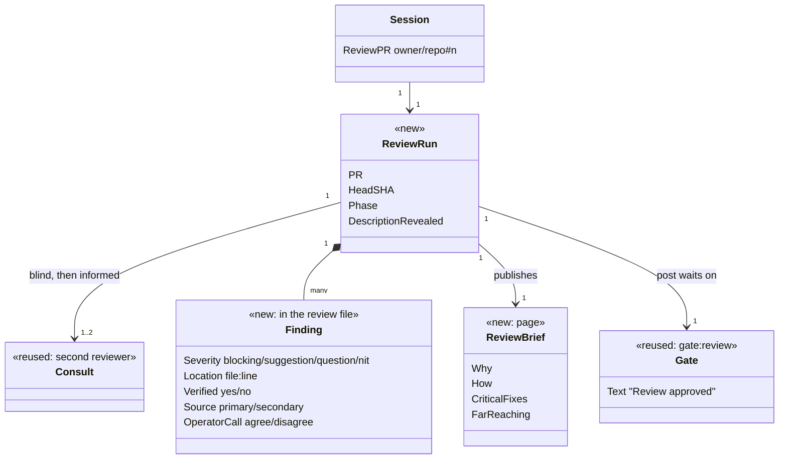
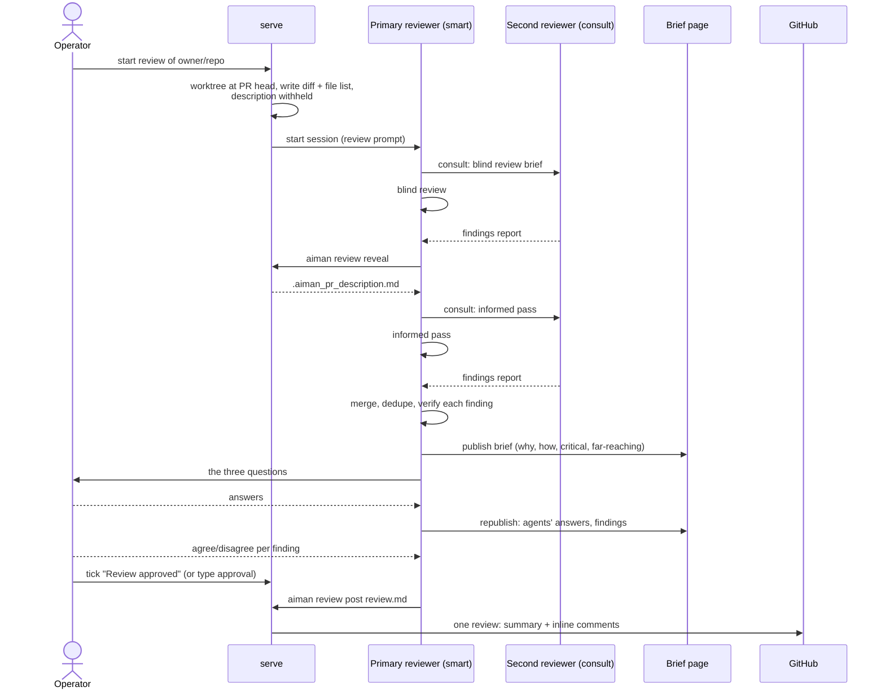

# Review mode sessions

**Date:** 2026-10-30
**Status:** Approved 2026-10-30

## Intent

The operator picks a GitHub pull request and gets a structured review from
two smart agents, plus their own understanding of the change. The agents
dig; the engineer comes away able to explain the PR, judge it and stand
behind the review that is posted. As in design-first sessions, a review
the engineer approved but cannot explain is a failure.

Evidence for the choices below is in
`2026-10-29-code-review-research.md` (cited by section, C1 to C8): reviews
mostly build understanding (C1), noise is the main failure of AI review
(C4), a second top-tier model from another family adds recall (C5), PR
descriptions can blind an LLM reviewer (C4), and people over-trust AI
findings unless they commit to their own judgement first (C6).

## Goals

1. The operator starts a review session from a PR, in the TUI or the CLI.
2. Two smart reviewers, on different model families when both are
   installed, each review the PR **without the PR description** first,
   then do a second pass **with** it (operator's decision).
3. Findings are verified before the operator sees them: reproduced, or
   tested, or else turned into a question. Nothing unverified is posted
   as a defect.
4. The operator reads a terse brief: why the PR was needed, how it was
   addressed, where the most critical fixes are, and where the most
   far-reaching changes are (operator's words).
5. The operator is then asked, and answers before seeing the agents'
   view (operator's questions):
   - What is the PR doing, why, and how does the change achieve it?
   - Where is the functionality used: what is the blast radius?
   - Can the outcome be achieved with less code or less complexity?
6. Only after the operator answers are the agents' answers and findings
   revealed; the operator agrees or disagrees with each.
7. One GitHub review, approved by the operator, is posted: a summary plus
   inline comments. The agent never approves a PR.

## Non-goals

- Reviewing anything other than a GitHub PR.
- Auto-fixing the PR. Review mode reads; it never pushes to the PR branch.
- Tracking whether posted comments are resolved (a later measurement).
- Agents driving a debugger, and time-travel debugging.

## Anti-goals

- Noise: a review full of low-value comments is worse than none.
- A rubber stamp: the operator approving a review they did not read.
- Leaking the PR description into the blind pass.

## Current state

- Session modes: JIRA issue, new branch, existing branch, ad-hoc,
  autonomous trigger. None starts from a PR.
- The detail pane shows static "Review PR / Approved / Request Changes"
  labels (`internal/ui/a1_detail.go:272`) with no behaviour behind them.
- Reusable from the design-first work: the hidden `consult` role (smart
  tier, family preference, brief, kept report, timeout), the operator-only
  gate on a pinned to-do, `aiman design publish` to the private
  `realfi-co/docs` Pages site, and the ledger.

## Domain model

New: `Session.ReviewPR`, `ReviewRun` state, the review file format, the
`gate:review` gate. Reused unchanged: consult, design publisher, ledger.

## Behaviour

### Starting

- TUI: the create wizard's mode picker gains **Review a PR**: repo picker,
  then a PR picker (`gh pr list --json number,title,author,headRefName,additions,deletions`,
  open PRs, newest first), then the agent picker. My call.
- CLI: `aiman session create --review owner/repo#n`.
- serve makes a worktree `<repo>@pr-<n>` at the PR head (detached), and
  writes `.aiman_review/diff.patch`, `.aiman_review/files.txt` (changed
  files with line counts) and `.aiman_review/meta.json` (number, base,
  head SHA, title, author). The description is **not** written. The
  session is interactive with `ReviewPR` set, smart tier by default.

### Blind, then informed

- The review prompt tells the primary reviewer not to read the PR
  description, commit messages or `gh pr view` until it runs
  `aiman review reveal`. serve cannot stop an agent calling `gh`; the
  rule is prompt-level (accepted, as with consult read-only). My call.
- A review session is an ordinary interactive session with `ReviewPR`
  set, not a new `Mode` value. Code that must treat it differently checks
  `ReviewPR != ""` explicitly: no design-first prompt suffix, no
  `gate:design`, no `verify.before_pr`, and the handover child still runs.
  My call.
- One live review session per PR: create refuses with `review_exists`
  when one is running. A later review of the same PR reuses the page key
  `pr-<n>` (a new revision) and the worktree name. My call.
- The second reviewer is a consult (`session create --consult --for`)
  with a review brief; consults already prefer another model family. Its
  report uses the consult format: `## Objections` bullets
  `[high]`/`[medium]`/`[low]` with file:line, and `## Verdict`.
- `aiman review reveal` writes `.aiman_pr_description.md` (title, body,
  linked issues) and records `review.revealed` in the ledger. It refuses
  before both blind passes are done: the primary has ticked its
  `Blind review` to-do and the blind consult item is done.
- The informed pass is a second consult plus the primary's own pass.
- If the second reviewer cannot run (`consult_needs_smart`) or its
  consult ends without a report, reveal still proceeds once the primary's
  blind pass is done, and the review is marked **single reviewer**: the
  page says so in its header and the posted summary says so. Review
  consults get their own timeout, `review.consult_timeout`, default 30
  minutes, because a chunked review takes longer than a design consult.
  My call.

### Size

A PR over 400 changed lines (C2) is reviewed in chunks: the primary
groups files by package or directory into chunks of about 400 lines and
reviews and briefs the chunk order explicitly; the brief lists the chunk
order as the reading order. My call.

### Verifying findings

Each merged finding is verified before the operator sees it: a failing
test or reproduction command, or a pointer to the exact code that proves
it. An unverified finding becomes severity `question`. The review file
records `Verified: yes|no` and the evidence (C4).

### The brief and questions

The brief is published with `aiman design publish --key pr-<n>` to the
docs repo (`docs/designs/<repo>/pr-<n>.md`). First revision, in order:

1. **Why**: the problem the PR solves, in two or three sentences.
2. **How**: the approach in a paragraph, with a small diagram when the
   change spans components.
3. **Most critical fixes**: file:line links with one line each.
4. **Most far-reaching changes**: changed contracts and their callers
   (the blast radius), with counts.
5. **Reading order**: files or chunks in the order to read them.

Then the primary asks the operator the three questions in the terminal,
one at a time. Its own answers and the findings are added to the page
only after the operator answers (C6), as a second revision with: the
agents' answers to the three questions, then findings grouped
blocking / suggestion / question / nit, each with source and evidence.
The operator agrees or disagrees with each finding in the terminal; the
primary records it in the review file.

### Posting

- The gate `gate:review` (`Review approved`) is added on the first brief
  publish and closes exactly like the design gate: the operator ticks it,
  or types approval and the session runs `aiman todo approve-review
  --quote "..."`.
- `aiman review post <file>` refuses while the gate is open, and also
  refuses (`review_incomplete`) unless the review file records the
  operator's answers to the three questions and an operator call (agree
  or disagree) on every finding. serve parses the review file for this;
  the primary records the operator's words as quotes, like
  `approve-design`. My call: it keeps the operator engaged without new
  RPCs.
- If the PR head moved, `aiman review refresh` fetches the new head into
  the same worktree, rewrites `.aiman_review/`, resets the phase to blind,
  withdraws the description file and reopens `gate:review`. My call. It posts one
  GitHub review with `gh api repos/<o>/<r>/pulls/<n>/reviews`: event
  `COMMENT` or `REQUEST_CHANGES` (the operator says which; never
  `APPROVE`), the summary as body, and inline comments for findings the
  operator agreed with. Comments are labelled `blocking:`, `suggestion:`,
  `question:` or `nit:`; suggestions with a concrete patch use GitHub
  suggestion blocks. Disagreed findings are not posted.
- It records `review.posted` with counts per label and the event.
- If the PR head moved since the worktree was made, post refuses and asks
  for a fresh review.

### Seeing and stepping through the change

Evidence: `2026-10-30-debugger-review-research.md`. The operator decided
to add these three.

- **Changed lines marked in every editor.** After the detached checkout,
  serve runs `git reset --soft <merge-base>` so the PR's changes show as
  staged. Every editor's change gutter then marks exactly the PR's lines,
  also while debugging. The review prompt says the changes are staged on
  purpose and forbids commit, stash and reset. Refresh resets hard to the
  new head, then soft to the new merge base.
- **Debugging from the laptop.** `aiman review debug` starts a headless
  debugger in the worktree on the host (`dlv dap` for Go, `node --inspect`
  for a Node or TypeScript entry point, plus the dev server and React
  DevTools port 8097 for a React app), records the ports as the session's
  `Tunnels` so the TUI's existing port forwarding carries them, and writes
  `.vscode/launch.json` with attach configurations so F5 attaches over
  Remote-SSH or the forwarded ports. Breakpoints are placed on the brief's
  most critical changes in reading order, so "continue" walks the change.
- **Changed-line coverage.** `aiman review coverage` runs the PR's tests
  with coverage in the worktree and writes `.aiman_review/coverage.md`:
  per changed hunk, which changed lines ran and which did not. Go uses
  `go test -coverprofile` on the changed packages; other languages use
  the repository's `repos.<slug>.review.coverage` command, which must
  write Istanbul `coverage-final.json`. Changed lines no test ran become
  `question` findings, and the brief shows the totals.

Agent-driven debugger servers (MCP over DAP) are a later step: they can
read secrets and the PR is untrusted code.

## Prompt and skill

- Review prompt (new constant): the phases above, the blind rule, the
  question order, and "never approve; never push".
- SKILL.md gains `## Review mode` (start, reveal, consult briefs for the
  two passes, verification, brief sections, questions, gate, post) and a
  review-file format.

## Evals

- `review-blind`: the worktree has no description file before reveal;
  reveal refuses before both blind passes; after, the file exists and the
  ledger row is written.
- `review-gate`: post refuses while `gate:review` is open; after an
  operator tick it calls the GitHub fake once with event COMMENT and the
  agreed findings only; `APPROVE` is refused.
- `review-head-moved`: post refuses when the fake PR head differs;
  refresh resets the phase and reopens the gate.
- `review-incomplete`: post refuses when a finding has no operator call
  or an answer is missing.
- `review-single`: with no smart second entry, reveal proceeds after the
  primary's blind pass and the posted summary says single reviewer.

## Left to the builder

- Review-file format details beyond the fields in the domain model.
- PR picker layout and paging.
- How chunks are named in the brief.

## Implementation plan

1. **Domain and create** (Go, M): `Session.ReviewPR`
   (sqlite column, COALESCE-protected), `session.create {review}`, PR
   head worktree, `.aiman_review/` files, review prompt. Tests, eval
   `review-blind` (create half).
2. **Reveal and refresh** (Go, S): `review.reveal` and `review.refresh`
   RPCs and CLI, phase checks including the single-reviewer path,
   `review.consult_timeout`, ledger. Eval `review-blind`.
3. **Gate and post** (Go, M): `gate:review` reusing the gate code with a
   second ref, `todo.approve_review`, review-file parser,
   `review.post` RPC and CLI through an injectable GitHub client,
   `review_incomplete`, head-moved check, ledger. Evals
   `review-gate`, `review-head-moved`.
4. **TUI** (Go, M): wizard mode, PR picker, detail pane shows review
   phase; remove the static PR action labels.
5. **Skill and docs** (docs, S): SKILL.md `## Review mode`, review-file
   format, AGENTS.md.
6. `make ci`, `make eval`, `graphify update .`.
